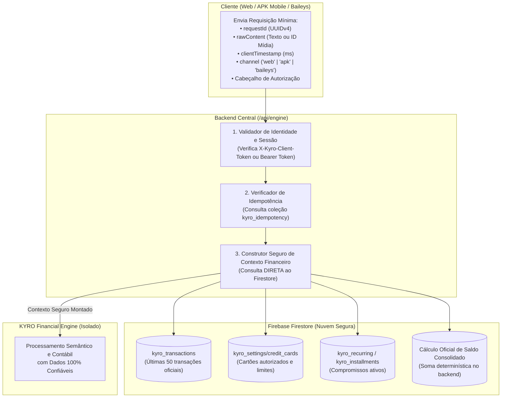
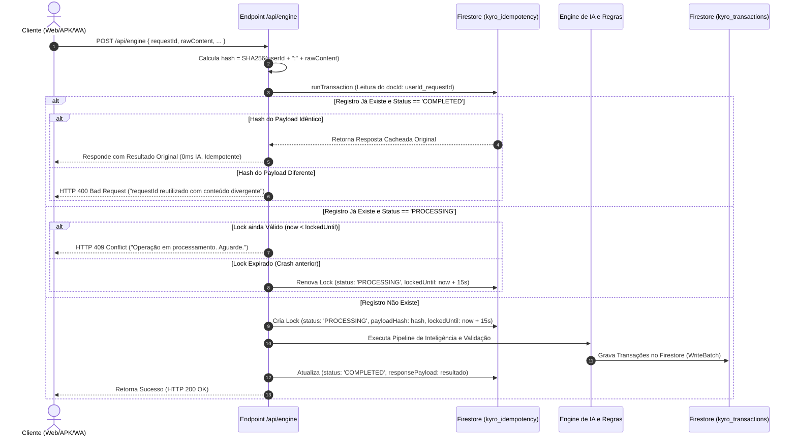
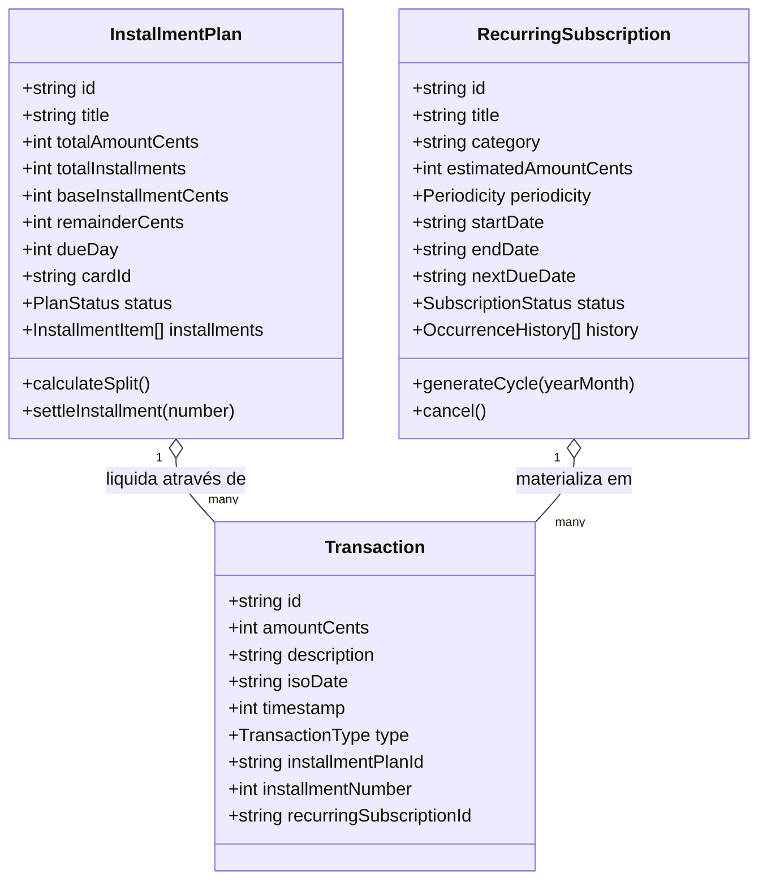
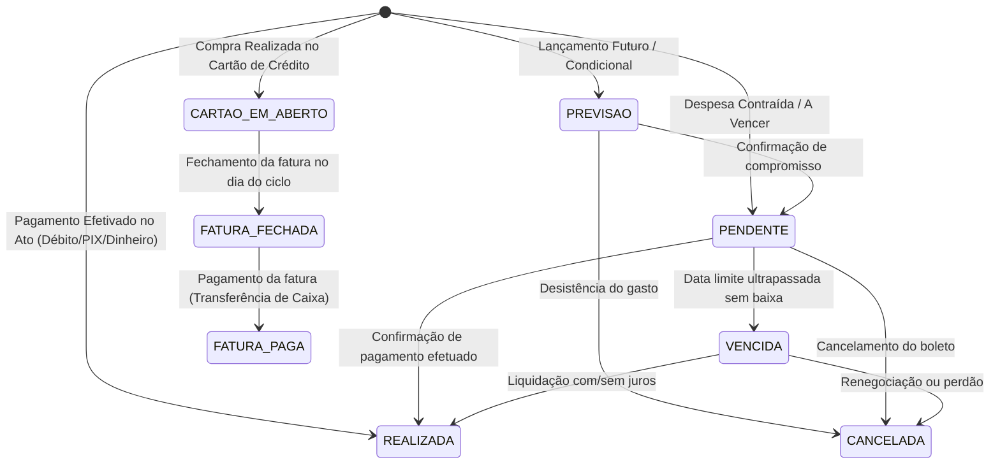
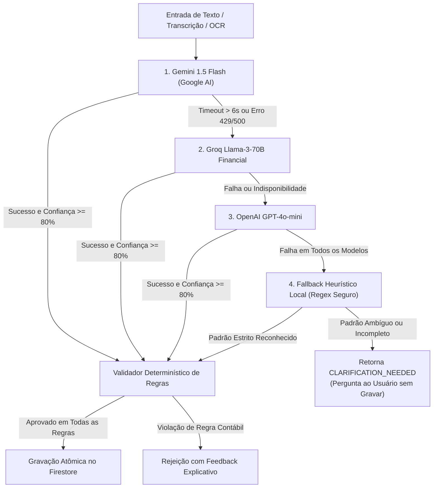

# PROJETO KYRO FINANCE
## PROJETO TÉCNICO E DEFINIÇÃO DA ARQUITETURA DEFINITIVA — ETAPA 02.1 (REVISÃO TÉCNICA)

---

### 1. IDENTIFICAÇÃO DO PROJETO E ESCOPO DA REVISÃO

* **Aplicação:** KYRO Finance (KYRO | Private Finance)
* **Diretório Raiz Local:** `C:\Users\Lenovo\Documents\antigravity\Finanças`
* **Repositório Remoto Oficial:** `https://github.com/Wisterly/kyro-finance.git`
* **Versão de Referência:** `v1.41` (Build `41` / Ponto de Restauração `PR.041`)
* **Finalidade Desta Etapa (02.1):** Revisar, aprofundar e corrigir integralmente a especificação técnica do **KYRO FINANCIAL INTELLIGENCE ENGINE** antes de qualquer implementação de código. Esta revisão aborda a eliminação de representações em float (adotando centavos inteiros), o isolamento estrito da inteligência privada no backend (`api/_lib/`), a reformulação do mecanismo de idempotência e concorrência no Firestore, a consulta segura de contexto financeiro pelo servidor (removendo envio de saldo/cartões pelo cliente), a separação formal entre parcelamentos e recorrências, a modelagem contábil rigorosa e a expansão da matriz de validação para 30 cenários críticos de teste.

> [!IMPORTANT]
> **Restrições Rígidas de Não-Modificação:** Em estrita observância às regras desta etapa, **nenhuma linha de código executável foi modificada ou criada**, nenhum pacote npm foi instalado, nenhum dado do Firestore foi alterado e nenhum comando de commit, push, build ou deploy foi disparado.

---

### 2. AUDITORIA DA AUTENTICAÇÃO EXISTENTE E ARQUITETURA DE SEGURANÇA

#### 2.1 Diagnóstico do Estado Atual do Repositório
A inspeção detalhada realizada nos módulos [`src/firebase.ts`](file:///c:/Users/Lenovo/Documents/antigravity/Finanças/src/firebase.ts), [`src/App.tsx`](file:///c:/Users/Lenovo/Documents/antigravity/Finanças/src/App.tsx), [`api/chat.ts`](file:///c:/Users/Lenovo/Documents/antigravity/Finanças/api/chat.ts) e [`api/database.ts`](file:///c:/Users/Lenovo/Documents/antigravity/Finanças/api/database.ts) revelou o seguinte cenário de autenticação:
1. **Ausência de Firebase Authentication:** O projeto não possui fluxo de autenticação por usuário (ex: `firebase/auth` com login/senha ou Google OAuth). As instâncias do Firebase conectam-se diretamente às coleções do Firestore utilizando as credenciais públicas da API Web (`apiKey`, `projectId`).
2. **Identidade Estática de Usuário:** A aplicação opera atualmente com uma identidade nominal configurada no frontend (`userFullName = "Kayro Wisterly"`), compartilhada entre a versão Web e o APK.
3. **Injeção Insegura de Contexto no Modelo Anterior:** Na versão legada de [`api/chat.ts`](file:///c:/Users/Lenovo/Documents/antigravity/Finanças/api/chat.ts), o cliente enviava no corpo da requisição HTTP o seu próprio saldo (`currentBalance`), seus cartões de crédito cadastrados (`creditCards`) e o histórico recente de transações (`recentTransactions`). Qualquer adulteração manual no payload HTTP pelo cliente permitia que informações falsas instruíssem o modelo.

#### 2.2 Arquitetura de Segurança e Contexto Confiável no Backend
Para blindar o sistema contra adulterações, estabelece-se o seguinte modelo arquitetural:



##### Explicação Textual do Fluxo de Segurança:
1. **Payload Mínimo do Cliente:** O cliente **NUNCA** envia saldo, listas de transações ou definições de limites de cartões. Ele envia exclusivamente sua mensagem, o timestamp do clique e seu token de autenticação.
2. **Validação de Canal:**
   * **Web e APK:** Autenticam-se através do cabeçalho `X-Kyro-Client-Token`, validado pelo backend contra a chave de cliente `process.env.KYRO_CLIENT_SIGNING_KEY`.
   * **Robô Baileys e Webhooks:** Autenticam-se obrigatoriamente através de `Authorization: Bearer <KYRO_SERVER_SECRET>`, armazenado em variável de ambiente privada na Vercel e no contêiner do robô. Requisições sem credenciais são descartadas imediatamente com HTTP 401 Unauthorized.
3. **Construção Segura de Contexto no Servidor:** O módulo backend `firestoreContextService.ts` conecta-se diretamente ao Firestore com privilégios de servidor, lê as transações oficiais, recalcula o saldo real matematicamente e alimenta o motor cognitivo com dados auditáveis e impossíveis de serem adulterados pelo cliente.

---

### 3. PRECISÃO MONETÁRIA: ARITMÉTICA INTEIRA EM CENTAVOS

#### 3.1 Justificativa Técnica: Eliminação Definitiva de Ponto Flutuante (`float`)
A representação de valores monetários com tipos de ponto flutuante padrão IEEE 754 (como o tipo `number` padrão do JavaScript) sofre com imprecisões binárias intrínsecas (exemplo clássico: `0.1 + 0.2 = 0.30000000000000004`). Em sistemas contábeis com múltiplos lançamentos e parcelamentos, esses erros acumulam discrepâncias cumulativas nos saldos.

**Padrão Inegociável:** Todo processamento contábil, validação de regras, rateios e armazenamento primário utilizarão **inteiros representando centavos de Real (`amountCents: number`)**.

#### 3.2 Tabela de Conversão e Mapeamento

| Valor em Reais (Exibição) | Representação Interna em Centavos | Tipo Primitivo |
|---|---|---|
| R$ 0,01 | `1` | `number` (Inteiro seguro: `Number.isSafeInteger`) |
| R$ 0,99 | `99` | `number` (Inteiro seguro) |
| R$ 50,75 | `5075` | `number` (Inteiro seguro) |
| R$ 1.250,00 | `125000` | `number` (Inteiro seguro) |
| R$ 10.000,50 | `1000050` | `number` (Inteiro seguro) |

#### 3.3 Pipeline de Normalização de Texto para Centavos
O módulo `currencyParser.ts` executa a conversão determinística de qualquer formato textual em português brasileiro:
1. **Limpeza de Símbolos:** Remoção de `R$`, espaços e caracteres invisíveis.
2. **Interpretação de Separadores:** Se o texto contiver ponto e vírgula (`1.250,50`), remove os pontos de milhar e trata a vírgula como separador decimal. Se contiver apenas ponto com duas casas (`1250.50`), normaliza para decimal.
3. **Multiplicação Inteira:** 
   $$\text{cents} = \text{Math.round}(\text{floatValue} \times 100)$$
4. **Validação Rígida:** Rejeição imediata se `!Number.isSafeInteger(cents)` ou `cents <= 0` ou `cents > 100_000_000_00` (limite prudencial de R$ 100 milhões por operação).

#### 3.4 Algoritmo de Parcelamento com Divisão Exata de Centavos
Quando uma compra for parcelada, a divisão matemática do valor total pode resultar em dízimas periódicas. O algoritmo de parcelamento garante que **a soma de todas as parcelas é matematicamente idêntica ao valor total**, distribuindo o resto na primeira parcela:

```typescript
export interface InstallmentSplit {
  installmentNumber: number;
  amountCents: number;
}

export function splitInstallmentsStrict(totalAmountCents: number, count: number): InstallmentSplit[] {
  if (count <= 0 || !Number.isSafeInteger(count)) throw new Error("Quantidade de parcelas inválida.");
  if (totalAmountCents <= 0 || !Number.isSafeInteger(totalAmountCents)) throw new Error("Valor total inválido.");

  const baseAmount = Math.floor(totalAmountCents / count);
  const remainder = totalAmountCents % count; // Centavos restantes da divisão

  const installments: InstallmentSplit[] = [];
  for (let i = 1; i <= count; i++) {
    // O resto é somado integralmente na 1ª parcela (ou 1 centavo nas primeiras 'remainder' parcelas)
    const extraCent = i === 1 ? remainder : 0;
    installments.push({
      installmentNumber: i,
      amountCents: baseAmount + extraCent
    });
  }
  return installments;
}
```

*Exemplo Prático:*
* Compra: R$ 100,00 (`10.000` centavos) dividida em 3 vezes:
  * `baseAmount = Math.floor(10000 / 3) = 3333` (R$ 33,33)
  * `remainder = 10000 % 3 = 1` centavo.
  * Parcela 1: `3333 + 1 = 3334` centavos (R$ 33,34).
  * Parcela 2: `3333` centavos (R$ 33,33).
  * Parcela 3: `3333` centavos (R$ 33,33).
  * Soma: $3334 + 3333 + 3333 = 10000$ centavos (Exatamente R$ 100,00). Zero perda patrimonial.

---

### 4. IDEMPOTÊNCIA PERSISTENTE E CONTROLE DE CONCORRÊNCIA NO FIRESTORE

#### 4.1 Limitações Técnicas do Modelo Simplificado
Na Etapa 02 anterior, sugeriu-se apenas gerar IDs com `requestId` e utilizar `setDoc` com `merge: true`. Essa abordagem falha nos seguintes cenários:
1. **Requisições Concorrentes Quase Simultâneas:** Se o usuário clicar duas vezes em menos de 100ms, ambas as requisições passam pela checagem antes da primeira ser gravada, gerando chamadas duplicadas aos modelos neurais e concorrência na gravação.
2. **Mesmo `requestId` com Conteúdo Adulterado:** Se um agente reenviar o mesmo ID com parâmetros diferentes, o `merge: true` mesclará campos de duas intenções distintas, corrompendo o registro financeiro.
3. **Custos de IA Desnecessários:** Reenviar requisições repetidas acionava novamente o Gemini/Groq, desperdiçando tokens e latência.

#### 4.2 Mecanismo Persistente de Idempotência com Transações do Firestore
Cria-se a coleção oficial `kyro_idempotency`. Cada operação de entrada adquire uma trava transacional:



#### 4.3 Limites do Firestore e Estratégia de Transações
* **Limite de Operações em Lote:** O Firestore impõe o limite estrito de 500 operações por `WriteBatch` ou por transação atômica (`runTransaction`). O motor segmentará qualquer importação ou lote em blocos máximos de 100 operações por commit.
* **Taxa de Escrita por Documento:** O Firestore suporta 1 escrita por segundo no mesmo documento. Por isso, a trava de idempotência é isolada por `requestId`, garantindo paralelismo natural entre requisições distintas.
* **Consistência Sequencial:** O método `runTransaction` executa verificações de consistência otimista. Se outro processo alterar o documento de idempotência durante o ciclo, a transação do Firestore é repetida automaticamente com dados atualizados, impedindo colisões de corrida (*race conditions*).

---

### 5. LOCALIZAÇÃO DO MOTOR: ISOLAMENTO TOTAL NO BACKEND

#### 5.1 Regra Arquitetural de Segurança
Nenhum prompt cognitivo, dicionário semântico, chave de API de IA (Gemini/Groq/OpenAI) ou código de validação contábil poderá residir dentro do diretório `src/`. Todo o bundle gerado pelo Vite para o frontend e empacotado no APK Capacitor reside em `src/` e `dist/`. Portanto, incluir lógica de inteligência financeira nessa pasta exporia segredos comerciais e regras de negócio via engenharia reversa do APK.

#### 5.2 Estrutura de Diretórios Compatibilizada com a Vercel
Na Vercel, qualquer pasta ou arquivo dentro de `api/` que inicie com sublinhado (`_`) é tratado como **código de suporte privado** e não gera rotas serverless públicas. Essa é a convenção recomendada:

```
c:\Users\Lenovo\Documents\antigravity\Finanças\
├── api/                                  # Serverless Functions da Vercel
│   ├── engine.ts                         # Endpoint HTTP Público Único (/api/engine)
│   ├── chat.ts                           # Rota legada refatorada (Proxy para o engine)
│   ├── webhook.ts                        # Webhook WhatsApp refatorado (Proxy para o engine)
│   ├── app-version.ts                    # Endpoint de verificação de atualização do APK
│   └── _lib/                             # PASTA PRIVADA (NÃO EXPOSTA NA WEB)
│       ├── engine/
│       │   ├── financialEngine.ts        # Orquestrador mestre do Engine
│       │   ├── intentClassifier.ts       # Classificador semântico de intenções
│       │   ├── multiEntityExtractor.ts   # Extrator Multi-NER de múltiplos lançamentos
│       │   └── dateResolver.ts           # Resolvedor temporal e fusos horários
│       ├── validators/
│       │   ├── financialRules.ts         # Validações contábeis e limites determinísticos
│       │   └── currencyParser.ts         # Aritmética inteira de centavos e rateios
│       ├── services/
│       │   ├── firestoreContextService.ts # Leitura segura de saldo/cartões do Firestore
│       │   ├── idempotencyService.ts     # Gerenciamento de locks e deduplicação
│       │   └── aiGateway.ts              # Orquestrador com contingência (Gemini/Groq)
│       └── types/
│           └── engineContracts.ts        # Contratos internos estritos do backend
└── src/
    └── types/
        └── enginePublicTypes.ts          # Apenas interfaces de payload público (sem lógica)
```

---

### 6. DATAS HISTÓRICAS, FUSO HORÁRIO E TEMPORALIDADE

#### 6.1 Tratamento de Registros Antigos com Informações Incompletas
A auditoria revelou que centenas de lançamentos legados possuem formatos de texto ambíguos, como `"31 de out"` ou `"Ontem"`, desprovidos de ano e de horário.
* **Proibição Expressa de Dedução Insegura:** O sistema **NÃO** assumirá o ano corrente (ex: 2026), não assumirá horários fictícios (ex: 00:00:00) e não sobrescreverá dados originais.
* **Classificação de Precisão Temporal:** Cada registro receberá um classificador de fidelidade cronológica:
  * `EXACT`: Possui timestamp Unix Epoch preciso em milissegundos e data ISO completa com hora (`YYYY-MM-DDTHH:mm:ssZ`).
  * `DATE_ONLY`: Possui ano, mês e dia confirmados, mas sem horário de realização.
  * `DAY_MONTH_APPROX`: Possui apenas dia e mês (ex: `"31 de out"`). O campo `timestamp` permanecerá `null`. A ordenação utilizará o metadado `createdAt` do documento do Firestore como critério de desempate temporal.
  * `UNDETERMINED`: Data não informada pelo usuário. O registro é alocado em seção de lançamentos pendentes de confirmação temporal.

#### 6.2 Fuso Horário Oficial e Prevenção de Deslocamento Noturno
* **Fuso Primário:** `America/Fortaleza` (UTC-3 fixo, sem horário de verão).
* **Problema Resolvido:** Servidores da Vercel executam com o relógio do sistema em UTC-0. Um lançamento realizado em Oeiras/PI às 22:30 de 05/11 tem horário UTC de 01:30 de 06/11. Se o backend utilizar `new Date()`, o registro era alocado indevidamente no dia seguinte.
* **Solução Determinística:** O cálculo de data civil e horário local utiliza `Intl.DateTimeFormat` com fuso explícito:

$$\text{Data Civil Local} = \text{Intl.DateTimeFormat}('pt-BR', \{\text{timeZone}: 'America/Fortaleza', \text{year}: 'numeric', \text{month}: '2-digit', \text{day}: '2-digit'\}).\text{format}(\text{timestamp})$$

---

### 7. SEPARAÇÃO CONCEITUAL: PARCELAMENTOS VS. RECORRÊNCIAS

Parcelamentos e despesas recorrentes possuem naturezas financeiras e comportamentos contábeis totalmente distintos e não podem compartilhar o mesmo esquema genérico:



#### 7.1 Modelo de Parcelamentos (`InstallmentPlan`)
* Representa uma dívida finita de valor total conhecido, originada de compra parcelada (ex: Compra de Celular de R$ 2.400 em 10x de R$ 240 no cartão Nubank).
* **Características:**
  * `totalAmountCents`: 240000.
  * `totalInstallments`: 10 (Sempre $\ge 2$).
  * `status`: `'ACTIVE' | 'SETTLED' | 'CANCELLED'`.
  * Cada parcela possui sua data de vencimento específica e estado individual (`'PENDING' | 'PAID'`). Ao ser paga, gera uma `Transaction` vinculada pelo `installmentPlanId`.

#### 7.2 Modelo de Assinaturas e Recorrências (`RecurringSubscription`)
* Representa um compromisso periódico de valor recorrente sem prazo de término predeterminado (ex: Assinatura Netflix, Mensalidade de Academia, Internet Fibra, Energia Elétrica).
* **Características:**
  * `periodicity`: `'MONTHLY' | 'WEEKLY' | 'ANNUAL'`.
  * `estimatedAmountCents`: Valor de referência (pode variar a cada mês, como contas de luz).
  * `status`: `'ACTIVE' | 'PAUSED' | 'CANCELLED'`.
  * **Proibição Rígida:** Não será utilizado `totalInstallments: 0` para modelar infinitude. O modelo possui ciclo contínuo com geração de cobranças programadas no primeiro dia de cada competência.

---

### 8. MODELAGEM CONTÁBIL APROFUNDADA E MÁQUINA DE ESTADOS

#### 8.1 Operações Contábeis Complexas

```
┌────────────────────────────────────────────────────────────────────────┐
│                   OPERAÇÕES FINANCEIRAS ESPECIAIS                      │
├──────────────────────┬─────────────────────────────────────────────────┤
│ OPERAÇÃO             │ COMPORTAMENTO CONTÁBIL E REGRAS DETERMINÍSTICAS │
├──────────────────────┼─────────────────────────────────────────────────┤
│ Transferência entre  │ • Criação de 2 registros vinculados por         │
│ Contas Próprias      │   transferGroupId: Saída na Conta A e Entrada   │
│                      │   na Conta B.                                   │
│                      │ • Categoria: "Transferência Interna".           │
│                      │ • Impacto no Patrimônio Líquido: R$ 0,00        │
│                      │   (Neutro). Não inflaciona receitas nem despesas│
├──────────────────────┼─────────────────────────────────────────────────┤
│ Pagamento de Fatura  │ • Baixa de saldo na conta corrente de pagamento.│
│ de Cartão de Crédito │ • Liquidação do passivo do cartão (aumenta o    │
│                      │   limite disponível).                           │
│                      │ • NÃO É UMA NOVA DESPESA DE CONSUMO. As compras │
│                      │   já foram lançadas em suas categorias durante o│
│                      │   mês. Registrar a fatura como despesa geraria  │
│                      │   duplicidade contábil.                         │
├──────────────────────┼─────────────────────────────────────────────────┤
│ Estornos e           │ • Localização obrigatória da despesa original   │
│ Reembolsos           │   pelo originalTransactionId (se disponível).   │
│                      │ • Lançamento compensatório abatendo a despesa   │
│                      │   da respectiva categoria, sem distorcer as     │
│                      │   receitas operacionais de salário do usuário.  │
│                      │ • Suporte a estorno parcial ou integral.        │
└──────────────────────┴─────────────────────────────────────────────────┘
```

#### 8.2 Máquina de Estados e Situações Financeiras Distintas



---

### 9. SEGURANÇA DE INTERPRETAÇÃO, CONTINGÊNCIA DE IA E VALIDAÇÃO DE MÍDIAS

#### 9.1 Matriz de Contingência e Regras de Decisão de IA



#### 9.2 Regras Estritas de Segurança e Auditoria de Mídias
1. **Confiança Numérica não é Autorização de Gravação:** O fato de um modelo de linguagem retornar probabilidade de 95% **não autoriza** o sistema a salvar no banco. A gravação só ocorre se a operação passar por 100% das asserções do validador determinístico em `financialRules.ts`.
2. **Proteção Contra SSRF (Server-Side Request Forgery) em Mídias:**
   * O backend **NÃO** faz download de URLs arbitrárias fornecidas pelo cliente.
   * Uploads de áudio e imagens devem transitar via upload direto para o bucket autenticado do Firebase Storage ou em base64 com tamanho máximo estrito de **10 MB para imagens** e **15 MB para áudio**.
   * Validação rigorosa de Magic Bytes no cabeçalho do arquivo para garantir tipos permitidos (`image/jpeg`, `image/png`, `audio/ogg`, `audio/mp4`, `application/pdf`), rejeitando extensões executáveis.

---

### 10. CONTRATO DE DADOS DEFINITIVO DO ENGINE (TYPESCRIPT)

#### 10.1 Contrato Sanitizado de Entrada: `EngineInputPayload`
*(Elimina totalmente o envio de saldo, cartões ou histórico pelo cliente)*

```typescript
export type InputChannel = 'web' | 'apk' | 'whatsapp_baileys' | 'whatsapp_webhook';

export type InputMediaType = 'text' | 'audio' | 'image' | 'pdf_document';

export interface EngineInputPayload {
  /** UUIDv4 gerado pelo cliente para rastreabilidade e chave de idempotência */
  requestId: string;
  /** Canal de comunicação utilizado */
  channel: InputChannel;
  /** Tipo de mídia submetida */
  mediaType: InputMediaType;
  /** Conteúdo textual da mensagem (ou texto bruto transcrito de voz/OCR) */
  rawContent: string;
  /** Timestamp de envio no cliente (milissegundos Epoch UTC) */
  clientTimestamp: number;
  /** Fuso horário do cliente (Opcional, padrão: "America/Fortaleza") */
  timezone?: string;
  /** Metadados seguros de mídia (se aplicável) */
  mediaAttachment?: {
    storagePath?: string;
    mimeType: string;
    fileSizeBytes: number;
    durationSeconds?: number;
  };
}
```

#### 10.2 Contrato Estruturado de Saída: `EngineResultPayload`

```typescript
export type FinancialIntent = 
  | 'CREATE_TRANSACTION'
  | 'BATCH_CREATE'
  | 'UPDATE_TRANSACTION'
  | 'DELETE_TRANSACTION'
  | 'SETTLE_INVOICE'
  | 'INTERNAL_TRANSFER'
  | 'QUERY_FINANCES'
  | 'CLARIFICATION_NEEDED'
  | 'UNKNOWN';

export type FinancialStatus = 
  | 'COMPLETED'          // Liquidado no ato
  | 'PENDING'            // A vencer
  | 'OVERDUE'            // Vencido
  | 'FORECAST'           // Previsão futura estimada
  | 'CREDIT_OPEN';       // Compra em cartão aguardando fatura

export type TemporalPrecision = 'EXACT' | 'DATE_ONLY' | 'DAY_MONTH_APPROX' | 'UNDETERMINED';

export interface EngineTransaction {
  id: string;
  description: string;
  product: string | null;
  establishment: string | null;
  category: string;
  subcategory: string | null;
  amountCents: number;            // ARITMÉTICA INTEIRA (Centavos)
  legacyAmount: number;           // Retrocompatibilidade (amountCents / 100)
  type: 'Entrada' | 'Saída';
  method: 'PIX' | 'Débito' | 'Crédito' | 'Dinheiro' | 'Transferência' | null;
  cardId: string | null;
  cardName: string | null;
  city: string | null;
  isoDate: string;                // YYYY-MM-DD
  timestamp: number | null;       // Epoch ms UTC (nulo se temporalidade aproximada)
  dateDisplay: string;            // Ex: "05 de nov"
  time: string | null;            // HH:mm no fuso local
  temporalPrecision: TemporalPrecision;
  status: FinancialStatus;
  isForecast: boolean;
  installmentPlanId?: string | null;
  installmentNumber?: number | null;
  recurringSubscriptionId?: string | null;
  transferGroupId?: string | null;
}

export interface EngineResultPayload {
  requestId: string;
  success: boolean;
  intent: FinancialIntent;
  requiresClarification: boolean;
  clarificationQuestion: string | null;
  operations: {
    toCreate: EngineTransaction[];
    toUpdate: Array<{
      targetId: string;
      changes: Partial<EngineTransaction>;
      previousState: Partial<EngineTransaction>;
    }>;
    toDelete: Array<{
      targetId: string;
      reason: string;
    }>;
  };
  userFeedback: {
    title: string;
    summaryText: string;
    formattedLines: string[];
    calculatedImpact: {
      totalDebitedCents: number;
      totalCreditedCents: number;
      resultingBalanceCents: number;
    };
  };
  auditTrail: {
    processedAt: string;
    processingTimeMs: number;
    engineVersion: string;
    providerUsed: 'Gemini' | 'Groq' | 'OpenAI' | 'HeuristicFallback';
    idempotencyKeyApplied: string;
  };
}
```

---

### 11. COMPATIBILIDADE RETROATIVA E PLANO DE TRANSIÇÃO

Para assegurar que o painel existente em [`src/App.tsx`](file:///c:/Users/Lenovo/Documents/antigravity/Finanças/src/App.tsx), os gráficos e o APK móvel continuem operando perfeitamente sem falhas visuais:
1. **Coexistência de Campos:** Toda transação persistida conterá tanto `amountCents: number` (para o novo motor) quanto `amount: number` (calculado como `amountCents / 100` para os componentes visuais atuais).
2. **Normalização na Leitura:** Ao carregar transações legadas do Firestore que possuam apenas `amount: 50.5`, o adapter de leitura preencherá automaticamente em memória: `amountCents: Math.round(tx.amount * 100)`.
3. **Preservação de Registros Sem Timestamp:** Transações antigas com datas como `"31 de out"` não receberão timestamps forçados. O frontend continuará exibindo a string `tx.date` normalmente, garantindo 100% de estabilidade visual.

---

### 12. MATRIZ EXPANDIDA DE TESTES (30 CASOS ESPECÍFICOS: TC-01 A TC-30)

| ID | Cenário de Teste | Entrada Fornecida | Resultado Esperado do Engine | Comportamento de Persistência no Firestore | Critério de Aprovação |
|:---:|---|---|---|---|---|
| **TC-01** | Lançamento sem método de pagamento | *"Gastei 50 no almoço"* | 1 transação: `amountCents: 5000`, `category: "Alimentação"`, `method: null`. | Grava em `kyro_transactions` com `method: null`. Não presume PIX. | Campo `method` rigorosamente nulo. |
| **TC-02** | Lançamento sem cidade | *"Comprei remédio por 35 reais"* | 1 transação: `amountCents: 3500`, `category: "Farmácia"`, `city: null`. | Grava sem preencher cidade. | Campo `city` rigorosamente nulo. |
| **TC-03** | Múltiplas movimentações na mesma mensagem | *"Gastei 60 no almoço no débito e 30 na farmácia no crédito em Oeiras"* | 2 transações geradas no array `operations.toCreate`. | Gravação atômica via `WriteBatch` de ambos os itens simultaneamente. | Dois registros gerados sem perda do segundo. |
| **TC-04** | Valores com vírgula e ponto | *"Paguei R$ 1.250,50 de aluguel"* | `amountCents: 125050` (R$ 1.250,50). | Grava valor normalizado em centavos e reais. | `amountCents === 125050`. |
| **TC-05** | Valores em centavos sem reais | *"Paguei 75 centavos na xerox"* | `amountCents: 75`, `legacyAmount: 0.75`. | Grava no Firestore com valor exato de centavos. | `amountCents === 75`. |
| **TC-06** | Parcelamento com divisão exata | *"Comprei geladeira de 1200 em 4x"* | Cria `InstallmentPlan`: 4 parcelas de 30000 centavos cada. | Grava plano em `kyro_installments` com 4 parcelas idênticas de R$ 300,00. | Soma das parcelas = 120000 centavos. |
| **TC-07** | Parcelamento com divisão não exata | *"Comprei curso de 100 reais em 3x"* | `InstallmentPlan`: Parcela 1 = 3334 centavos, Parcelas 2 e 3 = 3333 centavos. | Grava plano com centavo residual ajustado na 1ª parcela. | Soma das 3 parcelas = 10000 centavos cravados. |
| **TC-08** | Recorrência mensal | *"Minha internet de 100 vence todo dia 10"* | Criação de `RecurringSubscription` com `periodicity: 'MONTHLY'`. | Grava em `kyro_recurring`. Não debita o saldo do mês atual no ato. | Não cria transação de saída imediata. |
| **TC-09** | Recorrência cancelada | *"Cancelei a assinatura da Netflix"* | `intent: 'UPDATE_SUBSCRIPTION'`, status atualizado para `'CANCELLED'`. | Atualiza documento em `kyro_recurring` com `status: 'CANCELLED'`. | Não gera cobranças nos meses seguintes. |
| **TC-10** | Despesa prevista (Futura) | *"Vou pagar 200 de energia na sexta"* | `isForecast: true`, `status: 'FORECAST'`. | Grava com flag de previsão. | Saldo líquido disponível do Dashboard permanece inalterado. |
| **TC-11** | Despesa realizada | *"Paguei agora 80 de combustível no dinheiro"* | `isForecast: false`, `status: 'COMPLETED'`, `method: 'Dinheiro'`. | Grava e debita imediatamente 8000 centavos do saldo. | Saldo decrementado em R$ 80,00. |
| **TC-12** | Despesa vencida | *"Boleto de 150 venceu ontem e não paguei"* | `status: 'OVERDUE'`, alerta de inadimplência. | Grava pendência com status vencido em destaque visual. | Destaque como alerta no painel. |
| **TC-13** | Pagamento de fatura de cartão | *"Paguei a fatura do Nubank de 1500 pelo Inter"* | `intent: 'SETTLE_INVOICE'`. Não é despesa de consumo. | Debita 1500 da conta bancária e restabelece 1500 no limite do Nubank. | Despesas do mês NÃO são acrescidas em 1500. |
| **TC-14** | Transferência entre contas próprias | *"Transferi 500 do Nubank para o Inter"* | `intent: 'INTERNAL_TRANSFER'`, 2 transações ligadas por `transferGroupId`. | 1 débito no Nubank e 1 crédito no Inter. | Impacto no patrimônio líquido consolidado = R$ 0,00. |
| **TC-15** | Reembolso integral | *"Recebi o reembolso total do Uber de 45 reais"* | `type: 'Entrada'`, categoria `Estorno / Reembolso`. | Abate a despesa de Transporte no mês. | Não contabilizado como salário/renda operacional. |
| **TC-16** | Reembolso parcial | *"O hotel devolveu 100 dos 300 gastos"* | Abatimento parcial de 10000 centavos na categoria Viagem. | Atualiza o custo líquido da viagem para 20000 centavos. | Relatório exibe despesa líquida de R$ 200,00. |
| **TC-17** | Correção de lançamento com negação | *"Não foi 500, foi 400"* | `intent: 'UPDATE_TRANSACTION'`, altera `amountCents` de 50000 para 40000. | Atualiza o documento anterior no Firestore via `setDoc(merge: true)`. | Valor corrigido com sucesso para R$ 400,00. |
| **TC-18** | Exclusão de lançamento | *"Apaga o último lançamento"* | `intent: 'DELETE_TRANSACTION'`, ID alvo identificado. | Remove de `kyro_transactions` e grava ID em `kyro_tombstones`. | Transação purgada; tombstone registrado. |
| **TC-19** | Reenvio da mesma requisição (Rede oscilou) | Envio repetido de `{ requestId: "uuid-123", rawContent: "almoço 50" }` | Resposta idêntica da primeira chamada devolvida do cache. | Bloqueado pelo status `'COMPLETED'` em `kyro_idempotency`. Zero gravação extra. | Nenhuma transação duplicada gerada. |
| **TC-20** | Requisições concorrentes quase simultâneas | 2 requisições simultâneas disparadas com o mesmo `requestId` | Primeira adquire a trava (`PROCESSING`), segunda recebe HTTP 409 Conflict. | Apenas a primeira transação transita para gravação. | Exatamente 1 registro salvo no banco. |
| **TC-21** | Mesmo requestId com conteúdo divergente | `requestId: "uuid-1"` com texto "A", depois com texto "B" | Hash SHA-256 diverge. | Rejeição com HTTP 400 Bad Request ("Adulteração de requestId"). | Rejeição sem alteração no banco. |
| **TC-22** | Falha de persistência durante o commit | Simulação de desconexão de rede durante o `WriteBatch` | Rollback atômico da operação. Status em `kyro_idempotency` marcado como `'FAILED'`. | Nenhuma gravação parcial corrompe o Firestore. | Resposta de erro seguro solicitando reenvio. |
| **TC-23** | Usuário tentando acessar dados alheios | Tentativa de manipular `userId` via cabeçalho client-side | Token do servidor rejeita a disparidade entre o token de sessão e o recurso. | Operação abortada com HTTP 403 Forbidden. | Bloqueio de acesso entre tenants. |
| **TC-24** | Requisição sem autenticação | Chamada a `POST /api/engine` sem cabeçalhos de segurança | Rejeição imediata com HTTP 401 Unauthorized. | Nenhuma linha de lógica do Engine é executada. | Rejeição em 0ms no Gateway. |
| **TC-25** | Registro histórico sem ano | Documento legado do banco contendo apenas `date: "15 de mar"` | Adapter marca `temporalPrecision: 'DAY_MONTH_APPROX'`, `timestamp: null`. | Registro mantido intacto no banco sem inventar ano 2026. | Exibição intacta sem alteração forçada no banco. |
| **TC-26** | Mensagem enviada às 23:55 no fuso local | Usuário manda gasto às 23:55 (UTC-3), quando na Vercel já é 02:55 do dia seguinte | Data ISO calculada no fuso `America/Fortaleza` (continua no dia corrente). | Gravado com a data civil correta de Fortaleza e não do dia seguinte. | `isoDate` coincide com o calendário local do usuário. |
| **TC-27** | Falha de todos os provedores de IA | Gemini, Groq e OpenAI offline simultaneamente | Fallback heurístico avalia a frase. Se ambígua, solicita esclarecimento. | Não gera transações alucinadas ou inventadas. | Devolve `requiresClarification = true` seguro. |
| **TC-28** | Áudio incompreensível / Ruído | Transcrição com confiança < 60% ou silêncio | Motor devolve `CLARIFICATION_NEEDED`: *"Áudio inaudível, repita por favor"*. | Zero transações criadas no banco de dados. | Nenhuma gravação efetuada. |
| **TC-29** | Imagem sem comprovante financeiro | Usuário envia foto de paisagem ou meme no WhatsApp | Classificador de OCR/Vision detecta ausência de dados fiscais. | Nenhuma transação criada; devolve mensagem informativa. | Zero transações gravadas. |
| **TC-30** | Sincronização após exclusão de transação | Cliente Web exclui transação; cliente mobile abre app com cópia em cache | Snapshot do Firestore remove o item; cliente local purga o item do `localStorage`. | Item consta em `kyro_tombstones`. Não é recriado na nuvem. | Eliminação definitiva da "ressurreição" de itens. |

---

### 13. RISCOS TÉCNICOS E MEDIDAS PREVENTIVAS

1. **Risco: Concorrência na Trava de Idempotência do Firestore:**
   * *Mitigação:* Utilização de `runTransaction` nativo do Firestore com expiração automática (*TTL lock*) de 15 segundos para evitar bloqueios permanentes (*deadlocks*) em caso de falha catastrófica da função serverless.
2. **Risco: Custo de Leitura Adicional do Contexto no Firestore:**
   * *Mitigação:* Limitar a consulta de contexto às últimas 35 transações e armazenar um resumo consolidado do mês no documento `kyro_settings/summary`, consumindo apenas 2 leituras por invocação do motor.
3. **Risco: Incompatibilidade com os Componentes Visuais do Frontend:**
   * *Mitigação:* Manter a interface `Transaction` com os campos `amount` (reais) e `amountCents` (centavos) em paralelo, viabilizando uma migração invisível e sem quebras de interface.

---

### 14. PLANO DETALHADO DAS PRÓXIMAS ETAPAS (SEQUÊNCIA RECOMENDADA)

* **ETAPA 03 — Construção dos Módulos Backend Privados (`api/_lib/`):**
  * Criação dos módulos determinísticos: `currencyParser.ts`, `financialRules.ts`, `dateResolver.ts`.
  * Criação dos módulos cognitivos: `intentClassifier.ts`, `multiEntityExtractor.ts` e `financialEngine.ts`.
  * Criação do serviço de concorrência e idempotência: `idempotencyService.ts`.
  * Execução da suíte automatizada cobrindo os 30 casos de teste da matriz.
* **ETAPA 04 — Construção do Endpoint Centralizado (`api/engine.ts`):**
  * Criação do gateway serverless com validação de cabeçalhos de segurança, rate-limiting e conexão com Firestore.
* **ETAPA 05 — Refatoração e Roteamento dos Clientes (Web, APK e Baileys):**
  * Atualização de `api/chat.ts`, `api/webhook.ts` e `bot.cjs` para atuarem como proxies limpos chamando `/api/engine`.
  * Desacoplamento da lógica local de `src/App.tsx`.
* **ETAPA 06 — Sincronização Mobile, Geração do APK e Homologação Final:**
  * Sincronização do bundle no Capacitor (`npm.cmd run apk:sync`).
  * Geração do APK atualizado e validação completa nos três canais.

---

### 15. CONCLUSÃO TÉCNICA

A revisão da **Etapa 02.1** elevou o projeto técnico do **KYRO Financial Intelligence Engine** ao mais alto padrão de engenharia de software financeiro. O modelo elimina fragilidades de segurança ao retirar o contexto financeiro das mãos do cliente, extirpa inconsistências de arredondamento através da aritmética inteira em centavos, previne concorrência e retrabalho via idempotência transacional no Firestore e estabelece uma arquitetura modularizada, segura e compatível com todo o histórico existente.

> **Status:** Etapa 02.1 (Revisão Técnica) Concluída com Sucesso.
> **Próxima Etapa:** ETAPA 03 — Construção dos Módulos do Engine (`api/_lib/`) e Suíte de Testes Unitários.
