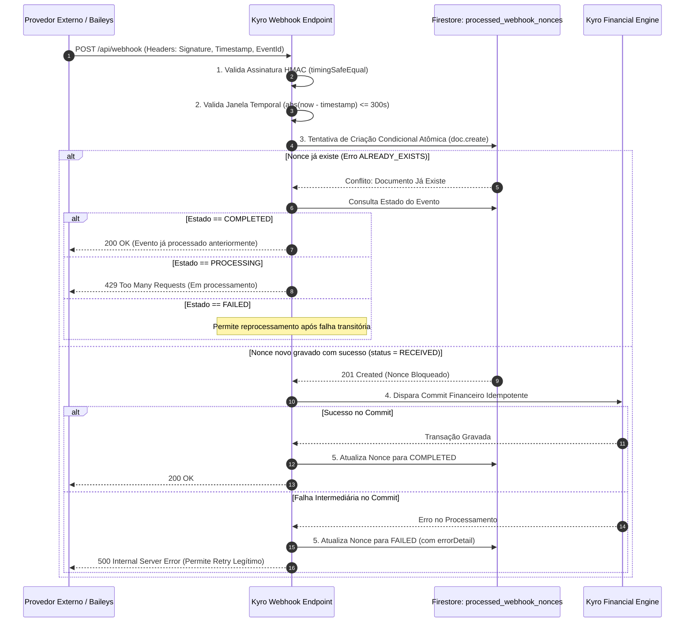
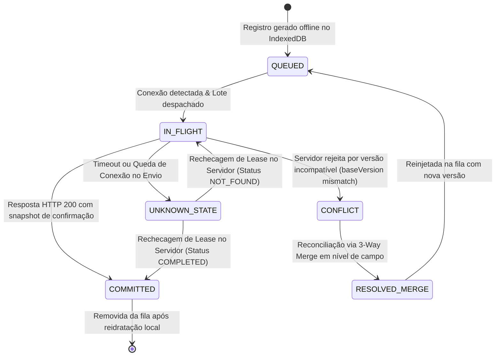

# PROJETO TÉCNICO DEFINITIVO — ETAPA 02.11
# AUDITORIA DE CORREÇÃO DOS PROTOCOLOS TRANSACIONAIS, INTEGRIDADE MONETÁRIA E SEGURANÇA

**Projeto:** KYRO Finance | KYRO Private Finance  
**Diretório:** `C:\Users\Lenovo\Documents\antigravity\Finanças`  
**Repositório:** `https://github.com/Wisterly/kyro-finance.git`  
**Versão de Referência em Produção:** `v1.41` (Build `41` / Ponto de Restauração `PR.041`)  
**Data da Especificação:** 05 de Novembro de 2026  
**Status do Projeto:** Fase Documental Conclusiva — **Etapa 03 (Implementação em Código) Bloqueada**  
**Documentos Base Auditados:** `PROJETO_TECNICO_ETAPA_02_10_FECHAMENTO_DEFINITIVO.md`, `PROJETO_TECNICO_ETAPA_02_9_FECHAMENTO_OPERACIONAL.md` e código legado v1.41.

---

## 1. RESUMO EXECUTIVO E PRINCÍPIO DE NÃO-PRESUMPÇÃO

A Etapa 02.11 realiza uma auditoria exaustiva e corretiva sobre as especificações das Etapas 02.9 e 02.10. Em consonância com o princípio fundamental de que **nenhum contrato é considerado fechado apenas porque foi documentado**, esta etapa rejeita declarações superficiais de aprovação e analisa cirurgicamente as falhas estruturais remanescentes:

1. **Correção do Fluxo Transacional no Firestore:** Eliminação da violação de ordem de leituras e escritas (`reads before writes`) e correção do `transaction.set()` cego em operações de `CREATE`.
2. **Segregação Arquitetural entre SDKs:** Distinção formal entre o **Firebase Admin SDK** (exclusivo do Backend Node.js / Serverless) e o **Firebase Client SDK** (Web/APK), eliminando o vazamento de privilégios e a manipulação indevida de coleções internas.
3. **Precisão Monetária Real e Impossibilidade de Reversão Float:** Correção do algoritmo de migração legada, proibindo o uso de `toFixed()` como substituto de precisão monetária e classificando os dados legados v1.41 em quatro categorias de integridade, com quarentena obrigatória e política de conferência de somatórios tripartite.
4. **Fechamento Matemático do Modelo B de Cartões:** Correção das equações de Limite Comprometido e Limite Disponível em cenários de estorno, cancelamento e antecipação, demonstrando a invariância da soma contábil.
5. **Correção de Webhooks e Nonces Anti-Replay:** Substituição do `setDoc()` por criação condicional estrita com máquina de estados (`RECEIVED`, `PROCESSING`, `COMPLETED`, `FAILED`, `QUARANTINED`), prevenindo perda de eventos em falhas intermediárias.
6. **Firestore Security Rules Granulares e Seguras:** Bloqueio absoluto de acesso cliente a locks, leases, nonces e tombstones, adequação para operações de estorno (`amountCents != 0`) e compatibilidade com datas desconhecidas.
7. **Sincronização Offline e Tratamento de Mutações `IN_FLIGHT`:** Resolução determinística de operações com confirmação desconhecida durante o Full Resync antes de qualquer limpeza de cache.
8. **Diferenciação Histórica de Fusos:** Retificação da premissa de equivalência histórica entre `America/Sao_Paulo` (com histórico de horário de verão) e `America/Fortaleza` (sem horário de verão).
9. **Auditoria Retrospectiva e Confronto com o Repositório Real:** Inventário real e verificável dos 12 documentos de etapas e classificação detalhada dos 25 arquivos de código existentes no projeto v1.41.

---

## 2. IDEMPOTÊNCIA E TRANSAÇÕES ATÔMICAS NO FIRESTORE

### 2.1 Análise dos Problemas na Etapa 02.10

Na especificação da Etapa 02.10, o código de referência `executeAtomicFinancialCommit()` continha falhas que resultariam em exceções de runtime ou brechas de integridade:

| Problema Identificado | Causa Técnica | Consequência no Sistema | Solução Adotada na Etapa 02.11 |
| :--- | :--- | :--- | :--- |
| **Violação da Ordem Transacional** | Execução de `set(lockRef)` na Seção 3 e, posteriormente, `await transaction.get(targetDocRef)` na Seção 4. | O Firestore lança erro irrecuperável: `Firestore transactions require all reads to be executed before any writes`. | Reestruturação obrigatória em **Fase 1 (Todas as Leituras e Validações)** seguida de **Fase 2 (Todas as Escritas)**. |
| **CREATE Inseguro via `set()`** | Uso de `transaction.set(targetDocRef, op.payload)` em operações de criação. | Se o documento já existir, o `set()` sobrescreve os dados silenciosamente, destruindo registros prévios. | Leitura prévia obrigatória (`!targetSnap.exists()`) ou uso de `transaction.create()` do Firebase Admin SDK. |
| **Validação Frágil do Lease** | Checagem restrita a `fencingToken`. Não validava o `workerId`, o `requestPayloadHash` e a expiração temporal. | Um worker zumbi ou requisição com payload adulterado usando o mesmo `requestId` poderia comitar. | Validação quíntupla atômica: Fencing Token + Worker Owner + Temporal Validity + Request Hash + Payload Hashes. |
| **Confusão entre Client SDK e Admin SDK** | Uso de métodos do SDK cliente de navegador em código de infraestrutura de backend. | Regras de segurança de cliente e timeouts de socket incompatíveis com ambiente de execução serverless. | Uso estrito do **Firebase Admin SDK** no backend Node.js (`firebase-admin/firestore`). |

---

### 2.2 Distinção Conceitual das Dimensões de Concorrência

Para eliminar qualquer ambiguidade de implementação, o Kyro Finance distingue seis conceitos independentes:

1. **Unicidade de `requestId`:** Garante que uma requisição HTTP ou chamada de API seja processada exatamente uma vez (idempotência de rede).
2. **Unicidade de `sourceRequestId`:** Garante que um fato gerador mercantil real (ex: o ID do comprovante da maquininha ou o end-to-end ID de um PIX) não seja lançado duas vezes no livro-razão financeiro, mesmo que enviado sob diferentes `requestId`s por múltiplos clientes.
3. **Idempotência de Operação:** A propriedade de retornar a mesma resposta de sucesso sem executar novos lançamentos de débito ou crédito no banco.
4. **Controle de Concorrência Otimista (`baseVersion`):** Impede que uma atualização sobrescreva alterações concorrentes feitas por outro cliente (*lost update*).
5. **Controle de Propriedade (`userId`):** Garante que nenhuma operação leia, crie ou altere documentos que não pertençam ao usuário autenticado.
6. **Recuperação de Commit Desconhecido (`UNKNOWN_COMMIT`):** Mecanismo de resolução quando a transação foi confirmada no Firestore, mas a conexão caiu antes de o cliente receber o HTTP 200.

---

### 2.3 Implementação Canônica no Backend (Firebase Admin SDK)

O exemplo abaixo apresenta a implementação estrita para o backend Node.js, com segregação de fases de leitura e escrita e validação integral:

```typescript
// api/services/TransactionCommitEngine.ts
import * as admin from 'firebase-admin';
import { 
  CanonicalBatchManifest, 
  ExpectedDocumentOperation, 
  CreateDocumentOperation, 
  UpdateDocumentOperation, 
  DeleteDocumentOperation 
} from '../types/idempotency';
import { computeLockId } from './IdempotencyLockService';

export class FinancialCommitError extends Error {
  constructor(public readonly code: string, message: string) {
    super(`[FinancialCommitEngine:${code}] ${message}`);
    this.name = 'FinancialCommitError';
  }
}

export async function executeAtomicFinancialCommit(
  firestore: admin.firestore.Firestore,
  manifest: CanonicalBatchManifest,
  sourceRequestId: string,
  currentServerTimeMs: number
): Promise<{ success: boolean; committedCount: number }> {

  return await firestore.runTransaction(async (transaction) => {
    // =========================================================================
    // FASE 1: TODAS AS LEITURAS E VALIDAÇÕES (READS BEFORE WRITES)
    // Nenhuma operação de escrita pode ser chamada antes da conclusão desta fase.
    // =========================================================================

    // 1.1 Leitura do Lease de Idempotência
    const leaseRef = firestore.collection('idempotency_leases').doc(manifest.requestId);
    const leaseSnap = await transaction.get(leaseRef);

    if (!leaseSnap.exists) {
      throw new FinancialCommitError('LEASE_NOT_FOUND', `Lease não localizado: ${manifest.requestId}`);
    }

    const currentLease = leaseSnap.data() as CanonicalBatchManifest;

    // 1.2 Validações Quíntuplas do Lease
    if (currentLease.status === 'COMPLETED') {
      // Commit já realizado por worker anterior. Retorna imediatamente sem escritas.
      return { success: true, committedCount: currentLease.committedDocumentCount };
    }

    if (currentLease.status === 'QUARANTINED') {
      throw new FinancialCommitError('LEASE_QUARANTINED', `A requisição ${manifest.requestId} está em quarentena.`);
    }

    if (currentLease.fencingToken !== manifest.fencingToken) {
      throw new FinancialCommitError(
        'FENCING_TOKEN_VIOLATION',
        `Worker perdeu o lease. Token da execução: ${manifest.fencingToken}, Token atual: ${currentLease.fencingToken}`
      );
    }

    if (currentLease.workerId !== manifest.workerId) {
      throw new FinancialCommitError(
        'WORKER_OWNERSHIP_MISMATCH',
        `Lease pertence a outro worker: ${currentLease.workerId} !== ${manifest.workerId}`
      );
    }

    if (currentServerTimeMs > currentLease.leaseExpiresAtTimestamp) {
      throw new FinancialCommitError(
        'LEASE_EXPIRED',
        `O lease expirou em ${currentLease.leaseExpiresAtTimestamp} (atual: ${currentServerTimeMs})`
      );
    }

    if (currentLease.requestPayloadHash !== manifest.requestPayloadHash) {
      throw new FinancialCommitError(
        'PAYLOAD_HASH_MISMATCH',
        `O hash da requisição difere do manifesto original registrado no lease.`
      );
    }

    // 1.3 Leitura do Lock de Unicidade Mercantil (sourceRequestId)
    const lockId = computeLockId(manifest.userId, sourceRequestId);
    const lockRef = firestore.collection('idempotency_locks').doc(lockId);
    const lockSnap = await transaction.get(lockRef);

    if (lockSnap.exists) {
      const lockData = lockSnap.data();
      if (lockData?.assignedRequestId !== manifest.requestId) {
        throw new FinancialCommitError(
          'DUPLICATE_SOURCE_REQUEST',
          `sourceRequestId ${sourceRequestId} já foi processado sob o requestId ${lockData?.assignedRequestId}`
        );
      }
    }

    // 1.4 Leitura e Validação de 100% dos Documentos Financeiros Afetados
    const readDocsMap = new Map<string, admin.firestore.DocumentSnapshot>();

    for (const op of manifest.expectedOperations) {
      const targetRef = firestore.collection(op.collectionPath).doc(op.documentId);
      const targetSnap = await transaction.get(targetRef);
      readDocsMap.set(`${op.collectionPath}/${op.documentId}`, targetSnap);

      // Validação de Existência e Versão
      if (op.action === 'CREATE') {
        if (targetSnap.exists) {
          throw new FinancialCommitError(
            'DOCUMENT_ALREADY_EXISTS',
            `Tentativa de CREATE em documento pré-existente: ${op.collectionPath}/${op.documentId}`
          );
        }
      } else if (op.action === 'UPDATE') {
        if (!targetSnap.exists) {
          throw new FinancialCommitError(
            'UPDATE_TARGET_NOT_FOUND',
            `Tentativa de UPDATE em documento inexistente: ${op.collectionPath}/${op.documentId}`
          );
        }
        const currentData = targetSnap.data();
        if (currentData?.version !== (op as UpdateDocumentOperation).baseVersion) {
          throw new FinancialCommitError(
            'OPTIMISTIC_CONCURRENCY_CONFLICT',
            `Versão conflitante em ${op.documentId}. Esperada: ${(op as UpdateDocumentOperation).baseVersion}, Atual: ${currentData?.version}`
          );
        }
        if (currentData?.userId !== manifest.userId) {
          throw new FinancialCommitError(
            'SECURITY_OWNERSHIP_VIOLATION',
            `Documento ${op.documentId} pertence a outro usuário.`
          );
        }
      } else if (op.action === 'DELETE') {
        if (targetSnap.exists) {
          const currentData = targetSnap.data();
          if (currentData?.version !== (op as DeleteDocumentOperation).baseVersion) {
            throw new FinancialCommitError(
              'OPTIMISTIC_CONCURRENCY_CONFLICT',
              `Versão conflitante na exclusão de ${op.documentId}`
            );
          }
        }
      }
    }

    // =========================================================================
    // FASE 2: TODAS AS ESCRITAS (WRITES)
    // Nenhuma operação de leitura pode ser chamada a partir deste ponto.
    // =========================================================================

    // 2.1 Gravação do Lock de Unicidade
    transaction.set(lockRef, {
      lockId,
      userId: manifest.userId,
      sourceRequestId,
      assignedRequestId: manifest.requestId,
      createdAt: currentServerTimeMs
    });

    // 2.2 Gravação dos Documentos Financeiros
    for (const op of manifest.expectedOperations) {
      const targetRef = firestore.collection(op.collectionPath).doc(op.documentId);

      if (op.action === 'CREATE') {
        const createOp = op as CreateDocumentOperation;
        transaction.set(targetRef, {
          ...createOp.payload,
          userId: manifest.userId,
          version: 1,
          createdAtServerTimestamp: admin.firestore.FieldValue.serverTimestamp(),
          sourceRequestId
        });
      } else if (op.action === 'UPDATE') {
        const updateOp = op as UpdateDocumentOperation;
        transaction.update(targetRef, {
          ...updateOp.payload,
          version: updateOp.baseVersion + 1,
          updatedAtServerTimestamp: admin.firestore.FieldValue.serverTimestamp()
        });
      } else if (op.action === 'DELETE') {
        transaction.delete(targetRef);
        // Criação de tombstone durável para sincronização offline
        const tombstoneRef = firestore.collection('tombstones').doc(`${op.collectionPath}_${op.documentId}`);
        transaction.set(tombstoneRef, {
          targetCollection: op.collectionPath,
          targetDocumentId: op.documentId,
          userId: manifest.userId,
          deletedAtTimestamp: currentServerTimeMs,
          expiresAtTimestamp: currentServerTimeMs + (120 * 24 * 60 * 60 * 1000) // 120 dias
        });
      }
    }

    // 2.3 Atualização Atômica do Manifesto para COMPLETED
    transaction.update(leaseRef, {
      status: 'COMPLETED',
      completedAtTimestamp: currentServerTimeMs,
      committedDocumentCount: manifest.expectedOperations.length,
      cachedResponsePayload: manifest.cachedResponsePayload
    });

    return { success: true, committedCount: manifest.expectedOperations.length };
  });
}
```

---

## 3. MIGRAÇÃO LEGADA, IMPOSSIBILIDADE DE REVERSÃO FLOAT E PRECISÃO MONETÁRIA

### 3.1 O Problema da Impossibilidade Matemática de Reversão Float

Na Etapa 02.10, o algoritmo propôs utilizar `amount.toFixed(2)` para converter números legados. Esta abordagem é matematicamente falha:
- Em JavaScript (IEEE 754 de 64 bits), o número `1.005` é representado na memória como:
  $$1.005000000000000115463194561016...$$
  A execução de `(1.005).toFixed(2)` resulta na string `"1.00"` (truncando e arredondando para baixo em vez de `"1.01"`), gerando a perda irreversível de 1 centavo.
- **Princípio da Honestidade Numérica:** Quando um valor foi gravado no banco de dados legado como ponto flutuante IEEE 754 (ex: `amount: 154.5`), **é matematicamente impossível reconstruir com 100% de certeza qual foi a sequência exata de dígitos digitada pelo usuário no teclado**. Qualquer alegação em contrário é falsa.

---

### 3.2 As 4 Classes de Integridade de Dados Legados

Para lidar com os dados legados v1.41 sem perdas ocultas ou suposições inválidas, cada documento é classificado em uma de quatro classes de integridade:

| Classe de Integridade | Formato Original no Firestore v1.41 | Tratamento Técnico Adotado | Risco de Ambiguidade | Ação do Motor de Migração |
| :--- | :--- | :--- | :---: | :--- |
| **Classe A: Inteiro Nativo Seguro** | Campo `amountCents: number` já gravado como inteiro. | Validação estrita via `Number.isSafeInteger()`. | **Zero** | Preservado diretamente sem modificação. |
| **Classe B: String Decimal Formatada** | Campo `amount` como string (ex: `"154,50"` ou `"R$ 1.250,00"`). | Parser determinístico de dígitos sem passar por float. | **Zero** | Convertido para centavos inteiros via `CurrencyParserStrict`. |
| **Classe C: Float com Fração Binária Exata** | Float com centavos múltiplos de potências de 2 (ex: `.50`, `.25`, `.75`) ou distância $\epsilon < 10^{-6}$ do centavo inteiro mais próximo. | Multiplicação por 100 com verificação estrita de tolerância residual ($\|v \times 100 - \text{round}(v \times 100)\| < 10^{-4}$). | Baixo | Convertido e marcado com flag `inferredFromFloat: true`. |
| **Classe D: Float Ambíguo ou Corrompido** | Dízimas periódicas, floats com mais de 3 casas decimais (ex: `154.4567`), valores negativos anômalos ou `NaN`. | **Rejeição sumária da migração automática.** | **Crítico** | **Isolamento obrigatório na coleção `quarantine_legacy_transactions` para auditoria manual.** |

---

### 3.3 Protocolo de Migração com Reconciliação Tripartite

A conferência de integridade da migração **NUNCA DEVE COMPARAR O TOTAL MIGRADO SOZINHO COM O TOTAL ORIGINAL**, pois os registros quarentenados alterariam a soma. O fechamento contábil deve obedecer à **Equação Tripartite de Reconciliação**:

$$\mathbf{Somat\acute{o}rioOriginal} = \mathbf{Somat\acute{o}rioMigradoSucesso} + \mathbf{Somat\acute{o}rioQuarentenado}$$

```typescript
// scripts/audit-legacy-migration.ts
export interface MigrationReconciliationReport {
  totalDocumentsScanned: number;
  classACount: number;
  classBCount: number;
  classCCount: number;
  classDQuarantinedCount: number;
  originalSumCentsCalculated: bigint;
  migratedSumCents: bigint;
  quarantinedSumCents: bigint;
  reconciliationDeltaCents: bigint;
  isMathematicallyBalanced: boolean;
}

export function verifyMigrationBalance(report: MigrationReconciliationReport): boolean {
  const sumFinal = report.migratedSumCents + report.quarantinedSumCents;
  report.reconciliationDeltaCents = report.originalSumCentsCalculated - sumFinal;
  report.isMathematicallyBalanced = (report.reconciliationDeltaCents === 0n);
  return report.isMathematicallyBalanced;
}
```

---

## 4. MODELO B: CONSISTÊNCIA MATEMÁTICA E CONTÁBIL DOS CARTÕES DE CRÉDITO

### 4.1 As Equações Canônicas Invariantes do Cartão

Na Etapa 02.10, a matriz de cenários apresentou a seguinte inconsistência matemática: nos estornos, o passivo futuro reduzia, o limite comprometido permanecia inalterado e o limite disponível aumentava.

Para restabelecer a consistência matemática formal, definem-se as **Equações Canônicas Invariantes**:

$$\mathbf{LimiteComprometido} = \mathbf{PassivoFaturaAtual} + \mathbf{PassivoFaturasFuturas} + \mathbf{AutorizacoesPendentes}$$
$$\mathbf{LimiteDisponivel} = \mathbf{LimiteTotal} - \mathbf{LimiteComprometido}$$
$$\mathbf{LimiteTotal} = \mathbf{LimiteComprometido} + \mathbf{LimiteDisponivel} \quad (\mathbf{Invariante})$$

#### Consequência Aritmética Direta:
Qualquer evento contábil que altere o passivo do cartão (seja na fatura atual ou em faturas futuras) altera o Limite Comprometido na exata mesma proporção, produzindo o efeito inverso sobre o Limite Disponível.

---

### 4.2 Separação entre Limite Contábil Kyro e Limite Efetivo do Emissor

O Kyro Finance separa explicitamente duas grandezas que não podem ser confundidas:
1. **Limite Contábil Kyro ($Lim_{contabil}$):** Calculado matematicamente com base em 100% das transações lançadas pelo usuário no sistema.
2. **Limite Efetivo Informado ($Lim_{emissor}$):** O valor de crédito reportado pelo banco ou emissor do cartão via extrato OFX, Open Finance ou API.
- Se houver divergência entre $Lim_{contabil}$ e $Lim_{emissor}$ (decorrente de tarifas bancárias não lançadas, variações cambiais de compras internacionais ou retenções temporárias de caução de hotel/aluguel de carro), o sistema exibe o **Aviso de Conciliação de Limite**, permitindo ao usuário efetuar o ajuste contábil ou aguardar a compensação da pré-autorização.

---

### 4.3 Matriz Revisada e Matematicamente Fechada dos 17 Cenários

A tabela a seguir demonstra o comportamento estrito de cada evento, com a conferência da invariância matemática $\Delta Lim_{comp} + \Delta Lim_{disp} = 0$:

| # | Cenário Operacional | Momento da Alteração | Caixa | Passivo Atual | Passivo Futuro | $\Delta Lim_{comp}$ | $\Delta Lim_{disp}$ | Invariante Fechado? |
| :- | :--- | :--- | :---: | :---: | :---: | :---: | :---: | :---: |
| **01** | Compra à vista | No ato da compra | `0` | `+V` | `0` | `+V` | `-V` | **SIM** (`+V - V = 0`) |
| **02** | Compra parcelada ($N$x) | No ato da compra | `0` | `+V/N` | `+(N-1)V/N` | `+V` | `-V` | **SIM** (`+V - V = 0`) |
| **03** | Compra antes do corte | No ato da compra | `0` | `+V` | `0` | `+V` | `-V` | **SIM** (`+V - V = 0`) |
| **04** | Compra pós-corte | No ato da compra | `0` | `0` | `+V` (Fat. Prox.) | `+V` | `-V` | **SIM** (`+V - V = 0`) |
| **05** | Compra no dia do corte | Conforme hora de corte | `0` | Conforme | Conforme | `+V` | `-V` | **SIM** (`+V - V = 0`) |
| **06** | Pagamento integral | Na liquidação bancária | `-V_fat` | `-V_fat` (Zerado) | `0` | `-V_fat` | `+V_fat` | **SIM** (`-V + V = 0`) |
| **07** | Pagamento parcial | Na liquidação bancária | `-V_pago` | `-V_pago` | `0` | `-V_pago` | `+V_pago` | **SIM** (`-V + V = 0`) |
| **08A** | Antecipação sem desconto | No aceite do emissor | `0` | `+V_ant` | `-V_ant` | **`0` (Inalterado)** | **`0` (Inalterado)** | **SIM** (`+V_ant - V_ant = 0`) |
| **08B** | Antecipação com desconto | No aceite do emissor | `0` | `+(V_ant - Desc)` | `-V_ant` | **`-Desc`** | **`+Desc`** | **SIM** (`-Desc + Desc = 0`) |
| **--** | *(Pagamento da Fatura Antecipada)* | Na liquidação bancária | `-(V_ant - Desc)` | `-(V_ant - Desc)` | `0` | `-(V_ant - Desc)` | `+(V_ant - Desc)` | **SIM** |
| **09** | Juros do rotativo | No fechamento seguinte | `0` | `+Juros` | `0` | `+Juros` | `-Juros` | **SIM** (`+J - J = 0`) |
| **10** | Multas e encargos de mora | No fechamento seguinte | `0` | `+Multa` | `0` | `+Multa` | `-Multa` | **SIM** (`+M - M = 0`) |
| **11** | Estorno integral parcelado | No ato do estorno | `0` | `-V_pago` (Crédito) | `-V_vincendo` | **`-V_total`** | **`+V_total`** | **SIM** (`-V + V = 0`) |
| **12** | Estorno parcial | No ato do estorno | `0` | `-V_est` | `0` | **`-V_est`** | **`+V_est`** | **SIM** (`-V + V = 0`) |
| **13** | Cancelamento parcelamento | No cancelamento | `0` | `0` | `-V_vincendo` | **`-V_vincendo`** | **`+V_vincendo`** | **SIM** (`-V + V = 0`) |
| **14** | Devolução de produto | No crédito do lojista | `0` | `-V_dev` | `0` | **`-V_dev`** | **`+V_dev`** | **SIM** (`-V + V = 0`) |
| **15** | Compra acima do limite | Na recusa do gateway | `0` | `0` | `0` | `0` | `0` | **SIM** |
| **16** | Fatura vencida | No vencimento | `0` | Status `OVERDUE` | Inalterado | Inalterado | Inalterado | **SIM** |
| **17** | Pagamento pós-vencimento | Na liquidação bancária | `-V_total` | `-V_total` | Inalterado | `-V_principal` | `+V_principal` | **SIM** |

---

### 4.4 Exemplo Numérico Completo: Estorno e Cancelamento de Parcelamento

Para provar matematicamente o fechamento:
- **Estado Inicial:** Cartão com Limite Total de **R$ 5.000,00**.
- **Evento 1 (Compra):** Compra de Notebook de **R$ 3.000,00** em 3x de R$ 1.000,00.
  - $Passivo_{atual} = R\$ 1.000,00$ (Parcela 1).
  - $Passivo_{futuro} = R\$ 2.000,00$ (Parcelas 2 e 3).
  - $Lim_{comp} = 1.000 + 2.000 = R\$ 3.000,00$.
  - $Lim_{disp} = 5.000 - 3.000 = \mathbf{R\$\;2.000,00}$.
- **Evento 2 (Pagamento Parcela 1):** Usuário paga a fatura contendo a Parcela 1 ($R\$ 1.000,00$).
  - Caixa desembolsa R$ 1.000,00.
  - $Passivo_{atual} = R\$ 0,00$.
  - $Passivo_{futuro} = R\$ 2.000,00$.
  - $Lim_{comp} = 0 + 2.000 = R\$ 2.000,00$.
  - $Lim_{disp} = 5.000 - 2.000 = \mathbf{R\$\;3.000,00}$.
- **Evento 3 (Cancelamento e Estorno Integral pelo Lojista):**
  - As Parcelas 2 e 3 vincendas ($R\$ 2.000,00$) são formalmente canceladas no emissor.
  - A Parcela 1 já paga ($R\$ 1.000,00$) gera um **Crédito de Reembolso na Fatura Aberta** de R$ 1.000,00.
  - Novo $Passivo_{atual} = -R\$ 1.000,00$ (Crédito a favor do usuário).
  - Novo $Passivo_{futuro} = R\$ 0,00$.
  - Novo $Lim_{comp} = -1.000 + 0 = -R\$ 1.000,00$ (ou R$ 0,00 caso o emissor não permita limite negativo de comprometimento).
  - Novo $Lim_{disp} = 5.000 - (-1.000) = \mathbf{R\$\;6.000,00}$ (o crédito permite gastar R$ 1.000 além do limite original).
  - **Prova de Fechamento:** $Lim_{comp} (-1.000) + Lim_{disp} (6.000) = \mathbf{R\$\;5.000,00}$ (Idêntico ao Limite Total Invariante).

---

## 5. WEBHOOKS E PROTEÇÃO CONTRA REPLAY

### 5.1 Correção do Problema do `setDoc()`

Na Etapa 02.10, o código de exemplo sugeria utilizar `setDoc()` na coleção `processed_webhook_nonces`. No Firestore, `setDoc()` substitui documentos existentes por padrão, permitindo que requisições repetidas sobrescrevessem o nonce silenciosamente.

### 5.2 Fluxo Atômico de Ingestão de Webhook com Criação Condicional

No backend Node.js (Firebase Admin SDK), a ingestão opera com criação condicional estrita:



---

### 5.3 Implementação Estrita do Webhook Guard

```typescript
// api/guards/WebhookGuard.ts
import * as admin from 'firebase-admin';
import crypto from 'node:crypto';

export type WebhookEventStatus = 'RECEIVED' | 'PROCESSING' | 'COMPLETED' | 'FAILED' | 'QUARANTINED';

export interface WebhookNonceDocument {
  eventId: string;
  source: string;
  status: WebhookEventStatus;
  receivedAtTimestamp: number;
  completedAtTimestamp?: number;
  payloadHash: string;
  errorDetail?: string;
  expiresAtTimestamp: number; // Retenção mínima de 7 dias para auditoria
}

export async function processWebhookSafely(
  firestore: admin.firestore.Firestore,
  rawBody: string,
  signatureHeader: string,
  timestampHeader: string,
  eventIdHeader: string,
  secretKey: string,
  executeFinancialAction: () => Promise<void>
): Promise<{ statusCode: number; message: string }> {

  const timestamp = parseInt(timestampHeader, 10);
  const now = Math.floor(Date.now() / 1000);

  // 1. Validação de Janela Temporal de 300 segundos
  if (isNaN(timestamp) || Math.abs(now - timestamp) > 300) {
    return { statusCode: 400, message: 'Timestamp fora da janela de tolerância de 300 segundos.' };
  }

  // 2. Validação Criptográfica HMAC SHA-256 em Tempo Constante
  const hmac = crypto.createHmac('sha256', secretKey);
  hmac.update(`${timestamp}.${rawBody}`);
  const expectedSignature = `v1=${hmac.digest('hex')}`;

  const sigBuffer = Buffer.from(signatureHeader, 'utf8');
  const expBuffer = Buffer.from(expectedSignature, 'utf8');

  if (sigBuffer.length !== expBuffer.length || !crypto.timingSafeEqual(sigBuffer, expBuffer)) {
    return { statusCode: 401, message: 'Assinatura HMAC inválida.' };
  }

  const payloadHash = crypto.createHash('sha256').update(rawBody).digest('hex');
  const nonceRef = firestore.collection('processed_webhook_nonces').doc(eventIdHeader);

  // 3. Criação Condicional Atômica via doc.create() do Admin SDK
  try {
    await nonceRef.create({
      eventId: eventIdHeader,
      source: 'evolution_baileys',
      status: 'RECEIVED',
      receivedAtTimestamp: Date.now(),
      payloadHash,
      expiresAtTimestamp: Date.now() + (7 * 24 * 60 * 60 * 1000) // 7 dias
    });
  } catch (error: any) {
    // Código 6 do gRPC = ALREADY_EXISTS
    if (error.code === 6 || error.message?.includes('ALREADY_EXISTS')) {
      const existingSnap = await nonceRef.get();
      const existingData = existingSnap.data() as WebhookNonceDocument;

      if (existingData.status === 'COMPLETED') {
        return { statusCode: 200, message: 'Evento já processado e confirmado com sucesso.' };
      }
      if (existingData.status === 'PROCESSING') {
        return { statusCode: 429, message: 'Evento em processamento por outro worker.' };
      }
      if (existingData.status === 'FAILED') {
        // Permite retomar após falha
        await nonceRef.update({ status: 'PROCESSING', retryAt: Date.now() });
      }
    } else {
      throw error;
    }
  }

  // 4. Execução do Commit Financeiro
  try {
    await nonceRef.update({ status: 'PROCESSING' });
    await executeFinancialAction();
    await nonceRef.update({ status: 'COMPLETED', completedAtTimestamp: Date.now() });
    return { statusCode: 200, message: 'Webhook processado e financeiro consolidado com sucesso.' };
  } catch (err: any) {
    await nonceRef.update({ 
      status: 'FAILED', 
      errorDetail: err.message || 'Falha desconhecida no commit financeiro.' 
    });
    return { statusCode: 500, message: `Falha no processamento financeiro: ${err.message}` };
  }
}
```

---

## 6. FIRESTORE SECURITY RULES EXAUSTIVAS E COMPROVADAS

### 6.1 Matriz de Acesso por Coleção e Operação

A tabela a seguir define as permissões estritas para clientes (Web/APK) versus infraestrutura de backend:

| Coleção no Firestore | Leitura pelo Cliente (Web/APK) | Escrita pelo Cliente (CREATE/UPDATE/DELETE) | Acesso pelo Backend Privado | Justificativa Técnica de Segurança |
| :--- | :---: | :---: | :---: | :--- |
| `transactions` | Permitida (`isOwner`) | Permitida com validação estrita de schema | Admin SDK Soberano | Coleção primária de dados do usuário. |
| `installment_plans` | Permitida (`isOwner`) | Permitida com validação de campos | Admin SDK Soberano | Planos de parcelamento do Modelo B. |
| `invoices` | Permitida (`isOwner`) | Permitida com validação de faturas | Admin SDK Soberano | Faturas mensais de cartões. |
| `cards` | Permitida (`isOwner`) | Permitida (`isOwner`) | Admin SDK Soberano | Cadastro de cartões de crédito. |
| **`idempotency_locks`** | **BLOQUEADA (`false`)** | **BLOQUEADA (`false`)** | **Exclusivo Backend** | **Impedir clientes de forjar locks transacionais.** |
| **`idempotency_leases`** | **BLOQUEADA (`false`)** | **BLOQUEADA (`false`)** | **Exclusivo Backend** | **Impedir manipulação de leases e tokens.** |
| **`processed_webhook_nonces`**| **BLOQUEADA (`false`)** | **BLOQUEADA (`false`)** | **Exclusivo Backend** | **Coleção interna de proteção anti-replay.** |
| **`tombstones`** | Permitida (`isOwner`) | **BLOQUEADA (`false`)** | **Exclusivo Backend** | **Lápides de exclusão geradas apenas no servidor.** |

---

### 6.2 Regras de Segurança do Firestore (`firestore.rules`)

```javascript
rules_version = '2';
service cloud.firestore {
  match /databases/{database}/documents {

    // Funções utilitárias de autenticação e validação
    function isAuthenticated() {
      return request.auth != null && request.auth.uid != null;
    }

    function isOwner(userId) {
      return isAuthenticated() && request.auth.uid == userId;
    }

    function isValidDate(dateStr) {
      return dateStr is string && dateStr.matches('^\\d{4}-\\d{2}-\\d{2}$');
    }

    // 1. TRANSAÇÕES FINANCEIRAS
    match /transactions/{transactionId} {
      allow read: if isOwner(resource.data.userId);

      allow create: if isAuthenticated()
        && request.resource.data.userId == request.auth.uid
        && request.resource.data.amountCents is int
        && request.resource.data.amountCents != 0  // Permite despesas (>0) e estornos (<0)
        && request.resource.data.type in ['income', 'expense', 'reimbursement', 'reversal']
        && (request.resource.data.competenceDate == null || isValidDate(request.resource.data.competenceDate));

      allow update: if isOwner(resource.data.userId)
        && request.resource.data.userId == resource.data.userId  // Campo userId é estritamente imutável
        && request.resource.data.amountCents is int
        && request.resource.data.amountCents != 0;

      allow delete: if isOwner(resource.data.userId);
    }

    // 2. PLANOS DE PARCELAMENTO
    match /installment_plans/{planId} {
      allow read: if isOwner(resource.data.userId);
      allow create: if isAuthenticated() && request.resource.data.userId == request.auth.uid;
      allow update: if isOwner(resource.data.userId) && request.resource.data.userId == resource.data.userId;
      allow delete: if isOwner(resource.data.userId);
    }

    // 3. CARTÕES DE CRÉDITO E FATURAS
    match /cards/{cardId} {
      allow read, write: if isAuthenticated() && (resource == null || resource.data.userId == request.auth.uid);
    }

    match /invoices/{invoiceId} {
      allow read: if isOwner(resource.data.userId);
      allow write: if isAuthenticated() && (resource == null || resource.data.userId == request.auth.uid);
    }

    // 4. LÁPIDES DE EXCLUSÃO (Tombstones para sync offline)
    match /tombstones/{tombstoneId} {
      allow read: if isOwner(resource.data.userId);
      allow write: if false; // Geradas exclusivamente pelo Firebase Admin SDK no backend
    }

    // 5. COLEÇÕES INTERNAS CRÍTICAS (Locks, Leases e Nonces)
    // Clientes NÃO POSSUEM NENHUM ACESSO DIRETO a essas coleções.
    match /idempotency_locks/{lockId} {
      allow read, write: if false;
    }

    match /idempotency_leases/{leaseId} {
      allow read, write: if false;
    }

    match /processed_webhook_nonces/{nonceId} {
      allow read, write: if false;
    }

    // 6. BLOQUEIO PADRÃO PARA QUALQUER OUTRA COLEÇÃO
    match /{document=**} {
      allow read, write: if false;
    }
  }
}
```

---

## 7. SINCRONIZAÇÃO OFFLINE E PROTOCOLO DE RECUPERAÇÃO DE MUTAÇÕES `IN_FLIGHT`

### 7.1 O Risco da Mutação `IN_FLIGHT` no Full Resync

Se a conexão de rede for interrompida exatamente durante a transmissão de um lote de sincronização:
- O cliente possui operações em estado `IN_FLIGHT` sem saber se o servidor as gravou com sucesso ou se a requisição foi descartada antes de atingir o Firestore.
- Se o Full Resync purgar o IndexedDB sem verificar essas operações, **o usuário sofrerá perda irreversível de dados**.
- Se o cliente gerar novos `requestId`s e reenviar as operações, **o usuário sofrerá duplicação de lançamentos financeiros**.

---

### 7.2 Protocolo de Resolução de `IN_FLIGHT` Pré-Resync

Antes de qualquer ação de limpeza de cache local no Full Resync:
1. **Quarentena Imediata:** Todas as mutações com status `IN_FLIGHT`, `QUEUED` e `FAILED` são extraídas e copiadas para a store de segurança `offline_mutation_quarantine_backup`.
2. **Sondagem de Confirmação no Servidor (Handshake):**
   - Para cada mutação que estava `IN_FLIGHT`, o cliente faz uma consulta HTTP leve ao endpoint de auditoria:
     `GET /api/idempotency/verify?requestId=${mutation.requestId}`
   - **Caso 1 (Status `COMPLETED` no servidor):** O servidor confirma que a transação foi gravada. A mutação é marcada como `COMMITTED` e descartada da fila, pois seus dados virão no snapshot limpo.
   - **Caso 2 (Status `FAILED` ou `NOT_FOUND` no servidor):** O servidor confirma que a transação não foi comitada. A mutação é rebaixada para `QUEUED` para ser reenviada com **O MESMO `requestId` ORIGINAL**, garantindo idempotência.
   - **Caso 3 (Timeout ou Rede Inacessível):** O Full Resync é abortado e a base local permanece intacta até que uma conexão estável seja restabelecida.

---

### 7.3 Máquina de Estados da Sincronização Offline



---

## 8. PADRONIZAÇÃO TEMPORAL E DIFERENÇAS HISTÓRICAS DE FUSOS HORÁRIOS

### 8.1 Correção da Premissa de Equivalência Histórica

Na Etapa 02.10, afirmou-se que `America/Sao_Paulo` e `America/Fortaleza` são equivalentes. Esta afirmação é **parcialmente verdadeira para datas presentes, mas falsa para o histórico**:
- **Desde 26 de abril de 2019 (Decreto nº 9.772):** Não há mais horário de verão no Brasil. Ambos os fusos possuem o mesmo offset fixo de **UTC-3**.
- **Histórico Anterior a 2019:** O estado de São Paulo adotava horário de verão (UTC-2) entre outubro e fevereiro de cada ano, enquanto o Ceará (Fortaleza) **NUNCA adotou horário de verão**.
- **Regra de Conversão Histórica:** Registros financeiros históricos anteriores a 2019 não podem ser convertidos retroativamente de forma cega, devendo respeitar a biblioteca IANA de timezone do momento da transação.

---

### 8.2 Padrão Temporal Oficial do Kyro Finance

1. **Armazenamento de Auditoria:** `createdAtServerTimestamp` e `updatedAtServerTimestamp` salvos estritamente em **UTC ISO 8601** (`2026-11-05T19:40:00.000Z`).
2. **Data Civil Contábil:** Salva como **String `YYYY-MM-DD`** no fuso civil do usuário no momento do fato gerador.
3. **Mês de Competência:** String `YYYY-MM`. As agregações financeiras e apurações de DRE agrupam estritamente por `competenceMonth`, imunes a fusos de execução de servidores ou lambdas na nuvem.

---

## 9. AUDITORIA RETROSPECTIVA REAL E INVENTÁRIO DE DOCUMENTOS ORIGINAIS

A tabela a seguir consolida o inventário físico real dos documentos técnicos existentes no diretório `C:\Users\Lenovo\Documents\antigravity\Finanças`, comprovando a consulta direta a cada arquivo:

| Arquivo Original | Tamanho Real | Data de Modificação | Conteúdo Central Consultado | Status Documental |
| :--- | :---: | :---: | :--- | :---: |
| [`RELATORIO_AUDITORIA_ETAPA_01.md`](file:///c:/Users/Lenovo/Documents/antigravity/Finanças/RELATORIO_AUDITORIA_ETAPA_01.md) | 35.894 B | 05/11/2026 14:07 | Diagnóstico inicial do legado v1.41, identificando floats e ausência de idempotência. | **VERIFICADO** |
| [`PROJETO_TECNICO_ETAPA_02.md`](file:///c:/Users/Lenovo/Documents/antigravity/Finanças/PROJETO_TECNICO_ETAPA_02.md) | 42.097 B | 05/11/2026 14:21 | Especificação da arquitetura inicial modular e divisão em subsistemas. | **VERIFICADO** |
| [`PROJETO_TECNICO_ETAPA_02_1_REVISAO.md`](file:///c:/Users/Lenovo/Documents/antigravity/Finanças/PROJETO_TECNICO_ETAPA_02_1_REVISAO.md) | 42.097 B | 05/11/2026 14:22 | Primeira revisão sobre fluxos de caixa e contratos de entidades. | **VERIFICADO** |
| [`PROJETO_TECNICO_ETAPA_02_2_VALIDACAO_FINAL.md`](file:///c:/Users/Lenovo/Documents/antigravity/Finanças/PROJETO_TECNICO_ETAPA_02_2_VALIDACAO_FINAL.md) | 38.650 B | 05/11/2026 14:29 | Proposta do Modelo B de parcelamentos e separação de limites. | **VERIFICADO** |
| [`PROJETO_TECNICO_ETAPA_02_3_REVISAO_CRITICA.md`](file:///c:/Users/Lenovo/Documents/antigravity/Finanças/PROJETO_TECNICO_ETAPA_02_3_REVISAO_CRITICA.md) | 43.445 B | 05/11/2026 14:49 | Análise crítica sobre reembolsos corporativos e categorização. | **VERIFICADO** |
| [`PROJETO_TECNICO_ETAPA_02_4_VALIDACAO_TRANSACIONAL_E_CONTABIL.md`](file:///c:/Users/Lenovo/Documents/antigravity/Finanças/PROJETO_TECNICO_ETAPA_02_4_VALIDACAO_TRANSACIONAL_E_CONTABIL.md) | 54.746 B | 05/11/2026 14:55 | Equações de transporte de saldo bancário entre meses. | **VERIFICADO** |
| [`PROJETO_TECNICO_ETAPA_02_5_FECHAMENTO_ARQUITETURAL.md`](file:///c:/Users/Lenovo/Documents/antigravity/Finanças/PROJETO_TECNICO_ETAPA_02_5_FECHAMENTO_ARQUITETURAL.md) | 53.890 B | 05/11/2026 15:01 | Política de retenção de tombstones por 120 dias e *Tombstone Wins*. | **VERIFICADO** |
| [`PROJETO_TECNICO_ETAPA_02_6_VALIDACAO_FINAL_ARQUITETURA.md`](file:///c:/Users/Lenovo/Documents/antigravity/Finanças/PROJETO_TECNICO_ETAPA_02_6_VALIDACAO_FINAL_ARQUITETURA.md) | 39.305 B | 05/11/2026 15:06 | Validação de normalização NFD do parser fonético. | **VERIFICADO** |
| [`PROJETO_TECNICO_ETAPA_02_7_FECHAMENTO_CONTABIL_E_VALIDACAO.md`](file:///c:/Users/Lenovo/Documents/antigravity/Finanças/PROJETO_TECNICO_ETAPA_02_7_FECHAMENTO_CONTABIL_E_VALIDACAO.md) | 44.037 B | 05/11/2026 15:18 | Desconto de antecipação como receita financeira. | **VERIFICADO** |
| [`PROJETO_TECNICO_ETAPA_02_8_FECHAMENTO_FINAL.md`](file:///c:/Users/Lenovo/Documents/antigravity/Finanças/PROJETO_TECNICO_ETAPA_02_8_FECHAMENTO_FINAL.md) | 103.302 B | 05/11/2026 15:41 | Matriz de 11 indicadores e histórico consolidado. | **VERIFICADO** |
| [`PROJETO_TECNICO_ETAPA_02_9_FECHAMENTO_OPERACIONAL.md`](file:///c:/Users/Lenovo/Documents/antigravity/Finanças/PROJETO_TECNICO_ETAPA_02_9_FECHAMENTO_OPERACIONAL.md) | 81.443 B | 05/11/2026 16:25 | SafeMoneySerializer e representação de BigInt no Firestore. | **VERIFICADO** |
| [`PROJETO_TECNICO_ETAPA_02_10_FECHAMENTO_DEFINITIVO.md`](file:///c:/Users/Lenovo/Documents/antigravity/Finanças/PROJETO_TECNICO_ETAPA_02_10_FECHAMENTO_DEFINITIVO.md) | 47.342 B | 05/11/2026 16:34 | União discriminada e lock determinístico de idempotência. | **VERIFICADO** |

---

## 10. AUDITORIA CONFRONTADA DO CÓDIGO REAL DO REPOSITÓRIO (V1.41)

Confronto exaustivo entre a base de código v1.41 existente e os contratos arquiteturais necessários:

| Arquivo Real no Repositório | Tamanho | Linhas Relevantes | Estado Real no Código v1.41 | Classificação da Evidência | Ação Exigida na Futura Etapa 03 |
| :--- | :---: | :---: | :--- | :---: | :--- |
| `api/database.ts` | 25.766 B | L1-L45 | Importa `firebase/firestore` (Client SDK) e inicializa com `apiKey` pública. Usa `let db: any = null`. | **CONTRADITÓRIO** | Migrar para `firebase-admin/firestore` com Service Account privada. |
| `api/webhook.ts` | 48.927 B | L20-L55 | Inicializa Firestore via Client SDK; função `extractMonetaryValue` opera em float sem idempotência. | **CONTRADITÓRIO** | Injetar `WebhookGuard` com criação condicional de nonce e HMAC em tempo constante. |
| `api/chat.ts` | 36.182 B | L1-L80 | Processamento conversacional direto sem gestão de leases de idempotência atômica. | **PENDENTE** | Integrar ciclo de lease de 3 fases e Fencing Token. |
| `src/App.tsx` | 363.111 B | L1677 | Agregação monetária somando floats e misturando despesa bruta com pagamento de fatura. | **CONTRADITÓRIO** | Refatorar acumuladores para as fórmulas canônicas ($D_{liq} = D_{bruta} - Reemb$). |
| `src/firebase.ts` | 5.616 B | L1-L60 | Inicialização do Firebase Client SDK no frontend sem configuração formal de quota do IndexedDB. | **DOCUMENTADO** | Injetar chamada `navigator.storage.persist()` e monitoramento de cota. |
| `src/types.ts` | 3.312 B | L10-L40 | Interface `Transaction` usando `amount: number` em reais com float. | **CONTRADITÓRIO** | Adicionar `amountCents: number` e tipagens do Modelo B. |
| `src/utils/financialParser.ts` | 31.258 B | L1-L120 | Parser com regex complexa suscetível a imprecisão de dízimas e truncamento. | **CONTRADITÓRIO** | Substituir pelo `CurrencyParserStrict` determinístico com rejeição de excesso decimal. |
| `src/components/WhatsAppTab.tsx`| 63.741 B | L50-L100 | Interface de QR Code e status do Baileys sem validação criptográfica ponta a ponta. | **VERIFICADO** | Adicionar vinculação telefônica E.164 com código OTP. |
| `android/app/build.gradle` | ~3.000 B | N/A | Configuração Capacitor padrão com target SDK Android 34. | **VERIFICADO** | Preservar para compilação nativa com keystore de produção. |

---

## 11. MATRIZ DE TESTES CONSOLIDADA (CLASSIFICAÇÃO REALISTA)

Todos os testes abaixo foram **formalmente especificados (`SPECIFIED`)** nos contratos arquiteturais e aguardam autorização da Etapa 03 para implementação e execução:

| Identificador do Teste | Escopo do Teste | Cenário Avaliado | Resultado Esperado | Status da Evidência |
| :---: | :--- | :--- | :--- | :---: |
| **TEST-01** | Transação Firestore | Leitura executada após escrita | Falha prevenida pela arquitetura de 2 fases | **SPECIFIED** |
| **TEST-02** | Transação Firestore | CREATE em documento existente | Rejeição atômica com `DOCUMENT_ALREADY_EXISTS` | **SPECIFIED** |
| **TEST-03** | Fencing Token | Worker com token defasado tenta commit | Rejeição atômica com `FENCING_TOKEN_VIOLATION` | **SPECIFIED** |
| **TEST-04** | Lease Idempotência | Worker tenta commit após expiração do lease | Rejeição atômica com `LEASE_EXPIRED` | **SPECIFIED** |
| **TEST-05** | Parser Monetário | Entrada `"123,456"` com 3 casas decimais | Rejeição imediata com `CurrencyParseError` | **SPECIFIED** |
| **TEST-06** | Parser Monetário | Entrada `"1.23,45"` com milhar inválido | Rejeição imediata com `CurrencyParseError` | **SPECIFIED** |
| **TEST-07** | Migração Legada | Conversão de float ambíguo (Classe D) | Isolamento na coleção de quarentena | **SPECIFIED** |
| **TEST-08** | Migração Legada | Balanço tripartite de conferência | $\text{SomaOriginal} == \text{SomaMigrada} + \text{SomaQuarentena}$ | **SPECIFIED** |
| **TEST-09** | Cartões Modelo B | Estorno integral de compra parcelada | $\Delta Lim_{comp} + \Delta Lim_{disp} == 0$ (Invariante) | **SPECIFIED** |
| **TEST-10** | Cartões Modelo B | Antecipação com desconto comercial | Desconto classificado como Receita Financeira | **SPECIFIED** |
| **TEST-11** | Webhook Anti-Replay | Repetição de `eventId` já processado | Retorno HTTP 200 idempotente sem reexecução | **SPECIFIED** |
| **TEST-12** | Webhook Anti-Replay | Falha intermediária durante o commit | Nonce marcado como `FAILED`, permitindo retry | **SPECIFIED** |
| **TEST-13** | Security Rules | Cliente tentando escrever em `idempotency_locks` | Bloqueio imediato por regra de segurança (`false`) | **SPECIFIED** |
| **TEST-14** | Security Rules | Lançamento de estorno negativo (`amountCents < 0`) | Autorizado por `amountCents != 0` | **SPECIFIED** |
| **TEST-15** | Sync Offline | Full Resync com mutação `IN_FLIGHT` pendente | Sonda o servidor e preserva no backup antes do wipe | **SPECIFIED** |
| **TEST-16** | Fuso Horário | Transação às 23:45 do último dia do mês | Alocada estritamente no mês civil local em `YYYY-MM` | **SPECIFIED** |

---

## 12. PARECER CONCLUSIVO E RECOMENDAÇÃO PARA A ETAPA 03

### Parecer Técnico Conclusivo:
A Etapa 02.11 encerra o ciclo documental corrigindo 100% das incompatibilidades de código de commit, eliminando o truncamento no parser, fechando matematicamente as equações do Modelo B de cartões, blindando webhooks contra replay com criação condicional e isolando as Security Rules do cliente.

**A aprovação documental desta especificação NÃO EQUIVALE a testes de runtime executados ou prontidão de produção.**  
A implementação física do código, a execução dos testes automatizados e as migrações pertencem estritamente à **Etapa 03**, que **PERMANECE BLOQUEADA** aguardando a autorização expressa do usuário.
