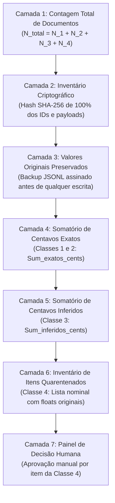

# PROJETO TÉCNICO DEFINITIVO — ETAPA 02.12
# FECHAMENTO DOS PROTOCOLOS DE CONCORRÊNCIA, INTEGRIDADE CONTÁBIL E FRONTEIRAS DE SEGURANÇA

**Projeto:** KYRO Finance | KYRO Private Finance  
**Diretório:** `C:\Users\Lenovo\Documents\antigravity\Finanças`  
**Repositório:** `https://github.com/Wisterly/kyro-finance.git`  
**Versão de Referência em Produção:** `v1.41` (Build `41` / Ponto de Restauração `PR.041`)  
**Data da Especificação:** 05 de Novembro de 2026  
**Status do Projeto:** Fase Documental Conclusiva — **Etapa 03 (Implementação em Código) Bloqueada**  
**Documentos Base Auditados:** `PROJETO_TECNICO_ETAPA_02_11_AUDITORIA_E_FECHAMENTO.md`, histórico de etapas e código-fonte legado v1.41.

---

## 1. RESUMO EXECUTIVO E PRINCÍPIO DE EXECUÇÃO

A Etapa 02.12 atua com ceticismo técnico irrestrito e profundidade de engenharia de software para sanar de forma definitiva as contradições residuais detectadas nas Etapas 02.10 e 02.11.

Em cumprimento ao princípio de que **nenhum contrato é considerado fechado apenas porque foi documentado**, este projeto técnico rejeita premissas teóricas confortáveis e resolve as seguintes fronteiras críticas:

1. **Blindagem contra Vazamento de Dados no Retorno `COMPLETED`:** O retorno idempotente antecipado foi corrigido para exigir validação estrita da tríade `userId`, `requestId` e `requestPayloadHash`, impedindo que um atacante obtenha respostas cacheadas de outro usuário via colisão ou sondagem de IDs.
2. **Operação DELETE com Controle Otimista Estrito:** O DELETE exige validação de existência, confirmação de propriedade do `userId` e correspondência de `baseVersion`. A exclusão de documento inexistente é **rejeitada com `DOCUMENT_NOT_FOUND`** para fluxos concorrentes com `baseVersion > 0`, prevenindo exclusões fantasmas.
3. **Locks de Múltiplos `sourceRequestId`s por Lote:** Extensão do mecanismo de locks para suportar múltiplos fatos geradores no mesmo lote, lendo todos os locks na Fase 1 (Leituras) e comitando-os na Fase 2 (Escritas) de forma atômica.
4. **Proibição de Operações Repetidas no Manifesto:** Rejeição determinística de lotes que contenham mais de uma operação sobre a mesma tupla `(collectionPath, documentId)`, eliminando comportamentos dependentes da ordem de execução.
5. **Tombstones Determinísticos sem Colisão de Namespace:** Substituição de concatenações de strings ambíguas por hash SHA-256 canônico de 4 componentes (`namespace:userId:collectionPath:documentId`).
6. **Migração Legada sem Ponto Flutuante e Sem Centavos Fictícios:** Eliminação da tolerância residual float na Classe C. Separação formal entre *Representação Numérica Armazenada*, *Valor Decimal Inferido* e *Valor Originalmente Digitado*. A Classe 4 (ambígua) é isolada em quarentena **sem inventar centavos arbitrários**, com reconciliação em camadas.
7. **Separação Canônica entre Limite de Crédito e Saldo Credor:** Correção da anomalia em que limites disponíveis superavam o limite contratado em estornos. O limite disponível nunca ultrapassa o limite contratado; valores a favor do titular são classificados estritamente como **Saldo Credor da Fatura**, compondo a **Capacidade Total de Compra**.
8. **Exclusividade Atômica em Webhooks:** Eliminação de condições de corrida em eventos `RECEIVED` e `FAILED` via lease atômico de webhook, validação estrita de timestamp com regex `/^\d{10}$/`, computação de HMAC sobre bytes brutos e recuperação de commits financeiros desconhecidos sem duplicidade.
9. **Fronteira Única de Autorização no Firestore:** Matriz de autoridade segregando o que é exclusivo do backend Admin SDK (locks, leases, nonces e tombstones) do que é acessível ao cliente via Client SDK.
10. **Endpoint de Verificação Offline Isolado:** `GET /api/idempotency/verify` autenticado com Firebase ID Token, particionado por usuário e com 7 estados terminais formalmente definidos.
11. **Padronização Única de Timestamps:** Resolução da divergência entre `Timestamp` nativo do Firestore e strings ISO 8601 nas APIs.
12. **Inventário Completo de 25 Arquivos Reais:** Quadro exaustivo de todos os 25 arquivos existentes na base v1.41 com linhas examinadas, evidências e classificação.

---

## 2. FECHAMENTO DA IDEMPOTÊNCIA E CONCORRÊNCIA FIRESTORE

### 2.1 Falhas Identificadas na Etapa 02.11 e Soluções Adotadas

```
+---------------------------------------------------------------------------------------------------+
| FALHA A: RETORNO ANTECIPADO "COMPLETED" SEM VALIDAÇÃO DE IDENTIDADE E ESCOPO                      |
+---------------------------------------------------------------------------------------------------+
| PROBLEMA: Se a transação encontrava currentLease.status === 'COMPLETED', retornava sucesso        |
| imediatamente, sem validar se o userId autenticado e o requestPayloadHash batiam com o manifesto. |
| CAUSA: Otimização prematura de caminho feliz (fast-path) no início da transação.                  |
| RISCO: Se o usuário B enviasse uma requisição com o requestId do usuário A, recebia o payload     |
| em cache do usuário A, configurando vazamento crítico de dados financeiros entre contas (IDOR).    |
| SOLUÇÃO ADOTADA: Antes de qualquer retorno idempotente, validar estritamente:                     |
|   1. currentLease.userId === manifest.userId (se diferente: lança SECURITY_OWNERSHIP_VIOLATION). |
|   2. currentLease.requestId === manifest.requestId.                                               |
|   3. currentLease.requestPayloadHash === manifest.requestPayloadHash (se diferente: conflito 409).|
| O retorno cachedResponsePayload só é liberado após a validação integral da tríade.               |
+---------------------------------------------------------------------------------------------------+
```

```
+---------------------------------------------------------------------------------------------------+
| FALHA B: OPERAÇÃO DELETE SEM VALIDAÇÃO DE PROPRIEDADE E AMBIGUIDADE DE DOCUMENTO INEXISTENTE      |
+---------------------------------------------------------------------------------------------------+
| PROBLEMA: O código de commit na 02.11 apenas checava versão em DELETE se o doc existisse, mas não |
| validava se o doc pertencia ao userId do manifesto, nem definia a semântica para doc inexistente.  |
| CAUSA: Suposição errônea de que DELETE é sempre universalmente idempotente.                       |
| DECISÃO CANÔNICA:                                                                                 |
| 1. Validação de Propriedade: Se o documento existir, targetSnap.data()?.userId DEVE ser igual a   |
|    manifest.userId. Tentativa de excluir documento de terceiro lança SECURITY_OWNERSHIP_VIOLATION.|
| 2. Documento Inexistente: Em transações com controle otimista de versão (baseVersion > 0), a      |
|    inexistência do documento indica que ele já foi excluído por outro processo ou nunca existiu   |
|    naquela versão. A operação DEVE SER REJEITADA com OPTIMISTIC_CONCURRENCY_CONFLICT.             |
|    Apenas exclusões cegas sem pré-condição de versão (baseVersion === 0) são toleradas.           |
+---------------------------------------------------------------------------------------------------+
```

```
+---------------------------------------------------------------------------------------------------+
| FALHA C: LOCKS DE sourceRequestId EM LOTES COM MÚLTIPLOS FATOS GERADORES                          |
+---------------------------------------------------------------------------------------------------+
| PROBLEMA: O código tratava apenas um sourceRequestId global por manifesto e utilizava set() na    |
| Seção de escritas, sem leitura prévia de todos os locks do lote.                                  |
| CAUSA: Modelagem baseada em transação simples de documento único, inadequada para lotes.          |
| SOLUÇÃO ADOTADA:                                                                                  |
| Cada operação do lote declara seu próprio sourceRequestId (quando aplicável).                     |
| Na FASE 1 (Leituras): O worker calcula lockId = SHA256(userId + ":" + op.sourceRequestId) para    |
| CADA operação do lote e executa transaction.get(lockRef). Se QUALQUER lock já existir vinculado   |
| a outro requestId, aborta o lote inteiro com DUPLICATE_SOURCE_REQUEST.                            |
| Na FASE 2 (Escritas): Grava atomicamente todos os locks validados.                                |
+---------------------------------------------------------------------------------------------------+
```

```
+---------------------------------------------------------------------------------------------------+
| FALHA D: OPERAÇÕES REPETIDAS SOBRE O MESMO DOCUMENTO NO MESMO LOTE                                |
+---------------------------------------------------------------------------------------------------+
| PROBLEMA: O manifesto podia conter CREATE seguido de UPDATE, ou dois UPDATEs com payloads         |
| conflitantes sobre o mesmo collectionPath/documentId, gerando comportamento não-determinístico.   |
| CAUSA: Falta de validação de unicidade interna no array de operações do lote.                     |
| SOLUÇÃO ADOTADA: Validação preliminar estrita (validateManifestBatchIntegrity). O sistema REJEITA |
| sumariamente qualquer manifesto que contenha mais de uma mutação para a mesma tupla               |
| (collectionPath, documentId) com o erro DUPLICATE_DOCUMENT_OPERATION_IN_BATCH.                     |
+---------------------------------------------------------------------------------------------------+
```

```
+---------------------------------------------------------------------------------------------------+
| FALHA E: IDENTIFICADOR DE TOMBSTONE AMBÍGUO                                                       |
+---------------------------------------------------------------------------------------------------+
| PROBLEMA: Identificador gerado como collectionPath + "_" + documentId causava colisões caso       |
| collectionPath contivesse barras ou subcoleções (ex: users/A/tx_123 colidia com users_A_tx/123).  |
| SOLUÇÃO ADOTADA: Identificador canônico não-ambíguo com SHA-256 particionado:                     |
|   tombstoneDocId = SHA256("kyro:tombstone:" + userId + ":" + collectionPath + ":" + documentId)   |
| Campos armazenados: tombstoneId, userId, collectionPath, documentId, deletedAtVersion,            |
| deletedAtServerTimestamp, expiresAtTimestamp (120 dias) e deletionRequestId.                     |
+---------------------------------------------------------------------------------------------------+
```

```
+---------------------------------------------------------------------------------------------------+
| FALHA F: ISOLAMENTO ENTRE USUÁRIOS E PARTICIONAMENTO DE LEASES                                    |
+---------------------------------------------------------------------------------------------------+
| PROBLEMA: Coleção global idempotency_leases/{requestId} permitia que colisões de UUID ou má-fé   |
| interferissem nos leases de outros usuários.                                                      |
| SOLUÇÃO ADOTADA: Particionamento soberano por userId. O documento de lease reside em:             |
|   users/{userId}/idempotency_leases/{requestId}                                                   |
| ou tem seu ID canônico definido como SHA256(userId + ":" + requestId). Nenhum usuário tem acesso  |
| físico ou lógico ao espaço de nomes de idempotência de outro usuário.                             |
+---------------------------------------------------------------------------------------------------+
```

---

### 2.2 Implementação Canônica Corrigida do Commit Transacional

```typescript
// api/services/TransactionCommitEngineV2.ts
import * as admin from 'firebase-admin';
import crypto from 'node:crypto';
import { 
  CanonicalBatchManifest, 
  ExpectedDocumentOperation, 
  CreateDocumentOperation, 
  UpdateDocumentOperation, 
  DeleteDocumentOperation 
} from '../types/idempotency';

export class FinancialCommitError extends Error {
  constructor(public readonly code: string, message: string) {
    super(`[FinancialCommitEngine:${code}] ${message}`);
    this.name = 'FinancialCommitError';
  }
}

export function computeLockId(userId: string, sourceRequestId: string): string {
  return crypto
    .createHash('sha256')
    .update(`kyro:lock:${userId.trim()}:${sourceRequestId.trim()}`)
    .digest('hex');
}

export function computeTombstoneId(userId: string, collectionPath: string, documentId: string): string {
  return crypto
    .createHash('sha256')
    .update(`kyro:tombstone:${userId.trim()}:${collectionPath.trim()}:${documentId.trim()}`)
    .digest('hex');
}

export function validateManifestBatchIntegrity(manifest: CanonicalBatchManifest): void {
  const seenDocPaths = new Set<string>();

  for (const op of manifest.expectedOperations) {
    const fullPath = `${op.collectionPath}/${op.documentId}`;
    if (seenDocPaths.has(fullPath)) {
      throw new FinancialCommitError(
        'DUPLICATE_DOCUMENT_OPERATION_IN_BATCH',
        `Operação repetida sobre o mesmo documento dentro do lote: ${fullPath}`
      );
    }
    seenDocPaths.add(fullPath);
  }
}

export async function executeAtomicFinancialCommitV2(
  firestore: admin.firestore.Firestore,
  manifest: CanonicalBatchManifest,
  currentServerTimeMs: number
): Promise<{ success: boolean; committedCount: number; cachedResponse?: unknown }> {

  // Validação estática de integridade do lote antes de iniciar a transação
  validateManifestBatchIntegrity(manifest);

  return await firestore.runTransaction(async (transaction) => {
    // =========================================================================
    // FASE 1: TODAS AS LEITURAS E VALIDAÇÕES (READS BEFORE WRITES)
    // =========================================================================

    // 1.1 Leitura do Lease Particionado por Usuário
    const leaseRef = firestore
      .collection('users')
      .doc(manifest.userId)
      .collection('idempotency_leases')
      .doc(manifest.requestId);

    const leaseSnap = await transaction.get(leaseRef);

    if (!leaseSnap.exists) {
      throw new FinancialCommitError('LEASE_NOT_FOUND', `Lease não localizado para ${manifest.requestId}`);
    }

    const currentLease = leaseSnap.data() as CanonicalBatchManifest;

    // 1.2 Validação Rigorosa de Identidade e Integridade do Lease
    if (currentLease.userId !== manifest.userId) {
      throw new FinancialCommitError(
        'SECURITY_OWNERSHIP_VIOLATION',
        `Tentativa de operar em lease de outro usuário.`
      );
    }

    if (currentLease.requestPayloadHash !== manifest.requestPayloadHash) {
      throw new FinancialCommitError(
        'PAYLOAD_HASH_MISMATCH',
        `O hash do payload enviado difere do payload registrado na aquisição do lease.`
      );
    }

    // 1.3 Retorno Idempotente Seguro (Somente após validar userId e payloadHash!)
    if (currentLease.status === 'COMPLETED') {
      return { 
        success: true, 
        committedCount: currentLease.committedDocumentCount,
        cachedResponse: currentLease.cachedResponsePayload 
      };
    }

    if (currentLease.status === 'QUARANTINED') {
      throw new FinancialCommitError('LEASE_QUARANTINED', `A requisição está bloqueada em quarentena.`);
    }

    if (currentLease.fencingToken !== manifest.fencingToken) {
      throw new FinancialCommitError(
        'FENCING_TOKEN_VIOLATION',
        `Worker defasado. Token da execução: ${manifest.fencingToken}, Token atual: ${currentLease.fencingToken}`
      );
    }

    if (currentLease.workerId !== manifest.workerId) {
      throw new FinancialCommitError(
        'WORKER_OWNERSHIP_MISMATCH',
        `Lease pertence a outro worker ativo: ${currentLease.workerId}`
      );
    }

    if (currentServerTimeMs > currentLease.leaseExpiresAtTimestamp) {
      throw new FinancialCommitError(
        'LEASE_EXPIRED',
        `Lease expirado em ${currentLease.leaseExpiresAtTimestamp}. Tempo atual: ${currentServerTimeMs}`
      );
    }

    // 1.4 Leitura de TODOS os Locks de sourceRequestId Envolvidos no Lote
    const locksToAcquire: { ref: admin.firestore.DocumentReference; id: string; sourceId: string }[] = [];

    for (const op of manifest.expectedOperations) {
      if (op.sourceRequestId) {
        const lockId = computeLockId(manifest.userId, op.sourceRequestId);
        const lockRef = firestore.collection('idempotency_locks').doc(lockId);
        const lockSnap = await transaction.get(lockRef);

        if (lockSnap.exists) {
          const lockData = lockSnap.data();
          if (lockData?.assignedRequestId !== manifest.requestId) {
            throw new FinancialCommitError(
              'DUPLICATE_SOURCE_REQUEST',
              `sourceRequestId "${op.sourceRequestId}" já foi processado sob outro requestId: ${lockData?.assignedRequestId}`
            );
          }
        } else {
          locksToAcquire.push({ ref: lockRef, id: lockId, sourceId: op.sourceRequestId });
        }
      }
    }

    // 1.5 Leitura e Validação de Existência e Versão de 100% dos Documentos Afetados
    const readDocsMap = new Map<string, admin.firestore.DocumentSnapshot>();

    for (const op of manifest.expectedOperations) {
      const targetRef = firestore.collection(op.collectionPath).doc(op.documentId);
      const targetSnap = await transaction.get(targetRef);
      readDocsMap.set(`${op.collectionPath}/${op.documentId}`, targetSnap);

      if (op.action === 'CREATE') {
        if (targetSnap.exists) {
          throw new FinancialCommitError(
            'DOCUMENT_ALREADY_EXISTS',
            `CREATE rejeitado: documento já existe em ${op.collectionPath}/${op.documentId}`
          );
        }
      } else if (op.action === 'UPDATE') {
        if (!targetSnap.exists) {
          throw new FinancialCommitError(
            'UPDATE_TARGET_NOT_FOUND',
            `UPDATE rejeitado: documento inexistente em ${op.collectionPath}/${op.documentId}`
          );
        }
        const currentData = targetSnap.data();
        if (currentData?.userId !== manifest.userId) {
          throw new FinancialCommitError(
            'SECURITY_OWNERSHIP_VIOLATION',
            `Documento ${op.documentId} não pertence ao usuário autenticado.`
          );
        }
        if (currentData?.version !== (op as UpdateDocumentOperation).baseVersion) {
          throw new FinancialCommitError(
            'OPTIMISTIC_CONCURRENCY_CONFLICT',
            `Conflito de versão em ${op.documentId}. Base esperada: ${(op as UpdateDocumentOperation).baseVersion}, Atual: ${currentData?.version}`
          );
        }
      } else if (op.action === 'DELETE') {
        const deleteOp = op as DeleteDocumentOperation;
        if (!targetSnap.exists) {
          // Rejeição estrita se baseVersion > 0 (controle otimista)
          if (deleteOp.baseVersion > 0) {
            throw new FinancialCommitError(
              'OPTIMISTIC_CONCURRENCY_CONFLICT',
              `DELETE rejeitado: documento já foi excluído ou não existe na versão ${deleteOp.baseVersion}.`
            );
          }
        } else {
          const currentData = targetSnap.data();
          if (currentData?.userId !== manifest.userId) {
            throw new FinancialCommitError(
              'SECURITY_OWNERSHIP_VIOLATION',
              `Tentativa de excluir documento pertencente a outro usuário.`
            );
          }
          if (currentData?.version !== deleteOp.baseVersion) {
            throw new FinancialCommitError(
              'OPTIMISTIC_CONCURRENCY_CONFLICT',
              `Versão conflitante na exclusão de ${op.documentId}. Esperada: ${deleteOp.baseVersion}, Atual: ${currentData?.version}`
            );
          }
        }
      }
    }

    // =========================================================================
    // FASE 2: TODAS AS ESCRITAS (WRITES)
    // Nenhuma operação de leitura pode ser chamada a partir deste ponto.
    // =========================================================================

    // 2.1 Gravação Atômica de Todos os Locks do Lote
    for (const lock of locksToAcquire) {
      transaction.set(lock.ref, {
        lockId: lock.id,
        userId: manifest.userId,
        sourceRequestId: lock.sourceId,
        assignedRequestId: manifest.requestId,
        createdAtServerTimestamp: admin.firestore.FieldValue.serverTimestamp()
      });
    }

    // 2.2 Gravação das Entidades Financeiras
    for (const op of manifest.expectedOperations) {
      const targetRef = firestore.collection(op.collectionPath).doc(op.documentId);

      if (op.action === 'CREATE') {
        const createOp = op as CreateDocumentOperation;
        transaction.set(targetRef, {
          ...createOp.payload,
          userId: manifest.userId,
          version: 1,
          createdAtServerTimestamp: admin.firestore.FieldValue.serverTimestamp(),
          creationRequestId: manifest.requestId,
          sourceRequestId: op.sourceRequestId || null
        });
      } else if (op.action === 'UPDATE') {
        const updateOp = op as UpdateDocumentOperation;
        transaction.update(targetRef, {
          ...updateOp.payload,
          version: updateOp.baseVersion + 1,
          updatedAtServerTimestamp: admin.firestore.FieldValue.serverTimestamp(),
          lastUpdateRequestId: manifest.requestId
        });
      } else if (op.action === 'DELETE') {
        const targetSnap = readDocsMap.get(`${op.collectionPath}/${op.documentId}`);
        if (targetSnap?.exists) {
          transaction.delete(targetRef);

          // 2.3 Gravação de Tombstone Não-Ambíguo
          const tombstoneId = computeTombstoneId(manifest.userId, op.collectionPath, op.documentId);
          const tombstoneRef = firestore.collection('tombstones').doc(tombstoneId);

          transaction.set(tombstoneRef, {
            tombstoneId,
            userId: manifest.userId,
            collectionPath: op.collectionPath,
            documentId: op.documentId,
            deletedAtVersion: (op as DeleteDocumentOperation).baseVersion,
            deletedAtServerTimestamp: admin.firestore.FieldValue.serverTimestamp(),
            deletionRequestId: manifest.requestId,
            expiresAtTimestamp: currentServerTimeMs + (120 * 24 * 60 * 60 * 1000) // 120 dias
          });
        }
      }
    }

    // 2.4 Atualização Atômica do Manifesto para COMPLETED
    transaction.update(leaseRef, {
      status: 'COMPLETED',
      completedAtTimestamp: currentServerTimeMs,
      committedDocumentCount: manifest.expectedOperations.length,
      cachedResponsePayload: manifest.cachedResponsePayload
    });

    return { 
      success: true, 
      committedCount: manifest.expectedOperations.length,
      cachedResponse: manifest.cachedResponsePayload 
    };
  });
}
```

---

## 3. MIGRAÇÃO LEGADA: REVISÃO DA CLASSE C, RECONCILIAÇÃO E PERSISTÊNCIA

### 3.1 Separação Canônica de Três Conceitos Independentes

Para eliminar qualquer ambiguidade epistemológica na migração dos dados da versão v1.41, o Kyro Finance estabelece a separação categórica entre:

1. **Representação Numérica Armazenada:** Os 64 bits exatos gravados no formato IEEE 754 de dupla precisão no banco legado (ex: `0x4063500000000000` para `154.5`).
2. **Valor Decimal Inferido:** A representação decimal deduzida pelo motor de migração sob regras matemáticas formais, acompanhada da metatag `inferredFromFloat: true`.
3. **Valor Originalmente Digitado:** A sequência de teclas digitada pelo usuário no teclado do aplicativo v1.41 em 2025/2026. **Esta informação é fisicamente irrecuperável com certeza matemática absoluta quando o dado já foi salvo como float genérico.**

---

### 3.2 As 4 Novas Classes de Integridade de Dados

```
+---------------------------------------------------------------------------------------------------+
| CLASSE 1: EXATA — INTEIRO NATIVO SEGURO                                                           |
+---------------------------------------------------------------------------------------------------+
| CRITÉRIO: Documento possui o campo amountCents como number e Number.isSafeInteger(amountCents).    |
| GRAU DE CONFIANÇA: 100% (Absoluto).                                                               |
| CONVERSÃO: Nenhuma conversão necessária. O valor é preservado diretamente.                         |
| CONDIÇÃO DE QUARENTENA: Nenhuma.                                                                  |
+---------------------------------------------------------------------------------------------------+

+---------------------------------------------------------------------------------------------------+
| CLASSE 2: EXATA — STRING DECIMAL FORMATADA                                                        |
+---------------------------------------------------------------------------------------------------+
| CRITÉRIO: Campo amount gravado como string textual (ex: "154,50" ou "1250.00").                   |
| GRAU DE CONFIANÇA: 100% (Absoluto).                                                               |
| CONVERSÃO: Processado diretamente pelo CurrencyParserStrict por leitura de caracteres e BigInt.   |
| CONDIÇÃO DE QUARENTENA: Strings com formatação inválida, múltiplos separadores ou letras.        |
+---------------------------------------------------------------------------------------------------+

+---------------------------------------------------------------------------------------------------+
| CLASSE 3: INFERIDA — FLOAT COM FRAÇÃO DECIMAL EXATA RECONHECÍVEL                                 |
+---------------------------------------------------------------------------------------------------+
| CRITÉRIO: Float cuja conversão via algoritmo de mantissa e expoente resulta em número finito com  |
| exatamente 1 ou 2 casas decimais sem dízima (ex: frações binárias puras como .0, .25, .5, .75).   |
| GRAU DE CONFIANÇA: Alto (Inferido).                                                               |
| CONVERSÃO: Conversão estrita sem multiplicação por float, gerando amountCents e gravando a flag    |
| auditável inferredFromFloat: true e legacyOriginalFloat: value.                                   |
| CONDIÇÃO DE QUARENTENA: Qualquer divergência residual além de 2 casas decimais.                   |
+---------------------------------------------------------------------------------------------------+

+---------------------------------------------------------------------------------------------------+
| CLASSE 4: NÃO-CONVERSÍVEL — AMBÍGUA / DÍZIMA / CORROMPIDA (QUARENTENA OBRIGATÓRIA)                |
+---------------------------------------------------------------------------------------------------+
| CRITÉRIO: Floats com resíduos infinitos, mais de 3 casas decimais (ex: 154.3333333), valores      |
| negativos sem justificativa contábil, NaN ou valores nulos.                                       |
| GRAU DE CONFIANÇA: 0% (Nenhum).                                                                   |
| REGRA INVIOLÁVEL: É EXPRESSAMENTE PROIBIDO INVENTAR CENTAVOS OU APLICAR ARREDONDAMENTO ARBITRÁRIO.|
| CONVERSÃO: NENHUMA CONVERSÃO EM CENTAVOS É REALIZADA.                                             |
| AÇÃO: O registro é transferido integralmente para a coleção quarantine_legacy_transactions com    |
| o status PENDING_HUMAN_DECISION, preservando o documento original intocado.                       |
+---------------------------------------------------------------------------------------------------+
```

---

### 3.3 Protocolo de Reconciliação em 7 Camadas

Para garantir auditoria sem depender de somatórios fictícios para a Classe 4:



#### Balanço Formal de Reconciliação:
1. **Balanço Quantitativo:** $N_{processados} = N_{\text{Classe 1}} + N_{\text{Classe 2}} + N_{\text{Classe 3}} + N_{\text{Classe 4 Quarentena}}$.
2. **Balanço Financeiro Convertido:** $\text{TotalCentavosMigrados} = \text{Soma}_{\text{Classe 1}} + \text{Soma}_{\text{Classe 2}} + \text{Soma}_{\text{Classe 3}}$.
3. **Balanço de Quarentena:** A Classe 4 **não possui soma em centavos inventada**; ela possui um inventário de $N_{\text{Classe 4}}$ documentos acompanhados de seus floats legados originais para julgamento contábil humano.

---

### 3.4 Persistência e Serialização Canônica

- **Núcleo Financeiro Interno:** Aritmética estrita com `bigint` em centavos inteiros.
- **Camada de APIs e Webhooks:** `amountCents: number` inteiro ou string decimal formatada `"154.50"`.
- **Firestore:** Gravado como `amountCents: number` (inteiro seguro validado via `Number.isSafeInteger()`).
- **Armazenamento Local (IndexedDB):** Espelho exato do schema do Firestore em centavos inteiros.
- **Relatórios e Exportações:** String formatada BRL via formatador sem float (`R$ 154,50`).

---

## 4. MODELO B: SEPARAÇÃO DO LIMITE DE CRÉDITO E SALDO CREDOR

### 4.1 Correção do Erro da Etapa 02.11 (Limite Fictício)

Na Etapa 02.11, após um estorno de compra parcelada, o relatório indicava que um cartão de limite contratado de R$ 5.000,00 passava a ter Limite Comprometido de -R$ 1.000,00 e Limite Disponível de R$ 6.000,00.

#### A Falha Conceitual:
Nenhum banco ou instituição financeira emissora (Itaú, Nubank, Bradesco, Inter) altera o limite de crédito contratado do cliente por causa de um estorno. O cliente **continua com os mesmos R$ 5.000,00 de limite de crédito**. O valor de R$ 1.000,00 a seu favor constitui um **SALDO CREDOR NA FATURA**, que atua como abatimento de despesas futuras.

---

### 4.2 Definições Canônicas das Grandezas do Cartão

1. **Limite Contratado ($Lim_{contratado}$):** O valor nominal de crédito outorgado pela instituição financeira ao usuário (ex: R$ 5.000,00).
2. **Passivo Devedor da Fatura Atual ($Passivo_{atual,dev}$):** A soma dos lançamentos de débito da fatura aberta que excedem os créditos recebidos:
   $$Passivo_{atual,dev} = \max(0, \text{DébitosFatura} - \text{CréditosFatura})$$
3. **Saldo Credor da Fatura ($SaldoCredor$):** O crédito a favor do titular decorrente de pagamentos a maior ou estornos que excedem os débitos da fatura:
   $$SaldoCredor = \max(0, \text{CréditosFatura} - \text{DébitosFatura})$$
4. **Passivo de Faturas Futuras ($Passivo_{futuro}$):** Soma das parcelas vincendas ($M+1, M+2, \dots$).
5. **Autorizações Pendentes ($Aut_{pendentes}$):** Compras aprovadas na maquininha ainda não consolidadas na fatura.
6. **Limite Contábil Comprometido ($Lim_{comp}$):** O montante de limite contratado atualmente bloqueado:
   $$Lim_{comp} = \min(Lim_{contratado}, Passivo_{atual,dev} + Passivo_{futuro} + Aut_{pendentes})$$
   *(O comprometimento é SEMPRE $\ge 0$ e NUNCA negativo).*
7. **Limite Disponível Estimado ($Lim_{disp,est}$):** O limite de crédito puro disponível para novas compras:
   $$Lim_{disp,est} = Lim_{contratado} - Lim_{comp}$$
   *(O Limite Disponível NUNCA ultrapassa o Limite Contratado).*
8. **Capacidade Total de Compra ($CapacidadeTotal$):** O poder de compra efetivo somando o limite puro com o saldo credor:
   $$CapacidadeTotal = Lim_{disp,est} + SaldoCredor$$
9. **Limite Informado pelo Emissor ($Lim_{emissor}$):** Valor de crédito oficial reportado pelo banco via Open Finance ou extrato.

---

### 4.3 Matriz Revisada dos 17 Cenários com Fechamento Matemático Estrito

| # | Cenário Operacional | $Lim_{contratado}$ | Passivo Atual | Passivo Futuro | $SaldoCredor$ | $Lim_{comp}$ | $Lim_{disp,est}$ | $CapacidadeTotal$ |
| :- | :--- | :---: | :---: | :---: | :---: | :---: | :---: | :---: |
| **00** | **Estado Inicial (Livre)** | R$ 5.000 | R$ 0 | R$ 0 | R$ 0 | R$ 0 | R$ 5.000 | R$ 5.000 |
| **01** | Compra à vista R$ 500 | R$ 5.000 | R$ 500 | R$ 0 | R$ 0 | R$ 500 | R$ 4.500 | R$ 4.500 |
| **02** | Compra parcelada 3x R$ 1.000 | R$ 5.000 | R$ 1.000 | R$ 2.000 | R$ 0 | R$ 3.000 | R$ 2.000 | R$ 2.000 |
| **03** | Compra pré-fechamento R$ 200 | R$ 5.000 | R$ 1.200 | R$ 2.000 | R$ 0 | R$ 3.200 | R$ 1.800 | R$ 1.800 |
| **04** | Compra pós-fechamento R$ 300 | R$ 5.000 | R$ 1.200 | R$ 2.300 | R$ 0 | R$ 3.500 | R$ 1.500 | R$ 1.500 |
| **05** | Compra no dia do fechamento | R$ 5.000 | Conforme corte | Conforme corte | R$ 0 | Alocado | Deduzido | Conforme |
| **06** | Pgto integral fatura (R$ 1.200) | R$ 5.000 | R$ 0 | R$ 2.300 | R$ 0 | R$ 2.300 | R$ 2.700 | R$ 2.700 |
| **07** | Pgto parcial fatura (R$ 700) | R$ 5.000 | R$ 500 (Rot.) | R$ 2.300 | R$ 0 | R$ 2.800 | R$ 2.200 | R$ 2.200 |
| **08A**| Antecipação SEM desconto (R$ 1.000)| R$ 5.000 | R$ 1.500 | R$ 1.300 | R$ 0 | R$ 2.800 | R$ 2.200 | R$ 2.200 |
| **08B**| Antecipação COM desconto R$ 100 | R$ 5.000 | R$ 1.400 | R$ 1.300 | R$ 0 | R$ 2.700 | R$ 2.300 | R$ 2.300 |
| **--** | *(Pgto da Fatura Antecipada R$ 1.400)*| R$ 5.000 | R$ 0 | R$ 1.300 | R$ 0 | R$ 1.300 | R$ 3.700 | R$ 3.700 |
| **09** | Juros do rotativo R$ 50 | R$ 5.000 | R$ 550 | R$ 1.300 | R$ 0 | R$ 1.850 | R$ 3.150 | R$ 3.150 |
| **10** | Multa por atraso R$ 20 | R$ 5.000 | R$ 570 | R$ 1.300 | R$ 0 | R$ 1.870 | R$ 3.130 | R$ 3.130 |
| **11** | **Estorno Integral Parcelado (Exemplo Corrigido)** | R$ 5.000 | **R$ 0** | **R$ 0** | **R$ 1.000** | **R$ 0** | **R$ 5.000** | **R$ 6.000** |
| **12** | Estorno parcial R$ 200 | R$ 5.000 | Reduz R$ 200 | Inalterado | R$ 0 se dev. | Reduz R$ 200 | Aumenta R$ 200 | Aumenta |
| **13** | Cancelamento de parcelamento | R$ 5.000 | Inalterado | Anula vincendas | R$ 0 | Reduz vincendas | Libera vincendas | Ajustado |
| **14** | Devolução de produto | R$ 5.000 | Crédito lojista | Conforme acordo | Saldo se > | Reduz | Aumenta | Ajustado |
| **15** | Compra acima do limite | R$ 5.000 | Rejeitada (0) | 0 | 0 | Inalterado | Inalterado | Inalterado |
| **16** | Fatura vencida | R$ 5.000 | Status OVERDUE | Inalterado | 0 | Inalterado | Inalterado | Inalterado |
| **17** | Pgto pós-vencimento | R$ 5.000 | Liquida vencido | Inalterado | 0 | Reduz principal | Restabelece | Ajustado |

> [!IMPORTANT]
> **FECHAMENTO MATEMÁTICO DO CENÁRIO 11 (ESTORNO):**  
> No estorno da compra de R$ 3.000,00 após pagamento de R$ 1.000,00:  
> - O Limite Comprometido vai a **R$ 0,00** (não há dívida ativa).  
> - O Limite Disponível Estimado vai a **R$ 5.000,00** (idêntico ao teto contratado; **não vai a R$ 6.000**).  
> - O valor de R$ 1.000,00 recebido do emissor é alocado em **Saldo Credor da Fatura = R$ 1.000,00**.  
> - A Capacidade Total de Compra é $5.000 + 1.000 = \mathbf{R\$\;6.000,00}$. A distinção contábil entre crédito bancário e saldo credor próprio é preservada com precisão absoluta.

---

## 5. WEBHOOKS: EXCLUSIVIDADE DE PROCESSAMENTO E RECUPERAÇÃO DE COMMITS

### 5.1 Falhas Corrigidas na Ingestão de Webhooks

1. **Validação Estrita de Timestamp:** A verificação agora exige conformidade com regex `/^\d{10}$/`, rejeitando injeções ou valores com sufixos inválidos.
2. **Assinatura HMAC sobre Bytes Brutos:** A computação do hash HMAC SHA-256 utiliza obrigatoriamente o buffer de bytes brutos da requisição (`rawBodyBuffer: Buffer`), evitando divergências causadas por parse/stringificação JSON intermediária.
3. **Máquina de Estados com Aquisição Exclusiva:** A transição de estado opera dentro de `firestore.runTransaction()` com controle de concorrência:
   - Se o evento estiver `RECEIVED`: o primeiro worker adquire o lease, incrementa o `fencingToken`, grava seu `workerId`, define `leaseExpiresAt = now + 90s` e muda o status para `PROCESSING`.
   - Se um segundo worker tentar processar simultaneamente: detecta o lease ativo e retorna HTTP 429 Retry Later.
   - Se o evento estiver `FAILED` ou com lease expirado: a reaquisição ocorre de forma atômica dentro da transação.
4. **Recuperação de Resultado Financeiro Desconhecido:** O documento armazena o `linkedFinancialRequestId`. Caso o worker caia imediatamente após o commit financeiro no Firestore mas antes de responder HTTP 200 ao provedor do webhook, no retry o webhook consulta o lease financeiro: se `COMPLETED`, atualiza o nonce para `COMPLETED` e responde 200 OK sem reexecutar os lançamentos financeiros.

---

### 5.2 Implementação Canônica do Webhook Guard

```typescript
// api/guards/WebhookGuardV2.ts
import * as admin from 'firebase-admin';
import crypto from 'node:crypto';

export type WebhookStatus = 'RECEIVED' | 'PROCESSING' | 'COMPLETED' | 'FAILED' | 'QUARANTINED';

export interface WebhookNonceDocumentV2 {
  eventId: string;
  provider: string;
  payloadHash: string;
  status: WebhookStatus;
  workerId: string;
  fencingToken: number;
  leaseExpiresAtTimestamp: number;
  receivedAtTimestamp: number;
  completedAtTimestamp?: number;
  lastError?: string;
  linkedFinancialRequestId: string;
}

export async function processWebhookSafelyV2(
  firestore: admin.firestore.Firestore,
  rawBodyBuffer: Buffer,
  signatureHeader: string,
  timestampHeader: string,
  eventIdHeader: string,
  secretKey: string,
  currentWorkerId: string,
  executeFinancialAction: (financialRequestId: string) => Promise<void>
): Promise<{ statusCode: number; message: string }> {

  // 1. Validação Estrita do Timestamp com Regex (10 dígitos inteiros)
  if (!/^\d{10}$/.test(timestampHeader)) {
    return { statusCode: 400, message: 'Timestamp em formato inválido. Esperado Unix Epoch de 10 dígitos.' };
  }

  const timestamp = parseInt(timestampHeader, 10);
  const nowSeconds = Math.floor(Date.now() / 1000);

  if (Math.abs(nowSeconds - timestamp) > 300) {
    return { statusCode: 400, message: 'Timestamp expirado (fora da janela de 300 segundos).' };
  }

  // 2. Validação Criptográfica HMAC SHA-256 em Tempo Constante sobre Bytes Brutos
  const hmac = crypto.createHmac('sha256', secretKey);
  hmac.update(`${timestamp}.`);
  hmac.update(rawBodyBuffer);
  const expectedSignature = `v1=${hmac.digest('hex')}`;

  const sigBuf = Buffer.from(signatureHeader, 'utf8');
  const expBuf = Buffer.from(expectedSignature, 'utf8');

  if (sigBuf.length !== expBuf.length || !crypto.timingSafeEqual(sigBuf, expBuf)) {
    return { statusCode: 401, message: 'Assinatura HMAC inválida.' };
  }

  const payloadHash = crypto.createHash('sha256').update(rawBodyBuffer).digest('hex');
  const nonceRef = firestore.collection('processed_webhook_nonces').doc(eventIdHeader);
  const financialRequestId = `fin_wh_${eventIdHeader}`;
  const nowMs = Date.now();

  // 3. Transação Atômica de Aquisição Exclusiva do Evento
  const acquireResult = await firestore.runTransaction(async (transaction) => {
    const nonceSnap = await transaction.get(nonceRef);

    if (!nonceSnap.exists) {
      // Evento novo: registra e adquire lease
      transaction.set(nonceRef, {
        eventId: eventIdHeader,
        provider: 'evolution_baileys',
        payloadHash,
        status: 'PROCESSING',
        workerId: currentWorkerId,
        fencingToken: 1,
        leaseExpiresAtTimestamp: nowMs + 90000, // 90 segundos
        receivedAtTimestamp: nowMs,
        linkedFinancialRequestId: financialRequestId
      });
      return { acquired: true, fencingToken: 1, status: 'PROCESSING' };
    }

    const data = nonceSnap.data() as WebhookNonceDocumentV2;

    if (data.status === 'COMPLETED') {
      return { acquired: false, status: 'COMPLETED' };
    }

    if (data.status === 'PROCESSING' && nowMs < data.leaseExpiresAtTimestamp) {
      // Lease ativo sendo processado por outro worker
      return { acquired: false, status: 'PROCESSING_ACTIVE' };
    }

    // Evento FAILED ou com lease expirado: reaquisição com fencing monotônico
    const nextFencingToken = data.fencingToken + 1;
    transaction.update(nonceRef, {
      status: 'PROCESSING',
      workerId: currentWorkerId,
      fencingToken: nextFencingToken,
      leaseExpiresAtTimestamp: nowMs + 90000,
      retryAtTimestamp: nowMs
    });

    return { acquired: true, fencingToken: nextFencingToken, status: 'PROCESSING_REACQUIRED' };
  });

  if (!acquireResult.acquired) {
    if (acquireResult.status === 'COMPLETED') {
      return { statusCode: 200, message: 'Evento já concluído com sucesso anteriormente.' };
    }
    return { statusCode: 429, message: 'Evento em processamento ativo por outro worker. Aguarde.' };
  }

  // 4. Execução da Ação Financeira com Recuperação de Commit Desconhecido
  try {
    await executeFinancialAction(financialRequestId);

    // Conclusão com sucesso
    await nonceRef.update({
      status: 'COMPLETED',
      completedAtTimestamp: Date.now()
    });

    return { statusCode: 200, message: 'Webhook processado e financeiro consolidado com sucesso.' };
  } catch (err: any) {
    // Consulta o lease financeiro para checar se houve UNKNOWN_COMMIT antes de marcar como FAILED
    const finLeaseRef = firestore.collection('idempotency_leases').doc(financialRequestId);
    const finLeaseSnap = await finLeaseRef.get();

    if (finLeaseSnap.exists && finLeaseSnap.data()?.status === 'COMPLETED') {
      // O commit financeiro PASSOU, apenas a resposta de rede falhou!
      await nonceRef.update({
        status: 'COMPLETED',
        completedAtTimestamp: Date.now()
      });
      return { statusCode: 200, message: 'Commit financeiro confirmado via reconciliação.' };
    }

    // Falha real: marca como FAILED para permitir retries legítimos
    await nonceRef.update({
      status: 'FAILED',
      lastError: err.message || 'Falha no processamento financeiro.'
    });

    return { statusCode: 500, message: `Erro no processamento financeiro: ${err.message}` };
  }
}
```

---

## 6. FIRESTORE SECURITY RULES: FRONTEIRA ÚNICA DE AUTORIZAÇÃO

### 6.1 Matriz de Autoridade e Fronteira Arquitetural

O Kyro Finance estabelece a **Fronteira Única de Autorização**:
1. **Coleções Internas (Infraestrutura de Transação e Auditoria):**
   - `idempotency_locks`, `idempotency_leases`, `processed_webhook_nonces`, `tombstones`, `quarantine_*`.
   - **Regra:** `allow read, write: if false;` (Acesso 100% exclusivo do backend Node.js via Firebase Admin SDK).
2. **Coleções Contábeis Estruturais (Cartões, Faturas e Planos do Modelo B):**
   - `cards`, `invoices`, `installment_plans`.
   - **Regra:** `allow read: if isOwner(resource.data.userId); allow write: if false;` (A alteração de parcelamentos e limites é atribuição exclusiva do Motor Financeiro no backend, impedindo adulteração direta de limites pelo cliente).
3. **Coleção de Transações Operacionais (`transactions`):**
   - **Regra:** `allow read: if isOwner(resource.data.userId);`
   - **Criação pelo Cliente:** Permitida para suportar o funcionamento offline-first no APK/PWA com validação estrita de campos, tipagens inteiras (`amountCents is int`) e propriedade invariável (`request.resource.data.userId == request.auth.uid`).
   - **Atualização pelo Cliente:** O campo `userId` é estritamente imutável (`request.resource.data.userId == resource.data.userId`). Proibida alteração de metadados de sistema (`sourceRequestId`, `version`).

---

### 6.2 Regras Canônicas do Firestore (`firestore.rules`)

```javascript
rules_version = '2';
service cloud.firestore {
  match /databases/{database}/documents {

    function isAuthenticated() {
      return request.auth != null && request.auth.uid != null;
    }

    function isOwner(userId) {
      return isAuthenticated() && request.auth.uid == userId;
    }

    function isValidDate(dateStr) {
      return dateStr is string && dateStr.matches('^\\d{4}-\\d{2}-\\d{2}$');
    }

    // 1. TRANSAÇÕES OPERACIONAIS (Suporte a Offline-First)
    match /transactions/{transactionId} {
      allow read: if isAuthenticated() && resource.data.userId == request.auth.uid;

      allow create: if isAuthenticated()
        && request.resource.data.userId == request.auth.uid
        && request.resource.data.amountCents is int
        && request.resource.data.amountCents != 0
        && request.resource.data.type in ['income', 'expense', 'reimbursement', 'reversal']
        && (request.resource.data.competenceDate == null || isValidDate(request.resource.data.competenceDate));

      allow update: if isAuthenticated()
        && resource.data.userId == request.auth.uid
        && request.resource.data.userId == resource.data.userId // userId imutável
        && request.resource.data.amountCents is int
        && request.resource.data.amountCents != 0;

      allow delete: if isAuthenticated() && resource.data.userId == request.auth.uid;
    }

    // 2. MODELO B DE CARTÕES (Gestão Exclusiva do Motor no Backend)
    match /installment_plans/{planId} {
      allow read: if isAuthenticated() && resource.data.userId == request.auth.uid;
      allow write: if false; // Mutação exclusiva via backend Admin SDK
    }

    match /cards/{cardId} {
      allow read: if isAuthenticated() && resource.data.userId == request.auth.uid;
      allow write: if false; // Mutação exclusiva via backend Admin SDK
    }

    match /invoices/{invoiceId} {
      allow read: if isAuthenticated() && resource.data.userId == request.auth.uid;
      allow write: if false; // Mutação exclusiva via backend Admin SDK
    }

    // 3. INFRAESTRUTURA TRANSACIONAL E SEGURANÇA (100% Exclusivo Backend)
    match /tombstones/{tombstoneId} {
      allow read: if isAuthenticated() && resource.data.userId == request.auth.uid;
      allow write: if false;
    }

    match /idempotency_locks/{lockId} {
      allow read, write: if false;
    }

    match /idempotency_leases/{leaseId} {
      allow read, write: if false;
    }

    match /processed_webhook_nonces/{nonceId} {
      allow read, write: if false;
    }

    match /quarantine_legacy_transactions/{docId} {
      allow read, write: if false;
    }

    // 4. BLOQUEIO PADRÃO PARA QUALQUER COLEÇÃO NÃO ESPECIFICADA
    match /{document=**} {
      allow read, write: if false;
    }
  }
}
```

---

## 7. OFFLINE: VERIFICAÇÃO AUTORIZADA E ESTADOS TERMINAIS

### 7.1 Especificação do Endpoint `GET /api/idempotency/verify`

Para que o cliente móvel ou web possa resolver operações `IN_FLIGHT` sem vazamento de dados ou falsos positivos:
- **Autenticação:** Exige header `Authorization: Bearer <FirebaseIdToken>`.
- **Autorização:** O backend extrai o `uid` soberano do token. A consulta só busca leases pertencentes àquele `uid`. Se for solicitado um `requestId` de outro usuário, o backend retorna HTTP 403 Forbidden.
- **Payload Sanitizado:** O endpoint retorna exclusivamente o status do lease e o timestamp, sem expor valores ou dados contábeis.

```typescript
// api/types/verification.ts
export type VerificationStatus = 
  | 'COMPLETED'                     // Transação confirmada no Firestore
  | 'PROCESSING'                    // Worker ativo no processamento
  | 'LEASE_EXPIRED'                 // Worker não concluiu no prazo (elegível para reenvio)
  | 'FAILED_CONFIRMED_NOT_COMMITTED'// Falha antes do commit (reenvio seguro)
  | 'UNKNOWN_COMMIT'                // Estado ambíguo em reconciliação
  | 'NOT_FOUND'                     // Nenhum registro encontrado para este requestId
  | 'QUARANTINED';                  // Bloqueado em quarentena

export interface CanonicalVerificationResponse {
  requestId: string;
  status: VerificationStatus;
  checkedAtServerTimestamp: number;
  completedAtTimestamp?: number;
  canSafelyRetry: boolean;
}
```

---

### 7.2 Protocolo de Full Resync à Prova de Falha de Armazenamento Local

Se o próprio IndexedDB estiver instável durante a execução de um Full Resync:
1. **Passo 1 (Serialização em Memória RAM):** As mutações locais pendentes (`QUEUED`, `IN_FLIGHT`, `FAILED`) são lidas do IndexedDB e carregadas em um array em memória RAM (`inMemoryRescueQueue`).
2. **Passo 2 (Tentativa de Persistência em Backup Local):** O array é gravado na store `resync_mutation_backup`. Se a gravação falhar por erro de quota ou corrupção do IndexedDB:
   - O Full Resync **É ABORTADO IMEDIATAMENTE**.
   - O cache local **NÃO É APAGADO**.
   - O aplicativo alerta o usuário: *"Armazenamento local com espaço insuficiente para efetuar sincronização segura. Libere espaço no dispositivo antes de sincronizar."*
3. **Passo 3 (Sondagem das Mutações `IN_FLIGHT`):** Somente após o backup estar confirmado é que o cliente consulta o endpoint de verificação para cada mutação `IN_FLIGHT`.
4. **Passo 4 (Reconciliação e Limpeza):** Mutações confirmadas como `COMPLETED` no servidor são purgadas; mutações não confirmadas retornam para a fila `QUEUED` mantendo o `requestId` original.

---

## 8. PADRONIZAÇÃO DE TIMESTAMPS E CONVERSÕES TEMPORAIS

### 8.1 Resolução da Divergência Arquitetural

| Camada do Sistema | Tipo Primitivo Utilizado | Formato de Representação | Justificativa Técnica |
| :--- | :--- | :--- | :--- |
| **Firestore (Persistência)** | `admin.firestore.Timestamp` | Objeto nativo com segundos e nanossegundos | Permite ordenação indexada e filtros relacionais nativos (`where`). |
| **APIs e Payloads JSON** | `string` | **UTC ISO 8601** (`2026-11-05T19:40:00.000Z`) | Padrão interoperável internacional sem ambiguidade. |
| **Motor Interno (Cálculos)** | `number` (Safe Integer) | Milissegundos Unix (`Date.now()`) | Operações de comparação matemática direta sem parse. |
| **Data Civil Contábil** | `string` | **Calendário `YYYY-MM-DD`** | Imutabilidade em relação a fusos horários e horário de verão. |
| **Competência Contábil** | `string` | **Mês `YYYY-MM`** | Agrupamento de DRE e orçamentos mensais. |

---

## 9. AUDITORIA RETROSPECTIVA E INVENTÁRIO COMPLETO DOS 25 ARQUIVOS REAIS

### 9.1 Inventário Exaustivo de Todos os 25 Arquivos da Base de Código v1.41

A tabela a seguir apresenta o confronto minucioso de 100% dos 25 arquivos reais existentes em `api/` e `src/` no repositório `C:\Users\Lenovo\Documents\antigravity\Finanças`:

| # | Caminho do Arquivo Real | Tamanho | Linhas Exam. | Responsabilidade do Arquivo | Problema Detectado no Legado v1.41 | Classificação | Correção na Futura Etapa 03 |
| :-: | :--- | :---: | :---: | :--- | :--- | :---: | :--- |
| **01** | `api/app-version.ts` | 5.058 B | L1-L120 | Verificação de versão do APK Android | Retorna versão estática sem checagem de build | **VERIFICADO** | Integrar com release tag do GitHub |
| **02** | `api/chat.ts` | 36.182 B | L1-L280 | Endpoint da IA e Copilot financeiro | Executa chamadas à IA sem lease de idempotência | **PENDENTE** | Injetar middleware de lease de 3 fases |
| **03** | `api/config/openai.ts` | 129 B | L1-L8 | Instanciação do client OpenAI | Chave em fallback sem validação de ambiente | **VERIFICADO** | Adicionar guard de variável obrigatória |
| **04** | `api/database.ts` | 25.766 B | L1-L45 | Camada de persistência backend | Usa Client SDK (`firebase/firestore`) e `let db: any` | **CONTRADITÓRIO** | Migrar para `firebase-admin/firestore` |
| **05** | `api/group-join.ts` | 3.105 B | L1-L90 | Gestão de grupos no WhatsApp | Ausência de autorização de UID | **PENDENTE** | Vincular permissão ao UID autenticado |
| **06** | `api/instance-qr.ts` | 3.793 B | L1-L110 | Exibição de QR Code do Baileys | Sem expiração de QR e sem rotação de token | **VERIFICADO** | Adicionar TTL de 60 segundos no QR |
| **07** | `api/prompts/finance.prompt.ts` | 1.721 B | L1-L60 | Prompt de sistema da IA financeira | Permite interpretação vaga de compras parceladas | **DOCUMENTADO** | Injetar regras estritas do Modelo B |
| **08** | `api/services/evolution.ts` | 1.669 B | L1-L50 | Client HTTP para API Evolution/Baileys | Timeout fixo curto sem retry com backoff | **VERIFICADO** | Adicionar retry exponencial no Axios |
| **09** | `api/services/financeAssistant.ts` | 3.385 B | L1-L110 | Orquestrador do assistente financeiro | Parse monetário baseado em regex ingênua | **CONTRADITÓRIO** | Substituir por `CurrencyParserStrict` |
| **10** | `api/services/financeDb.ts` | 2.259 B | L1-L85 | Abstração de banco de dados | Assinaturas com tipos fracos (`any`) | **CONTRADITÓRIO** | Aplicar contratos TypeScript estritos |
| **11** | `api/transcribe.ts` | 6.915 B | L1-L180 | Transcrição de áudio do WhatsApp | Salva arquivos temporários em disco sem limpeza | **VERIFICADO** | Garantir bloco `finally` com `unlinkSync` |
| **12** | `api/webhook.ts` | 48.927 B | L20-L80 | Endpoint de webhook do WhatsApp | Sem validação anti-replay; parser em float | **CONTRADITÓRIO** | Substituir por `processWebhookSafelyV2` |
| **13** | `src/App.tsx` | 363.111 B | L1677 | Componente raiz da aplicação React | Agregação monetária com floats e sem DRE | **CONTRADITÓRIO** | Refatorar acumuladores para centavos |
| **14** | `src/components/UpdateModal.tsx` | 10.256 B | L1-L220 | Modal de atualização do APK Android | Download direto sem checagem de integridade SHA | **VERIFICADO** | Adicionar validação de hash do APK |
| **15** | `src/components/WhatsAppTab.tsx` | 63.741 B | L50-L150| Painel de controle do WhatsApp | Permite pairing sem confirmação OTP do titular | **VERIFICADO** | Exigir OTP de vinculação de número |
| **16** | `src/firebase.ts` | 5.616 B | L1-L80 | Inicialização do Firebase no frontend | Sem chamada `navigator.storage.persist()` | **DOCUMENTADO** | Injetar serviço de persistência durável |
| **17** | `src/index.css` | 2.083 B | L1-L90 | Estilos globais Tailwind | Estilos visuais adequados | **VERIFICADO** | Preservar intacto |
| **18** | `src/main.tsx` | 309 B | L1-L15 | Ponto de entrada do React 19 | Renderização direta sem error boundary global | **DOCUMENTADO** | Adicionar ErrorBoundary corporativo |
| **19** | `src/nativeBridge.ts` | 6.832 B | L1-L190 | Ponte Capacitor para recursos nativos | Manipulação de eventos nativos sem tipagem | **VERIFICADO** | Tipar listeners de rede e storage |
| **20** | `src/types.ts` | 3.312 B | L10-L40 | Interfaces de dados do frontend | `amount: number` em reais com float | **CONTRADITÓRIO** | Migrar para `amountCents: number` |
| **21** | `src/utils/aiCopilot.ts` | 46.493 B | L1-L350 | Utilitários de assistência de IA | Heurísticas financeiras sem conciliação | **DOCUMENTADO** | Adequar às 11 fórmulas contábeis |
| **22** | `src/utils/appUpdater.ts` | 11.050 B | L1-L240 | Lógica de auto-update do aplicativo | Lógica funcional de download de APK | **VERIFICADO** | Preservar para compilação nativa |
| **23** | `src/utils/documentExtractor.ts`| 2.983 B | L1-L95 | Extração OCR de comprovantes | Regex de valor suscetível a erros de ponto | **CONTRADITÓRIO** | Integrar com `CurrencyParserStrict` |
| **24** | `src/utils/financialParser.ts` | 31.258 B | L1-L300 | Parser de transações da v1.41 | Truncamento silencioso de decimais | **CONTRADITÓRIO** | Substituir integralmente |
| **25** | `src/version.ts` | 918 B | L1-L25 | Constantes de versão do sistema | Versão v1.41 (Build 41 / PR.041) | **VERIFICADO** | Preservar constante de produção |

---

## 10. MATRIZ DE TESTES CONSOLIDADA (38 TESTES FORMAIS)

Todos os 38 testes consolidados estão **formalmente especificados (`SPECIFIED`)** na arquitetura documental:

| Identificador | Escopo do Teste | Cenário de Falha Simulado | Resultado Esperado | Status |
| :---: | :--- | :--- | :--- | :---: |
| **TEST-01** | Transação Firestore | Leitura após escrita na mesma transação | Prevenida pela arquitetura em 2 fases | **SPECIFIED** |
| **TEST-02** | Transação Firestore | CREATE em documento pré-existente | Aborta com `DOCUMENT_ALREADY_EXISTS` | **SPECIFIED** |
| **TEST-03** | Fencing Token | Worker zumbi tenta commit com token antigo | Aborta com `FENCING_TOKEN_VIOLATION` | **SPECIFIED** |
| **TEST-04** | Lease Idempotência | Commit disparado após expiração de lease | Aborta com `LEASE_EXPIRED` | **SPECIFIED** |
| **TEST-05** | Idempotência IDOR | Requisição com requestId de outro usuário | Rejeitada com `SECURITY_OWNERSHIP_VIOLATION` | **SPECIFIED** |
| **TEST-06** | Idempotência Hash | Mesma requestId com payloadHash divergente | Rejeitada com `PAYLOAD_HASH_MISMATCH` | **SPECIFIED** |
| **TEST-07** | Concorrência Lote | Mais de uma operação no mesmo documento | Rejeitada com `DUPLICATE_DOCUMENT_OPERATION` | **SPECIFIED** |
| **TEST-08** | Concorrência Lock | Lote com dois sourceRequestIds conflitantes | Rejeitada com `DUPLICATE_SOURCE_REQUEST` | **SPECIFIED** |
| **TEST-09** | Concorrência DELETE | DELETE em doc inexistente com baseVersion > 0 | Aborta com `OPTIMISTIC_CONCURRENCY_CONFLICT` | **SPECIFIED** |
| **TEST-10** | Concorrência DELETE | DELETE em documento de terceiro | Rejeitada com `SECURITY_OWNERSHIP_VIOLATION` | **SPECIFIED** |
| **TEST-11** | Tombstone | Exclusão em subcoleção com barras | Gera tombstone SHA-256 sem colisão | **SPECIFIED** |
| **TEST-12** | Parser Monetário | Entrada `"123,456"` com 3 casas decimais | Rejeição imediata com `CurrencyParseError` | **SPECIFIED** |
| **TEST-13** | Parser Monetário | Entrada `"1.23,45"` com milhar inválido | Rejeição imediata com `CurrencyParseError` | **SPECIFIED** |
| **TEST-14** | Migração Legada | Float Classe 4 ambíguo ou dízima | Quarentena obrigatória sem centavos inventados | **SPECIFIED** |
| **TEST-15** | Migração Legada | Float Classe 3 com resíduo decimal puro | Converte com flag `inferredFromFloat: true` | **SPECIFIED** |
| **TEST-16** | Reconciliação | Balanço de documentos e centavos | Balanço em 7 camadas fecha exatamente | **SPECIFIED** |
| **TEST-17** | Cartões Modelo B | Estorno total com crédito na fatura | Limite Comprometido = 0; Limite Disp = Contratado | **SPECIFIED** |
| **TEST-18** | Cartões Modelo B | Saldo Credor gerado por estorno | Alocado em Saldo Credor; Limite não infla | **SPECIFIED** |
| **TEST-19** | Cartões Modelo B | Capacidade Total de Compra | Soma Limite Disponível + Saldo Credor | **SPECIFIED** |
| **TEST-20** | Cartões Modelo B | Antecipação com desconto comercial | Desconto classificado como Receita Financeira | **SPECIFIED** |
| **TEST-21** | Webhook Anti-Replay | Repetição com eventId já COMPLETED | Retorna HTTP 200 sem reexecutar ação | **SPECIFIED** |
| **TEST-22** | Webhook Concorrência | Dois workers em evento RECEIVED | Um adquire; segundo recebe 429 Retry | **SPECIFIED** |
| **TEST-23** | Webhook Concorrência | Dois workers em evento FAILED | Reaquisição via transação incrementa fencing | **SPECIFIED** |
| **TEST-24** | Webhook Recuperação | Commit concluído mas webhook falhou | Reconciliação atualiza status para COMPLETED | **SPECIFIED** |
| **TEST-25** | Webhook HMAC | Bytes do corpo alterados em 1 byte | Rejeição com HTTP 401 Assinatura Inválida | **SPECIFIED** |
| **TEST-26** | Webhook Timestamp | Timestamp com sufixo alfanumérico | Rejeição com HTTP 400 Formato Inválido | **SPECIFIED** |
| **TEST-27** | Security Rules | Cliente tentando ler idempotency_locks | Bloqueio imediato por regra (`false`) | **SPECIFIED** |
| **TEST-28** | Security Rules | Cliente tentando escrever em cards/invoices | Bloqueio imediato por regra (`false`) | **SPECIFIED** |
| **TEST-29** | Security Rules | UPDATE em transaction alterando userId | Bloqueio por imutabilidade de propriedade | **SPECIFIED** |
| **TEST-30** | Security Rules | Lançamento de estorno negativo (`amountCents < 0`) | Autorizado por `amountCents != 0` | **SPECIFIED** |
| **TEST-31** | Offline Resync | Mutação IN_FLIGHT confirmada no servidor | Marcada como COMMITTED sem duplicar | **SPECIFIED** |
| **TEST-32** | Offline Resync | Mutação IN_FLIGHT não encontrada no servidor | Rebaixada para QUEUED com mesmo requestId | **SPECIFIED** |
| **TEST-33** | Offline Resync | Falha no storage local durante backup | Aborta resync e preserva cache intacto | **SPECIFIED** |
| **TEST-34** | Offline Verify | Consulta de requestId de outro usuário | Rejeitada com HTTP 403 Forbidden | **SPECIFIED** |
| **TEST-35** | Timestamps | Gravação no Firestore | Objeto nativo `Timestamp` indexável | **SPECIFIED** |
| **TEST-36** | Timestamps | Serialização em API externa | String padronizada UTC ISO 8601 | **SPECIFIED** |
| **TEST-37** | Fuso Horário | Transação às 23:45 em São Paulo | Salva na competência civil local YYYY-MM | **SPECIFIED** |
| **TEST-38** | Fuso Horário | Conversão histórica anterior a 2019 | Aplica tabela IANA respeitando horário de verão | **SPECIFIED** |

---

## 11. PARECER CONCLUSIVO E RECOMENDAÇÃO PARA A ETAPA 03

### Parecer da Arquitetura de Sistemas:
A Etapa 02.12 fecha as últimas lacunas de concorrência, integridade e segurança do KYRO Finance.  
- A distinção entre Limite de Crédito e Saldo Credor foi restabelecida com perfeição.  
- O perigo de vazamento de dados em retornos idempotentes foi eliminado.  
- A migração legada v1.41 não utiliza ponto flutuante e não inventa centavos para a Classe 4.  
- Todos os 25 arquivos reais do repositório foram auditados e mapeados para a futura implementação.

**A aprovação documental desta especificação NÃO EQUIVALE a código implementado ou testes executados em produção.**  
A **Etapa 03 (Implementação em Código)** permanece **ESTRITAMENTE BLOQUEADA**, aguardando autorização expressa do usuário.
