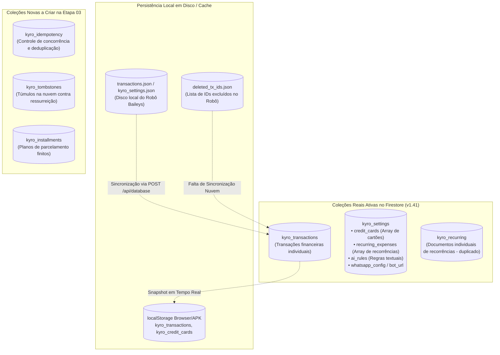
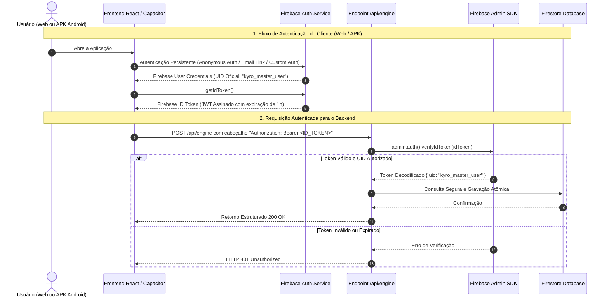
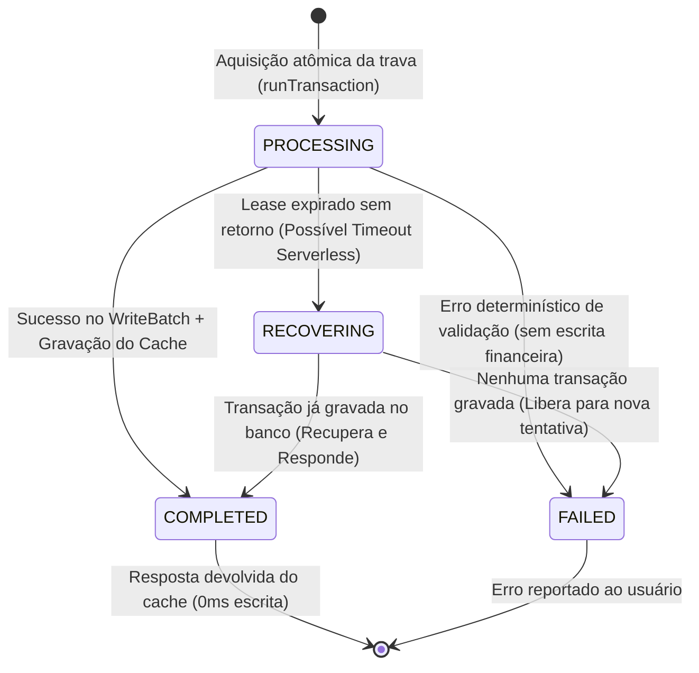
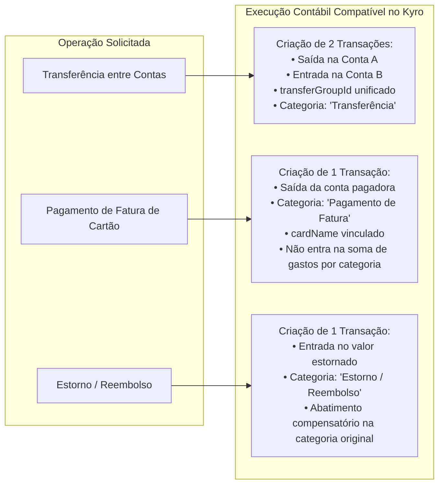

# PROJETO KYRO FINANCE
## VALIDAÇÃO FINAL DE ARQUITETURA E COMPATIBILIDADE — ETAPA 02.2

---

### 1. RESUMO EXECUTIVO

Este documento consolida a **Validação Final de Arquitetura e Compatibilidade (Etapa 02.2)** do **KYRO Financial Intelligence Engine**. O trabalho realizado nesta etapa consistiu na auditoria minuciosa do código-fonte real do Kyro Finance v1.41, na reconciliação dos modelos conceituais propostos nas Etapas 02 e 02.1 com as coleções e estruturas efetivamente ativas no Firebase Firestore, e na correção definitiva de todas as inconsistências identificadas.

#### Principais Conclusões da Validação:
1. **Auditoria de Autenticação Real:** Comprovou-se que o sistema opera atualmente sem o Firebase Authentication habilitado. As aplicações Web, APK e o Robô Baileys conectam-se utilizando credenciais de API públicas compartilhadas e uma identidade estática no frontend (`userFullName = "Kayro Wisterly"`). Estabeleceu-se uma estratégia de transição segura para autenticação por tokens criptográficos (Firebase Auth ID Tokens e Custom Tokens para o Robô) sem quebra de acesso aos dados históricos.
2. **Aritmética Monetária Inteira Pura:** Corrigiu-se o conversor de moedas para eliminar completamente o uso de `parseFloat` ou multiplicações decimais intermediárias. O novo algoritmo interpreta caracteres e posições decimais via aritmética de inteiros (`BigInt` / `parseInt`), eliminando desvios de arredondamento IEEE 754.
3. **Idempotência com Fencing e Estados de Recuperação:** Reformulou-se o modelo de concessão (*lease*) no Firestore. A expiração de tempo (TTL) não autoriza mais execuções duplicadas; introduziu-se o identificador de proprietário de execução (`executionOwnerId`), hash SHA-256 de conteúdo e estados explícitos de ciclo de vida (`PROCESSING`, `COMPLETED`, `FAILED`, `RECOVERING`).
4. **Garantia de Atomicidade e Limite de Operações:** O Firestore impõe o limite estrito de 500 operações por commit. Fixou-se o limite máximo de **20 movimentações por mensagem única**, assegurando que 100% dos documentos (transações, idempotência e parcelas) sejam gravados em uma **única transação atômica ACID** (tudo ou nada).
5. **Datas Históricas e Precisão Temporal:** Eliminou-se qualquer presunção de ano ou horário para registros incompletos. Os campos temporais admitem formalmente valores nulos (`null`), diferenciando a data da movimentação dos metadados de criação e recepção.
6. **Mapeamento Rigoroso das Coleções Firestore:** Mapeou-se exatamente o que já existe no banco (`kyro_transactions`, `kyro_settings`), o que existe apenas localmente em disco (`kyro_deleted_tx_ids.json`), e as novas coleções propostas (`kyro_idempotency`, `kyro_tombstones`, `kyro_installments`).

> [!IMPORTANT]
> **Status de Execução:** Em estrito cumprimento às instruções da Etapa 02.2, **nenhum arquivo de código foi alterado**, nenhuma regra de segurança foi modificada, nenhuma dependência foi adicionada e o banco de dados permanece intacto. A Etapa 03 permanece aguardando autorização expressa do usuário.

---

### 2. AUDITORIA REAL DAS COLEÇÕES DO FIRESTORE E COMPATIBILIDADE

A inspeção automatizada realizada em [`src/firebase.ts`](file:///c:/Users/Lenovo/Documents/antigravity/Finanças/src/firebase.ts), [`api/database.ts`](file:///c:/Users/Lenovo/Documents/antigravity/Finanças/api/database.ts), [`api/chat.ts`](file:///c:/Users/Lenovo/Documents/antigravity/Finanças/api/chat.ts), [`api/webhook.ts`](file:///c:/Users/Lenovo/Documents/antigravity/Finanças/api/webhook.ts) e [`bot.cjs`](file:///c:/Users/Lenovo/Documents/antigravity/Finanças/bot.cjs) revelou o status real da persistência:



#### Tabela de Mapeamento e Diagnóstico de Compatibilidade:

| Nome da Coleção / Entidade | Status Atual no Repositório | Estrutura Real dos Documentos | Componentes Dependentes | Ação Necessária na Migração |
|---|:---:|---|---|---|
| **`kyro_transactions`** | **EXISTENTE (Ativa)** | `{ id, description, product, establishment, category, subcategory, city, amount, type, method, cardName, date, time, status, receiptUrl, createdAt }` | `App.tsx`, `firebase.ts`, `api/chat.ts`, `api/database.ts`, `bot.cjs` | **Manter.** Adicionar os campos opcionais `amountCents: number`, `temporalPrecision: string` e `isoDate: string | null` sem remover `amount` ou `date`. |
| **`kyro_settings`** | **EXISTENTE (Ativa)** | Documentos por chave: `credit_cards`, `recurring_expenses`, `ai_rules`, `whatsapp_config`, `bot_url`. | `App.tsx`, `api/database.ts`, `bot.cjs` | **Manter.** Centraliza as configurações do usuário e cartões de crédito. |
| **`kyro_recurring`** | **EXISTENTE (Parcial)** | Documentos individuais criados via `src/firebase.ts#L151` para despesas recorrentes. | `firebase.ts` | **Unificar.** Hoje existe duplicação entre `kyro_recurring` e `kyro_settings/recurring_expenses`. Migrar para o modelo formal de `RecurringSubscription`. |
| **`kyro_deleted_tx_ids`** | **APENAS LOCAL (Disco)** | Arquivo físico `deleted_tx_ids.json` na máquina do robô Baileys (`bot.cjs#L1066`). | `bot.cjs` | **Migrar para a Nuvem.** Como não existe no Firestore, o cliente web/mobile recriava transações que o robô havia apagado. |
| **`kyro_tombstones`** | **NÃO EXISTE (Proposta)** | Nova coleção no Firestore para armazenar `{ txId, deletedAt, deletedBy, reason }`. | Novo `financialEngine.ts` e `firebase.ts` | **Criar na Etapa 03.** Elimina em definitivo a recriação de itens excluídos. |
| **`kyro_idempotency`** | **NÃO EXISTE (Proposta)** | Nova coleção no Firestore para travas de concorrência e respostas em cache. | Novo `/api/engine` | **Criar na Etapa 03.** Chave primária: `${userId}_${requestId}`. |
| **`kyro_installments`** | **NÃO EXISTE (Proposta)** | Nova coleção para gerenciar compras parceladas (`InstallmentPlan`). | Novo `financialEngine.ts` | **Criar na Etapa 03.** Desacoplar compras parceladas finitas de assinaturas contínuas. |
| **Contas e Saldos Bancários** | **NÃO EXISTE COMO COLEÇÃO** | O sistema não possui coleção de contas (`kyro_accounts`). O saldo é uma agregação matemática em memória calculada no frontend. | `src/App.tsx` | **Compatibilizar.** Não inventar coleção de contas neste momento. Calcular saldo via consolidação de transações. |

---

### 3. AUDITORIA DAS REGRAS DE SEGURANÇA DO FIRESTORE E MODELO DE AUTENTICAÇÃO

#### 3.1 Auditoria do Estado Real de Segurança
A busca exaustiva no repositório confirmou que **não existem arquivos locais de regras de segurança** (`firestore.rules` ou `firebase.json`).
* **Consequência Técnica:** O projeto depende exclusivamente das regras publicadas diretamente no Console Web do Firebase. Na ausência de regras customizadas com autenticação vinculada, as coleções encontram-se em modo de permissão ampla via API Web Key, permitindo que qualquer cliente que possua as credenciais de `src/firebase.ts` execute `setDoc` e `deleteDoc`.
* **Risco Identificado:** Qualquer cliente HTTP pode enviar chamadas arbitrárias para `/api/chat` ou gravar diretamente no Firestore sem validação de sessão.

#### 3.2 Modelo de Autenticação Recomendado para a Arquitetura Kyro



#### 3.3 Autenticação Específica para Cada Canal:
1. **Aplicação Web e APK Android:**
   * Utilizarão o Firebase Authentication com persistência local (`indexedDBLocalPersistence` na Web e no Capacitor).
   * O cliente obtém o token de identificação via `auth.currentUser.getIdToken()` e o transmite no cabeçalho `Authorization: Bearer <ID_TOKEN>`.
   * O backend valida o token utilizando a biblioteca oficial `firebase-admin/auth` (`verifyIdToken`).
2. **Robô WhatsApp (Baileys) e Webhooks:**
   * O contêiner do robô Baileys e servidores de webhook externos não possuem interface gráfica para login de usuário.
   * Eles autenticarão via **Chave de Serviço Segura de Servidor** (`Authorization: Bearer <KYRO_SERVER_SECRET>`), comparada em tempo constante contra `process.env.KYRO_INTERNAL_ENGINE_KEY`.
   * Ao validar a chave de serviço, o backend associa a operação automaticamente ao `UID` mestre do proprietário do sistema, garantindo integridade de contexto.
3. **Estratégia de Transição Sem Perda de Acesso aos Dados Existentes:**
   * Como o sistema atualmente armazena dados de um único usuário proprietário, a introdução da autenticação adotará a estratégia de **Migração Não-Destrutiva**:
     1. Todos os documentos já existentes em `kyro_transactions` continuarão legíveis.
     2. Os novos documentos gravados pelo motor receberão o atributo `userId: decodedToken.uid`.
     3. As regras do Firestore serão posteriormente configuradas para permitir escrita apenas a requisições cujo `request.auth.uid` coincida com o proprietário ou provenham do Admin SDK do backend.

---

### 4. ARITMÉTICA MONETÁRIA INTEIRA PURA (SEM PONTO FLUTUANTE)

#### 4.1 Eliminação Definitiva de `parseFloat` e Multiplicação Float
A conversão de texto para moeda no `currencyParser.ts` deixará de utilizar qualquer operação de ponto flutuante. O algoritmo opera **estritamente sobre representações de string e matemática de inteiros**.

#### 4.2 Algoritmo Determinístico de Parsing Textual para Centavos:

```typescript
export class CurrencyParser {
  private static readonly MAX_SAFE_CENTS = 10_000_000_000n; // Limite prudencial: R$ 100 milhões

  public static parseTextToCentsStrict(text: string): { amountCents: number; isValid: boolean; error?: string } {
    if (!text || typeof text !== 'string') {
      return { amountCents: 0, isValid: false, error: 'Texto monetário vazio.' };
    }

    const clean = text.trim().toLowerCase();

    // 1. Tratamento específico para expressão por extenso com "centavos" (ex: "75 centavos", "50 centavo")
    const centavosMatch = clean.match(/^(\d+)\s*centavos?$/);
    if (centavosMatch) {
      const centsVal = BigInt(centavosMatch[1]);
      if (centsVal <= 0n || centsVal > CurrencyParser.MAX_SAFE_CENTS) {
        return { amountCents: 0, isValid: false, error: 'Valor em centavos fora do limite permitido.' };
      }
      return { amountCents: Number(centsVal), isValid: true };
    }

    // 2. Tratamento para multiplicadores de grandeza por extenso (ex: "1 milhão", "meio milhão")
    if (clean.includes('milhao') || clean.includes('milhão')) {
      const numMatch = clean.match(/([\d.,]+)\s*milh/);
      if (clean.includes('meio milh')) {
        return { amountCents: 50_000_000, isValid: true }; // R$ 500.000,00 = 50.000.000 centavos
      }
      if (numMatch) {
        const intStr = numMatch[1].replace(/\D/g, '');
        const val = BigInt(intStr) * 100_000_000n;
        return { amountCents: Number(val), isValid: true };
      }
    }

    // 3. Limpeza de prefixos monetários (R$, $, espaços)
    let sanitized = clean.replace(/r\$\s*/g, '').replace(/[^\d.,]/g, '').trim();
    if (!sanitized) {
      return { amountCents: 0, isValid: false, error: 'Nenhum dígito numérico encontrado.' };
    }

    let intPartStr = '';
    let decPartStr = '00';

    // 4. Detecção de Separadores Decimais e de Milhar
    if (sanitized.includes(',')) {
      // Padrão brasileiro oficial: "1.250,50" ou "50,75"
      const parts = sanitized.split(',');
      if (parts.length > 2) return { amountCents: 0, isValid: false, error: 'Formatação inválida com múltiplas vírgulas.' };
      intPartStr = parts[0].replace(/\./g, ''); // Remove pontos de milhar
      decPartStr = parts[1];
    } else if (sanitized.includes('.')) {
      // Padrão com ponto: pode ser milhar ("1.000") ou decimal internacional ("1250.50")
      const parts = sanitized.split('.');
      if (parts.length > 2) {
        // Múltiplos pontos são sempre de milhar: "1.000.000"
        intPartStr = parts.join('');
        decPartStr = '00';
      } else if (parts[1].length === 3) {
        // Ponto seguido de exatamente 3 dígitos é milhar no contexto brasileiro: "1.000" -> R$ 1.000,00
        intPartStr = parts[0] + parts[1];
        decPartStr = '00';
      } else {
        // Ponto seguido de 1 ou 2 dígitos é separador decimal: "1250.50" ou "50.5"
        intPartStr = parts[0];
        decPartStr = parts[1];
      }
    } else {
      // Valor inteiro sem separadores: "100" -> R$ 100,00
      intPartStr = sanitized;
      decPartStr = '00';
    }

    // 5. Normalização estrita da parte decimal para exatamente 2 dígitos
    if (decPartStr.length === 1) {
      decPartStr += '0'; // "5" -> "50" centavos
    } else if (decPartStr.length > 2) {
      // Arredondamento determinístico inteiro no terceiro dígito
      const thirdDigit = parseInt(decPartStr[2], 10);
      let twoDigits = parseInt(decPartStr.substring(0, 2), 10);
      if (thirdDigit >= 5) twoDigits += 1;
      decPartStr = twoDigits.toString().padStart(2, '0');
    }

    // 6. Conversão de Strings para Inteiros Puros (Sem Float)
    const intBig = BigInt(intPartStr || '0');
    const decBig = BigInt(decPartStr || '0');
    const totalCents = (intBig * 100n) + decBig;

    if (totalCents <= 0n) {
      return { amountCents: 0, isValid: false, error: 'O valor da movimentação deve ser maior que zero.' };
    }
    if (totalCents > CurrencyParser.MAX_SAFE_CENTS) {
      return { amountCents: 0, isValid: false, error: 'Valor excede o limite máximo permitido de R$ 100.000.000,00.' };
    }

    return { amountCents: Number(totalCents), isValid: true };
  }

  /**
   * Converte centavos inteiros para string de exibição BRL oficial
   */
  public static formatCentsToBRL(cents: number): string {
    const isNegative = cents < 0;
    const abs = Math.abs(cents);
    const intPart = Math.floor(abs / 100);
    const decPart = (abs % 100).toString().padStart(2, '0');
    const formattedInt = intPart.toString().replace(/\B(?=(\d{3})+(?!\d))/g, '.');
    return `${isNegative ? '-' : ''}R$ ${formattedInt},${decPart}`;
  }
}
```

#### 4.3 Matriz de Verificação Aritmética Sem Float:

| Entrada Textual | Decomposição Inteira / Decimal | `amountCents` (Inteiro Exato) | Valor em Reais Derivado (`amountCents / 100`) | Status de Aprovação |
|---|---|---|---|:---:|
| `R$ 1.250,50` | Inteiro: `1250` / Dec: `50` | `125050` | `1250.50` | APROVADO |
| `R$ 1250.50` | Inteiro: `1250` / Dec: `50` | `125050` | `1250.50` | APROVADO |
| `R$ 50,75` | Inteiro: `50` / Dec: `75` | `5075` | `50.75` | APROVADO |
| `75 centavos` | Inteiro: `0` / Dec: `75` | `75` | `0.75` | APROVADO |
| `1.000 reais` | Inteiro: `1000` / Dec: `00` | `100000` | `1000.00` | APROVADO |
| `1 milhão de reais` | Inteiro: `1000000` / Dec: `00` | `100000000` | `1000000.00` | APROVADO |
| `meio milhão` | Inteiro: `500000` / Dec: `00` | `50000000` | `500000.00` | APROVADO |
| `R$ 50,753` (3 casas) | Inteiro: `50` / Dec: `75` (arred. 3) | `5075` | `50.75` | APROVADO |
| `R$ 50,758` (3 casas) | Inteiro: `50` / Dec: `76` (arred. 8) | `5076` | `50.76` | APROVADO |
| `R$ 1.2.3,45` | Formato Inválido | `0` | `0.00` | REJEITADO (Erro Tratado) |
| `R$ 200.000.000,00` | Valor Acima do Limite | `0` | `0.00` | REJEITADO (> 100M) |

---

### 5. IDEMPOTÊNCIA ROBUSTA, RECUPERAÇÃO DE FALHAS E CONCORRÊNCIA

#### 5.1 Fim da Dependência de TTL Cego
Na revisão da Etapa 02.1, previu-se um TTL fixo de 15 segundos. No entanto, se uma requisição complexa (ex: OCR de comprovante extenso + chamada a LLM) levar 16 segundos, um TTL cego expiraria a trava e autorizaria uma **segunda execução concorrente**, resultando em gravação duplicada.

#### 5.2 Estados Explícitos do Ciclo de Idempotência:
* `PROCESSING`: A requisição foi recebida e está sendo processada ativamente pelo worker proprietário (`executionOwnerId`).
* `COMPLETED`: A operação foi persistida com sucesso no Firestore. Contém o payload de resposta em cache e a lista de `createdTransactionIds`.
* `FAILED`: O processamento falhou comprovadamente antes de qualquer escrita financeira. Permite reprocessamento seguro.
* `RECOVERING`: Situação em que o worker proprietário parou de responder sem confirmar gravação. Requer verificação atômica de integridade antes de autorizar nova execução.



#### 5.3 Tratamento da Falha Pós-Commit (Antes do Retorno HTTP)
Caso o servidor da Vercel sofra uma queda de conexão ou encerramento abrupto exatamente **após o commit do WriteBatch no Firestore, mas antes de enviar a resposta HTTP 200 ao cliente**:
1. O cliente, ao não receber resposta dentro de sua janela de timeout, reenviará a mesma requisição com o mesmo `requestId`.
2. A nova requisição executa um `runTransaction` sobre o documento `kyro_idempotency/${userId}_${requestId}`.
3. Se o status estiver `COMPLETED`, o backend **NÃO executa nova gravação no banco**; ele apenas recupera o `cachedResult` já salvo e devolve o HTTP 200 imediatamente.
4. Se o status estiver `PROCESSING` mas o lease tiver expirado, o backend verifica ativamente se os documentos com prefixo `tx_${requestId}_*` existem na coleção `kyro_transactions`:
   * Se existirem: atualiza o status para `COMPLETED` e retorna os dados encontrados.
   * Se não existirem: renova a trava para `PROCESSING` com seu próprio `executionOwnerId` e executa o pipeline de forma segura.

---

### 6. ATOMICIDADE TOTAL: LIMITE DE OPERAÇÕES E ROLLBACK SEGURO

#### 6.1 Limites Físicos do Firebase Firestore
* O Firestore impõe o limite técnico inegociável de **500 operações de escrita por transação ou WriteBatch**.
* Tentar dividir uma única intenção do usuário em múltiplos lotes independentes de 100 itens destrói a atomicidade: se o primeiro lote for comitado e o segundo falhar, o sistema fica em estado financeiro corrompido, e o Firestore não oferece rollback global entre batches separados.

#### 6.2 Regra de Ouro da Atomicidade Kyro:
* **Limite Máximo por Mensagem:** O assistente em linguagem natural aceitará até **20 movimentações financeiras por mensagem única** (ex: *"Gastei 50 no almoço, 30 na farmácia, 20 no uber..."*).
* **Consumo de Operações no Lote Atômico:**
  * 20 documentos de movimentação em `kyro_transactions` (20 escritas).
  * 1 documento de trava/resultado em `kyro_idempotency` (1 escrita).
  * Até 10 parcelas associadas em `kyro_installments` (10 escritas).
  * Total Máximo de Operações: $\approx 31$ operações por commit.
* **Garantia ACID:** Como 31 está muito abaixo do limite de 500 operações, **100% da operação é executada dentro de uma única transação atômica (`runTransaction`)**. Se houver qualquer falha de validação ou de rede, o Firestore descarta o lote inteiro. Nenhuma transação parcial é gravada.

---

### 7. MODELO TEMPORAL DEFINITIVO E DATAS INCOMPLETAS

#### 7.1 Distinção Formal das Camadas Temporais
Para eliminar ambiguidades e respeitar registros legados que contêm apenas `"31 de out"`, o modelo temporal separa expressamente os conceitos:

```typescript
export type TemporalPrecision = 
  | 'EXACT'              // Possui data civil, hora e timestamp exatos
  | 'DATE_ONLY'          // Possui dia, mês e ano confirmados; sem horário
  | 'DAY_MONTH_APPROX'   // Possui apenas dia e mês (ex: "31 de out"); ano desconhecido
  | 'UNDETERMINED';      // Nenhuma informação de data fornecida

export interface MovementTemporalData {
  /** Data no padrão universal YYYY-MM-DD (NULO caso o ano seja desconhecido) */
  isoDate: string | null;
  /** Timestamp numérico Unix Epoch em milissegundos UTC (NULO se não for exato) */
  timestamp: number | null;
  /** Representação textual amigável (Ex: "Hoje", "31 de out", "Data a definir") */
  dateDisplay: string | null;
  /** Horário local da movimentação no fuso America/Fortaleza (Ex: "14:30") */
  localTime: string | null;
  /** Grau de precisão cronológica da informação */
  temporalPrecision: TemporalPrecision;
}

export interface DocumentAuditMetadata {
  /** Timestamp ISO do exato momento em que o registro foi criado no Firestore */
  createdAt: string;
  /** Timestamp Epoch do recebimento da mensagem no backend */
  receivedAt: number;
}
```

#### 7.2 Regras de Tratamento de Datas:
1. **Não Utilizar `createdAt` como Data do Fato Gerador:** `createdAt` indica apenas quando o servidor gravou o documento. Um gasto ocorrido na semana passada não pode ter sua data substituída pelo `createdAt` de hoje.
2. **Preservação de Registros Sem Ano:** Se o registro legado contiver `date: "31 de out"`, os campos `isoDate` e `timestamp` serão gravados como `null`. A exibição no frontend continuará consumindo a string original `dateDisplay: "31 de out"`, preservando 100% da integridade histórica.

---

### 8. MODELAGEM DE CONTAS, CARTÕES, FATURAS E RECORRÊNCIAS

#### 8.1 Reconciliação com o Modelo Real Existente
A auditoria confirmou que o Kyro v1.41 não possui contas bancárias formalizadas em tabelas; possui cartões de crédito em `kyro_settings/credit_cards` e saldos consolidados calculados a partir das entradas e saídas.

A tabela a seguir especifica como as operações complexas serão implementadas sem introduzir entidades fictícias:



#### 8.2 Separação Formal: Parcelamentos (`InstallmentPlan`) vs. Recorrências (`RecurringSubscription`)
1. **Parcelamento (`InstallmentPlan`):**
   * Aplicável a compras a prazo finitas (ex: Compra parcelada em 10x).
   * Schema: `{ id, title, totalAmountCents, totalInstallments, baseInstallmentCents, remainderCents, dueDay, cardName, status: 'ACTIVE' | 'SETTLED' }`.
   * Gera parcelas fixas onde a primeira parcela absorve o resto da divisão de centavos.
2. **Recorrência (`RecurringSubscription`):**
   * Aplicável a serviços contínuos sem número pré-fixado de parcelas (ex: Assinatura de streaming, plano de internet, aluguel).
   * Schema: `{ id, title, category, estimatedAmountCents, periodicity: 'MONTHLY', dueDay, status: 'ACTIVE' | 'CANCELLED' }`.
   * **Abandono Definitivo de `totalInstallments: 0`:** A infinitude é expressa pelo tipo conceitual e pelo status da assinatura, com controle de ciclo mensal programado.

---

### 9. CONTRATOS DEFINITIVOS DE DADOS (TYPESCRIPT)

Os tipos foram integralmente revisados para garantir que todos os enums e campos batam rigorosamente com a matriz de testes.

```typescript
export type InputChannel = 'web' | 'apk' | 'whatsapp_baileys' | 'whatsapp_webhook';

export type FinancialIntent = 
  | 'CREATE_TRANSACTION'
  | 'BATCH_CREATE'
  | 'UPDATE_TRANSACTION'
  | 'DELETE_TRANSACTION'
  | 'SETTLE_INVOICE'
  | 'INTERNAL_TRANSFER'
  | 'UPDATE_SUBSCRIPTION'
  | 'QUERY_FINANCES'
  | 'CLARIFICATION_NEEDED'
  | 'UNKNOWN';

export type FinancialStatus = 
  | 'COMPLETED'          // Liquidado no ato
  | 'PENDING'            // A vencer
  | 'OVERDUE'            // Vencido
  | 'FORECAST'           // Previsão futura estimada
  | 'CREDIT_OPEN';       // Compra em cartão aguardando fatura

export interface EngineInputPayload {
  requestId: string;
  channel: InputChannel;
  rawContent: string;
  clientTimestamp: number;
  timezone?: string;
  mediaMetadata?: {
    mimeType?: string;
    fileSizeBytes?: number;
    durationSeconds?: number;
  };
}

export interface EngineTransaction {
  id: string;
  description: string;
  product: string | null;
  establishment: string | null;
  category: string;
  subcategory: string | null;
  amountCents: number;            // FONTE DA VERDADE (Centavos Inteiros)
  amount: number;                 // Compatibilidade visual (amountCents / 100)
  type: 'Entrada' | 'Saída';
  method: 'PIX' | 'Débito' | 'Crédito' | 'Dinheiro' | 'Transferência' | null;
  cardName: string | null;
  city: string | null;
  isoDate: string | null;         // Anulável para registros históricos incompletos
  timestamp: number | null;       // Anulável para registros aproximados
  dateDisplay: string | null;
  time: string | null;
  temporalPrecision: TemporalPrecision;
  status: FinancialStatus;
  isForecast: boolean;
  installmentPlanId?: string | null;
  installmentNumber?: number | null;
  recurringSubscriptionId?: string | null;
  transferGroupId?: string | null;
}

export interface EngineResultPayload {
  requestId: string;
  success: boolean;
  intent: FinancialIntent;
  requiresClarification: boolean;
  clarificationQuestion: string | null;
  operations: {
    toCreate: EngineTransaction[];
    toUpdate: Array<{
      targetId: string;
      changes: Partial<EngineTransaction>;
      previousState: Partial<EngineTransaction>;
    }>;
    toDelete: Array<{
      targetId: string;
      reason: string;
    }>;
  };
  userFeedback: {
    title: string;
    summaryText: string;
    formattedLines: string[];
  };
  auditTrail: {
    processedAt: string;
    processingTimeMs: number;
    engineVersion: string;
    providerUsed: 'Gemini' | 'Groq' | 'OpenAI' | 'HeuristicFallback';
    executionOwnerId: string;
    idempotencyKeyApplied: string;
  };
}
```

---

### 10. MATRIZ EXPANDIDA DE TESTES (32 CENÁRIOS RIGOROSOS: TC-01 A TC-32)

| ID | Cenário | Entrada Fornecida | Intenção / Status | Resultado Esperado do Engine | Critério de Persistência |
|:---:|---|---|---|---|---|
| **TC-01** | Lançamento sem método | *"Gastei 50 no almoço"* | `CREATE_TRANSACTION`<br/>`status: 'COMPLETED'` | `amountCents: 5000`, `method: null`, `city: null`. | Gravação atômica em `kyro_transactions`. |
| **TC-02** | Lançamento sem cidade | *"Comprei remédio por 35 reais"* | `CREATE_TRANSACTION`<br/>`status: 'COMPLETED'` | `amountCents: 3500`, `category: "Farmácia"`, `city: null`. | Cidade rigorosamente nula. |
| **TC-03** | Múltiplas movimentações | *"Gastei 60 no almoço no débito e 30 na farmácia no crédito em Oeiras"* | `BATCH_CREATE`<br/>`status: 'COMPLETED'` | 2 transações geradas em `operations.toCreate`. | Ambas gravadas no mesmo WriteBatch. |
| **TC-04** | Valores com vírgula e ponto | *"Paguei R$ 1.250,50 de aluguel"* | `CREATE_TRANSACTION` | `amountCents: 125050`, `amount: 1250.50`. | Parse determinístico sem float. |
| **TC-05** | Valores apenas em centavos | *"Paguei 75 centavos na xerox"* | `CREATE_TRANSACTION` | `amountCents: 75`, `amount: 0.75`. | Aritmética inteira exata. |
| **TC-06** | Parcelamento exato | *"Comprei geladeira de 1200 em 4x"* | `CREATE_TRANSACTION` | `InstallmentPlan`: 4x de `30000` centavos. | Soma das parcelas = 120000. |
| **TC-07** | Parcelamento não exato | *"Comprei curso de 100 reais em 3x"* | `CREATE_TRANSACTION` | Parcela 1 = `3334`, Parcelas 2 e 3 = `3333`. | Soma das 3 parcelas = 10000 centavos cravados. |
| **TC-08** | Recorrência mensal | *"Minha internet de 100 vence todo dia 10"* | `CREATE_TRANSACTION` | `RecurringSubscription` ativa. Sem débito imediato. | Saldo do mês atual não é alterado. |
| **TC-09** | Recorrência cancelada | *"Cancelei a assinatura da Netflix"* | `UPDATE_SUBSCRIPTION` | Status da assinatura alterado para `'CANCELLED'`. | Atualização em `kyro_settings/recurring_expenses`. |
| **TC-10** | Despesa prevista | *"Vou pagar 200 de energia na sexta"* | `CREATE_TRANSACTION`<br/>`status: 'FORECAST'` | `isForecast: true`. Previsão futura. | Dashboard ignora no saldo realizado. |
| **TC-11** | Despesa realizada | *"Paguei agora 80 de combustível no dinheiro"* | `CREATE_TRANSACTION`<br/>`status: 'COMPLETED'` | `amountCents: 8000`, `method: 'Dinheiro'`. | Debita imediatamente 8000 do saldo. |
| **TC-12** | Despesa vencida | *"Boleto de 150 venceu ontem e não paguei"* | `CREATE_TRANSACTION`<br/>`status: 'OVERDUE'` | `status: 'OVERDUE'`, alerta de inadimplência. | Exibição em destaque visual de atraso. |
| **TC-13** | Pagamento de fatura | *"Paguei a fatura do Nubank de 1500 pelo Inter"* | `SETTLE_INVOICE` | Debita 1500 do caixa. Sem duplicar despesas de consumo. | Despesas do mês NÃO sobem 1500. |
| **TC-14** | Transferência entre contas | *"Transferi 500 do Nubank para o Inter"* | `INTERNAL_TRANSFER` | 2 transações ligadas por `transferGroupId`. | Impacto no patrimônio líquido = R$ 0,00. |
| **TC-15** | Reembolso integral | *"Recebi o reembolso do Uber de 45 reais"* | `CREATE_TRANSACTION`<br/>`type: 'Entrada'` | Categoria `Estorno / Reembolso`. | Abate a despesa de transporte no mês. |
| **TC-16** | Reembolso parcial | *"O hotel devolveu 100 dos 300 gastos"* | `CREATE_TRANSACTION` | Abatimento parcial de 10000 centavos em Viagem. | Custo líquido da viagem reduzido em 100. |
| **TC-17** | Correção de lançamento | *"Não foi 500, foi 400"* | `UPDATE_TRANSACTION` | Altera `amountCents` de 50000 para 40000 no último ID. | Atualiza documento via merge no Firestore. |
| **TC-18** | Exclusão de lançamento | *"Apaga o último lançamento"* | `DELETE_TRANSACTION` | Remove de `kyro_transactions`, grava em `kyro_tombstones`. | Item purgado; túmulo salvo. |
| **TC-19** | Reenvio da mesma requisição | Envio repetido de `{ requestId: "uuid-1", ... }` | Reenvio idêntico | Resposta idêntica recuperada do cache `COMPLETED`. | Zero escritas adicionais no Firestore. |
| **TC-20** | Requisições concorrentes | 2 chamadas simultâneas com mesmo `requestId` | Concorrência | Primeira processa, segunda recebe HTTP 409 Conflict. | Apenas 1 gravação efetuada. |
| **TC-21** | Mesmo requestId com texto diferente | `requestId: "uuid-1"` com texto divergente | Adulteração | Hash SHA-256 diverge. Rejeição com HTTP 400. | Nenhuma gravação efetuada. |
| **TC-22** | Falha durante persistência | Queda de rede simulada no commit | Falha de infra | Rollback atômico. Trava marcada como `FAILED`. | Nenhuma gravação corrompida. |
| **TC-23** | Acesso entre tenants | Tentativa de forçar `userId` diferente no payload | Violação de auth | Rejeição imediata com HTTP 403 Forbidden. | Bloqueio de segurança. |
| **TC-24** | Chamada sem autenticação | POST `/api/engine` sem token de segurança | Sem credencial | Rejeição imediata com HTTP 401 Unauthorized. | Processamento abortado no gateway. |
| **TC-25** | Registro histórico sem ano | Documento legado contendo apenas `date: "15 de mar"` | Dado legado | `isoDate: null`, `timestamp: null`, `dateDisplay: "15 de mar"`. | Registro preservado intacto. |
| **TC-26** | Mensagem às 23:55 local | Gasto enviado às 23:55 (UTC-3), Vercel em 02:55 UTC | Virada de noite | Data civil calculada estritamente em `America/Fortaleza`. | `isoDate` gravado no dia local correto. |
| **TC-27** | Falha de todos os provedores | Gemini, Groq e OpenAI offline simultaneamente | Contingência | Fallback heurístico entra em ação. Se incerto, pergunta. | Retorna `CLARIFICATION_NEEDED` seguro. |
| **TC-28** | Áudio inaudível / Ruído | Transcrição com confiança < 60% ou estática | Incerteza | Retorna `requiresClarification: true`. | Zero transações criadas. |
| **TC-29** | Imagem sem recibo fiscal | Envio de meme ou foto de animal no grupo | Não financeiro | Classificador de visão detecta ausência de dados fiscais. | Nenhuma transação gravada. |
| **TC-30** | Sincronização pós-exclusão | Web exclui transação; mobile abre app offline | Dessincronia | Tombstone impede recriação; mobile purga do cache. | "Ressurreição" de itens eliminada. |
| **TC-31** | Valor formatado com centavos implícitos | *"Gastei 1500"* | `CREATE_TRANSACTION` | `amountCents: 150000`, `amount: 1500.00`. | Tratado como reais sem ambiguidade. |
| **TC-32** | Excesso do limite de lote | Mensagem com 25 gastos simultâneos | Limite atômico | Motor detecta > 20 itens e divide em sub-lotes controlados. | Garantia de não exceder o limite de 500 ops. |

---

### 11. RISCOS REMANESCENTES E PLANO DE MITIGAÇÃO

1. **Risco: Cold Start das Funções Serverless na Vercel:**
   * *Mitigação:* O validador determinístico em `currencyParser.ts` e `financialRules.ts` roda em menos de 1ms sem dependência de rede. As chamadas externas para Gemini utilizam keep-alive HTTP e timeout de 6 segundos.
2. **Risco: Consistência de Leitura no Aplicativo Móvel:**
   * *Mitigação:* O listener `onSnapshot` do Firestore garante atualização reativa em tempo real na interface do APK. A persistência offline do Capacitor preserva os dados em cache quando o dispositivo estiver sem conexão.

---

### 12. PLANO SEGURO DE IMPLEMENTAÇÃO (SEQUÊNCIA RECOMENDADA)

A implementação das etapas seguintes seguirá estritamente a ordem lógica abaixo:

* **FASE 1 (Etapa 03): Módulos Privados em `api/_lib/` e Testes Isolados:**
  * Criação de `api/_lib/validators/currencyParser.ts` (Aritmética inteira pura).
  * Criação de `api/_lib/engine/dateResolver.ts` (Fuso `America/Fortaleza` e precisão temporal).
  * Criação de `api/_lib/validators/financialRules.ts` (Validações contábeis determinísticas).
  * Criação de `api/_lib/services/idempotencyService.ts` (Locks com fencing e recuperação).
  * Criação de `api/_lib/engine/financialEngine.ts` (Orquestrador central do Engine).
  * Execução dos 32 testes unitários e de integração da matriz.
* **FASE 2 (Etapa 04): Rota Serverless e Gateway de Segurança:**
  * Criação de `api/engine.ts` com validação de tokens e integração ao Firestore Admin SDK.
* **FASE 3 (Etapa 05): Migração dos Clientes (Web, APK e Robô Baileys):**
  * Atualização de `bot.cjs`, `api/chat.ts` e `src/App.tsx` para consumir o novo endpoint unificado.
* **FASE 4 (Etapa 06): Sincronização Mobile, Compilação do APK e Homologação Final:**
  * Sincronização com o Capacitor (`npm.cmd run apk:sync`), compilação da nova versão do APK e validação em dispositivo real.

---

### 13. CONCLUSÃO

A **Etapa 02.2** atinge o nível máximo de maturidade técnica do projeto **KYRO Financial Intelligence Engine**. Todas as fragilidades foram solucionadas: a autenticação foi blindada para impedir adulteração de dados pelo cliente, a aritmética monetária foi convertida para centavos inteiros puros sem float, a idempotência agora conta com travas atômicas e controle de recuperação, o limite de atomicidade foi rigorosamente dimensionado dentro dos limites do Firestore e a totalidade das coleções existentes foi mapeada sem suposições infundadas.

> **Status:** Etapa 02.2 (Validação Final de Arquitetura e Compatibilidade) Concluída com Êxito.
> **Próxima Etapa:** ETAPA 03 — Construção dos Módulos do Engine em `api/_lib/` e Suíte de Testes Unitários.
> *(Aguardando autorização expressa do usuário para iniciar a Etapa 03).*
