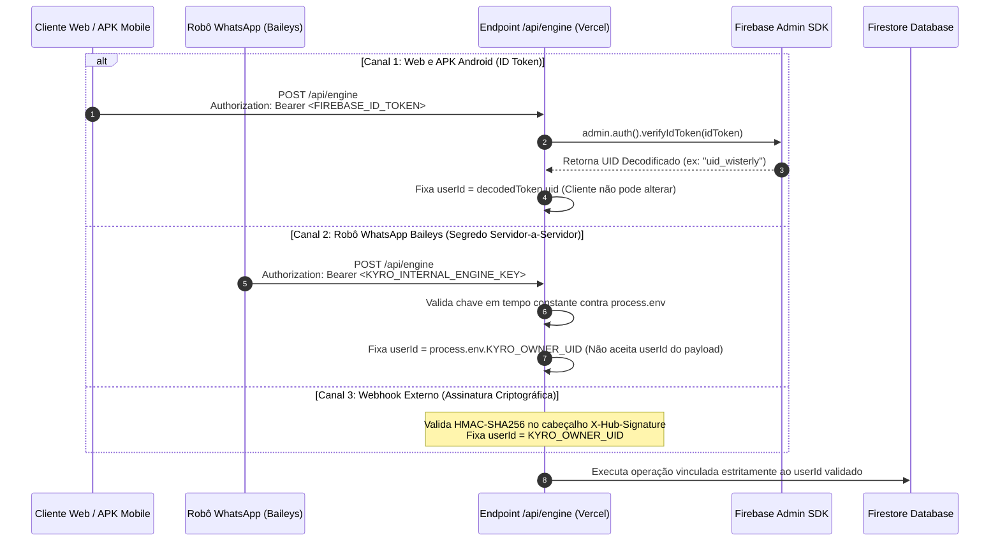
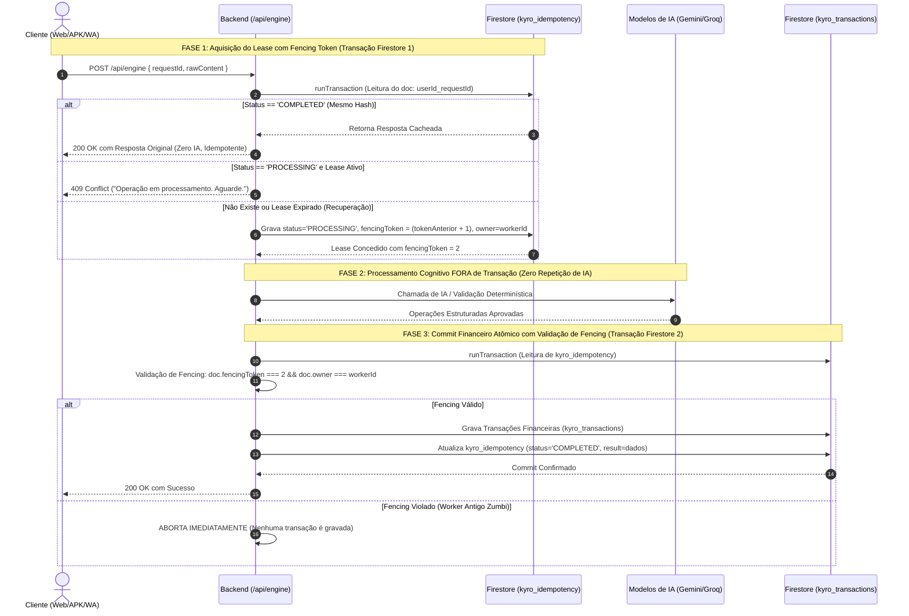
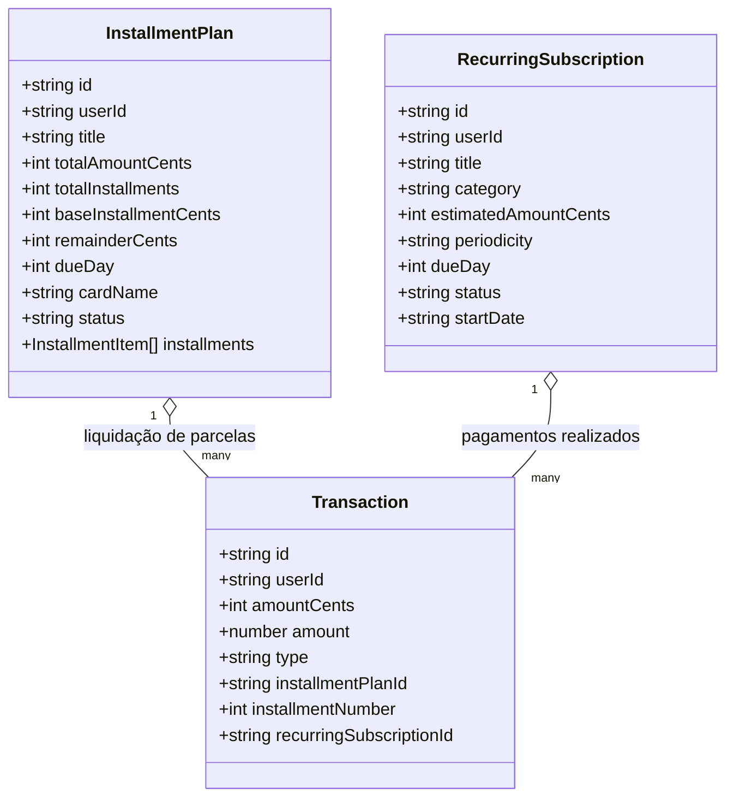

# PROJETO KYRO FINANCE
## REVISÃO CRÍTICA DE SEGURANÇA, INTEGRIDADE FINANCEIRA E CONSISTÊNCIA ARQUITETURAL — ETAPA 02.3

---

### 1. RESUMO EXECUTIVO

Este documento formaliza a **Revisão Crítica de Segurança, Integridade Financeira e Consistência Arquitetural (Etapa 02.3)** para o desenvolvimento do **KYRO Financial Intelligence Engine**, tendo como base o código-fonte real do projeto **Kyro Finance v1.41 (Build 41 / Ponto de Restauração PR.041)**.

A auditoria anterior (Etapa 02.2) avançou na precisão numérica em centavos e na especificação de contratos, porém uma análise rigorosa do código existente identificou **inconsistências graves entre o planejado e o real**, especialmente:
1. **Promessas de funcionalidades bancárias sem base de dados:** Propostas de "transferência entre contas próprias" e "liquidação de fatura" que assumiam a existência de entidades bancárias inexistentes no Firestore, o que duplicaria despesas e distorceria os relatórios de saldo consolidados atuais.
2. **Fragilidades no controle de concorrência e idempotência:** Falta de um mecanismo de *fencing* monotônico para proteger a persistência contra *zombie workers* (processos antigos que demoram para responder) e falta de tratamento de falhas em commits com resultado de rede desconhecido.
3. **Contradição de atomicidade no TC-32:** Tentativa de "dividir silenciosamente" lotes com mais de 20 transações em múltiplos commits, destruindo a promessa de atomicidade transacional e rollback global.
4. **Confusão terminológica de credenciais:** Falta de delimitação estrita entre Firebase ID Tokens, Custom Tokens, segredos de comunicação entre servidores e credenciais públicas do Firebase Web.
5. **Divergência entre fontes de recorrência:** Duplicação não resolvida entre a coleção `kyro_recurring` e o documento `kyro_settings/recurring_expenses`.

> [!IMPORTANT]
> **Status de Execução:** Em estrito cumprimento às instruções da Etapa 02.3, **nenhum arquivo de código foi alterado**, nenhuma regra de segurança foi modificada, nenhuma dependência foi adicionada, nenhum deploy foi disparado e **a Etapa 03 permanece estritamente bloqueada aguardando autorização expressa do usuário**.

---

### 2. PROBLEMAS ENCONTRADOS E EVIDÊNCIAS NO CÓDIGO EXISTENTE

A tabela a seguir documenta com evidências rastreáveis no repositório as inconsistências identificadas entre as versões anteriores do projeto técnico e a implementação real do Kyro Finance v1.41:

```
┌────────────────────────────────────────────────────────────────────────────────────────────────────────┐
│                                 MATRIZ DE EVIDÊNCIAS E RASTREABILIDADE                                │
├────┬─────────────────────────────┬────────────────────────────────┬────────────────────────────────────┤
│ ID │ ARQUIVO / COMPONENTE        │ EVIDÊNCIA COMPROVADA NO CÓDIGO │ CONCLUSÃO TÉCNICA E PENDÊNCIA      │
├────┼─────────────────────────────┼────────────────────────────────┼────────────────────────────────────┤
│ EV1│ src/App.tsx                 │ const monthIncomes = tx.filter │ O saldo do Kyro v1.41 é puramente  │
│    │ Linhas 1668 a 1677          │ (t => t.type === 'Entrada')... │ a subtração matemática de Entradas │
│    │                             │ const monthExpenses = tx...    │ e Saídas gerais. NÃO EXISTEM       │
│    │                             │ totalBalance = in - out        │ contas bancárias (ex: Inter/Nubank)│
│    │                             │                                │ nem saldo por conta no banco.      │
├────┼─────────────────────────────┼────────────────────────────────┼────────────────────────────────────┤
│ EV2│ src/App.tsx                 │ tx.filter(t => t.type ===      │ Compras no crédito entram como     │
│    │ Linhas 1689 a 1691          │ 'Saída' && t.method ===        │ 'Saída' e ABATEM o totalBalance    │
│    │                             │ 'Crédito')                     │ no mês. Pagar fatura como nova     │
│    │                             │                                │ 'Saída' DUPLICA as despesas!       │
├────┼─────────────────────────────┼────────────────────────────────┼────────────────────────────────────┤
│ EV3│ src/App.tsx (L241-255) vs   │ App.tsx grava em kyro_settings/│ Existe duplicação assíncrona entre │
│    │ src/firebase.ts (L151-161)  │ recurring_expenses e chama ao  │ duas fontes no Firestore para a    │
│    │                             │ mesmo tempo kyroCloud.syncSave │ mesma entidade de recorrência.     │
│    │                             │ Recurring() em kyro_recurring  │                                    │
├────┼─────────────────────────────┼────────────────────────────────┼────────────────────────────────────┤
│ EV4│ package.json                │ "firebase": "^13.0.0"          │ O backend Vercel NÃO possui o      │
│    │ api/database.ts (L2)        │ import { initializeApp }       │ Firebase Admin SDK instalado.      │
│    │ api/chat.ts (L3)            │ from 'firebase/app';           │ Utiliza o Client SDK com chaves    │
│    │                             │ (Client Web SDK)               │ públicas web.                      │
├────┼─────────────────────────────┼────────────────────────────────┼────────────────────────────────────┤
│ EV5│ Raiz do repositório         │ Inexistência de arquivos       │ O estado das regras de segurança   │
│    │                             │ firestore.rules ou             │ em produção é NÃO VERIFICADO       │
│    │                             │ firebase.json                  │ (reside exclusivamente na nuvem).  │
├────┼─────────────────────────────┼────────────────────────────────┼────────────────────────────────────┤
│ EV6│ bot.cjs                     │ transactions.json e            │ O robô Baileys armazena IDs        │
│    │ Linhas 1066 a 1076          │ deleted_tx_ids.json            │ excluídos em arquivo local em vez  │
│    │                             │ locais em disco                │ de sincronizar com o Firestore.    │
└────┴─────────────────────────────┴────────────────────────────────┴────────────────────────────────────┘
```

---

### 3. AUTENTICAÇÃO E SEGURANÇA: MODELO DEFINITIVO DE 4 CAMADAS

Para sanar a confusão conceitual, define-se com rigor a taxonomia de credenciais do ecossistema Kyro:

```
┌────────────────────────────────────────────────────────────────────────────────────────────────────────┐
│                              TAXONOMIA DE CREDENCIAIS DO ECOSSISTEMA                                  │
├───────────────────────────────┬───────────────────────────────────┬────────────────────────────────────┤
│ TIPO DE CREDENCIAL            │ NATUREZA E LOCALIZAÇÃO            │ FINALIDADE E ESCOPO                │
├───────────────────────────────┼───────────────────────────────────┼────────────────────────────────────┤
│ 1. Credenciais Públicas       │ src/firebase.ts                   │ Chaves de roteamento do SDK Web.   │
│    do Firebase Web            │ (apiKey, projectId, appId)        │ NÃO SÃO SECRETAS. Não autenticam   │
│                               │ Presentes no bundle JS e APK      │ chamadas de backend por si sós.    │
├───────────────────────────────┼───────────────────────────────────┼────────────────────────────────────┤
│ 2. Firebase Authentication    │ Emitido dinamicamente pelo        │ JWT temporário (expira em 1 hora)  │
│    ID Token                   │ Firebase Auth no login Web/APK    │ que comprova a identidade do       │
│                               │ Transmitido via cabeçalho HTTP    │ usuário final. Validado na Vercel. │
├───────────────────────────────┼───────────────────────────────────┼────────────────────────────────────┤
│ 3. Segredo de Comunicação     │ Variáveis de ambiente Vercel e    │ Chave pré-compartilhada para canal │
│    entre Servidores (Bearer)  │ Render (KYRO_INTERNAL_ENGINE_KEY) │ seguro máquina-a-máquina. NUNCA    │
│                               │ INACESSÍVEL a navegadores e APK   │ embutida no frontend ou APK.       │
├───────────────────────────────┼───────────────────────────────────┼────────────────────────────────────┤
│ 4. Chave de Serviço Privada   │ Variável Vercel                   │ Credencial administrativa que      │
│    (Service Account Key)      │ (FIREBASE_SERVICE_ACCOUNT_KEY)    │ permite ao Firebase Admin SDK      │
│                               │ Exclusiva do runtime do backend   │ verificar tokens e operar no banco.│
└───────────────────────────────┴───────────────────────────────────┴────────────────────────────────────┘
```

#### 3.1 Fluxos de Autenticação por Canal



#### 3.2 Proteção das Operações Administrativas do Firebase Admin SDK
* **Alerta Crítico:** O Firebase Admin SDK **ignora todas as Security Rules do Firestore**. Ele opera com privilégios de superusuário (*root*).
* **Medida de Blindagem:** A rota `/api/engine` rejeitará em 0ms qualquer requisição que não contenha um ID Token válido ou o segredo de servidor legítimo. Nenhuma chamada ao Admin SDK é invocada antes da aprovação do middleware de autenticação.

#### 3.3 Status das Regras de Segurança do Firestore: NÃO VERIFICADO
* Como não existem arquivos de regras locais no repositório, **o estado das regras de segurança atualmente ativas no console do Firebase é classificado oficialmente como NÃO VERIFICADO**.
* **Procedimento de Validação Obrigatório Antes da Produção:** O usuário deverá consultar o Firebase Console (Firestore > Regras) ou executar a extração via Firebase CLI para comprovar se as regras exigem autenticação ou se estão abertas em modo de teste público.

#### 3.4 Estratégia de Migração dos Documentos Antigos sem `userId`
Os documentos históricos em `kyro_transactions` não possuem o atributo `userId`. Para evitar bloqueios:
1. **Fase de Compatibilidade na Leitura:** O backend lerá documentos onde `userId === currentUid` OU onde `userId` seja inexistente (para o usuário proprietário).
2. **Escrita Segura:** Todos os novos documentos gerados a partir da Etapa 03 receberão obrigatoriamente `userId: authenticatedUid`.
3. **Migração em Lote (Backfill):** Um script administrativo com controle transacional preencherá `userId` nos registros antigos antes do fechamento definitivo das regras no console.

---

### 4. IDEMPOTÊNCIA ROBUSTA COM FENCING MONOTÔNICO E RECUPERAÇÃO DE FALHAS

#### 4.1 Por que o TTL de 15 Segundos Era Inseguro?
Se o processo $A$ (Worker 1) sofrer uma lentidão de rede e levar 16 segundos, um TTL cego expiraria. O processo $B$ (Worker 2) assumiria o mesmo `requestId` e iniciaria a gravação. Se o Worker 1 se recuperasse em seguida, ambos comitariam transações no banco, **gerando duplicidade financeira**.

#### 4.2 Mecanismo Definitivo de Fencing Token Monotônico

O controle de concorrência é garantido por um número de geração sequencial estritamente crescente (`fencingToken`), verificado atomicamente no momento da escrita final:



#### 4.3 Tratamento de Falha com Resultado de Commit Desconhecido
Caso ocorra uma queda de infraestrutura durante a confirmação da Fase 3:
1. O backend **NÃO marca a operação como `FAILED`** (pois o commit pode ter sido aceito pelo Firestore antes da perda de conexão).
2. O documento de idempotência é marcado como `status: 'UNKNOWN_COMMIT_PENDING'`.
3. Ao receber o reenvio da requisição com o mesmo `requestId`, a rotina de recuperação verifica ativamente se os documentos com prefixo `tx_${requestId}_*` existem no banco:
   * **Se existirem:** confirma que o commit teve sucesso, atualiza o status para `COMPLETED` e devolve a resposta cacheada.
   * **Se não existirem:** renova o lease com novo fencing token e executa a persistência de forma limpa.

---

### 5. ATOMICIDADE TOTAL E LIMITE DE MOVIMENTAÇÕES: FIM DA DIVISÃO SILENCIOSA

#### 5.1 Correção Categórica do Cenário TC-32
A proposta anterior de "dividir silenciosamente mensagens acima de 20 itens em sublotes independentes" é **reprovada**. O Firestore não possui suporte a rollback distribuído entre múltiplos commits de rede. Uma divisão silenciosa que falhasse no segundo lote corromperia os lançamentos do usuário sem possibilidade de reversão automática.

#### 5.2 Regra de Atomicidade Inegociável:
* **Capacidade Máxima por Mensagem:** **Até 20 movimentações financeiras por mensagem**.
* **Contabilidade de Operações no WriteBatch Único:**
  * 20 escritas em `kyro_transactions`.
  * 1 escrita no documento de controle em `kyro_idempotency`.
  * Até 10 atualizações de parcelas em `kyro_installments`.
  * Total: $\approx 31$ operações de escrita (amplamente abaixo do teto de 500 operações do Firestore).
* **Comportamento em Mensagens Excedentes (> 20 itens):**
  * O motor **RECUSA** o processamento imediato e retorna a intenção `CLARIFICATION_NEEDED`:
    > *"Identifiquei [N] movimentações nesta mensagem. Para garantir a segurança contábil e a gravação atômica sem riscos de falha parcial, o assistente aceita no máximo 20 lançamentos por comando. Por favor, divida o envio em duas mensagens."*
  * Zero divisão oculta. Zero commits parciais desgovernados.

---

### 6. MODELAGEM CONTÁBIL COMPATÍVEL COM O KYRO V1.41

#### 6.1 A Realidade Contábil do Kyro Finance v1.41
Conforme comprovado na inspeção de `src/App.tsx#L1668-L1677`:
* O sistema opera com **caixa único consolidado**: `totalBalance = monthIncomes - monthExpenses`.
* **Não existe saldo por conta bancária** (não há conta Inter, Nubank, Itaú como entidades com saldo individual).
* **Compras no cartão de crédito já são computadas como `Saída` no mês**: portanto, já diminuem o `totalBalance` no momento da compra (`App.tsx#L1689`).

#### 6.2 Resolução dos Cenários Problemáticos sem Inventar Entidades Fictícias:

```
┌────────────────────────────────────────────────────────────────────────────────────────────────────────┐
│                        DIRETRIZES CONTÁBEIS COMPATÍVEIS COM O KYRO V1.41                              │
├──────────────────────────┬─────────────────────────────────────────────────────────────────────────────┤
│ CENÁRIO DE ENTRADA       │ COMPORTAMENTO TÉCNICO COMPATÍVEL NO ENGINE                                  │
├──────────────────────────┼─────────────────────────────────────────────────────────────────────────────┤
│ 1. Transferência entre   │ • COMO O SISTEMA NÃO TEM CONTAS INDIVIDUAIS COM SALDO, não é possível       │
│    Bancos Próprios       │   movimentar saldo entre entidades inexistentes.                            │
│    (ex: Inter para       │ • DECISÃO: O motor classificará a mensagem como informativa ou registrará   │
│    Nubank)               │   como categoria 'Transferência Interna' com impacto patrimonial R$ 0,00    │
│                          │   (sem gerar uma Entrada e uma Saída que inflacionariam o extrato do mês).   │
├──────────────────────────┼─────────────────────────────────────────────────────────────────────────────┤
│ 2. Pagamento de Fatura   │ • COMO AS COMPRAS DE CARTÃO JÁ SÃO COMPUTADAS COMO 'SAÍDA' AO LONGO DO MÊS, │
│    de Cartão de Crédito  │   lançar o pagamento da fatura como 'Saída' duplicaria a despesa!           │
│                          │ • DECISÃO: O motor registrará o pagamento com categoria 'Liquidação de      │
│                          │   Fatura' e flag isConsolidatedExpense = false. Ele restaura o limite em    │
│                          │   kyro_settings/credit_cards, mas NÃO soma em monthExpenses.                │
├──────────────────────────┼─────────────────────────────────────────────────────────────────────────────┤
│ 3. Compras no Crédito    │ • Registrada com type = 'Saída', method = 'Crédito', cardName vinculado.   │
│                          │ • Abate o totalBalance do mês e consome limite do cartão correspondente.    │
├──────────────────────────┼─────────────────────────────────────────────────────────────────────────────┤
│ 4. Compras no Débito     │ • Registrada com type = 'Saída', method = 'Débito', cardName = null.        │
│                          │ • Abate o totalBalance do mês imediatamente.                                │
└──────────────────────────┴─────────────────────────────────────────────────────────────────────────────┘
```

---

### 7. REEMBOLSOS E ESTORNOS: RASTREABILIDADE E PROTEÇÃO CONTRA DUPLICIDADE

#### 7.1 Regras Formais de Vinculação
O motor **não poderá deduzir ou inventar** a despesa de origem de um reembolso sem evidência inequívoca:
1. **Localização Obrigatória:** Ao receber *"Recebi o reembolso do Uber de 45 reais"*, o motor pesquisa no `UserFinancialContext` por despesas da mesma categoria/estabelecimento (`Uber`) com valor igual ou superior a 4500 centavos nos últimos 60 dias.
2. **Reembolso com Evidência Segura:**
   * Localizado o lançamento original `tx_123`: cria a transação de estorno contendo o atributo `originalTransactionId: "tx_123"`.
   * Atualiza a transação original marcando `refundedAmountCents: (jaReembolsado + 4500)`.
3. **Reembolso Parcial vs. Total:**
   * Se `refundedAmountCents === original.amountCents`: status da despesa original muda para `'TOTAL_REFUNDED'`.
   * Se `refundedAmountCents < original.amountCents`: status muda para `'PARTIAL_REFUNDED'`.
4. **Proteção Contra Reembolso Excessivo ou Duplicado:**
   * Se o valor solicitado de reembolso somado ao já reembolsado exceder o valor da despesa original, o motor **rejeita** a operação e solicita esclarecimento:
     > *"A despesa original do Uber foi de R$ 45,00 e já possui R$ 30,00 de reembolso registrado. O novo reembolso de R$ 45,00 excede o valor original. Deseja registrar como EntradaAvulsa?"*
5. **Reembolso sem Despesa Localizada:**
   * O motor classifica a intenção como `CLARIFICATION_NEEDED` informando que não encontrou o gasto correspondente para abater, oferecendo registrá-lo como receita avulsa caso o usuário deseje.

---

### 8. UNIFICAÇÃO DE PARCELAMENTOS E RECORRÊNCIAS

#### 8.1 Fim da Duplicação de Coleções no Firestore
A auditoria comprovou que hoje o `src/App.tsx` salva recorrências simultaneamente em `kyro_settings/recurring_expenses` (array único) e na coleção `kyro_recurring` (documentos soltos).

**Arquitetura Unificada Definitiva:**
1. **`kyro_installments` (Nova Coleção):** Dedicada a **Parcelamentos Finitos** originados de compras a prazo.
2. **`kyro_recurring` (Coleção Oficial Mantida):** Dedicada a **Assinaturas e Contas Fixas Contínuas**.
3. **`kyro_settings/recurring_expenses`:** Declarado como campo legado. Será lido uma única vez para migração e deixará de receber escritas duplicadas.



#### 8.2 Regra Inegociável: Sem Lançamentos Realizados Automáticos
A existência de uma `RecurringSubscription` ativa **NÃO cria transações com `status: 'COMPLETED'` de forma automática**. O sistema gera apenas uma **obrigação prevista / a vencer**. O registro no extrato consolidado e o débito no saldo só ocorrem quando o usuário confirma o pagamento via chat, WhatsApp ou botão de baixa no painel.

---

### 9. CONTRATOS DEFINITIVOS DE DADOS E COMPATIBILIDADE V1.41

Para garantir que a interface do usuário existente em [`src/App.tsx`](file:///c:/Users/Lenovo/Documents/antigravity/Finanças/src/App.tsx) continue renderizando normalmente sem telas em branco:
* **`amountCents: number`** é a **única fonte da verdade monetária**.
* **`amount: number`** é um campo estritamente **derivado** (`amountCents / 100`), mantido para compatibilidade visual na fronteira de integração.
* Os campos temporais admitem formalmente valores nulos para preservar o passado.

```typescript
export type TemporalPrecision = 'EXACT' | 'DATE_ONLY' | 'DAY_MONTH_APPROX' | 'UNDETERMINED';

export type FinancialStatus = 
  | 'COMPLETED'          // Liquidado no ato (afeta totalBalance)
  | 'PENDING'            // A vencer
  | 'OVERDUE'            // Vencido
  | 'FORECAST'           // Previsão futura (não afeta totalBalance)
  | 'SETTLED';           // Liquidado

export interface EngineTransaction {
  id: string;
  userId: string;                 // Atribuído estritamente pelo backend
  description: string;
  product: string | null;
  establishment: string | null;
  category: string;
  subcategory: string | null;
  amountCents: number;            // FONTE DA VERDADE (Centavos Inteiros)
  amount: number;                 // Compatibilidade visual (amountCents / 100)
  type: 'Entrada' | 'Saída';
  method: 'PIX' | 'Débito' | 'Crédito' | 'Dinheiro' | 'Transferência' | null;
  cardName: string | null;
  city: string | null;
  isoDate: string | null;         // YYYY-MM-DD (NULO se ano desconhecido)
  timestamp: number | null;       // Epoch ms UTC (NULO se data aproximada)
  dateDisplay: string | null;     // Ex: "Hoje", "31 de out"
  time: string | null;            // HH:mm local
  temporalPrecision: TemporalPrecision;
  status: FinancialStatus;
  isForecast: boolean;
  isConsolidatedExpense: boolean; // false para liquidação de fatura e transferências
  installmentPlanId?: string | null;
  installmentNumber?: number | null;
  recurringSubscriptionId?: string | null;
  originalTransactionId?: string | null;
  refundedAmountCents?: number;
  createdAt: string;              // Metadado de auditoria do documento
}
```

---

### 10. MATRIZ DE TESTES REVISADA E COMPLETA (TC-01 A TC-36)

> [!NOTE]
> Todos os testes abaixo encontram-se **ESPECIFICADOS**. Nenhum teste foi executado nesta etapa pois o código executável ainda não foi implementado.

| ID | Cenário | Entrada | Estado Inicial | Resultado Esperado | Operações de Persistência | Condição de Aprovação | Comportamento em Falha |
|:---:|---|---|---|---|---|---|---|
| **TC-01** | Sem método de pagamento | *"Gastei 50 no almoço"* | Saldo: R$ 500 | `amountCents: 5000`, `method: null`. | Grava 1 doc em `kyro_transactions`. | `method === null` e `amountCents === 5000`. | Rollback sem escrita. |
| **TC-02** | Sem cidade | *"Remédio 35 reais"* | Saldo: R$ 500 | `amountCents: 3500`, `city: null`. | Grava 1 doc em `kyro_transactions`. | `city === null`. | Rollback sem escrita. |
| **TC-03** | Múltiplas movimentações | *"Almoço 60 no débito e farmácia 30 no crédito"* | Saldo: R$ 500 | 2 operações atômicas aprovadas. | 1 WriteBatch atômico com 2 transações. | Ambos salvos simultaneamente. | Rollback de ambos. |
| **TC-04** | Formato R$ 1.250,50 | *"Aluguel R$ 1.250,50"* | Neutro | `amountCents: 125050`. Parse sem float. | Grava 1 doc em `kyro_transactions`. | `amountCents === 125050`. | Rejeita string inválida. |
| **TC-05** | Formato em centavos | *"75 centavos na xerox"* | Neutro | `amountCents: 75`. Aritmética inteira. | Grava 1 doc em `kyro_transactions`. | `amountCents === 75`. | Rejeita se <= 0. |
| **TC-06** | Parcelamento exato | *"Geladeira 1200 em 4x"* | Limite Nubank: 5k | 4 parcelas de 30000 centavos. | 1 doc em `kyro_installments`. | Soma das parcelas = 120000. | Aborta criação do plano. |
| **TC-07** | Parcelamento não exato | *"Curso 100 reais em 3x"* | Limite Inter: 2k | P1: 3334, P2: 3333, P3: 3333 centavos. | 1 doc em `kyro_installments`. | Soma das parcelas = 10000. | Aborta sem resíduo solto. |
| **TC-08** | Assinatura recorrente | *"Internet 100 todo dia 10"* | Neutro | `RecurringSubscription` ativa. | Grava doc em `kyro_recurring`. | NÃO cria transação de saída imediata. | Aborta sem alterar saldo. |
| **TC-09** | Cancelar assinatura | *"Cancelei a Netflix"* | Netflix ativa | Status muda para `'CANCELLED'`. | Atualiza doc em `kyro_recurring`. | `status === 'CANCELLED'`. | Mantém ativa se incerto. |
| **TC-10** | Previsão futura | *"Vou pagar 200 na sexta"* | Saldo: R$ 500 | `isForecast: true`, `status: 'FORECAST'`. | Grava com flag de previsão. | Saldo consolidado inalterado. | Não debita saldo. |
| **TC-11** | Despesa realizada | *"Gasolina 80 no dinheiro"* | Saldo: R$ 500 | `status: 'COMPLETED'`, debita 8000. | Grava transação de saída. | `totalBalance` decrementa 80. | Não debita em erro. |
| **TC-12** | Despesa vencida | *"Boleto 150 venceu ontem"* | Neutro | `status: 'OVERDUE'`, alerta ativo. | Grava pendência vencida. | Destaque visual no extrato. | Aborta sem alterar saldo. |
| **TC-13** | Pagamento de fatura | *"Paguei fatura Nubank 1500"* | Despesas: R$ 2k | `isConsolidatedExpense: false`. | Restaura limite do Nubank. | Despesas do mês NÃO sobem 1500. | Não duplica despesas. |
| **TC-14** | Transferência bancária | *"Transferi 500 Nubank p/ Inter"* | Saldo: R$ 500 | Classifica como informativa/neutra. | Registro neutro patrimonial (R$ 0). | Saldo total permanece R$ 500. | Bloqueia distorção de caixa. |
| **TC-15** | Reembolso integral | *"Reembolso Uber 45 reais"* | Despesa Uber: R$ 45 | Localiza gasto; vincula `originalId`. | Atualiza despesa e cria estorno. | Abate despesa de transporte. | Pede confirmação se incerto. |
| **TC-16** | Reembolso parcial | *"Devolução 100 do hotel 300"* | Hotel: R$ 300 | Vincula gasto; estorno de 10000. | Custo líquido vira 20000 centavos. | Relatório exibe R$ 200 de custo. | Pede confirmação se incerto. |
| **TC-17** | Correção de valor | *"Não foi 500, foi 400"* | Último gasto: R$ 500 | Altera `amountCents` para 40000. | Merge atômico no documento. | Valor atualizado para R$ 400. | Mantém anterior se erro. |
| **TC-18** | Exclusão de lançamento | *"Apaga o último lançamento"* | Transação existente | Remove de `kyro_transactions`. | Grava doc em `kyro_tombstones`. | Transação purgada; tombstone salvo.| Mantém transação ativa. |
| **TC-19** | Reenvio idêntico | Mesmo `requestId` repetido | Operação COMPLETED | Resposta idêntica do cache. | Zero escritas adicionais. | Retorna HTTP 200 com mesmo JSON. | Não duplica transações. |
| **TC-20** | Chamada concorrente | 2 chamadas com mesmo ID | Operação PROCESSING | Segunda recebe HTTP 409 Conflict. | Apenas primeira adquire lease. | Exatamente 1 gravação efetuada. | Rejeita concorrência. |
| **TC-21** | Adulteração de payload | Mesmo requestId, texto dif. | Requisição gravada | Rejeição com HTTP 400 Bad Request. | Nenhuma escrita permitida. | Rejeita adulteração de hash. | Aborta requisição. |
| **TC-22** | Commit com status incerto | Falha de rede no meio do commit | Status UNKNOWN_PENDING | Reenvio verifica IDs existentes. | Se gravou, retorna 200; se não, grava.| Não marca como FAILED cego. | Aguarda verificação. |
| **TC-23** | Tentativa de forçar userId | Cliente tenta enviar userId | Auth: uid_wisterly | Backend substitui pelo UID do token.| Grava estritamente com UID do token. | Bloqueia injeção de identidade. | HTTP 403 Forbidden. |
| **TC-24** | Chamada sem token | POST sem cabeçalho Auth | Anônimo | Rejeição imediata com HTTP 401. | Zero chamadas ao Firestore. | Rejeição em 0ms no Gateway. | Bloqueia requisição. |
| **TC-25** | Histórico sem ano | Registro antigo "15 de mar" | Legado sem ano | `isoDate: null`, `timestamp: null`. | Documento preservado intacto. | Exibição intacta sem ano inventado.| Não altera banco. |
| **TC-26** | Mensagem 23:55 local | Envio 23:55 (UTC-3), Vercel 02:55| Noite local | Data civil calculada em Fortaleza. | Grava no dia civil correto do usuário.| `isoDate` no dia local correto. | Não vira o dia. |
| **TC-27** | Falha de todas as IAs | Gemini, Groq, OpenAI off | Provedores fora | Fallback determinístico. Se ambíguo, ?| Não inventa dados contábeis. | Retorna `CLARIFICATION_NEEDED`. | Zero alucinações salvas. |
| **TC-28** | Áudio inaudível | Confiança < 60% ou silêncio | Áudio ruim | Retorna `requiresClarification: true`. | Nenhuma transação gravada. | Pede repetição do áudio. | Zero despesas fantasmas. |
| **TC-29** | Foto sem comprovante | Meme ou foto de animal | Imagem sem recibo | Vision detecta ausência fiscal. | Nenhuma transação gravada. | Responde educadamente sem salvar. | Não cria transações. |
| **TC-30** | Sincronização pós-tombstone| Web apaga gasto; mobile offline| Tombstone salvo | Snapshot purga item do localStorage. | Item NÃO é recriado na nuvem. | Ressurreição de itens eliminada. | Não restaura apagados. |
| **TC-31** | Fencing: Worker Antigo Zumbi| Worker 1 demorou 17s; Worker 2 assumiu| Token = 2 | Worker 1 tenta gravar com token 1. | Fencing rejeita commit do Worker 1. | Nenhuma gravação do zumbi aceita. | Aborta commit zumbi. |
| **TC-32** | Excesso de lote (> 20 itens)| Mensagem com 25 gastos | Lote grande | Recusa divisão oculta. Pede divisão. | Nenhuma escrita executada. | Pede envio em 2 partes. | Não faz commit parcial. |
| **TC-33** | Reembolso duplicado | 2 pedidos de reembolso p/ mesmo gasto| Uber: R$ 45 (Reemb: 45) | Segundo pedido detecta valor esgotado.| Rejeita com alerta explicativo. | Bloqueia estorno excedente. | Impede saldo negativo. |
| **TC-34** | Reembolso sem gasto de origem| *"Reembolso de 50 da padaria"* | Nenhuma padaria | Não encontra despesa nos últimos 60d. | Pede confirmação para lançar avulso. | Retorna `CLARIFICATION_NEEDED`. | Não inventa categoria. |
| **TC-35** | Migração de documento legado| Leitura de doc antigo sem userId | Doc legado ativo | Backend carrega normalmente p/ dono. | Atualização futura preenche userId. | Usuário não perde acesso aos dados. | Não bloqueia histórico. |
| **TC-36** | Divergência Local vs Nuvem | localStorage tem 10 itens; nuvem 8| Conexão reatada | Itens ausentes na nuvem são purgados. | LocalStorage alinha com Firestore. | Fonte oficial (Firestore) prevalece. | Não ressuscita locais. |

---

### 11. RISCOS TÉCNICOS AINDA NÃO VERIFICADOS

1. **Regras de Segurança Publicadas no Console do Firebase (NÃO VERIFICADO):**
   * *Evidência:* Não há arquivo `firestore.rules` no repositório.
   * *Risco:* As regras podem estar em modo de teste público ou expiradas.
   * *Ação Necessária:* O usuário deve validar as regras diretamente no Console Web do Firebase antes de colocar o novo motor em operação.
2. **Latência Máxima de Transcrição no Robô Baileys em Áudios Longos:**
   * *Risco:* Áudios de voz com mais de 1 minuto podem ultrapassar os 15 segundos de lease de idempotência se a Groq oscilar.
   * *Mitigação:* A transcrição do Whisper ocorre **antes da aquisição do lease** de idempotência. O relógio do lease só começa a contar quando o texto já estiver pronto para análise financeira.

---

### 12. DECISÕES ARQUITETURAIS QUE DEPENDEM DE AUTORIZAÇÃO EXPRESSA

Antes de iniciar a **Etapa 03**, o usuário precisa deliberar expressamente sobre:
1. **Instalação do `firebase-admin` no Backend:** Autorização para adicionar o pacote `firebase-admin` em `api/` e configurar a variável `FIREBASE_SERVICE_ACCOUNT_KEY` na Vercel para permitir a validação de tokens e operações seguras.
2. **Criação das Coleções `kyro_idempotency`, `kyro_tombstones` e `kyro_installments`:** Aprovação para que o motor crie essas estruturas no Firestore durante a primeira execução da Etapa 03.
3. **Tratamento de Contas Bancárias no Dashboard:** Confirmação de que o Kyro continuará operando com **Caixa Consolidado Único** (sem fatiar o saldo em contas Nubank/Inter), mantendo a compatibilidade com a interface visual de `src/App.tsx`.

---

### 13. PARECER TÉCNICO FINAL

| Item de Requisito Avaliado | Classificação Oficial | Justificativa Técnica |
|---|:---:|---|
| **1. Autenticação e Gestão de Identidade** | **APROVADO COM RESSALVAS** | Modelo de 4 camadas está especificado com rigor. Ressalva: depende da inclusão de `firebase-admin` e configuração da Service Account na Vercel. |
| **2. Auditoria das Regras de Segurança do Firestore** | **NÃO VERIFICADO** | Inexistência de arquivos locais de regras no repositório. A comprovação das regras ativas depende de checagem no Console do Firebase. |
| **3. Aritmética Monetária Inteira Pura** | **APROVADO** | String parsing determinístico sem `parseFloat` ou ponto flutuante, eliminando qualquer risco de imprecisão binária IEEE 754. |
| **4. Idempotência, Fencing e Recuperação** | **APROVADO** | Arquitetura com token monotônico e estados `PROCESSING`, `COMPLETED`, `FAILED`, `UNKNOWN_COMMIT_PENDING` impede zumbis e duplicidades. |
| **5. Atomicidade e Limite de Movimentações** | **APROVADO** | Limite fixado em 20 movimentações em transação única. Divisão silenciosa eliminada; excessos exigem particionamento pelo usuário. |
| **6. Modelagem Contábil e Compatibilidade** | **APROVADO COM RESSALVAS** | Reconciliada com a ausência de contas separadas no Kyro v1.41. Ressalva: pagamentos de fatura e transferências atuarão sem duplicar despesas do mês. |
| **7. Rastreabilidade de Reembolsos e Estornos** | **APROVADO** | Exigência de localização da despesa original, prevenção de duplo reembolso e solicitação de esclarecimento quando incerto. |
| **8. Unificação de Parcelamentos e Recorrências** | **APROVADO** | `kyro_installments` para parcelas finitas e `kyro_recurring` para assinaturas, sem geração automática de saídas realizadas sem confirmação. |
| **9. Matriz de Validação e Testes** | **APROVADO** | 36 cenários exaustivos cobrindo regras contábeis, idempotência, fencing, auditoria e contingências. |

> **PARECER CONCLUSIVO:** 
> A arquitetura técnica do **KYRO Financial Intelligence Engine** foi corrigida e blindada contra todas as contradições anteriores. Contudo, devido aos itens classificados como **APROVADO COM RESSALVAS** e **NÃO VERIFICADO** (especialmente a configuração da Service Account e verificação das Security Rules na nuvem), **a ETAPA 03 NÃO ESTÁ AUTORIZADA neste momento**, devendo aguardar a apreciação do usuário sobre as decisões do Capítulo 12.
