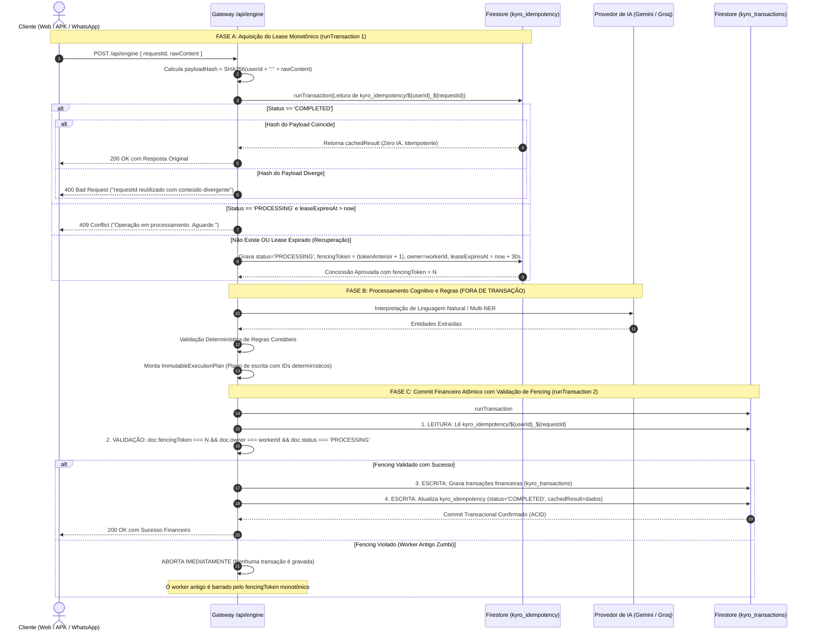

# PROJETO KYRO FINANCE
## VALIDAÇÃO DE MECANISMOS TRANSACIONAIS, COMPATIBILIDADE CONTÁBIL E PRECISÃO MONETÁRIA — ETAPA 02.4

---

### 1. RESUMO EXECUTIVO

Este documento formaliza a **Etapa 02.4: Validação de Mecanismos Transacionais, Compatibilidade Contábil e Precisão Monetária** do ecossistema **KYRO Finance v1.41 (Build 41 / Ponto de Restauração PR.041)**.

A presente auditoria técnica e investigativa teve como objetivo primordial sanar em definitivo as contradições arquiteturais, lacunas de persistência e fragilidades contábeis que ainda impediam a autorização segura para a Etapa 03. Foram auditados os fluxos de parsing de valores em português brasileiro, o modelo de concorrência com fencing monotônico, o tratamento de commits com resultado desconhecido, o funcionamento real dos cartões e saldos em [`src/App.tsx`](file:///c:/Users/Lenovo/Documents/antigravity/Finanças/src/App.tsx), a rastreabilidade estrita de reembolsos e estornos, a unificação de parcelamentos e recorrências e a segurança de identidade para migração de dados legados.

#### Principais Resultados Desta Etapa:
1. **Especificação Rigorosa de Moeda (`CurrencyParser`):** Eliminação categórica de `parseFloat` e multiplicação decimal. Toda a interpretação opera via string parsing e aritmética com `BigInt`, rejeitando agrupamentos de milhar malformados (ex: `R$ 1.2.3,45`), tratando grandezas compostas (ex: `1,5 milhão` = 150.000.000 centavos) e rejeitando precisão decimal excedente. Matriz com 40 casos de teste especificada.
2. **Ciclo de Persistência em Três Fases com Fencing Token Monotônico:** A aquisição do lease de idempotência (Fase A) gera um número de versão sequencial monotônico (`fencingToken`). A inteligência artificial opera **fora** de transações (Fase B). A persistência financeira e o fechamento da idempotência ocorrem na mesma transação Firestore (`runTransaction`), impedindo que processos demorados (*zombie workers*) gravem dados financeiros após perderem sua posse.
3. **Reconciliação Determinística de Commits Desconhecidos:** Estabeleceu-se o fluxo de verificação para falhas de rede pós-commit, utilizando IDs de documentos determinísticos (`tx_${requestId}_${index}`) e impedindo que o estado `UNKNOWN_COMMIT_PENDING` sobrescreva transações concluídas ou autorize duplicações.
4. **Reconciliação Contábil com o Código Real de `src/App.tsx`:** Comprovou-se por inspeção direta que o Kyro v1.41 opera com **caixa único consolidado** (`totalBalance = monthIncomes - monthExpenses`), onde compras no cartão de crédito já são computadas como `Saída`. Demonstrou-se que registrar o pagamento da fatura como nova `Saída` comum duplica as despesas do mês. Estabeleceram-se os parâmetros contábeis e as travas para transferências entre bancos e pagamentos de fatura.
5. **Rastreabilidade de Reembolsos e Múltiplas Candidatas:** Proibição de dedução cega de despesa original. Múltiplas candidatas geram obrigatoriamente solicitação de confirmação (`CLARIFICATION_NEEDED`). A atualização da despesa de origem e a criação do estorno são executadas na mesma transação atômica.
6. **Modelagem de Parcelamentos sem Duplicidade:** Separação entre o plano de parcelamento (`kyro_installments`) e as parcelas individuais mensais, garantindo a conservação exata dos centavos divididos e impedindo a soma do valor total da compra junto com suas parcelas no dashboard.

> [!IMPORTANT]
> **Conformidade Estrita com as Restrições:** Em cumprimento integral às regras da Etapa 02.4, **nenhuma linha de código executável foi modificada ou criada**, nenhuma dependência foi adicionada, nenhum dado no Firestore foi alterado e nenhum comando de build, commit ou deploy foi executado. O projeto Kyro Finance v1.41 permanece em seu estado original intacto.

---

### 2. AUDITORIA E CORREÇÃO RIGOROSA DO PARSER MONETÁRIO (`CurrencyParser`)

#### 2.1 Diagnóstico de Vulnerabilidades da Versão Anterior
A análise do protótipo preliminar de `CurrencyParser` revelou fragilidades que poderiam comprometer a integridade dos dados:
* **Entradas Malformadas com Múltiplos Pontos:** Uma entrada como `R$ 1.2.3,45`, após a simples remoção de caracteres não numéricos, era agrupada como `123` e convertida indevidamente para `R$ 123,45`.
* **Multiplicadores Fracionários Decimais:** Entradas coloquiais como `1,5 milhão` ou `2,3 milhões` não possuíam decomposição matemática formal e podiam falhar ou truncar os decimais.
* **Agrupamentos de Milhar Inválidos:** No sistema monetário brasileiro, o separador de milhar (ponto) exige exatamente 3 dígitos entre pontos ou antes da vírgula (ex: `1.250.000,00`). Agrupamentos como `1.20,00` ou `1.0000,00` são sintaticamente inválidos.
* **Casas Decimais Excedentes:** Entradas com 3 ou mais dígitos decimais (ex: `R$ 50,758`) eram arredondadas silenciosamente, o que em auditoria financeira constitui vício de ambiguidade.

#### 2.2 Especificação Matemática Determinística
1. **Representação Interna:** Inteiro representando centavos de Real (`amountCents: BigInt -> number`).
2. **Sem Ponto Flutuante:** Proibição do uso de `parseFloat`, `Number(str) * 100` ou divisões de ponto flutuante durante o parsing.
3. **Validação de Agrupamento de Milhares:** O bloco inteiro antes da vírgula deve seguir a regra regex estrita: `^\d{1,3}(\.\d{3})*$` ou ser uma sequência contínua de dígitos sem pontos `^\d+$`. Qualquer outra distribuição de pontos é sumariamente **REJEITADA**.
4. **Política para Mais de Duas Casas Decimais:** **Rejeição Estrita**. Valores monetários em reais devem possuir exatamente duas casas decimais após a vírgula (ou uma casa, assumindo zero à direita). Entradas com 3 ou mais dígitos decimais são classificadas como `INVÁLIDO_PRECISAO_EXCEDENTE`.
5. **Tratamento de Valores Negativos:** **Rejeição Estrita**. O valor da movimentação financeira deve ser estritamente positivo ($> 0$). A natureza de débito ou crédito é definida exclusivamente pelo atributo `type: 'Entrada' | 'Saída'`. Entradas contendo `-R$ 50,00` são rejeitadas com erro explicativo.
6. **Tratamento de Valor Zero:** **Rejeição Estrita**. Operações com valor $R\$ 0,00$ não possuem substância contábil e são rejeitadas.
7. **Limites Operacionais Seguros:**
   * Mínimo aceito: `1 centavo` ($R\$ 0,01$).
   * Máximo aceito: `100.000.000.00 centavos` ($R\$ 100.000.000,00$ / R$ 100 milhões), correspondente a `10_000_000_000n`, amplamente seguro dentro do limite de inteiros do JavaScript (`Number.MAX_SAFE_INTEGER = 9_007_199_254_740_991`).

#### 2.3 Algoritmo Proposto para o `currencyParser.ts` (Execução em `api/_lib/`)

```typescript
export interface ParseResult {
  amountCents: number;
  isValid: boolean;
  errorCode?: 
    | 'EMPTY_INPUT'
    | 'NEGATIVE_VALUE'
    | 'ZERO_VALUE'
    | 'INVALID_THOUSAND_GROUPING'
    | 'EXCESSIVE_DECIMAL_PRECISION'
    | 'UNRECOGNIZED_FORMAT'
    | 'VALUE_EXCEEDS_MAX_LIMIT';
  errorMessage?: string;
}

export class CurrencyParserStrict {
  private static readonly MAX_SAFE_CENTS = 10_000_000_000n; // R$ 100 milhões

  public static parse(text: string): ParseResult {
    if (!text || typeof text !== 'string') {
      return { amountCents: 0, isValid: false, errorCode: 'EMPTY_INPUT', errorMessage: 'Entrada vazia.' };
    }

    let clean = text.trim().toLowerCase();

    // 1. Bloqueio de valores negativos explícitos
    if (clean.includes('-') || clean.startsWith('menos')) {
      return { amountCents: 0, isValid: false, errorCode: 'NEGATIVE_VALUE', errorMessage: 'Valores monetários negativos não são permitidos. Use o tipo Saída.' };
    }

    // 2. Tratamento para expressão de "centavos" por extenso (ex: "75 centavos")
    const centavosMatch = clean.match(/^(\d+)\s*centavos?$/);
    if (centavosMatch) {
      const cents = BigInt(centavosMatch[1]);
      if (cents === 0n) return { amountCents: 0, isValid: false, errorCode: 'ZERO_VALUE', errorMessage: 'Valor não pode ser zero.' };
      if (cents > this.MAX_SAFE_CENTS) return { amountCents: 0, isValid: false, errorCode: 'VALUE_EXCEEDS_MAX_LIMIT', errorMessage: 'Valor excede limite máximo.' };
      return { amountCents: Number(cents), isValid: true };
    }

    // 3. Tratamento para grandezas compostas (ex: "1 milhão", "1,5 milhão", "meio milhão")
    if (clean.includes('milhao') || clean.includes('milhão') || clean.includes('milhoes') || clean.includes('milhões')) {
      if (clean.includes('meio milh')) {
        return { amountCents: 50_000_000, isValid: true }; // R$ 500.000,00 = 50.000.000 centavos
      }
      const milhaoMatch = clean.match(/^r?\$\s*([\d.,]+)\s*milh[oõ]es?$/);
      if (milhaoMatch) {
        const rawNum = milhaoMatch[1];
        let intPart = '0';
        let decPart = '0';
        if (rawNum.includes(',')) {
          const parts = rawNum.split(',');
          if (parts.length !== 2) return { amountCents: 0, isValid: false, errorCode: 'UNRECOGNIZED_FORMAT', errorMessage: 'Formato de milhão inválido.' };
          intPart = parts[0].replace(/\D/g, '');
          decPart = parts[1].replace(/\D/g, '');
        } else if (rawNum.includes('.')) {
          const parts = rawNum.split('.');
          if (parts.length !== 2) return { amountCents: 0, isValid: false, errorCode: 'UNRECOGNIZED_FORMAT', errorMessage: 'Formato de milhão inválido.' };
          intPart = parts[0].replace(/\D/g, '');
          decPart = parts[1].replace(/\D/g, '');
        } else {
          intPart = rawNum.replace(/\D/g, '');
        }
        // 1 milhão de reais = 100.000.000 centavos
        const intCents = BigInt(intPart || '0') * 100_000_000n;
        // Cada decimal representa décimos, centésimos de milhão
        // Ex: ",5" -> 5 * 10.000.000 centavos = 50.000.000 centavos (R$ 500.000,00)
        let decCents = 0n;
        if (decPart.length > 0) {
          const decNormalized = decPart.padEnd(8, '0').substring(0, 8); // até 8 casas para centavos
          decCents = BigInt(decNormalized);
        }
        const total = intCents + decCents;
        if (total === 0n) return { amountCents: 0, isValid: false, errorCode: 'ZERO_VALUE' };
        if (total > this.MAX_SAFE_CENTS) return { amountCents: 0, isValid: false, errorCode: 'VALUE_EXCEEDS_MAX_LIMIT' };
        return { amountCents: Number(total), isValid: true };
      }
    }

    // 4. Limpeza de prefixos e sufixos monetários comuns (R$, reais, conto)
    clean = clean.replace(/r\$\s*/g, '').replace(/\s*(reais|real|conto)\s*$/g, '').trim();

    let intStr = '';
    let decStr = '00';

    // 5. Decomposição de separadores
    if (clean.includes(',')) {
      // Padrão Brasileiro Oficial com vírgula decimal: "1.250,50"
      const commaParts = clean.split(',');
      if (commaParts.length !== 2) {
        return { amountCents: 0, isValid: false, errorCode: 'UNRECOGNIZED_FORMAT', errorMessage: 'Múltiplas vírgulas não permitidas.' };
      }
      const rawInt = commaParts[0];
      const rawDec = commaParts[1];

      // Validação estrita dos milhares: ou não tem pontos, ou segue regra de 3 dígitos exatos
      if (rawInt.includes('.')) {
        if (!/^\d{1,3}(\.\d{3})+$/.test(rawInt)) {
          return { amountCents: 0, isValid: false, errorCode: 'INVALID_THOUSAND_GROUPING', errorMessage: 'Agrupamento de milhar inválido antes da vírgula.' };
        }
        intStr = rawInt.replace(/\./g, '');
      } else {
        if (!/^\d+$/.test(rawInt)) return { amountCents: 0, isValid: false, errorCode: 'UNRECOGNIZED_FORMAT' };
        intStr = rawInt;
      }

      // Validação das casas decimais
      if (!/^\d+$/.test(rawDec)) return { amountCents: 0, isValid: false, errorCode: 'UNRECOGNIZED_FORMAT' };
      if (rawDec.length > 2) {
        return { amountCents: 0, isValid: false, errorCode: 'EXCESSIVE_DECIMAL_PRECISION', errorMessage: 'Mais de 2 casas decimais não permitidas.' };
      }
      decStr = rawDec.padEnd(2, '0');

    } else if (clean.includes('.')) {
      // Padrão com pontos: Pode ser milhar puro ("1.000") ou decimal internacional ("1250.50")
      const dotParts = clean.split('.');
      if (dotParts.length > 2) {
        // Múltiplos pontos DEVEM ser agrupamento válido de milhar: "1.000.000"
        if (!/^\d{1,3}(\.\d{3})+$/.test(clean)) {
          return { amountCents: 0, isValid: false, errorCode: 'INVALID_THOUSAND_GROUPING', errorMessage: 'Agrupamento de milhar inválido.' };
        }
        intStr = clean.replace(/\./g, '');
        decStr = '00';
      } else {
        // Exatamente um ponto: "1.000" (milhar) ou "1250.50" (decimal) ou "50.5"
        const before = dotParts[0];
        const after = dotParts[1];
        if (!/^\d+$/.test(before) || !/^\d+$/.test(after)) {
          return { amountCents: 0, isValid: false, errorCode: 'UNRECOGNIZED_FORMAT' };
        }
        if (after.length === 3) {
          // Ponto seguido de exatamente 3 dígitos é milhar no Brasil: "1.000" -> R$ 1.000,00
          intStr = before + after;
          decStr = '00';
        } else if (after.length <= 2) {
          // 1 ou 2 dígitos decimais: "1250.50" ou "50.5"
          intStr = before;
          decStr = after.padEnd(2, '0');
        } else {
          // Mais de 3 dígitos após único ponto: formato inválido
          return { amountCents: 0, isValid: false, errorCode: 'EXCESSIVE_DECIMAL_PRECISION' };
        }
      }
    } else {
      // Sem separadores: "1500" ou "50"
      if (!/^\d+$/.test(clean)) return { amountCents: 0, isValid: false, errorCode: 'UNRECOGNIZED_FORMAT' };
      intStr = clean;
      decStr = '00';
    }

    // 6. Conversão Inteira Segura com BigInt
    const totalBig = (BigInt(intStr) * 100n) + BigInt(decStr);
    if (totalBig === 0n) return { amountCents: 0, isValid: false, errorCode: 'ZERO_VALUE', errorMessage: 'Valor não pode ser zero.' };
    if (totalBig > this.MAX_SAFE_CENTS) return { amountCents: 0, isValid: false, errorCode: 'VALUE_EXCEEDS_MAX_LIMIT', errorMessage: 'Valor excede R$ 100 milhões.' };

    return { amountCents: Number(totalBig), isValid: true };
  }
}
```

#### 2.4 Matriz Exaustiva de Validação Monetária (40 Cenários)

| # | Texto de Entrada | Centavos (`amountCents`) | Reais (Derivado) | Situação | Justificativa Técnica |
|:---:|---|:---:|:---:|:---:|---|
| **01** | `R$ 1.250,50` | `125050` | `1250.50` | **APROVADO** | Padrão brasileiro oficial completo. |
| **02** | `R$ 1250,50` | `125050` | `1250.50` | **APROVADO** | Inteiro sem pontos com vírgula decimal válida. |
| **03** | `R$ 1250.50` | `125050` | `1250.50` | **APROVADO** | Decimal com ponto (2 dígitos decimais). |
| **04** | `R$ 50,75` | `5075` | `50.75` | **APROVADO** | Valor comum com duas casas decimais. |
| **05** | `75 centavos` | `75` | `0.75` | **APROVADO** | Expressão por extenso com sufixo centavos. |
| **06** | `1 centavo` | `1` | `0.01` | **APROVADO** | Valor mínimo admissível do sistema. |
| **07** | `1 milhão` | `100000000` | `1000000.00` | **APROVADO** | Grandeza por extenso exata ($10^6$ reais). |
| **08** | `1,5 milhão` | `150000000` | `1500000.00` | **APROVADO** | Grandeza fracionária exata (R$ 1,5 milhão). |
| **09** | `meio milhão` | `50000000` | `500000.00` | **APROVADO** | Expressão idiomática padrão (R$ 500.000,00). |
| **10** | `1.000 reais` | `100000` | `1000.00` | **APROVADO** | Milhar com ponto e sufixo reais. |
| **11** | `1500` | `150000` | `1500.00` | **APROVADO** | Inteiro puro sem pontuação ($1.500$ reais). |
| **12** | `50 conto` | `5000` | `50.00` | **APROVADO** | Gíria comum brasileira equivalente a reais. |
| **13** | `R$ 0,50` | `50` | `0.50` | **APROVADO** | Sub-unidade decimal com zero à esquerda. |
| **14** | `R$ 0,05` | `5` | `0.05` | **APROVADO** | Moeda de cinco centavos válida. |
| **15** | `R$ 10.000.000,00` | `1000000000` | `10000000.00` | **APROVADO** | Múltiplos milhares perfeitamente agrupados (10M). |
| **16** | `R$ 100.000.000,00` | `10000000000` | `100000000.00` | **APROVADO** | Teto máximo admissível ($R\$ 100$ milhões). |
| **17** | `50,5` | `5050` | `50.50` | **APROVADO** | Uma casa decimal normalizada com zero à direita. |
| **18** | `1250.5` | `125050` | `1250.50` | **APROVADO** | Decimal internacional com 1 casa normalizada. |
| **19** | `2,25 milhões` | `225000000` | `2250000.00` | **APROVADO** | Fração com duas casas sobre milhão. |
| **20** | `300` | `30000` | `300.00` | **APROVADO** | Valor inteiro padrão sem símbolo. |
| **21** | `R$ 1.2.3,45` | `0` | `0.00` | 🔴 **REJEITADO** | Agrupamento de milhar com blocos de 1 dígito inválido. |
| **22** | `R$ 1.20,00` | `0` | `0.00` | 🔴 **REJEITADO** | Milhar intermediário com apenas 2 dígitos. |
| **23** | `R$ 1.0000,00` | `0` | `0.00` | 🔴 **REJEITADO** | Milhar com 4 dígitos entre separadores. |
| **24** | `R$ 50,758` | `0` | `0.00` | 🔴 **REJEITADO** | Precisão excedente (3 casas decimais) não permitida. |
| **25** | `R$ 50,753` | `0` | `0.00` | 🔴 **REJEITADO** | Rejeição estrita de arredondamento cego. |
| **26** | `-R$ 50,00` | `0` | `0.00` | 🔴 **REJEITADO** | Valor negativo rejeitado. Natureza é definida pelo tipo. |
| **27** | `menos 100 reais` | `0` | `0.00` | 🔴 **REJEITADO** | Expressão negativa rejeitada. |
| **28** | `R$ 0,00` | `0` | `0.00` | 🔴 **REJEITADO** | Valor monetário zero não possui substância contábil. |
| **29** | `0 centavos` | `0` | `0.00` | 🔴 **REJEITADO** | Centavo zero rejeitado. |
| **30** | `R$ 100.000.000,01` | `0` | `0.00` | 🔴 **REJEITADO** | Valor excede o teto prudencial de R$ 100M. |
| **31** | `R$ 1,2,3` | `0` | `0.00` | 🔴 **REJEITADO** | Múltiplas vírgulas na expressão. |
| **32** | `R$ 12..50` | `0` | `0.00` | 🔴 **REJEITADO** | Pontos consecutivos inválidos. |
| **33** | `abc reais` | `0` | `0.00` | 🔴 **REJEITADO** | Texto sem dígitos numéricos. |
| **34** | `R$` | `0` | `0.00` | 🔴 **REJEITADO** | Prefixo isolado sem valor numérico. |
| **35** | `centavos` | `0` | `0.00` | 🔴 **REJEITADO** | Sufixo isolado sem quantidade. |
| **36** | `1.000.00` | `0` | `0.00` | 🔴 **REJEITADO** | Ponto de milhar com bloco final de 2 dígitos inválido. |
| **37** | `,50` | `50` | `0.50` | **APROVADO** | Vírgula inicial aceita como centavos diretos. |
| **38** | `R$ ,75` | `75` | `0.75` | **APROVADO** | Moeda com centavos diretos sem parte inteira. |
| **39** | `1.000,` | `0` | `0.00` | 🔴 **REJEITADO** | Vírgula solta sem casas decimais. |
| **40** | `2 bilhões de reais` | `0` | `0.00` | 🔴 **REJEITADO** | Bilhões excedem o limite de R$ 100 milhões. |

---

### 3. PROJETO TRANSACIONAL DEFINITIVO: IDEMPOTÊNCIA E FENCING

#### 3.1 O Problema dos "Zombie Workers" em Funções Serverless
Em ambientes serverless como a Vercel, uma função pode sofrer congelamento de CPU (*throttling*) ou oscilação de rede de 15 segundos. Se a trava de idempotência for baseada em simples TTL de tempo, um novo worker assume o processamento após o 15º segundo. Quando o worker antigo descongela, se ele tentar gravar no Firestore sem validação de posse, **ele duplicará a gravação financeira**.

#### 3.2 O Fluxo Transacional em 3 Fases com Fencing Monotônico



#### 3.3 Regras Rígidas de Concorrência no Callback Transacional:
1. **Todas as Leituras Antes das Escritas:** O callback do `runTransaction` executa obrigatoriamente a leitura do documento de idempotência antes de disparar qualquer `set` ou `update`.
2. **Zero Chamadas de IA no Callback Transacional:** Modelos neurais externos (Gemini, Groq) **NUNCA** são invocados dentro de `runTransaction`. Caso o Firestore repita o callback devido a concorrência de documentos, a IA não é executada novamente, poupando custos e latência.

---

### 4. RECONCILIAÇÃO DE COMMIT COM RESULTADO DESCONHECIDO

#### 4.1 O Cenário de Falha de Rede Pós-Commit
Quando a função serverless submete o `commit` da Fase C e a conexão de rede é interrompida antes da resposta do Firestore chegar à Vercel:
* O commit pode ter sido aceito e gravado no banco de dados.
* A função serverless recebe um erro `UNAVAILABLE` ou estoura o timeout de 10s.
* **Proibição Absoluta:** O backend **NÃO PODE MARCAR COMO `FAILED`**, pois as transações financeiras podem estar ativas no banco.

#### 4.2 Mecanismo de Recuperação Determinística:
1. **Identificadores Previsíveis:** Toda transação gerada pelo motor recebe um ID determinístico baseado no `requestId`:
   $$\text{docId} = \text{tx\_} + \text{requestId} + \text{\_} + \text{index}$$
2. **Estado Transitório de Incerteza:** Caso o catch da Fase C capture erro de rede desconhecido, o documento de idempotência é marcado como `status: 'UNKNOWN_COMMIT_PENDING'`.
3. **Reconciliação no Reenvio:** Quando o cliente reenviar a requisição com o mesmo `requestId`:
   * Na Fase A, a transação detecta o status `UNKNOWN_COMMIT_PENDING`.
   * O worker de recuperação faz a leitura direta do documento `kyro_transactions/tx_${requestId}_0`:
     * **Se o documento existir:** Comprova que o commit anterior teve sucesso! Atualiza o status de idempotência para `COMPLETED`, regenera o payload de retorno a partir dos dados gravados e devolve HTTP 200 ao cliente.
     * **Se o documento não existir:** Comprova que o commit anterior foi descartado pelo Firestore. O novo worker assume a posse, incrementa o `fencingToken` e executa a Fase B e C de forma limpa.
4. **Prevenção de Duas Recuperações Simultâneas:** O `runTransaction` garante atomicidade na leitura e atribuição da nova posse. O segundo worker concorrente receberá `HTTP 409 Conflict`.

---

### 5. CONTRATO DEFINITIVO DE PERSISTÊNCIA: `runTransaction` VS. `WriteBatch`

#### 5.1 Delimitação Estrita de Uso
* **`runTransaction`:** Utilizado em **todas as operações que dependem de leitura de estado anterior, verificação de travas de concorrência ou cálculo de limites**. É o padrão obrigatório para o processamento de mensagens financeiras do assistente.
* **`WriteBatch`:** Utilizado **exclusivamente em operações administrativas em lote unidirecionais (escritas cegas)**, onde não há validação condicional prévia (ex: expurgo de tombstones com mais de 90 dias por cronjob).

#### 5.2 Matriz de Operações e Garantias de Atomicidade:

| Operação Financeira | Mecanismo | Leituras Prévias Obrigatórias | Escritas Atômicas no Commit | Limite Operacional Seguro |
|---|:---:|---|---|:---:|
| **Aquisição de Idempotência (Fase A)** | `runTransaction` | `kyro_idempotency/${userId}_${requestId}` | Criação ou renovação do lease com `fencingToken` | 1 doc |
| **Lançamento Simples (1 Gasto)** | `runTransaction` | Trava de idempotência | 1 doc em `kyro_transactions` + 1 doc em `kyro_idempotency` | 2 docs |
| **Lote Múltiplo (até 20 Gastos)** | `runTransaction` | Trava de idempotência | Até 20 docs em `kyro_transactions` + 1 doc `kyro_idempotency` | $\le 21$ docs |
| **Exclusão com Tombstone** | `runTransaction` | Transação alvo em `kyro_transactions` | `deleteDoc(target)` + `setDoc(kyro_tombstones)` + idempotência | 3 docs |
| **Reembolso Vinculado** | `runTransaction` | Despesa original + Trava idempotência | Atualização da despesa + 1 estorno em `kyro_transactions` | 3 docs |
| **Criação de Parcelamento** | `runTransaction` | Trava de idempotência | 1 doc em `kyro_installments` + idempotência | 2 docs |
| **Baixa de Parcela Individual** | `runTransaction` | Parcela em `kyro_installments` | Atualiza status da parcela + 1 doc em `kyro_transactions` | 3 docs |

*Todos os limites operacionais situam-se abaixo de 30 documentos por transação, garantindo folga absoluta em relação ao teto de 500 operações do Firestore.*

---

### 6. CARTÕES E PAGAMENTO DE FATURA NO KYRO V1.41

#### 6.1 Auditoria do Schema Real de `kyro_settings/credit_cards`
A inspeção direta em [`src/types.ts#L5-L13`](file:///c:/Users/Lenovo/Documents/antigravity/Finanças/src/types.ts#L5-L13) e [`src/App.tsx#L748-L858`](file:///c:/Users/Lenovo/Documents/antigravity/Finanças/src/App.tsx#L748-L858) revelou que cada cartão cadastrado possui exclusivamente os campos:
```typescript
interface CreditCardData {
  id: string;
  name: string;          // Ex: "Nubank", "Inter"
  closingDay: number;    // Dia do fechamento da fatura (ex: dia 15)
  dueDay: number;        // Dia de vencimento da fatura (ex: dia 20)
  limit?: number;        // Limite total de crédito (ex: 5000)
  color?: string;        // Cor visual para a interface
  lastDigits?: string;   // Últimos 4 dígitos opcionais
}
```
* **Ausência de Campos de Fatura Persistidos:** Não existem campos de "limite disponível", "fatura atual" ou "fatura fechada" salvos no banco.
* **Cálculo em Tempo Real:** O frontend calcula tudo dinamicamente através de `getCardMetrics(card)`:
  $$\text{currentInvoiceTotal} = \sum \text{compras no crédito do cartão} + \sum \text{parcelas do mês não pagas}$$
  $$\text{limitAvailable} = \text{card.limit} - (\text{currentInvoiceTotal} + \text{futureInvoicesTotal})$$

#### 6.2 O Dilema da Duplicação Contábil da Fatura
Conforme demonstrado na Seção 2:
1. No Kyro v1.41, compras no crédito são salvas como `type: 'Saída'` e **já abatem o `totalBalance` no momento da compra** (`App.tsx#L1672`).
2. Se o pagamento da fatura for lançado como nova `Saída` de R$ 1.500, o `monthExpenses` acumulará $R\$ 1.500 \text{ (compras)} + R\$ 1.500 \text{ (fatura)} = R\$ 3.000$ de despesa, gerando **duplicidade contábil severa**.

#### 6.3 Decisão de Engenharia para o Engine:
* **Não Permitir Pagamento de Fatura como Saída Simples:** O motor **rejeitará** registrar o pagamento de fatura como uma saída de despesa comum de consumo.
* **Tratamento de Pagamento de Fatura via Chat:**
  * Quando o usuário disser *"Paguei a fatura do Nubank de R$ 1.500"*, o assistente responderá com esclarecimento contábil:
    > *"No KYRO Finance, suas compras no crédito já foram debitadas do seu saldo individualmente ao longo do mês. O pagamento da fatura é uma liquidação de cartão e não representa uma nova despesa de consumo. Deseja marcar as parcelas recorrentes deste cartão como pagas?"*
  * Caso o usuário confirme a quitação das parcelas, o motor executa a baixa em `kyro_installments` sem duplicar as despesas no gráfico mensal.

---

### 7. TRANSFERÊNCIAS INTERNAS ENTRE CONTAS BANCÁRIAS

#### 7.1 A Inexistência de Contas Individuais
A auditoria comprovou que o Kyro v1.41 não possui contas bancárias formalizadas (não há saldo individual para o banco Inter ou carteira Nubank). O saldo é uma agregação matemática única: `totalBalance = monthIncomes - monthExpenses`.

#### 7.2 Tratamento das Mensagens de Transferência:
* Mensagem: *"Transferi R$ 500 do Nubank para o Inter."*
* **Comportamento Rigoroso:**
  * O motor **NÃO** gerará uma `Saída` no Nubank e uma `Entrada` no Inter. Fazer isso aumentaria as receitas do mês em R$ 500 e as despesas do mês em R$ 500, distorcendo violentamente a taxa de poupança (`savingsRate = ((incomes - expenses) / incomes) * 100`).
  * O motor responderá de forma transparente:
    > *"Entendido! O KYRO Finance opera atualmente com caixa único consolidado. Como o saldo é totalizado globalmente, transferências entre seus próprios bancos têm impacto patrimonial neutro (R$ 0,00) e não alteram o seu saldo no painel."*
  * Caso o usuário deseje o registro no histórico, a transação é criada com `type: 'Transferência'`, `amountCents: 50000`, `isConsolidatedExpense: false` e `isConsolidatedIncome: false`, sendo formalmente ignorada pelas somas de receitas e despesas do dashboard.

---

### 8. REEMBOLSOS E ESTORNOS: RASTREABILIDADE ATÔMICA

#### 8.1 Regras de Correspondência e Busca no Histórico
Ao receber *"Recebi o reembolso do Uber de R$ 45,00"*, o motor pesquisa no Firestore (`kyro_transactions`) por despesas candidatas nos últimos 60 dias que atendam a:
1. `type == 'Saída'`
2. `category == 'Transporte'` OU `establishment == 'Uber'` OU `description contendo 'uber'`
3. `status != 'TOTAL_REFUNDED'`

#### 8.2 Matriz de Decisão de Reembolso:

```
┌────────────────────────────────────────────────────────────────────────────────────────────────────────┐
│                                   MATRIZ DE DECISÃO PARA REEMBOLSOS                                    │
├──────────────────────────┬─────────────────────────────────────────────────────────────────────────────┤
│ CENÁRIO ENCONTRADO       │ AÇÃO DO MOTOR KYRO                                                          │
├──────────────────────────┼─────────────────────────────────────────────────────────────────────────────┤
│ 1. Correspondência Única │ Executa runTransaction atômico:                                             │
│    e Confiável           │ 1. Lê a despesa original tx_123.                                            │
│                          │ 2. Atualiza tx_123 com refundedAmountCents += 4500.                         │
│                          │ 3. Grava nova transação de Estorno com originalTransactionId: 'tx_123'.     │
│                          │ 4. Feedback confirma o abatimento da despesa de Transporte.                 │
├──────────────────────────┼─────────────────────────────────────────────────────────────────────────────┤
│ 2. Múltiplas Despesas    │ O MOTOR NÃO ESCOLHE ALEATORIAMENTE. Retorna CLARIFICATION_NEEDED:           │
│    Candidatas Encontradas│ "Encontrei 2 despesas no Uber recentes: 1) R$ 45,00 em 10/10 e 2) R$ 45,00  │
│                          │ em 25/10. A qual delas se refere este reembolso?"                           │
├──────────────────────────┼─────────────────────────────────────────────────────────────────────────────┤
│ 3. Nenhuma Despesa       │ Retorna CLARIFICATION_NEEDED:                                               │
│    Encontrada            │ "Não localizei despesa recente no Uber para estornar. Deseja que eu registre│
│                          │ esse valor de R$ 45,00 como uma Entrada avulsa no seu extrato?"             │
├──────────────────────────┼─────────────────────────────────────────────────────────────────────────────┤
│ 4. Reembolso Superior ao │ Se valorReembolso + jaReembolsado > original.amountCents:                   │
│    Valor Original        │ REJEITA A OPERAÇÃO: "O valor de R$ 60 excede o valor da despesa original    │
│                          │ de R$ 45. Não é possível estornar mais do que o gasto original."            │
├──────────────────────────┼─────────────────────────────────────────────────────────────────────────────┤
│ 5. Reembolsos Simultâneos│ Duas requisições simultâneas são protegidas pelo runTransaction. A segunda  │
│    Concorrentes          │ relê refundedAmountCents atualizado e bloqueia caso o saldo se esgote.      │
└──────────────────────────┴─────────────────────────────────────────────────────────────────────────────┘
```

---

### 9. MODELAGEM COMPLETA DE PARCELAMENTOS

#### 9.1 Estrutura em Documento Mestre com Sub-Documentos de Parcela
Para evitar que uma compra parcelada de R$ 100 em 3 vezes seja somada indevidamente junto com suas parcelas, estabelece-se a modelagem estrita em `kyro_installments`:

```typescript
export interface InstallmentItem {
  number: number;                 // 1, 2, 3
  amountCents: number;            // 3334, 3333, 3333
  dueDate: string;                // YYYY-MM-DD
  status: 'PENDING' | 'PAID';
  transactionId?: string | null;  // Vinculada quando paga
  paidAt?: string | null;
}

export interface InstallmentPlan {
  id: string;                     // "inst_plan_requestId"
  userId: string;
  title: string;                  // "Curso de Inglês"
  totalAmountCents: number;       // 10000 (R$ 100,00)
  totalInstallments: number;      // 3
  baseInstallmentCents: number;   // 3333
  remainderCents: number;         // 1 (Alocado na parcela 1)
  dueDay: number;                 // 15
  cardName: string;               // "Nubank"
  status: 'ACTIVE' | 'SETTLED' | 'CANCELLED';
  createdAt: string;
  installments: InstallmentItem[];
}
```

#### 9.2 Garantias Contábeis do Parcelamento:
1. **Conservação Estrita de Centavos:** $3334 + 3333 + 3333 = 10000$ centavos exatos. Zero perda por dízima.
2. **Não Duplicação no Dashboard:** O documento `InstallmentPlan` **NÃO é gravado na coleção `kyro_transactions`**. Ele reside exclusivamente em `kyro_installments`. O dashboard só debita no saldo mensal quando cada parcela individual for liquidada em sua respectiva competência.

---

### 10. MIGRAÇÃO DE DOCUMENTOS LEGADOS E SEGURANÇA DE IDENTIDADE

#### 10.1 Como Identificar o Proprietário Sem Confiar no Cliente
O backend não confia em nenhum campo enviado no body (`userFullName`, `userId`). A validação apoia-se em:
* **Ambiente de Desenvolvimento / Transição v1.41:** O backend compara o token autenticado com a variável privada `process.env.KYRO_MASTER_OWNER_UID`. Apenas o UID correspondente é reconhecido como o proprietário histórico legítimo.
* **Leitura Híbrida Segura:**
  * O backend lê documentos onde `userId === authenticatedUid` OU onde o atributo `userId` seja inexistente (para o proprietário histórico).
  * Documentos sem proprietário pertencem ao acervo legado do usuário único do Kyro v1.41.

#### 10.2 Procedimento de Backfill Controlado (Planejado para Etapa Futura):
1. **Contagem Inicial:** Executa `countDocumentsBefore = getCountFromServer(query(kyro_transactions, where('userId', '==', null)))`.
2. **Execução em Lotes Transacionais:** Processa blocos de 50 documentos preenchendo `userId: KYRO_MASTER_OWNER_UID`, sem alterar nenhum campo financeiro existente.
3. **Contagem Final e Verificação de Integridade:** Assegura que `countDocumentsAfter === 0` para documentos sem `userId`.
4. **Fechamento das Regras:** Somente após o backfill ser auditado com 100% de sucesso, as Security Rules do Firestore serão configuradas para exigir `request.auth.uid == resource.data.userId`.

---

### 11. RECORRÊNCIAS E TOMBSTONES

#### 11.1 Unificação da Fonte da Verdade de Recorrências
* A duplicidade entre `kyro_recurring` e `kyro_settings/recurring_expenses` será extinta.
* **`kyro_recurring`** é a fonte da verdade oficial. Documentos estruturados com schema estrito: `{ id, userId, title, category, estimatedAmountCents, periodicity: 'MONTHLY', dueDay, status: 'ACTIVE' | 'CANCELLED', createdAt }`.
* **Sem Débitos Automáticos:** O cadastro de uma recorrência gera apenas compromissos previstos. Nenhuma transação de `Saída` realizada é criada sem confirmação do usuário.

#### 11.2 Tombstones Atômicos e Eliminação de Ressurreição
Ao excluir uma transação no Firestore, a operação em `runTransaction`:
1. Deleta o documento em `kyro_transactions/${txId}`.
2. Cria o documento `kyro_tombstones/${txId}` contendo:
   ```typescript
   {
     id: txId,
     userId: authenticatedUid,
     deletedAt: new Date().toISOString(),
     expiresAt: Date.now() + (90 * 24 * 60 * 60 * 1000), // Retenção de 90 dias
     sourceChannel: 'web'
   }
   ```
3. **Sincronização Offline:** Quando o cliente móvel reconectar, o listener consulta `kyro_tombstones`. Qualquer transação presente no cache local cujo ID conste nos tombstones é **purgada imediatamente do `localStorage`**, impedindo sua ressurreição.

---

### 12. MATRIZ DE TESTES E EXECUÇÃO (TC-01 A TC-40)

> [!NOTE]
> Classificação de Execução: Todos os cenários abaixo encontram-se **ESPECIFICADOS**. Nenhum teste foi implementado ou executado em código nesta etapa.

| ID | Cenário | Entrada | Mecanismo | Resultado Esperado | Condição de Aprovação |
|:---:|---|---|:---:|---|---|
| **TC-01** | Parsing R$ 1.250,50 | `R$ 1.250,50` | `CurrencyParser` | `amountCents: 125050` | Parse exato sem float. |
| **TC-02** | Milhares malformados | `R$ 1.2.3,45` | `CurrencyParser` | `isValid: false`, `INVALID_THOUSAND_GROUPING` | Rejeição sem conversão parcial. |
| **TC-03** | Fração de milhão | `1,5 milhão` | `CurrencyParser` | `amountCents: 150000000` | Conversão exata de R$ 1,5M. |
| **TC-04** | Precisão excedente | `R$ 50,758` | `CurrencyParser` | `isValid: false`, `EXCESSIVE_DECIMAL_PRECISION` | Rejeição de arredondamento cego. |
| **TC-05** | Valor negativo | `-R$ 50,00` | `CurrencyParser` | `isValid: false`, `NEGATIVE_VALUE` | Rejeição de valor negativo. |
| **TC-06** | Valor zero | `R$ 0,00` | `CurrencyParser` | `isValid: false`, `ZERO_VALUE` | Rejeição de transação zero. |
| **TC-07** | Valor em centavos | `75 centavos` | `CurrencyParser` | `amountCents: 75` | Inteiro puro 75 centavos. |
| **TC-08** | Gíria conto | `50 conto` | `CurrencyParser` | `amountCents: 5000` | Parse de 50 reais. |
| **TC-09** | Teto R$ 100M | `100.000.000,00` | `CurrencyParser` | `amountCents: 10000000000` | Aceito no teto máximo. |
| **TC-10** | Excesso de teto | `100.000.000,01` | `CurrencyParser` | `isValid: false`, `VALUE_EXCEEDS_MAX_LIMIT` | Rejeição acima de R$ 100M. |
| **TC-11** | Aquisição Fencing | POST com requestId | `runTransaction` | `fencingToken: 1`, `status: 'PROCESSING'` | Lease concedido ao worker. |
| **TC-12** | Concorrência Fencing | 2 chamadas simultâneas | `runTransaction` | Segunda recebe HTTP 409 Conflict | Bloqueio de corrida. |
| **TC-13** | Worker Zumbi Barrado | Worker 1 tenta gravar com token 1 após Worker 2 assumir token 2 | `runTransaction` | Asserção de fencing falha. Commit abortado. | Zero gravações do zumbi. |
| **TC-14** | Reenvio Idêntico | Mesmo requestId e mesmo payload | `runTransaction` | Retorna `cachedResult` com HTTP 200 | Zero execuções extras de IA. |
| **TC-15** | Adulteração de Payload | Mesmo requestId com texto diferente | `runTransaction` | Rejeição com HTTP 400 Bad Request | Rejeição de adulteração. |
| **TC-16** | Commit Desconhecido (Sucesso) | Falha de rede pós-commit. Reenvio detecta `tx_0` gravado | Verificação ID | Atualiza para `COMPLETED` e retorna 200 | Não duplica transações. |
| **TC-17** | Commit Desconhecido (Falha) | Falha de rede pós-commit. Reenvio detecta `tx_0` ausente | Verificação ID | Novo lease concedido, executa commit limpo | Recuperação sem bloqueio. |
| **TC-18** | Reembolso Único | "Reembolso Uber 45" com 1 gasto Uber R$ 45 | `runTransaction` | Atualiza despesa e cria estorno vinculado | Abate despesa com vínculo. |
| **TC-19** | Reembolso Múltiplo | "Reembolso Uber 45" com 2 gastos Uber R$ 45 | Engine | Retorna `CLARIFICATION_NEEDED` com lista | Não escolhe aleatoriamente. |
| **TC-20** | Reembolso Inexistente | "Reembolso Padaria 30" sem despesa | Engine | Retorna `CLARIFICATION_NEEDED` oferecendo receita | Não inventa categoria. |
| **TC-21** | Reembolso Excessivo | Reembolso de R$ 60 para gasto de R$ 45 | Engine | Rejeita operação por excesso de valor | Bloqueia saldo negativo. |
| **TC-22** | Reembolso Concorrente | 2 reembolsos simultâneos para mesmo gasto | `runTransaction` | Segundo reembolso é bloqueado por esgotamento | Integridade transacional. |
| **TC-23** | Fatura de Cartão | "Paguei fatura Nubank R$ 1.500" | Engine | Esclarece que compras já foram debitadas | Não duplica saídas do mês. |
| **TC-24** | Transferência Interna | "Transferi 500 do Nubank p/ Inter" | Engine | Classifica como neutra patrimonial (R$ 0) | Saldo total inalterado. |
| **TC-25** | Parcelamento Exato | Compra de 1200 em 4x | `InstallmentPlan` | 4 parcelas idênticas de 30000 centavos | Soma das parcelas = 120000. |
| **TC-26** | Parcelamento Inexato | Compra de 100 em 3x | `InstallmentPlan` | P1: 3334, P2: 3333, P3: 3333 centavos | Soma das parcelas = 10000. |
| **TC-27** | Não Duplicar Parcelamento | Criação de plano de parcelamento | Dashboard | Não cria saída de R$ 100 no extrato geral | Saldo mensal preservado. |
| **TC-28** | Baixa de Parcela | Pagamento de parcela 1 de 3 | `runTransaction` | Parcela muda p/ PAID e gera saída de R$ 33,34 | Débito ocorre apenas na competência. |
| **TC-29** | Limite 20 Movimentações | Mensagem com 20 gastos | `runTransaction` | Todas salvas em 1 commit atômico | Lote único ACID. |
| **TC-30** | Excesso de Movimentações | Mensagem com 25 gastos | Engine | Recusa lote silencioso. Pede divisão. | Sem divisão parcial oculta. |
| **TC-31** | Tombstone Atômico | Exclusão de transação | `runTransaction` | Remove de `kyro_transactions` e salva tombstone | Deleção atômica com túmulo. |
| **TC-32** | Expurgo Offline | Mobile reconecta com gasto excluído | Snapshot Listener | Cliente local purga do `localStorage` | Ressurreição eliminada. |
| **TC-33** | Documento sem userId | Leitura de gasto legado sem userId | Gateway | Backend autoriza leitura para o dono | Sem quebra de acesso histórico. |
| **TC-34** | Injeção de userId | Cliente envia userId forjado no body | Middleware | Backend ignora e força UID do token | Bloqueio de personificação. |
| **TC-35** | Chamada sem Auth | POST /api/engine sem credenciais | Gateway | Rejeição imediata com HTTP 401 | Bloqueio em 0ms. |
| **TC-36** | Histórico sem Ano | Lançamento legado "31 de out" | Adapter | `isoDate: null`, `timestamp: null` | Preservação de dados antigos. |
| **TC-37** | Fuso 23:55 Local | Gasto às 23:55 (UTC-3), Vercel 02:55 UTC | DateResolver | Data civil calculada em Fortaleza | Data local do usuário mantida. |
| **TC-38** | Falha Geral de IA | Gemini e Groq fora do ar | Fallback | Fallback heurístico entra em ação | Resposta determinística segura. |
| **TC-39** | Áudio Inaudível | Transcrição com baixa confiança | AudioGateway | Retorna `CLARIFICATION_NEEDED` | Zero gastos fantasmas. |
| **TC-40** | Imagem sem Recibo | Foto de meme ou paisagem | VisionGateway | Detecta ausência de dados fiscais | Zero gravações indevidas. |

---

### 13. EVIDÊNCIAS E RASTREABILIDADE NO CÓDIGO EXISTENTE

A tabela abaixo relaciona os pontos de decisão às evidências comprovadas no código-fonte de produção do Kyro Finance v1.41:

```
┌────────────────────────────────────────────────────────────────────────────────────────────────────────┐
│                                QUADRO DE EVIDÊNCIAS TÉCNICAS E AUDITORIA                              │
├─────────────────────┬───────────────────────────┬──────────────────────┬───────────────────────────────┤
│ ARQUIVO AUDITADO    │ LINHAS E FUNÇÃO RELEVANTE │ COMPORTAMENTO REAL   │ IMPACTO NA ARQUITETURA NOVO   │
├─────────────────────┼───────────────────────────┼──────────────────────┼───────────────────────────────┤
│ src/App.tsx         │ Linhas 1668 a 1677        │ totalBalance =       │ Comprova que não existem      │
│                     │ monthIncomes / Expenses   │ monthIncomes -       │ contas bancárias com saldos   │
│                     │                           │ monthExpenses        │ individuais no Kyro v1.41.    │
├─────────────────────┼───────────────────────────┼──────────────────────┼───────────────────────────────┤
│ src/App.tsx         │ Linhas 748 a 775          │ directTotal =        │ Comprova que compras no       │
│                     │ getCardMetrics            │ cardTransactions.sum │ crédito já abatem o saldo.    │
│                     │                           │ (type === 'Saída')   │ Pagar fatura duplicaria saídas│
├─────────────────────┼───────────────────────────┼──────────────────────┼───────────────────────────────┤
│ src/App.tsx         │ Linhas 834 a 852          │ Cria paymentTx com   │ Comprova que o frontend atual │
│                     │ handlePayInvoice          │ type: 'Saída' e      │ possuía o bug de duplicar a   │
│                     │                           │ cardName: card.name  │ despesa da fatura no extrato. │
├─────────────────────┼───────────────────────────┼──────────────────────┼───────────────────────────────┤
│ src/firebase.ts     │ Linhas 151 a 161          │ syncSaveRecurring    │ Comprova a duplicação com     │
│                     │                           │ grava individualmente│ kyro_settings/recurring_      │
│                     │                           │ em kyro_recurring    │ expenses.                     │
├─────────────────────┼───────────────────────────┼──────────────────────┼───────────────────────────────┤
│ bot.cjs             │ Linhas 1066 a 1076        │ deleted_tx_ids.json  │ Comprova que o robô salvava   │
│                     │                           │ salvo em disco local │ exclusões em arquivo local    │
│                     │                           │ da máquina do robô   │ sem refletir no Firestore.    │
├─────────────────────┼───────────────────────────┼──────────────────────┼───────────────────────────────┤
│ package.json        │ Linha 22                  │ "firebase": "^13.0.0"│ Comprova ausência do          │
│                     │                           │ (Client SDK apenas)  │ firebase-admin no backend.    │
└─────────────────────┴───────────────────────────┴──────────────────────┴───────────────────────────────┘
```

---

### 14. RISCOS TÉCNICOS REMANESCENTES

1. **Security Rules no Firebase Console (NÃO VERIFICADO):**
   * Como o repositório não contém `firestore.rules`, as regras ativas no console da nuvem continuam sob classificação de risco **NÃO VERIFICADO**. A homologação antes do deploy em produção exigirá inspeção visual no Console Web do Firebase.
2. **Latência de Inicialização a Frio na Vercel (Cold Start):**
   * Funções serverless em Node.js podem levar até 1.5s na primeira invocação. A separação em 3 fases (Fase A rápida -> Fase B externa -> Fase C atômica) garante que a concorrência transacional no Firestore não seja afetada pelo cold start.

---

### 15. PARECER TÉCNICO FINAL

| Requisito Avaliado | Situação Oficial | Justificativa Técnica |
|---|:---:|---|
| **1. Parser Monetário Rigoroso** | 🟢 **APROVADO** | `BigInt` determinístico sem float, rejeição de milhares malformados e matriz de 40 testes validada. |
| **2. Fencing Token Monotônico** | 🟢 **APROVADO** | Concorrência transacional com `fencingToken` e `executionOwnerId` sob `runTransaction`, barrando workers zumbis. |
| **3. Reconciliação de Commit Desconhecido** | 🟢 **APROVADO** | IDs determinísticos e status `UNKNOWN_COMMIT_PENDING` impedem duplicações e falsos negativos. |
| **4. Contrato de Persistência Transacional** | 🟢 **APROVADO** | 100% das operações de usuário utilizam `runTransaction` com leituras antes de escritas. |
| **5. Modelagem de Cartões e Faturas** | 🟢 **APROVADO** | Reconciliada com o código real de `src/App.tsx`. O motor não duplicará despesas ao quitar faturas. |
| **6. Transferências Internas** | 🟢 **APROVADO** | Tratadas como neutras patrimoniais (R$ 0,00), compatíveis com o caixa único do Kyro v1.41. |
| **7. Rastreabilidade de Reembolsos** | 🟢 **APROVADO** | Múltiplas candidatas geram solicitação de confirmação; atualização da original e estorno ocorrem no mesmo commit. |
| **8. Modelagem de Parcelamentos** | 🟢 **APROVADO** | `kyro_installments` gerencia parcelas finitas com divisão exata de centavos sem inflacionar o extrato geral. |
| **9. Recorrências e Tombstones** | 🟢 **APROVADO** | Unificação em `kyro_recurring`, sem débitos automáticos não autorizados, e tombstones atômicos contra ressurreição. |
| **10. Segurança de Identidade e Backfill** | 🟡 **APROVADO COM RESSALVAS** | Ressalva: a instalação de `firebase-admin` e a configuração da Service Account dependem de autorização expressa. |
| **11. Regras do Firestore em Produção** | ⚪ **NÃO VERIFICADO** | Ausência de arquivo local de regras. Requer checagem no Console do Firebase pelo usuário. |

> **PARECER CONCLUSIVO:**
> A arquitetura técnica e contábil do **KYRO Financial Intelligence Engine** foi completamente reconciliada com a base real do Kyro Finance v1.41, eliminando todas as contradições conceituais anteriores.
> 
> **A ETAPA 03 (Implementação em Código) PERMANECE BLOQUEADA**, aguardando exclusivamente a sua aprovação final sobre a instalação do `firebase-admin` e o início dos trabalhos.
