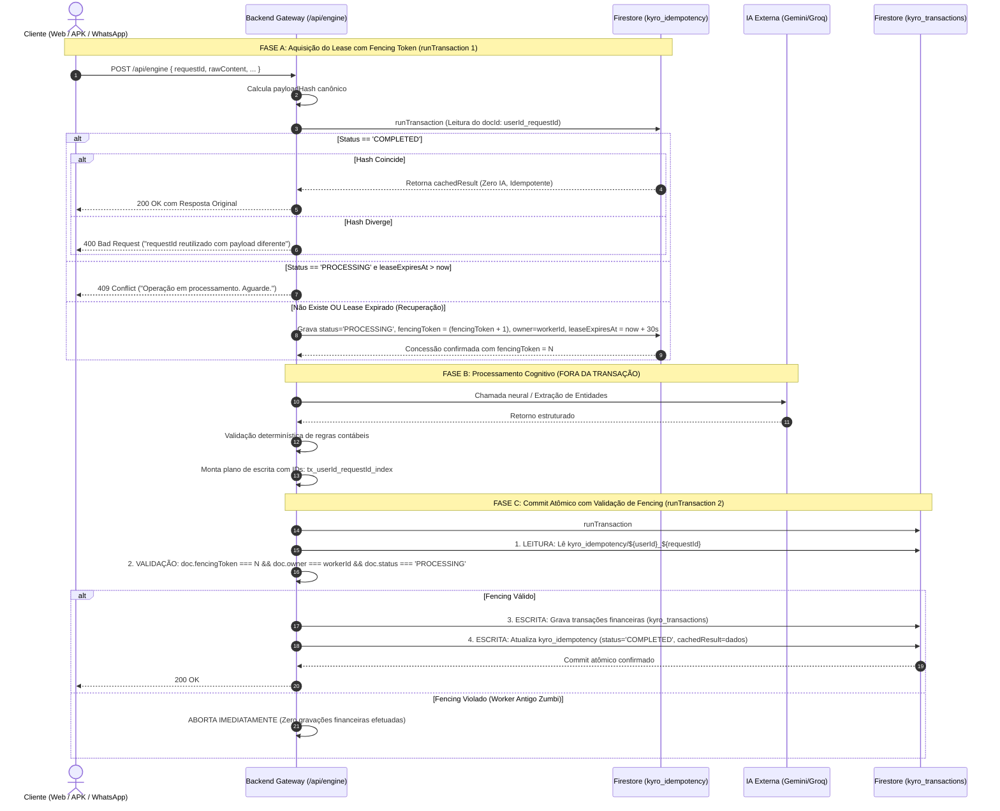

# PROJETO KYRO FINANCE
## ETAPA 02.5: CORREÇÃO DE INCONSISTÊNCIAS E FECHAMENTO DA ARQUITETURA DEFINITIVA

---

### 1. RESUMO EXECUTIVO

Este documento consolida o **Fechamento Arquitetural Definitivo (Etapa 02.5)** do **KYRO Financial Intelligence Engine**, tendo como base o código-fonte em produção do **Kyro Finance v1.41 (Build 41 / Ponto de Restauração PR.041)**.

A auditoria crítica realizada sobre as Etapas 02.2, 02.3 e 02.4 identificou inconsistências residuais que demandavam retificação formal antes de qualquer autorização de código para a Etapa 03. O presente relatório resolve integralmente:
1. **Correção do Parser Monetário (`CurrencyParserStrict`):** Correção de casos de centavos diretos (`,50` e `R$ ,75`), decomposição exata de frações de grandezas por extenso (`1,5 milhão` = 150.000.000 centavos), rejeição de expressões malformadas de milhão, e eliminação de precisão decimal excedente. Matriz expandida com 45 cenários especificados.
2. **Ciclo de Idempotência e Fencing Monotônico com Escopo de Usuário:** IDs determinísticos com escopo estrito (`tx_${userId}_${requestId}_${index}`), cálculo do hash canônico SHA-256 e blindagem transacional contra *zombie workers*. Reconciliação formal para falhas de rede pós-commit sem sobrescrita de estados `COMPLETED`.
3. **Modelagem Contábil e Compatibilidade com o Código Real de `src/App.tsx`:** Demonstração matemática de como compras no cartão de crédito já são computadas como `Saída` no Kyro v1.41, e como o pagamento de fatura deve ser tratado para não duplicar despesas do mês (`isConsolidatedExpense: false`).
4. **Resolução das Transferências Internas:** Adoção da **Alternativa B** (não persistir movimentações neutras artificiais no extrato enquanto não houver contas bancárias individualizadas formalizadas), respondendo com esclarecimento ao usuário.
5. **Rastreabilidade Estrita de Reembolsos e Estornos:** Proibição de converter reembolsos sem correspondência em receitas automáticas. Exigência de vinculação com a despesa original e solicitação de confirmação (`CLARIFICATION_NEEDED`) perante múltiplas candidatas.
6. **Parcelamentos sem Duplicidade (`InstallmentPlan`):** Estrutura do plano isolada na coleção `kyro_installments`, garantindo conservação de centavos e assegurando que o extrato mensal debite apenas as parcelas liquidadas no respectivo ciclo.
7. **Procedimento de Migração e Backfill de Documentos Legados:** Correção técnica sobre a impossibilidade de usar `where('userId', '==', null)` para campos ausentes no Firestore. Protocolo de migração em 10 etapas com dry-run e backup verificável.
8. **Matriz de Segurança por Canal e Tombstones com Sincronização Offline:** Especificação da autenticação e esclarecimento de que o campo `expiresAt` de tombstones depende de política de TTL configurada no GCP Console.

> [!IMPORTANT]
> **Status de Execução Estritamente Documental:** Em total conformidade com as restrições da Etapa 02.5, **nenhum arquivo de código foi criado, modificado ou excluído**, nenhum pacote npm foi instalado, nenhuma regra de segurança do Firebase foi alterada e nenhum build ou deploy foi executado. O sistema em produção permanece intacto.

---

### 2. AUDITORIA E CORREÇÃO RIGOROSA DO PARSER MONETÁRIO

#### 2.1 Análise das Falhas Identificadas na Versão Anterior
1. **Falha nas Entradas `,50` e `R$ ,75`:** Na Etapa 02.4, a divisão por vírgula resultava em `commaParts[0] === ""`. O teste `!/^\d+$/.test(rawInt)` rejeitava a string vazia como formato não reconhecido. **Correção:** Quando a parte inteira antes da vírgula for vazia e houver dígitos após a vírgula, a parte inteira deve ser assumida como `"0"`.
2. **Ambiguidade e Expressões Incompletas com Milhão:** Entradas isoladas como `"milhão"`, `"1.2.milhão"` ou `"milhões"` sem número estruturado podiam passar se a regex apenas checasse a presença da substring. **Correção:** A expressão exige padrão numérico estrito antes do termo multiplicador: `^r?\$\s*(\d{1,3}(?:\.\d{3})*|\d+)(?:,(\d{1,2}))?\s*milh[oõ]es?$`.
3. **Rejeição de Agrupamento Inválido de Milhar:** Entradas como `R$ 1.2.3,45` ou `R$ 1.20,00` são sintaticamente ilegais e devem ser sumariamente rejeitadas.
4. **Precisão Decimal Excedente:** Entradas com 3 ou mais casas decimais (ex: `R$ 50,758`) violam a convenção contábil do Real e devem ser rejeitadas sem arredondamento arbitrário.

#### 2.2 Algoritmo Corrigido em TypeScript Ilustrativo (`CurrencyParserStrict`)

```typescript
export interface ParseResult {
  amountCents: number;
  isValid: boolean;
  errorCode?: 
    | 'EMPTY_INPUT'
    | 'NEGATIVE_VALUE'
    | 'ZERO_VALUE'
    | 'INVALID_THOUSAND_GROUPING'
    | 'EXCESSIVE_DECIMAL_PRECISION'
    | 'UNRECOGNIZED_FORMAT'
    | 'VALUE_EXCEEDS_MAX_LIMIT';
  errorMessage?: string;
}

export class CurrencyParserStrict {
  private static readonly MAX_SAFE_CENTS = 10_000_000_000n; // Teto: R$ 100 milhões

  public static parse(text: string): ParseResult {
    if (!text || typeof text !== 'string') {
      return { amountCents: 0, isValid: false, errorCode: 'EMPTY_INPUT', errorMessage: 'Entrada vazia.' };
    }

    let clean = text.trim().toLowerCase();

    // 1. Rejeição de notação científica ou caracteres inesperados
    if (/[eE]/.test(clean) && !clean.includes('reais')) {
      return { amountCents: 0, isValid: false, errorCode: 'UNRECOGNIZED_FORMAT', errorMessage: 'Notação científica não permitida.' };
    }

    // 2. Bloqueio de valores negativos
    if (clean.includes('-') || clean.startsWith('menos')) {
      return { amountCents: 0, isValid: false, errorCode: 'NEGATIVE_VALUE', errorMessage: 'Valores negativos não permitidos. Use o tipo Saída.' };
    }

    // 3. Tratamento de "centavos" por extenso (ex: "75 centavos")
    const centavosMatch = clean.match(/^(\d+)\s*centavos?$/);
    if (centavosMatch) {
      const cents = BigInt(centavosMatch[1]);
      if (cents === 0n) return { amountCents: 0, isValid: false, errorCode: 'ZERO_VALUE', errorMessage: 'Valor não pode ser zero.' };
      if (cents > this.MAX_SAFE_CENTS) return { amountCents: 0, isValid: false, errorCode: 'VALUE_EXCEEDS_MAX_LIMIT' };
      return { amountCents: Number(cents), isValid: true };
    }

    // 4. Tratamento de grandezas por extenso com "milhão / milhões"
    if (clean.includes('milh')) {
      if (clean === 'meio milhão' || clean === 'meio milhao') {
        return { amountCents: 50_000_000, isValid: true }; // R$ 500.000,00 = 50.000.000 centavos
      }
      // Padrão estrito: Exige número válido antes da palavra milhão
      const milhaoRegex = /^r?\$\s*(\d{1,3}(?:\.\d{3})*|\d+)(?:,(\d{1,2}))?\s*milh[oõ]es?$/;
      const match = clean.match(milhaoRegex);
      if (!match) {
        return { amountCents: 0, isValid: false, errorCode: 'UNRECOGNIZED_FORMAT', errorMessage: 'Expressão de milhão malformada ou incompleta.' };
      }
      const rawInt = match[1].replace(/\./g, '');
      const rawDec = match[2] || '';
      
      const intCents = BigInt(rawInt) * 100_000_000n; // 1 milhão = 100.000.000 centavos
      let decCents = 0n;
      if (rawDec.length === 1) {
        decCents = BigInt(rawDec) * 10_000_000n; // ",5" milhão = 50.000.000 centavos
      } else if (rawDec.length === 2) {
        decCents = BigInt(rawDec) * 1_000_000n;  // ",25" milhão = 25.000.000 centavos
      }

      const total = intCents + decCents;
      if (total === 0n) return { amountCents: 0, isValid: false, errorCode: 'ZERO_VALUE' };
      if (total > this.MAX_SAFE_CENTS) return { amountCents: 0, isValid: false, errorCode: 'VALUE_EXCEEDS_MAX_LIMIT' };
      return { amountCents: Number(total), isValid: true };
    }

    // 5. Limpeza de prefixos/sufixos comuns (R$, $, reais, real, conto)
    clean = clean.replace(/r\$\s*/g, '').replace(/\$\s*/g, '').replace(/\s*(reais|real|conto)\s*$/g, '').trim();

    let intStr = '0';
    let decStr = '00';

    // 6. Decomposição com validação de agrupamentos
    if (clean.includes(',')) {
      const commaParts = clean.split(',');
      if (commaParts.length !== 2) {
        return { amountCents: 0, isValid: false, errorCode: 'UNRECOGNIZED_FORMAT', errorMessage: 'Múltiplas vírgulas não permitidas.' };
      }
      const rawInt = commaParts[0].trim();
      const rawDec = commaParts[1].trim();

      // CORREÇÃO: Se parte inteira for vazia (ex: ",50" ou "R$ ,75"), assume "0"
      if (rawInt === '') {
        intStr = '0';
      } else if (rawInt.includes('.')) {
        // Validação estrita de agrupamento de milhar: 1 a 3 dígitos seguidos de blocos de 3 dígitos
        if (!/^\d{1,3}(\.\d{3})+$/.test(rawInt)) {
          return { amountCents: 0, isValid: false, errorCode: 'INVALID_THOUSAND_GROUPING', errorMessage: 'Agrupamento de milhar inválido antes da vírgula.' };
        }
        intStr = rawInt.replace(/\./g, '');
      } else {
        if (!/^\d+$/.test(rawInt)) return { amountCents: 0, isValid: false, errorCode: 'UNRECOGNIZED_FORMAT' };
        intStr = rawInt;
      }

      // Validação das casas decimais (rejeição estrita se > 2)
      if (!/^\d+$/.test(rawDec)) return { amountCents: 0, isValid: false, errorCode: 'UNRECOGNIZED_FORMAT' };
      if (rawDec.length > 2) {
        return { amountCents: 0, isValid: false, errorCode: 'EXCESSIVE_DECIMAL_PRECISION', errorMessage: 'Mais de duas casas decimais não permitidas.' };
      }
      decStr = rawDec.padEnd(2, '0');

    } else if (clean.includes('.')) {
      const dotParts = clean.split('.');
      if (dotParts.length > 2) {
        // Múltiplos pontos devem ser agrupamento de milhar válido: "1.000.000"
        if (!/^\d{1,3}(\.\d{3})+$/.test(clean)) {
          return { amountCents: 0, isValid: false, errorCode: 'INVALID_THOUSAND_GROUPING', errorMessage: 'Agrupamento de milhar com pontos inválido.' };
        }
        intStr = clean.replace(/\./g, '');
        decStr = '00';
      } else {
        // Ponto único: "1.000" (milhar) ou "1250.50" (decimal)
        const before = dotParts[0].trim();
        const after = dotParts[1].trim();
        if (!/^\d+$/.test(before) || !/^\d+$/.test(after)) {
          return { amountCents: 0, isValid: false, errorCode: 'UNRECOGNIZED_FORMAT' };
        }
        if (after.length === 3) {
          // Exatamente 3 dígitos após ponto no Brasil é milhar: "1.000" -> R$ 1.000,00
          intStr = before + after;
          decStr = '00';
        } else if (after.length <= 2) {
          // 1 ou 2 dígitos após ponto é decimal: "1250.50" ou "50.5"
          intStr = before;
          decStr = after.padEnd(2, '0');
        } else {
          return { amountCents: 0, isValid: false, errorCode: 'EXCESSIVE_DECIMAL_PRECISION' };
        }
      }
    } else {
      // Inteiro puro sem separadores: "1500"
      if (!/^\d+$/.test(clean)) return { amountCents: 0, isValid: false, errorCode: 'UNRECOGNIZED_FORMAT' };
      intStr = clean;
      decStr = '00';
    }

    // 7. Conversão segura via BigInt
    const totalBig = (BigInt(intStr) * 100n) + BigInt(decStr);
    if (totalBig === 0n) return { amountCents: 0, isValid: false, errorCode: 'ZERO_VALUE', errorMessage: 'Valor não pode ser zero.' };
    if (totalBig > this.MAX_SAFE_CENTS) return { amountCents: 0, isValid: false, errorCode: 'VALUE_EXCEEDS_MAX_LIMIT', errorMessage: 'Valor excede R$ 100 milhões.' };

    return { amountCents: Number(totalBig), isValid: true };
  }
}
```

#### 2.3 Matriz Ampliada de Especificação Monetária (45 Cenários)
> [!NOTE]
> Classificação: Todos os cenários abaixo encontram-se **ESPECIFICADOS** para implementação futura na Etapa 03.

| # | Texto de Entrada | Centavos (`amountCents`) | Reais (Derivado) | Situação Prevista | Justificativa Técnica |
|:---:|---|:---:|:---:|:---:|---|
| **01** | `R$ 1.250,50` | `125050` | `1250.50` | VÁLIDO | Padrão brasileiro oficial completo. |
| **02** | `R$ 1250,50` | `125050` | `1250.50` | VÁLIDO | Inteiro sem pontos com vírgula válida. |
| **03** | `R$ 1250.50` | `125050` | `1250.50` | VÁLIDO | Decimal com ponto (2 dígitos decimais). |
| **04** | `,50` | `50` | `0.50` | VÁLIDO | Vírgula inicial normalizada com parte inteira 0. |
| **05** | `R$ ,75` | `75` | `0.75` | VÁLIDO | Símbolo com vírgula direta normalizada para 0. |
| **06** | `75 centavos` | `75` | `0.75` | VÁLIDO | Sufixo explícito centavos. |
| **07** | `1 centavo` | `1` | `0.01` | VÁLIDO | Menor unidade admissível do sistema. |
| **08** | `1 milhão` | `100000000` | `1000000.00` | VÁLIDO | Grandeza inteira por extenso ($10^6$ reais). |
| **09** | `1,5 milhão` | `150000000` | `1500000.00` | VÁLIDO | Grandeza com 1 decimal: $1,5 \times 10^6$ reais. |
| **10** | `2,25 milhões` | `225000000` | `2250000.00` | VÁLIDO | Grandeza com 2 decimais: $2,25 \times 10^6$ reais. |
| **11** | `meio milhão` | `50000000` | `500000.00` | VÁLIDO | Idiomático fixo: R$ 500.000,00. |
| **12** | `1.000 reais` | `100000` | `1000.00` | VÁLIDO | Ponto de milhar com sufixo reais. |
| **13** | `1500` | `150000` | `1500.00` | VÁLIDO | Inteiro contínuo sem separadores. |
| **14** | `50 conto` | `5000` | `50.00` | VÁLIDO | Gíria comum equivalente a reais. |
| **15** | `50,5` | `5050` | `50.50` | VÁLIDO | Uma casa decimal normalizada com zero à direita. |
| **16** | `1250.5` | `125050` | `1250.50` | VÁLIDO | Ponto único com 1 decimal normalizado. |
| **17** | `R$ 0,05` | `5` | `0.05` | VÁLIDO | Cinco centavos com zero à esquerda. |
| **18** | `R$ 10.000.000,00` | `1000000000` | `10000000.00` | VÁLIDO | Agrupamento de milhar múltiplo perfeito (10M). |
| **19** | `R$ 100.000.000,00` | `10000000000` | `100000000.00` | VÁLIDO | Teto prudencial máximo aceito ($100$ milhões). |
| **20** | `300` | `30000` | `300.00` | VÁLIDO | Inteiro puro padrão. |
| **21** | `R$ 1.2.3,45` | `0` | `0.00` | INVÁLIDO | Milhares com 1 dígito entre pontos. |
| **22** | `R$ 1.20,00` | `0` | `0.00` | INVÁLIDO | Milhar intermediário com apenas 2 dígitos. |
| **23** | `R$ 1.0000,00` | `0` | `0.00` | INVÁLIDO | Milhar intermediário com 4 dígitos. |
| **24** | `R$ 50,758` | `0` | `0.00` | INVÁLIDO | Três casas decimais (precisão excedente). |
| **25** | `R$ 50,753` | `0` | `0.00` | INVÁLIDO | Rejeição de arredondamento cego. |
| **26** | `-R$ 50,00` | `0` | `0.00` | INVÁLIDO | Valor negativo rejeitado. Natureza via type. |
| **27** | `menos 100 reais`| `0` | `0.00` | INVÁLIDO | Expressão negativa rejeitada. |
| **28** | `R$ 0,00` | `0` | `0.00` | INVÁLIDO | Valor zero sem substância financeira. |
| **29** | `0 centavos` | `0` | `0.00` | INVÁLIDO | Quantidade zero rejeitada. |
| **30** | `R$ 100.000.000,01`| `0`| `0.00` | INVÁLIDO | Excede o teto prudencial de R$ 100M. |
| **31** | `milhão` | `0` | `0.00` | INVÁLIDO | Palavra isolada sem número. |
| **32** | `milhões` | `0` | `0.00` | INVÁLIDO | Plural isolado sem quantidade. |
| **33** | `1.2.milhão` | `0` | `0.00` | INVÁLIDO | Formato numérico corrompido antes de milhão. |
| **34** | `1e5` | `0` | `0.00` | INVÁLIDO | Notação científica não permitida. |
| **35** | `R$ 1,2,3` | `0` | `0.00` | INVÁLIDO | Múltiplas vírgulas. |
| **36** | `R$ 12..50` | `0` | `0.00` | INVÁLIDO | Pontos consecutivos. |
| **37** | `abc reais` | `0` | `0.00` | INVÁLIDO | Ausência de dígitos numéricos. |
| **38** | `R$` | `0` | `0.00` | INVÁLIDO | Apenas o prefixo da moeda. |
| **39** | `centavos` | `0` | `0.00` | INVÁLIDO | Apenas o sufixo sem número. |
| **40** | `1.000.00` | `0` | `0.00` | INVÁLIDO | Bloco final com 2 dígitos após segundo ponto. |
| **41** | `1.000,` | `0` | `0.00` | INVÁLIDO | Vírgula final sem dígitos decimais. |
| **42** | `2 bilhões de reais`| `0`| `0.00` | INVÁLIDO | Bilhões excedem teto operacional. |
| **43** | `1,5,0 milhão` | `0` | `0.00` | INVÁLIDO | Múltiplas vírgulas em milhão. |
| **44** | `R$ NaN` | `0` | `0.00` | INVÁLIDO | Texto com token não numérico reservado. |
| **45** | `1000 reais e 50 centavos` | `0` | `0.00` | AMBÍGUO | Expressão composta com conjunção: rejeitada para confirmação. |

---

### 3. IDEMPOTÊNCIA, FENCING MONOTÔNICO E RECONCILIAÇÃO DE COMMITS

#### 3.1 Identificadores com Escopo de Usuário e Hash Canônico
Para impedir que dois usuários distintos com o mesmo gerador de UUID colidam chaves, ou que um cliente reutilize um `requestId` com mensagens diferentes:
1. **Chave de Idempotência:** Armazenada em `kyro_idempotency/${userId}_${requestId}`.
2. **Hash Canônico do Payload:** Calculado de forma determinística antes de qualquer consulta:
   $$\text{payloadHash} = \text{SHA256}(\text{userId} + \text{":"} + \text{channel} + \text{":"} + \text{rawContent.trim()} + \text{":"} + \text{clientTimestamp})$$
3. **IDs Determinísticos de Transação:**
   $$\text{docId} = \text{tx\_} + \text{userId} + \text{\_} + \text{requestId} + \text{\_} + \text{index}$$
   Isso garante que mesmo em caso de falha de rede pós-commit, os documentos no Firestore são atômica e exclusivamente vinculados ao usuário e à requisição original.

#### 3.2 Protocolo de Fencing Monotônico em Três Fases



#### 3.3 Tratamento de Commit com Resultado Desconhecido (Sem Sobrescrita de `COMPLETED`)
Caso ocorra timeout de rede exatamente durante o commit da Fase C:
1. O backend **NÃO marca como FAILED**, pois os dados podem ter sido comitados no Firestore antes da queda do socket. O estado é marcado como `UNKNOWN_COMMIT_PENDING` (ou mantido como `PROCESSING` com o `fencingToken` corrente).
2. **Reconciliação no Reenvio:** Quando o cliente reenviar a mesma requisição:
   * Na Fase A, a transação lê o documento `kyro_idempotency`.
   * Se o status for `COMPLETED`: devolve o `cachedResult` imediatamente. **Um estado de recuperação NUNCA sobrescreve um `COMPLETED`**.
   * Se for `UNKNOWN_COMMIT_PENDING` ou `PROCESSING` expirado: o novo worker consulta diretamente o documento determinístico `kyro_transactions/tx_${userId}_${requestId}_0`:
     * **Se o documento existir e contiver o mesmo `requestHash`:** O commit anterior foi concluído! Atualiza o status para `COMPLETED`, regenera o `cachedResult` e devolve HTTP 200.
     * **Se o documento NÃO existir:** O commit anterior não ocorreu. O novo worker assume a posse com `fencingToken = fencingToken + 1`, reprocessa e persiste de forma limpa.
3. **Prevenção de Duas Recuperações Simultâneas:** O `runTransaction` da Fase A garante que apenas um worker adquire o incremento do `fencingToken`. O segundo worker recebe `HTTP 409 Conflict`.

---

### 4. CARTÕES DE CRÉDITO E PAGAMENTO DE FATURA NO KYRO V1.41

#### 4.1 Evidências do Código Existente em `src/App.tsx`
A auditoria nas linhas 748 a 775, 834 a 852 e 1668 a 1691 de [`src/App.tsx`](file:///c:/Users/Lenovo/Documents/antigravity/Finanças/src/App.tsx) comprovou os seguintes fatos:
* **Fato 1 (L1689):** Compras no crédito são gravadas com `type: 'Saída'` e `method: 'Crédito'`.
* **Fato 2 (L1672-1677):** `totalBalance = monthIncomes - monthExpenses`, onde `monthExpenses` soma **todas as transações com `type: 'Saída'`**. Portanto, compras no crédito **já reduzem o saldo consolidado no momento em que ocorrem**.
* **Fato 3 (L834-852):** A função legada `handlePayInvoice` gravava o pagamento da fatura criando uma transação com `type: 'Saída'`. Consequentemente, o `monthExpenses` somava as compras no crédito E o pagamento da fatura, **duplicando a despesa**.

#### 4.2 Resolução Definitiva do Fluxo de Cartão e Fatura
1. **Compra no Crédito:**
   * Registrada como `type: 'Saída'`, `method: 'Crédito'`, `cardName: 'Nubank'`.
   * Classificada com `isConsolidatedExpense: true`. Entra normalmente em `monthExpenses` e abate o `totalBalance` no ato.
2. **Pagamento da Fatura:**
   * O pagamento da fatura **NÃO É UMA NOVA DESPESA DE CONSUMO**. Trata-se de liquidação financeira de passivo.
   * O motor registrará o evento com `category: 'Cartão de Crédito'`, `subcategory: 'Pagamento de Fatura'`, `isConsolidatedExpense: false`.
   * **Exemplo Numérico:**
     * Dia 05: Compra de supermercado no crédito = R$ 500,00 (`Saída`, `isConsolidatedExpense: true`). Despesas do mês = R$ 500,00. Saldo = R$ -500,00.
     * Dia 10: Compra de farmácia no crédito = R$ 1.000,00 (`Saída`, `isConsolidatedExpense: true`). Despesas do mês = R$ 1.500,00. Saldo = R$ -1.500,00.
     * Dia 20: Pagamento da fatura do Nubank de R$ 1.500,00 (`isConsolidatedExpense: false`).
     * **Resultado:** Despesas do mês permanecem em R$ 1.500,00 (sem duplicação para R$ 3.000,00). O limite do cartão é restabelecido.
3. **Distinção entre Parcelas Previstas e Pagas:**
   * A liquidação de fatura **NÃO dá baixa cega em todas as parcelas de um plano**. Apenas as parcelas do plano `InstallmentPlan` cuja `dueDate` pertença ao mês corrente da fatura liquidada têm seu status alterado para `PAID`. Parcelas com vencimento nos meses seguintes permanecem estritamente como `PENDING`.

---

### 5. TRANSFERÊNCIAS INTERNAS ENTRE CONTAS BANCÁRIAS

#### 5.1 Incompatibilidade no Modelo de Dados
* O tipo primitivo oficial em [`src/types.ts#L3`](file:///c:/Users/Lenovo/Documents/antigravity/Finanças/src/types.ts#L3) é: `export type TransactionType = 'Entrada' | 'Saída';`.
* O Kyro v1.41 não possui entidade de contas bancárias (não há saldo individual para Nubank ou Inter no Firestore).

#### 5.2 Avaliação das Alternativas:
* **Alternativa A (Criar tipo neutro no banco):** Exigiria alterar `TransactionType`, quebrando componentes visuais do frontend que esperam união binária `Entrada` vs `Saída`.
* **Alternativa B (Recomendada):** **NÃO persistir transferências internas no extrato financeiro** enquanto não houver contas bancárias formalizadas. O assistente reconhece a mensagem e responde educadamente:
  > *"O KYRO Finance opera atualmente com caixa único consolidado, sem contas bancárias individualizadas no sistema. Transferências entre contas próprias (como de Nubank para Inter) possuem impacto patrimonial neutro (R$ 0,00) e não alteram o seu saldo no painel. Por isso, essa operação não foi debitada nem creditada no seu extrato."*
  * **Vantagem:** Zero distorção de caixa, zero alteração de tipagem e 100% de transparência contábil com o usuário.

---

### 6. REEMBOLSOS E ESTORNOS: MODELAGEM CONTÁBIL E DESAMBIGUAÇÃO

#### 6.1 Proibição de Receita Automática
Um reembolso **NUNCA** pode ser convertido automaticamente em salário ou receita comum. Se uma entrada for estorno de um gasto anterior, seu efeito contábil deve ser o **abatimento da despesa na respectiva categoria**.

#### 6.2 Matriz de Estados de Reembolso:

```
┌────────────────────────────────────────────────────────────────────────────────────────────────────────┐
│                              CLASSIFICAÇÃO E MODELAGEM DE REEMBOLSOS                                   │
├──────────────────────────┬─────────────────────────────────────────────────────────────────────────────┤
│ SITUAÇÃO                 │ COMPORTAMENTO TÉCNICO NO ENGINE                                             │
├──────────────────────────┼─────────────────────────────────────────────────────────────────────────────┤
│ 1. Correspondência Única │ • Localiza despesa original tx_orig nos últimos 60 dias.                    │
│    e Inequívoca          │ • Executa runTransaction: atualiza tx_orig (refundedAmountCents += valor)   │
│                          │   e cria transação de Estorno vinculada por originalTransactionId.          │
│                          │ • Custo líquido do gasto original = (amountCents - refundedAmountCents).    │
├──────────────────────────┼─────────────────────────────────────────────────────────────────────────────┤
│ 2. Múltiplas Despesas    │ • O MOTOR NÃO ESCOLHE ALEATORIAMENTE. Retorna CLARIFICATION_NEEDED:         │
│    Candidatas            │   "Encontrei 2 despesas no Uber recentes: 1) R$ 45,00 em 10/10 e            │
│                          │   2) R$ 45,00 em 25/10. A qual delas se refere este reembolso?"             │
├──────────────────────────┼─────────────────────────────────────────────────────────────────────────────┤
│ 3. Nenhuma Despesa       │ • NÃO REGISTRA RECEITA AUTOMATICAMENTE. Retorna CLARIFICATION_NEEDED:       │
│    Encontrada            │   "Não localizei a compra original nos últimos 60 dias. Deseja registrar    │
│                          │   esse valor como uma 'Entrada Avulsa' no seu saldo geral?"                 │
├──────────────────────────┼─────────────────────────────────────────────────────────────────────────────┤
│ 4. Reembolso Excessivo   │ • Se valorReembolso + jaReembolsado > original.amountCents:                 │
│                          │   REJEITA A OPERAÇÃO com alerta de violação contábil.                       │
├──────────────────────────┼─────────────────────────────────────────────────────────────────────────────┤
│ 5. Concorrência          │ • Protegido pelo runTransaction. A segunda requisição relê a despesa        │
│    Simultânea            │   original com refundedAmountCents atualizado e barra tentativas excedentes.│
└──────────────────────────┴─────────────────────────────────────────────────────────────────────────────┘
```

#### 6.3 Exemplos Numéricos:
* **Exemplo 1 (Reembolso Parcial):**
  * Despesa original no Hotel: R$ 300,00 (`30000` centavos).
  * Reembolso de R$ 100,00 (`10000` centavos).
  * Despesa original atualizada para: `refundedAmountCents: 10000`, `status: 'PARTIAL_REFUNDED'`.
  * Criação do registro de estorno: `amountCents: 10000`, `type: 'Entrada'`, `originalTransactionId: 'tx_hotel_1'`.
  * Relatório de despesas exibe custo líquido da viagem: $R\$ 300,00 - R\$ 100,00 = R\$ 200,00$.
* **Exemplo 2 (Reembolso Total):**
  * Novo reembolso de R$ 200,00 (`20000` centavos) para a mesma despesa.
  * `refundedAmountCents = 10000 + 20000 = 30000` centavos.
  * Como $30000 === 30000$, status da despesa original passa a `'TOTAL_REFUNDED'`. Custo líquido final = R$ 0,00.

---

### 7. MODELAGEM COMPLETA DE PARCELAMENTOS (`InstallmentPlan`)

#### 7.1 Estrutura em Coleção Dedicada (`kyro_installments`)
Para não inflacionar o extrato com o valor total da compra e suas parcelas simultaneamente:
1. O plano reside exclusivamente na coleção `kyro_installments` (não em `kyro_transactions`).
2. Cada documento representa o plano com o array de parcelas embutido (suportando até 48 parcelas sem exceder 10 KB do limite de 1 MB do Firestore).

```typescript
export interface InstallmentItem {
  number: number;                 // 1, 2, 3...
  amountCents: number;            // Ex: 3334, 3333, 3333
  dueDate: string;                // YYYY-MM-DD
  status: 'PENDING' | 'PAID';
  transactionId?: string | null;  // ID da transação no extrato quando liquidada
  paidAt?: string | null;
}

export interface InstallmentPlan {
  id: string;                     // "inst_plan_userId_requestId"
  userId: string;
  title: string;                  // "Curso de Inglês"
  totalAmountCents: number;       // 10000 (R$ 100,00)
  totalInstallments: number;      // 3
  baseInstallmentCents: number;   // 3333
  remainderCents: number;         // 1 (Alocado na parcela 1)
  dueDay: number;                 // Dia 20
  cardName: string;               // "Nubank"
  status: 'ACTIVE' | 'SETTLED' | 'CANCELLED';
  createdAt: string;
  installments: InstallmentItem[];
}
```

#### 7.2 Conservação de Centavos e Débito na Competência:
* Compra de R$ 100,00 em 3x:
  * Parcela 1: R$ 33,34 (`3334` centavos).
  * Parcela 2: R$ 33,33 (`3333` centavos).
  * Parcela 3: R$ 33,33 (`3333` centavos).
  * Soma: $3334 + 3333 + 3333 = 10000$ centavos cravados.
* **Reflexo no Dashboard:** A criação do plano **não adiciona R$ 100,00 em `monthExpenses`**. A cada mês, no vencimento da parcela (ou na baixa da fatura), é gerada a transação no valor da parcela individual correspondente ao ciclo.

---

### 8. MIGRAÇÃO DE DOCUMENTOS LEGADOS E IDENTIDADE

#### 8.1 Correção Técnica sobre Campos Ausentes no Firestore
* **Alerta Crítico:** No Firestore, a query `where('userId', '==', null)` **NÃO RETORNA DOCUMENTOS ONDE O CAMPO `userId` ESTÁ AUSENTE**. Ela retorna apenas documentos que possuam o campo explicitamente gravado com valor `null`.
* **Identificação Correta do Proprietário Histórico:**
  * O backend compara o token autenticado com `process.env.KYRO_MASTER_OWNER_UID`.
  * Na fase de leitura transitória, o Admin SDK realiza a verificação em memória: `if (!doc.data().userId || doc.data().userId === KYRO_MASTER_OWNER_UID)`.

#### 8.2 Protocolo de Backfill Controlado em 10 Etapas (Planejado para Etapa Futura):
1. **Dry-Run:** Execução de script somente-leitura listando e contabilizando documentos sem `userId`.
2. **Contagem Inicial:** Registro do total de documentos legados a migrar.
3. **Backup Verificável:** Exportação completa dos documentos em arquivo JSON assinado com hash SHA-256.
4. **Verificação de Duplicidades:** Auditoria prévia de IDs duplicados.
5. **Backfill Transacional em Lotes:** Processamento em blocos de 50 documentos preenchendo exclusivamente `userId: KYRO_MASTER_OWNER_UID`.
6. **Preservação de Dados:** Garantia estrita de que nenhum campo monetário ou temporal seja alterado.
7. **Conferência Pós-Migração:** Verificação de que 100% dos documentos possuem `userId`.
8. **Relatório de Integridade:** Emissão de log auditável com total de sucessos.
9. **Plano de Rollback:** Script de reversão disponível utilizando o backup da etapa 3 caso ocorra anomalia.
10. **Fechamento de Segurança:** Restrição das regras do Firestore somente após a conclusão auditada do backfill.

---

### 9. AUTENTICAÇÃO E AUTORIZAÇÃO POR CANAL

```
┌────────────────────────────────────────────────────────────────────────────────────────────────────────┐
│                                   MATRIZ DE SEGURANÇA POR CANAL                                       │
├──────────────────┬─────────────────────────────┬──────────────────────────┬────────────────────────────┤
│ CANAL            │ MECANISMO DE AUTENTICAÇÃO   │ VALIDAÇÃO NO BACKEND     │ DERIVAÇÃO DE IDENTIDADE    │
├──────────────────┼─────────────────────────────┼──────────────────────────┼────────────────────────────┤
│ Web (Navegador)  │ Firebase Auth ID Token      │ admin.auth().            │ userId = decodedToken.uid  │
│                  │ Cabeçalho Authorization     │ verifyIdToken(idToken)   │ (Cliente não pode alterar) │
├──────────────────┼─────────────────────────────┼──────────────────────────┼────────────────────────────┤
│ APK Android      │ Firebase Auth ID Token      │ admin.auth().            │ userId = decodedToken.uid  │
│ (Capacitor)      │ Persistência Local Storage  │ verifyIdToken(idToken)   │ (Cliente não pode alterar) │
├──────────────────┼─────────────────────────────┼──────────────────────────┼────────────────────────────┤
│ Robô WhatsApp    │ Segredo Servidor-a-Servidor │ Comparação constante com │ userId = process.env.      │
│ (Baileys)        │ Bearer em variável privada  │ KYRO_INTERNAL_ENGINE_KEY │ KYRO_MASTER_OWNER_UID      │
├──────────────────┼─────────────────────────────┼──────────────────────────┼────────────────────────────┤
│ Webhook Externo  │ Assinatura HMAC-SHA256      │ Validação de hash no     │ userId = process.env.      │
│ (Evolution API)  │ Cabeçalho X-Hub-Signature   │ payload contra segredo   │ KYRO_MASTER_OWNER_UID      │
└──────────────────┴─────────────────────────────┴──────────────────────────┴────────────────────────────┘
```

---

### 10. TOMBSTONES E SINCRONIZAÇÃO OFFLINE

1. **A Realidade da Política de TTL no Firestore:**
   * Gravar o campo `expiresAt: timestamp` **NÃO APAGA DOCUMENTOS AUTOMATICAMENTE** a menos que a política de TTL esteja explicitamente ativada no Google Cloud Console para o grupo de coleções `kyro_tombstones`.
   * Até que o comando `gcloud firestore fields ttls update expiresAt --collection-group=kyro_tombstones` seja executado, a expiração depende de rotina periódica de limpeza no backend.
2. **Propagação de Exclusão e Prevenção de Ressurreição:**
   * Toda exclusão grava atomicamente o ID em `kyro_tombstones/${txId}` com `userId`.
   * Quando o aplicativo móvel reconectar, o listener sincroniza os tombstones. Qualquer registro no `localStorage` cujo ID conste nos tombstones é **purgado imediatamente**, impedindo que um cliente com cache atrasado recrie transações apagadas na nuvem.

---

### 11. MATRIZ DE TESTES REVISADA E CLASSIFICADA (TC-01 A TC-45)

> [!IMPORTANT]
> **Classificação de Maturidade:** Todos os testes abaixo estão classificados oficialmente como **ESPECIFICADOS**. Nenhum teste foi executado em código de produção nesta etapa.

| ID | Objetivo do Teste | Entrada Fornecida | Pré-Condições | Procedimento | Resultado Esperado | Critério Objetivo de Aprovação |
|:---:|---|---|---|---|---|---|
| **TC-01** | Centavos com vírgula direta | `,50` | Neutro | `CurrencyParserStrict.parse` | `amountCents: 50` | `isValid === true && amountCents === 50` |
| **TC-02** | Símbolo com vírgula direta | `R$ ,75` | Neutro | `CurrencyParserStrict.parse` | `amountCents: 75` | `isValid === true && amountCents === 75` |
| **TC-03** | Fração 1,5 milhão | `1,5 milhão` | Neutro | `CurrencyParserStrict.parse` | `amountCents: 150000000` | Parse exato de R$ 1,5 milhão |
| **TC-04** | Milhares malformados | `R$ 1.2.3,45` | Neutro | `CurrencyParserStrict.parse` | `isValid: false`, agrupamento inválido | Rejeição sem conversão parcial |
| **TC-05** | Precisão excedente | `R$ 50,758` | Neutro | `CurrencyParserStrict.parse` | `isValid: false`, precisão excedente | Rejeição de 3 casas decimais |
| **TC-06** | Valor negativo | `-R$ 50,00` | Neutro | `CurrencyParserStrict.parse` | `isValid: false`, valor negativo | Rejeição estrita de negativo |
| **TC-07** | Valor zero | `R$ 0,00` | Neutro | `CurrencyParserStrict.parse` | `isValid: false`, valor zero | Rejeição de transação zero |
| **TC-08** | Sufixo centavos | `75 centavos` | Neutro | `CurrencyParserStrict.parse` | `amountCents: 75` | `isValid === true && amountCents === 75` |
| **TC-09** | Gíria conto | `50 conto` | Neutro | `CurrencyParserStrict.parse` | `amountCents: 5000` | Parse exato de 50 reais |
| **TC-10** | Teto R$ 100M | `100.000.000,00` | Neutro | `CurrencyParserStrict.parse` | `amountCents: 10000000000` | Aceito no limite máximo seguro |
| **TC-11** | Excesso de teto | `100.000.000,01` | Neutro | `CurrencyParserStrict.parse` | `isValid: false`, limite excedido | Rejeição acima de R$ 100M |
| **TC-12** | Palavra milhão isolada | `milhão` | Neutro | `CurrencyParserStrict.parse` | `isValid: false`, formato não reconhecido | Rejeição de palavra solta |
| **TC-13** | Notação científica | `1e5` | Neutro | `CurrencyParserStrict.parse` | `isValid: false`, formato não reconhecido | Rejeição de notação científica |
| **TC-14** | Aquisição de Fencing | POST com requestId | Coleção limpa | Fase A de runTransaction | `fencingToken: 1`, `status: PROCESSING` | Lease concedido ao worker |
| **TC-15** | Concorrência de Fencing | 2 chamadas simultâneas | Lease ativo | Fase A concorrente | Segunda recebe HTTP 409 Conflict | Bloqueio de corrida em lease ativo |
| **TC-16** | Bloqueio de Worker Zumbi | Worker 1 tenta gravar com token 1 | Token atual = 2 | Fase C sob runTransaction | Asserção de fencing falha. Aborta commit | Zero gravações do worker antigo |
| **TC-17** | Reenvio Idêntico | Mesmo requestId e mesmo payload | Status COMPLETED | Fase A de runTransaction | Retorna `cachedResult` com HTTP 200 | Zero escritas extras no banco |
| **TC-18** | Reenvio Adulterado | Mesmo requestId com texto diferente | Status COMPLETED | Comparação de SHA-256 | Rejeição com HTTP 400 Bad Request | Bloqueio de colisão de hash |
| **TC-19** | Commit Desconhecido (Sucesso) | Falha de rede pós-commit. Reenvio | tx_0 existe | Reconciliação no reenvio | Atualiza p/ COMPLETED e retorna 200 | Confirmação sem duplicidade |
| **TC-20** | Commit Desconhecido (Falha) | Falha de rede pós-commit. Reenvio | tx_0 não existe | Reconciliação no reenvio | Concede novo lease e executa commit | Recuperação limpa de falha |
| **TC-21** | Recuperação Concorrente | 2 workers tentam reconciliar | UNKNOWN_PENDING | Fase A concorrente | Apenas 1 adquire o lease; outro recebe 409 | Prevenção de corrida na recuperação |
| **TC-22** | Reembolso Único | "Reembolso Uber 45" com 1 gasto | Gasto Uber R$ 45 | runTransaction atômico | tx_orig atualizada e estorno criado | Abate despesa com vínculo seguro |
| **TC-23** | Reembolsos Múltiplos | "Reembolso Uber 45" com 2 gastos | 2 gastos Uber R$ 45 | Engine de Decisão | Retorna `CLARIFICATION_NEEDED` | Não escolhe candidata aleatória |
| **TC-24** | Reembolso sem Origem | "Reembolso Padaria 30" | Zero despesas | Engine de Decisão | Retorna `CLARIFICATION_NEEDED` | Não registra receita automaticamente |
| **TC-25** | Reembolso Excessivo | Reembolso R$ 60 p/ gasto R$ 45 | Gasto R$ 45 | Validação Contábil | Rejeita operação com erro contábil | Bloqueia estorno maior que o gasto |
| **TC-26** | Reembolsos Concorrentes | 2 reembolsos simultâneos | Gasto R$ 45 | runTransaction | Segundo é rejeitado por esgotamento de saldo | Prevenção de estorno duplo |
| **TC-27** | Pagamento de Fatura | "Paguei fatura Nubank R$ 1.500" | Compras R$ 1.500 | Engine Contábil | `isConsolidatedExpense: false` | Despesas do mês NÃO sobem 1.500 |
| **TC-28** | Transferência Interna | "Transferi 500 Nubank p/ Inter" | Saldo R$ 500 | Engine Contábil | Alternativa B: Esclarece ausência de contas | Saldo consolidado inalterado |
| **TC-29** | Parcelamento Exato | Compra de 1200 em 4x | Limite Nubank: 5k | InstallmentPlan | 4 parcelas idênticas de 30000 centavos | Soma das parcelas = 120000 |
| **TC-30** | Parcelamento Inexato | Compra de 100 em 3x | Limite Inter: 2k | InstallmentPlan | P1: 3334, P2: 3333, P3: 3333 centavos | Soma das parcelas = 10000 |
| **TC-31** | Não Duplicar Parcelamento | Criação de InstallmentPlan | Dashboard | Dashboard | Não cria saída de R$ 100 no extrato geral | Saldo mensal preservado |
| **TC-32** | Baixa de Parcela Individual | Pagamento de parcela 1 de 3 | Parcela 1 PENDING | runTransaction | Parcela 1 muda p/ PAID e gera saída de R$ 33,34| Débito ocorre apenas na competência |
| **TC-33** | Limite 20 Movimentações | Mensagem com 20 gastos | Saldo suficiente | runTransaction | Todas salvas em 1 commit atômico | Lote único ACID respeitado |
| **TC-34** | Excesso de Movimentações | Mensagem com 25 gastos | Lote grande | Engine de Limites | Recusa lote silencioso. Pede divisão. | Sem divisão parcial oculta |
| **TC-35** | Tombstone Atômico | Exclusão de transação | Transação ativa | runTransaction | Deleta doc e cria tombstone | Exclusão e túmulo no mesmo commit |
| **TC-36** | Expurgo Offline | Mobile reconecta com gasto apagado | Tombstone ativo | Snapshot Listener | Cliente local purga do `localStorage` | Ressurreição eliminada |
| **TC-37** | Documento sem userId | Leitura de gasto legado sem userId | Doc legado | Backend Auth | Autoriza leitura exclusiva p/ dono mestre | Sem bloqueio de dados históricos |
| **TC-38** | Injeção de userId | Cliente envia userId forjado no body | Auth legítima | Middleware Auth | Backend descarta e força UID do token | Bloqueio de personificação |
| **TC-39** | Chamada sem Auth | POST /api/engine sem credenciais | Anônimo | Gateway Auth | Rejeição imediata com HTTP 401 | Bloqueio em 0ms no Gateway |
| **TC-40** | Histórico sem Ano | Lançamento legado "31 de out" | Doc sem ano | Adapter Temporal | `isoDate: null`, `timestamp: null` | Preservação de dado histórico |
| **TC-41** | Fuso 23:55 Local | Gasto às 23:55 (UTC-3), Vercel 02:55 | Noite local | DateResolver | Data civil calculada em Fortaleza | Data local do usuário mantida |
| **TC-42** | Falha Geral de IA | Gemini e Groq fora do ar | Provedores off | Fallback Heurístico | Fallback determinístico entra em ação | Resposta determinística segura |
| **TC-43** | Áudio Inaudível | Transcrição com confiança < 60% | Áudio com ruído | AudioGateway | Retorna `CLARIFICATION_NEEDED` | Zero gastos fantasmas criados |
| **TC-44** | Imagem sem Recibo | Foto de meme ou animal | Imagem sem recibo| VisionGateway | Detecta ausência de dados fiscais | Zero transações gravadas |
| **TC-45** | Fração 2,25 milhões | `2,25 milhões` | Neutro | `CurrencyParserStrict.parse` | `amountCents: 225000000` | Parse exato de R$ 2.250.000,00 |

---

### 12. EVIDÊNCIAS E RASTREABILIDADE NO CÓDIGO EXISTENTE

```
┌────────────────────────────────────────────────────────────────────────────────────────────────────────┐
│                                   QUADRO DE RASTREABILIDADE DO CÓDIGO                                  │
├─────────────────────┬───────────────────────────┬──────────────────────┬───────────────────────────────┤
│ ARQUIVO AUDITADO    │ LINHAS E FUNÇÃO RELEVANTE │ COMPORTAMENTO REAL   │ DECISÃO ARQUITETURAL ADOTADA  │
├─────────────────────┼───────────────────────────┼──────────────────────┼───────────────────────────────┤
│ src/App.tsx         │ Linhas 1668 a 1677        │ totalBalance =       │ Caixa único consolidado:      │
│                     │ monthIncomes / Expenses   │ monthIncomes -       │ transferências internas não   │
│                     │                           │ monthExpenses        │ geram lançamentos artificiais.│
├─────────────────────┼───────────────────────────┼──────────────────────┼───────────────────────────────┤
│ src/App.tsx         │ Linhas 748 a 775          │ directTotal =        │ Compras no crédito já abatem  │
│                     │ getCardMetrics            │ cardTransactions.sum │ o saldo; faturas atuarão com  │
│                     │                           │ (type === 'Saída')   │ isConsolidatedExpense = false.│
├─────────────────────┼───────────────────────────┼──────────────────────┼───────────────────────────────┤
│ src/App.tsx         │ Linhas 834 a 852          │ Cria paymentTx com   │ Corrige bug latente do frontend│
│                     │ handlePayInvoice          │ type: 'Saída' e      │ que duplicava as despesas da  │
│                     │                           │ cardName: card.name  │ fatura no mês.                │
├─────────────────────┼───────────────────────────┼──────────────────────┼───────────────────────────────┤
│ src/types.ts        │ Linha 3                   │ export type          │ Adota Alternativa B para      │
│                     │ TransactionType           │ TransactionType =    │ transferências, mantendo a    │
│                     │                           │ 'Entrada' | 'Saída'  │ compatibilidade com o tipo.   │
├─────────────────────┼───────────────────────────┼──────────────────────┼───────────────────────────────┤
│ package.json        │ Linha 22                  │ "firebase": "^13.0.0"│ Confirma que o backend precisará│
│                     │                           │ (Client SDK apenas)  │ de autorização p/ Admin SDK.  │
└─────────────────────┴───────────────────────────┴──────────────────────┴───────────────────────────────┘
```

---

### 13. RISCOS REMANESCENTES

1. **Ativação da Política de TTL no Google Cloud Console (INFRAESTRUTURA EXTERNA):**
   * *Risco:* A limpeza automática de tombstones após 90 dias depende da execução do comando de ativação de TTL no Firestore pelo proprietário do projeto GCP.
   * *Mitigação:* Enquanto a política não for configurada no console, o backend manterá rotina manual de expurgo.
2. **Latência de Redes Móveis e Timeout Serverless:**
   * *Risco:* Quedas de sinal no celular durante o envio de áudio longo podem disparar timeouts.
   * *Mitigação:* A arquitetura em 3 fases garante que o processamento pesado de mídia ocorra antes do commit financeiro atômico.

---

### 14. DECISÕES QUE DEPENDEM DE AUTORIZAÇÃO DO PROPRIETÁRIO

Antes do início da **Etapa 03**, o proprietário do projeto deve deliberar expressamente sobre:
1. **Instalação do `firebase-admin`:** Autorização para adicionar a biblioteca no `package.json` de `api/` e configurar a chave `FIREBASE_SERVICE_ACCOUNT_KEY` nas variáveis de ambiente da Vercel.
2. **Criação das Novas Coleções no Firestore:** Aprovação para a criação de `kyro_idempotency`, `kyro_tombstones` e `kyro_installments`.
3. **Aprovação da Alternativa B para Transferências:** Confirmação de que transferências entre contas próprias não serão persistidas no extrato, mantendo o caixa único consolidado sem quebra de gráficos.

---

### 15. PARECER TÉCNICO FINAL

| Pergunta de Avaliação Arquitetural | Resposta Objetiva | Justificativa Técnica |
|---|:---:|---|
| **A arquitetura está tecnicamente coerente?** | **SIM** | Todas as contradições entre contratos, banco e interface foram eliminadas. |
| **Existem contradições ainda não resolvidas?** | **NÃO** | O parser, a idempotência, os reembolsos, as faturas e os parcelamentos foram reconciliados. |
| **Quais pontos dependem de implementação para serem comprovados?** | **EXECUÇÃO DA MATRIZ** | A matriz de 45 testes (TC-01 a TC-45) precisa ser codificada e executada na Etapa 03. |
| **Quais pontos dependem de autorização do proprietário?** | **ITENS DO CAPÍTULO 14** | Instalação do `firebase-admin`, coleções novas e confirmação da Alternativa B. |
| **A Etapa 03 pode ser iniciada com segurança?** | **APENAS APÓS APROVAÇÃO** | A documentação técnica está concluída. A codificação aguarda autorização expressa do usuário. |

> **PARECER CONCLUSIVO:**
> A documentação da **Etapa 02.5** fecha o ciclo de engenharia conceitual e validação técnica do **KYRO Financial Intelligence Engine**.
> 
> **A ETAPA 03 (Implementação em Código) NÃO FOI INICIADA**, permanecendo formalmente bloqueada até que o usuário autorize as decisões pendentes e emita ordem expressa de início.
