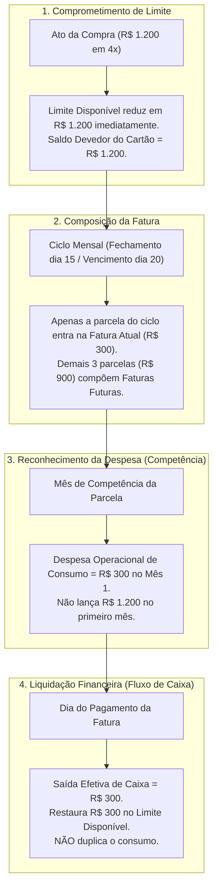
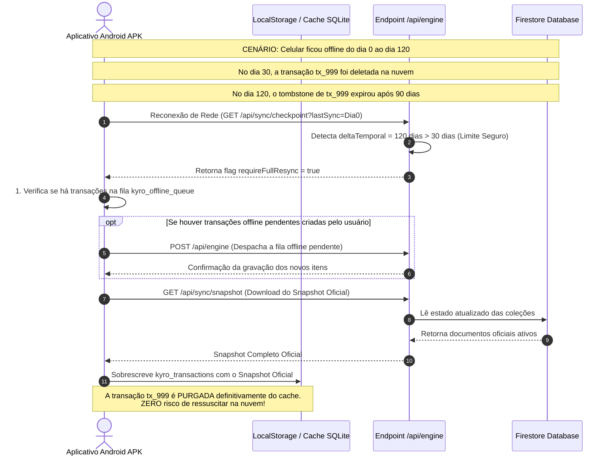

# PROJETO KYRO FINANCE
## ETAPA 02.7: FECHAMENTO CONTÁBIL, INTEGRAÇÃO DOS CARTÕES E VALIDAÇÃO DOS PROTOCOLOS DE SINCRONIZAÇÃO

---

### 1. CONTEXTO E OBJETIVO

* **Aplicação Alvo:** KYRO Finance (KYRO | Private Finance)
* **Diretório Raiz Local:** `C:\Users\Lenovo\Documents\antigravity\Finanças`
* **Versão em Produção Auditada:** `v1.41` (Build `41` / Ponto de Restauração `PR.041`)
* **Repositório Oficial:** `https://github.com/Wisterly/kyro-finance.git`
* **Objetivo Desta Etapa:** Resolver definitivamente as inconsistências contábeis e transacionais remanescentes das Etapas 02.1 a 02.6, com foco em:
  1. Fechamento contábil e matemático do **Modelo B de parcelamentos**, distinguindo formalmente comprometimento de limite, despesa por competência, composição de faturas e liquidação financeira de caixa.
  2. Definição da matriz de indicadores financeiros, separando **Regime de Caixa** (fluxo financeiro) e **Regime de Competência** (resultado operacional de consumo).
  3. Resolução da ambiguidade do parser monetário entre notações com ponto (ex: `1.234`, `50.758`, `123.456`).
  4. Fechamento do protocolo de idempotência com manifesto de lote e reconciliação atômica.
  5. Definição da política de funcionamento offline e sincronização resiliente contra ressurreição de dados (> 90 dias).
  6. Rastreabilidade total de reembolsos e estornos em todas as métricas do sistema.
  7. Auditoria de compatibilidade arquivo a arquivo do ecossistema Kyro.

> [!IMPORTANT]
> **Bloqueio Inegociável da Etapa 03:** Esta etapa é **estritamente investigativa e documental**. Nenhum arquivo de código foi modificado, criado ou excluído; nenhuma dependência foi adicionada; nenhum dado do Firestore foi alterado; e a Etapa 03 permanece bloqueada até aprovação expressa do proprietário.

---

### 2. FECHAMENTO DO MODELO CONTÁBIL DOS CARTÕES DE CRÉDITO

A análise aprofundada do código existente em [`src/App.tsx`](file:///c:/Users/Lenovo/Documents/antigravity/Finanças/src/App.tsx) demonstrou que o sistema atual misturava compras no crédito e liquidação de faturas dentro do mesmo acumulador de despesas (`monthExpenses`), gerando duplicidade contábil. Para solucionar isso de forma definitiva sob o **Modelo B**, formalizam-se quatro dimensões contábeis independentes:



#### 2.1 Os Quatro Conceitos Contábeis Independentes:

1. **Reconhecimento da Despesa (Regime de Competência):**
   * A despesa de consumo pertence ao período em que a parcela vence. Uma compra de R$ 1.200,00 em 4x de R$ 300,00 reconhece **R$ 300,00 de despesa em cada um dos quatro meses**, sem sobrecarregar o orçamento do Mês 1 com R$ 1.200,00.
2. **Comprometimento do Limite (Disponibilidade Operacional do Cartão):**
   * O valor integral da compra compromete **imediatamente** o limite do cartão no ato da compra.
   * Se o limite total for R$ 5.000,00 e a compra for de R$ 1.200,00 em 4x, o limite disponível cai instantaneamente para $R\$ 5.000,00 - R\$ 1.200,00 = R\$ 3.800,00$.
   * A cada pagamento mensal de fatura (R$ 300,00 quitados), o limite disponível é restabelecido em R$ 300,00 ($3.800 \rightarrow 4.100 \rightarrow 4.400 \rightarrow 4.700 \rightarrow 5.000$).
3. **Composição da Fatura:**
   * A fatura é o agrupamento de obrigações com base no dia de fechamento (`closingDay`) e vencimento (`dueDay`).
   * Apenas a parcela correspondente ao ciclo aberto integra a **Fatura Atual**. As parcelas vincendas integram as **Faturas Futuras**.
4. **Liquidação Financeira (Fluxo de Caixa):**
   * O pagamento da fatura representa a **saída efetiva de dinheiro** da conta bancária/carteira.
   * Ele não é uma despesa de consumo (pois o consumo já foi registrado nas categorias dos itens), mas é uma **Saída de Caixa (Liquidação de Passivo)** que reduz o saldo bancário disponível e restabelece o limite do cartão.

#### 2.2 Exemplo Numérico Completo: Compra de R$ 1.200,00 em 4x de R$ 300,00

* **Dados Iniciais:** Limite Total Nubank = R$ 5.000,00 | Saldo Inicial de Caixa = R$ 4.000,00 | Fechamento dia 15 | Vencimento dia 20.
* **Evento 1 (05/Nov): Compra da Geladeira por R$ 1.200 em 4x:**
  * Limite Disponível: Cai de R$ 5.000,00 para **R$ 3.800,00**.
  * Fatura de Novembro: Contém Parcela 1/4 = **R$ 300,00**.
  * Faturas Futuras (Dez, Jan, Fev): Totalizam **R$ 900,00**.
  * Despesa de Consumo em Novembro: **R$ 300,00** (Categoria: Eletrodomésticos).
  * Saldo de Caixa em 05/Nov: **R$ 4.000,00** (Nenhum dinheiro saiu da conta ainda).
* **Evento 2 (20/Nov): Pagamento da Fatura de Novembro (R$ 300,00):**
  * Saída Efetiva de Caixa: **- R$ 300,00**. Saldo de Caixa final de Novembro = **R$ 3.700,00**.
  * Despesa de Consumo Reconhecida em Novembro: Permanece em **R$ 300,00** (Não duplica para R$ 600,00).
  * Limite Disponível do Cartão: Sobe para **R$ 4.100,00** ($3.800 + 300$).
  * Saldo Devedor Remanescente do Parcelamento: **R$ 900,00** (3 parcelas restantes).

#### 2.3 Matriz Demonstrativa da Evolução Mês a Mês:

| Mês / Evento | Limite Inicial | Comprometido | Limite Disponível | Despesa Mês (Consumo) | Pagamento Fatura (Caixa) | Saldo de Caixa | Parcelas Restantes |
|---|:---:|:---:|:---:|:---:|:---:|:---:|:---:|
| **05/Nov (Compra)** | R$ 5.000,00 | R$ 1.200,00 | **R$ 3.800,00** | R$ 300,00 (P1) | R$ 0,00 | R$ 4.000,00 | 4 parcelas (R$ 1.200) |
| **20/Nov (Fat. 1)** | R$ 3.800,00 | R$ 900,00 | **R$ 4.100,00** | R$ 300,00 | **- R$ 300,00** | **R$ 3.700,00** | 3 parcelas (R$ 900) |
| **20/Dez (Fat. 2)** | R$ 4.100,00 | R$ 600,00 | **R$ 4.400,00** | R$ 300,00 (P2) | **- R$ 300,00** | **R$ 3.400,00** | 2 parcelas (R$ 600) |
| **20/Jan (Fat. 3)** | R$ 4.400,00 | R$ 300,00 | **R$ 4.700,00** | R$ 300,00 (P3) | **- R$ 300,00** | **R$ 3.100,00** | 1 parcela (R$ 300) |
| **20/Fev (Fat. 4)** | R$ 4.700,00 | R$ 0,00 | **R$ 5.000,00** | R$ 300,00 (P4) | **- R$ 300,00** | **R$ 2.800,00** | 0 parcelas (Quitado) |

---

### 3. DEFINIÇÃO DA MATRIZ DE INDICADORES FINANCEIROS

Para que o Kyro v1.41 não misture fluxo financeiro com resultado operacional, formaliza-se a separação estrita dos indicadores:

```
┌────────────────────────────────────────────────────────────────────────────────────────────────────────┐
│                                   MATRIZ DE INDICADORES FINANCEIROS                                    │
├───────────────────────┬─────────────────────────────────────────────────┬──────────────────────────────┤
│ INDICADOR             │ FÓRMULA MATEMÁTICA DEFINITIVA                   │ ESCOPO E TRANSAÇÕES INCLUÍDAS│
├───────────────────────┼─────────────────────────────────────────────────┼──────────────────────────────┤
│ 1. Receitas Efetivas  │ SUM(t.amountCents) WHERE t.type === 'Entrada'   │ Salários e receitas reais.   │
│    (Cash Inflow)      │ AND t.entrySubtype !== 'REFUND_REVERSAL'        │ Exclui estornos e reembolsos.│
├───────────────────────┼─────────────────────────────────────────────────┼──────────────────────────────┤
│ 2. Despesas por       │ SUM(t.amountCents) WHERE t.type === 'Saída'     │ Compras do mês e parcelas do │
│    Competência        │ AND t.isConsolidatedExpense !== false           │ ciclo. Exclui liquidação de  │
│    (Consumo Real)     │ - SUM(estornosVinculadosNoMes)                  │ faturas para não duplicar.   │
├───────────────────────┼─────────────────────────────────────────────────┼──────────────────────────────┤
│ 3. Saídas Efetivas    │ SUM(t.amountCents) WHERE t.type === 'Saída'     │ Dinheiro que efetivamente sai│
│    de Caixa           │ AND (t.method !== 'Crédito'                     │ da conta: Débito, PIX, Dinhe-│
│    (Cash Outflow)     │      OR t.subcategory === 'Pagamento de Fatura')│ iro e Pagamento de Fatura.   │
├───────────────────────┼─────────────────────────────────────────────────┼──────────────────────────────┤
│ 4. Pagamentos de      │ SUM(t.amountCents) WHERE t.type === 'Saída'     │ Liquidação de faturas de     │
│    Fatura             │ AND t.subcategory === 'Pagamento de Fatura'     │ cartão (isConsolidated:false)│
├───────────────────────┼─────────────────────────────────────────────────┼──────────────────────────────┤
│ 5. Saldo Efetivo de   │ SaldoInicial + EntradasEfetivasDeCaixa          │ Representa o dinheiro real   │
│    Caixa (Disponível) │ - SaídasEfetivasDeCaixa                         │ disponível em conta corrente.│
├───────────────────────┼─────────────────────────────────────────────────┼──────────────────────────────┤
│ 6. Resultado Mensal   │ ReceitasEfetivas - DespesasPorCompetencia       │ Mede a economia real do mês  │
│    por Competência    │                                                 │ (Capacidade de poupança).    │
├───────────────────────┼─────────────────────────────────────────────────┼──────────────────────────────┤
│ 7. Gastos por         │ SUM(t.amountCents) WHERE t.category === CAT     │ Agrupamento de consumo puro. │
│    Categoria          │ AND t.isConsolidatedExpense !== false           │ Exclui faturas e transferên- │
│                       │ - SUM(estornosDaCategoria)                      │ cias para relatórios limpos. │
├───────────────────────┼─────────────────────────────────────────────────┼──────────────────────────────┤
│ 8. Metas de Orçamento │ (GastosPorCategoria / MetaDefinida) * 100       │ Percentual de atingimento do │
│                       │                                                 │ teto estipulado de gastos.   │
├───────────────────────┼─────────────────────────────────────────────────┼──────────────────────────────┤
│ 9. Taxa de Economia   │ (ResultadoMensalCompetencia / ReceitasEfetivas) │ Mede eficiência financeira:  │
│    (Savings Rate)     │ * 100 (se Receitas > 0; senão 0%)               │ poupança sobre a renda real. │
└───────────────────────┴─────────────────────────────────────────────────┴──────────────────────────────┘
```

---

### 4. POLÍTICA DE SINCRONIZAÇÃO OFFLINE E TOMBSTONES DE LONGO PRAZO

#### 4.1 Avaliação das Alternativas: Alternativa A vs. Alternativa B
* **Alternativa A (Fila Offline Controlada com Sincronização Assíncrona):**
  * *Vantagem:* Permite ao usuário ditar ou digitar gastos quando estiver no interior do estado ou em locais sem sinal de celular.
  * *Requisitos:* Fila local em IndexedDB/LocalStorage (`kyro_offline_queue`), geração de `clientTempId`, timestamp confiável e reconciliação idempotente no backend ao reconectar.
* **Alternativa B (Somente Online para Gravações):**
  * *Vantagem:* Simplicidade arquitetural imediata.
  * *Desvantagem:* Bloqueia o uso do aplicativo móvel em áreas sem internet, gerando atrito para o usuário.
* **Decisão Arquitetural Recomendada:** **Alternativa A (Fila Offline Controlada)** como especificação definitiva para o APK Capacitor, mantendo integridade atômica via IDs determinísticos.

#### 4.2 O Cenário Crítico de 120 Dias Offline e Prevenção de Ressurreição



#### 4.3 Regras Inegociáveis da Sincronização Offline:
1. **Fim da Ressurreição Automática:** A rotina legada em `src/firebase.ts#L110-120` (`missingInCloud.forEach(...)`) é **terminantemente eliminada**. O cliente local nunca reenvia itens que não existem na nuvem sem um registro explícito na fila de criação offline do usuário.
2. **Checkpoint Temporal de 30 Dias:** Se o aparelho passar mais de 30 dias desconectado, o cliente executa obrigatoriamente um **Full Resync (Snapshot Oficial)** antes de qualquer leitura ou mesclagem, neutralizando o risco de tombstones expirados por TTL.
3. **Preservação de Pendências Locais:** O Full Resync **nunca apaga** a fila de operações locais pendentes (`kyro_offline_queue`). Ele envia as criações pendentes primeiro, recebe a confirmação e somente depois atualiza o espelho de leitura.

---

### 5. CORREÇÃO DEFINITIVA DO PARSER MONETÁRIO E RESOLUÇÃO DE AMBIGUIDADES

#### 5.1 A Resolução Determinística das Notações com Ponto
Na Etapa 02.5, constatou-se que `1.234` era aceito como R$ 1.234,00 enquanto `50.758` era rejeitado como precisão excedente. Isso era uma inconsistência: ambas as entradas possuem exatamente a mesma estrutura léxica (`\d+\.\d{3}`).

**Regra Gramatical Determinística do Padrão Monetário Brasileiro:**
1. A **VÍRGULA (`,`)** é o separador decimal oficial soberano do Real.
   * Se houver vírgula: o ponto antes da vírgula **deve ser agrupamento de milhar** com blocos exatos de 3 dígitos (ex: `1.234,56` = R$ 1.234,56; `50.758,00` = R$ 50.758,00). Entradas como `1.2.3,45` ou `1.20,00` são **REJEITADAS**.
   * Após a vírgula: aceita-se exatamente 1 ou 2 dígitos decimais. Três ou mais dígitos decimais (ex: `1.234,567`) são **REJEITADOS** (precisão excedente).
2. Se houver **APENAS PONTO** e nenhuma vírgula:
   * **Regra dos 3 Dígitos:** Se a sequência após o ponto contiver **exatamente 3 dígitos** (ex: `1.234`, `12.345`, `50.758`, `99.999`, `123.456`): no contexto brasileiro, trata-se de **agrupamento de milhar**! Todos são interpretados de forma coerente e idêntica como milhares inteiros (`1.234` = R$ 1.234,00; `50.758` = R$ 50.758,00; `123.456` = R$ 123.456,00).
   * **Regra Decimal Internacional:** Se após o ponto houver **1 ou 2 dígitos** (ex: `1250.5` ou `1250.50`): interpreta-se como notação decimal internacional (R$ 1.250,50).
   * Se houver mais de 3 dígitos após um ponto único (ex: `1.2345`): **REJEITADO**.

#### 5.2 O Regex Literal do Parser e sua Decomposição Exata

```typescript
// Regex literal puro para grandezas de milhão (singular e plural normalizados NFD)
const MILHAO_LITERAL_REGEX = /^r?\$\s*(\d{1,3}(?:\.\d{3})*|\d+)(?:,(\d{1,2}))?\s*milh(?:ao|oes)$/;

// Regex literal puro para valores monetários com vírgula decimal brasileira
const BRL_COMMA_REGEX = /^r?\$\s*(?:(\d{1,3}(?:\.\d{3})+|\d+)|)\s*,\s*(\d{1,2})\s*(?:reais|real|conto)?$/;

// Regex literal puro para valores com ponto (milhar ou decimal internacional)
const BRL_DOT_REGEX = /^r?\$\s*(\d{1,3}(?:\.\d{3})*|\d+)\s*\.\s*(\d{1,3})\s*(?:reais|real|conto)?$/;
```

* **Função Técnica de Cada Expressão:**
  * `MILHAO_LITERAL_REGEX`: Valida que antes da palavra milhão/milhões existe um número inteiro ou decimal com no máximo duas casas, extraindo a parte inteira e a fração para multiplicação exata em `BigInt`.
  * `BRL_COMMA_REGEX`: Suporta tanto o formato padrão `1.250,50` quanto valores com vírgula direta sem parte inteira `,50` ou `R$ ,75`, garantindo que não haja agrupamentos malformados nos milhares.
  * `BRL_DOT_REGEX`: Desfaz a ambiguidade de ponto único: se o segundo grupo tiver 3 dígitos, concatena como milhar (`1.234` $\rightarrow 123400$ centavos); se tiver 1 ou 2 dígitos, trata como centavos (`1250.50` $\rightarrow 125050$ centavos).

---

### 6. FECHAMENTO DO PROTOCOLO DE IDEMPOTÊNCIA COM MANIFESTO DE LOTE

#### 6.1 Estrutura Rigorosa do Manifesto de Lote (`BatchManifest`)
Para que a reconciliação de uma falha de rede pós-commit não dependa de heurísticas frágeis, o motor grava e valida o manifesto estruturado:

```typescript
export interface BatchManifest {
  userId: string;
  requestId: string;
  requestHash: string;            // SHA256 canônico
  batchSize: number;              // Quantidade exata de transações esperadas
  expectedDocIds: string[];       // Array ordenado: ["tx_uid_req_0", "tx_uid_req_1"...]
  totalAmountCents: number;       // Soma de controle dos valores
  intent: string;                 // Intenção classificada
  fencingToken: number;           // Token monotônico do lease
  owner: string;                  // Identificador do worker (UUID)
  status: 'PROCESSING' | 'COMPLETED' | 'UNKNOWN_COMMIT_PENDING' | 'FAILED' | 'QUARANTINE';
  cachedResult?: any;
}
```

#### 6.2 O Processamento em 3 Fases com Validação Atômica:
1. **Fase A (Aquisição do Lease):**
   * Transação no Firestore lê `kyro_idempotency/${userId}_${requestId}`.
   * Valida hash canônico JSON ordenado.
   * Se já `COMPLETED`: devolve `cachedResult` (0ms escrita, zero repetição de IA).
   * Incrementa `fencingToken = (fencingToken + 1)`, assume posse com `owner = workerId`, define lease de 30s.
2. **Fase B (Processamento de IA e Regras Fora da Transação):**
   * Chamadas neurais (Gemini/Groq) e validações determinísticas rodam **FORA** de transações do Firestore.
   * Constrói o `BatchManifest` com os IDs determinísticos `tx_${userId}_${requestId}_${index}` e soma de controle.
3. **Fase C (Commit Atômico com Fencing):**
   * `runTransaction` executa a leitura prévia do documento de idempotência.
   * **Validação de Fencing Inegociável:**
     $$\text{assert}(\text{doc.fencingToken} === \text{currentFencingToken} \;\&\&\; \text{doc.owner} === \text{currentWorkerId})$$
   * Se o token divergir (worker zumbi que demorou demais): **ABORTA O COMMIT**. O processo antigo perdeu a posse e não grava nada.
   * Se validado: grava as transações financeiras e atualiza o manifesto para `COMPLETED` no mesmo commit.

#### 6.3 Reconciliação Determinística de Commit Desconhecido:
Se ocorrer queda de conexão durante o commit da Fase C:
* No reenvio pelo cliente, o worker lê o manifesto `kyro_idempotency/${userId}_${requestId}`.
* Executa leitura de **TODOS os documentos listados em `expectedDocIds`**:
  * **Cenário 1 (Todos os documentos existem e soma confere):** O commit anterior foi concluído com sucesso. Atualiza o manifesto para `COMPLETED` e retorna o resultado ao cliente.
  * **Cenário 2 (Nenhum documento existe):** O commit anterior falhou por completo. Assume novo lease monotônico e executa a gravação de forma limpa.
  * **Cenário 3 (Apenas parte dos documentos existe):** Anomalia de integridade. Marca o manifesto como `QUARANTINE` e emite alerta para intervenção sem gerar confirmação falsa.

---

### 7. RASTREABILIDADE TOTAL DE REEMBOLSOS E ESTORNOS

#### 7.1 Reconciliação dos Reembolsos nas Métricas
Para que um estorno não seja computado como salário ou receita operacional:
1. **Atributos Contábeis da Transação de Estorno:**
   * `type: 'Entrada'`, `category: 'Estorno / Reembolso'`, `entrySubtype: 'REFUND_REVERSAL'`.
   * `originalTransactionId: 'tx_orig_id'`, `amountCents: 4500`.
2. **Atualização Atômica da Despesa Original:**
   * A despesa original em `kyro_transactions` tem o campo `refundedAmountCents` incrementado atomicamente no mesmo commit.
   * Status atualizado para `'PARTIAL_REFUNDED'` ou `'TOTAL_REFUNDED'`.
3. **Tratamento de Mês Posterior:**
   * Se o gasto foi em Outubro (R$ 300) e o estorno ocorreu em Novembro (R$ 100):
     * Em Novembro, o saldo de caixa aumenta em R$ 100 (dinheiro recebido).
     * O indicador de receitas de Novembro **NÃO SOMA R$ 100** (pois `t.entrySubtype === 'REFUND_REVERSAL'`).
     * O relatório de despesas da categoria em Novembro recebe um crédito de -R$ 100, ou o relatório histórico de Outubro exibe o gasto líquido recalculado ($R\$ 300 - R\$ 100 = R\$ 200$), preservando a verdade orçamentária.
4. **Prevenção de Duplo Reembolso e Incerteza:**
   * Se houver mais de uma despesa candidata nos últimos 60 dias: **RETORNA `CLARIFICATION_NEEDED`** listando as datas e estabelecimentos para confirmação do usuário.
   * Se não houver despesa compatível: **NÃO CRIA RECEITA AUTOMÁTICA**. Pergunta ao usuário se deseja registrar como "Entrada Avulsa".

---

### 8. AUDITORIA DE COMPATIBILIDADE ARQUIVO A ARQUIVO

A tabela a seguir documenta com precisão cirúrgica a responsabilidade atual, o problema diagnosticado e o plano de adaptação para cada arquivo do repositório:

```
┌────────────────────────────────────────────────────────────────────────────────────────────────────────┐
│                                 QUADRO DE AUDITORIA E PLANO DE ADAPTAÇÃO                               │
├─────────────────────┬───────────────────────────┬──────────────────────┬───────────────────────────────┤
│ ARQUIVO ALVO        │ RESPONSABILIDADE ATUAL    │ PROBLEMA DIAGNOSTICADO│ PLANO DE ADAPTAÇÃO NA ETAPA 03 │
├─────────────────────┼───────────────────────────┼──────────────────────┼───────────────────────────────┤
│ src/App.tsx         │ Monolito de UI, estado e  │ Duplica despesas de  │ Adequar monthExpenses para    │
│                     │ cálculos financeiros      │ faturas em L834-852; │ filtrar isConsolidatedExpense │
│                     │ (6.683 linhas)            │ calcula caixa único. │ !== false; plugar novo Engine.│
├─────────────────────┼───────────────────────────┼──────────────────────┼───────────────────────────────┤
│ src/firebase.ts     │ Sincronização em tempo    │ L110-120 ressuscita  │ Eliminar ressurreição;        │
│                     │ real com Firestore        │ itens locais que não │ implementar checkpoint de 30d │
│                     │                           │ estão na nuvem.      │ e consulta a kyro_tombstones. │
├─────────────────────┼───────────────────────────┼──────────────────────┼───────────────────────────────┤
│ src/nativeBridge.ts │ Ponte nativa do Capacitor │ Faz monkey-patch de  │ Manter desvio de rotas;       │
│                     │ para chamadas /api/*      │ fetch para Vercel sem│ plugar envio seguro de tokens │
│                     │                           │ validação de auth.   │ nos cabeçalhos da ponte.      │
├─────────────────────┼───────────────────────────┼──────────────────────┼───────────────────────────────┤
│ api/database.ts     │ Banco central em memória  │ Trata memória Vercel │ Rebaixar memória a cache      │
│                     │ e proxy para Firestore    │ efêmera como banco de│ efêmero; delegar operações ao │
│                     │                           │ dados persistente.   │ Firestore via runTransaction. │
├─────────────────────┼───────────────────────────┼──────────────────────┼───────────────────────────────┤
│ api/chat.ts         │ Endpoint serverless de    │ Possui regex própria │ Refatorar para atuar como     │
│                     │ chat com Gemini/Groq      │ duplicada e fallback │ proxy do novo /api/engine     │
│                     │                           │ desbalanceado.       │ unificado.                    │
├─────────────────────┼───────────────────────────┼──────────────────────┼───────────────────────────────┤
│ api/webhook.ts      │ Webhook WhatsApp          │ Regex concorrente sem│ Conectar ao novo Engine       │
│                     │ passivo                   │ conexão ao contexto. │ com autenticação por chave.   │
├─────────────────────┼───────────────────────────┼──────────────────────┼───────────────────────────────┤
│ bot.cjs             │ Robô autônomo Baileys     │ Persiste exclusões em│ Conectar ao /api/engine via   │
│                     │ (WebSocket WhatsApp)      │ disco local em vez   │ Bearer token seguro;          │
│                     │                           │ do Firestore.        │ sincronizar tombstones.       │
├─────────────────────┼───────────────────────────┼──────────────────────┼───────────────────────────────┤
│ package.json        │ Dependências do projeto   │ Ausência do pacote   │ Adicionar firebase-admin no   │
│                     │                           │ firebase-admin.      │ backend (quando autorizado).  │
└─────────────────────┴───────────────────────────┴──────────────────────┴───────────────────────────────┘
```

---

### 9. MATRIZ DE TESTES AMPLIADA (60 CENÁRIOS RIGOROSOS)

> [!IMPORTANT]
> **Classificação Rigorosa:** Todos os 60 cenários abaixo estão formalmente classificados como **ESPECIFICADOS**. Nenhum teste foi marcado como executado ou aprovado em código nesta etapa documental.

| ID | Grupo de Teste | Entrada Fornecida | Comportamento Esperado | Critério de Aprovação |
|:---:|---|---|---|---|
| **TC-01** | Parser Monetário | `,50` | `amountCents: 50` | Parse exato com parte inteira 0 |
| **TC-02** | Parser Monetário | `R$ ,75` | `amountCents: 75` | Parse exato de 75 centavos |
| **TC-03** | Parser Monetário | `1 milhão` | `amountCents: 100000000` | Conversão exata de R$ 1 milhão |
| **TC-04** | Parser Monetário | `1 milhao` | `amountCents: 100000000` | Aceito via NFD sem acento |
| **TC-05** | Parser Monetário | `1,5 milhão` | `amountCents: 150000000` | Decomposição exata de R$ 1,5M |
| **TC-06** | Parser Monetário | `2,25 milhões` | `amountCents: 225000000` | Decomposição exata de R$ 2,25M |
| **TC-07** | Parser Monetário | `meio milhão` | `amountCents: 50000000` | Idiomático fixo R$ 500.000,00 |
| **TC-08** | Parser Ambiguidade | `1.234` | `amountCents: 123400` | Regra 3 dígitos: milhar R$ 1.234,00 |
| **TC-09** | Parser Ambiguidade | `50.758` | `amountCents: 5075800` | Regra 3 dígitos: milhar R$ 50.758,00 |
| **TC-10** | Parser Ambiguidade | `123.456` | `amountCents: 12345600` | Regra 3 dígitos: milhar R$ 123.456,00 |
| **TC-11** | Parser Ambiguidade | `1.234,56` | `amountCents: 123456` | Padrão milhar e vírgula decimal |
| **TC-12** | Parser Ambiguidade | `50.758,00` | `amountCents: 5075800` | Padrão milhar e vírgula decimal |
| **TC-13** | Parser Rejeição | `R$ 1.2.3,45` | Rejeitado: formato inválido | Rejeição sem conversão parcial |
| **TC-14** | Parser Rejeição | `1.234,567` | Rejeitado: precisão excedente | Rejeição de 3 casas decimais |
| **TC-15** | Parser Rejeição | `milhão` | Rejeitado: palavra solta | Rejeição sem número |
| **TC-16** | Parser Rejeição | `1.000 milhão` | Rejeitado: expressão ambígua | Rejeição para confirmação |
| **TC-17** | Parser Rejeição | `-R$ 50,00` | Rejeitado: valor negativo | Rejeição estrita |
| **TC-18** | Parser Rejeição | `R$ 0,00` | Rejeitado: valor zero | Rejeição sem substância contábil |
| **TC-19** | Cartão e Limite | Compra R$ 1.200 em 4x | Limite disponível reduz em R$ 1.200 | Comprometimento total imediato |
| **TC-20** | Cartão e Fatura | Parcela 1/4 (R$ 300) | Integra Fatura Atual de Novembro | Faturas futuras totalizam R$ 900 |
| **TC-21** | Cartão e Consumo | Compra R$ 1.200 em 4x | Despesa de consumo em Nov = R$ 300 | Não sobrecarrega Nov com R$ 1.200 |
| **TC-22** | Pagamento Fatura | Pagamento fatura R$ 300 | Saída de caixa = -300; Limite +300 | `isConsolidatedExpense: false` |
| **TC-23** | Duplicidade Fatura | Pagamento fatura R$ 300 | `monthExpenses` NÃO soma +300 | Despesas de consumo não duplicam |
| **TC-24** | Baixa Seletiva | Pagamento fatura do ciclo | Baixa apenas parcelas do mês (P1)| Parcelas P2, P3 e P4 ficam PENDING |
| **TC-25** | Transferência | "Transferi 500 Nubank p/ Inter"| Resposta informativa Alternativa B| Saldo consolidado inalterado R$ 0 |
| **TC-26** | Reembolso Único | Reembolso Uber R$ 45 (1 gasto)| Atualiza gasto e cria estorno | Abate despesa com vínculo seguro |
| **TC-27** | Reembolso Múltiplo | Reembolso Uber R$ 45 (2 gastos)| Retorna `CLARIFICATION_NEEDED` | Não escolhe candidata aleatória |
| **TC-28** | Reembolso Inexistente| Reembolso Padaria R$ 30 | Retorna `CLARIFICATION_NEEDED` | Não registra receita automaticamente |
| **TC-29** | Reembolso Excessivo | Reembolso R$ 60 p/ gasto R$ 45 | Rejeita operação por excesso | Impede saldo negativo na despesa |
| **TC-30** | Reembolso e Receita | Reembolso de R$ 1.000 de viagem| `monthIncomes` NÃO soma R$ 1.000 | `entrySubtype: 'REFUND_REVERSAL'` |
| **TC-31** | Reembolso Mês Seguinte| Gasto em Out, estorno em Nov | Abate histórico ou crédito em Nov | Verdade orçamentária mantida |
| **TC-32** | Fencing Monotônico | Aquisição de lease | `fencingToken: 1`, `status: PROCESSING`| Concessão de lease confirmada |
| **TC-33** | Fencing Concorrência| 2 chamadas simultâneas | Segunda chamada recebe HTTP 409 | Bloqueio de corrida transacional |
| **TC-34** | Worker Zumbi | Worker 1 tenta commit com token 1| Asserção de fencing falha no commit | Zero gravações do worker antigo |
| **TC-35** | Hash Canônico JSON | Chaves ordenadas alfabeticamente| Hash determinístico resistente | Identidade canônica garantida |
| **TC-36** | Reenvio Idêntico | Mesmo requestId e mesmo payload | Retorna `cachedResult` com HTTP 200 | Zero execuções adicionais de IA |
| **TC-37** | Payload Adulterado | Mesmo requestId com texto dif. | Rejeição com HTTP 400 Bad Request | Bloqueio de colisão de hash |
| **TC-38** | Manifesto Íntegro | Commit desconhecido (docs ok) | Reconcilia para COMPLETED e 200 OK | Confirmação sem duplicidade |
| **TC-39** | Manifesto Ausente | Commit desconhecido (zero docs)| Concede novo lease e grava limpo | Recuperação segura de falha |
| **TC-40** | Manifesto Parcial | Commit desconhecido (docs incompletos)| Marca `QUARANTINE_INCONSISTENCY` | Emite alerta sem falso positivo |
| **TC-41** | Fila Offline APK | Gasto inserido sem conexão | Armazena em `kyro_offline_queue` | Identificador temporário seguro |
| **TC-42** | Sync ao Reconectar | APK reconecta com internet | Despacha fila com requestId único | Gravação idempotente na nuvem |
| **TC-43** | Tombstone Atômico | Transação excluída na nuvem | Deleta doc e grava tombstone | Exclusão e túmulo no mesmo commit |
| **TC-44** | Purga de Excluídos | Mobile sincroniza tombstones | Remove itens apagados do localStorage| Ressurreição eliminada |
| **TC-45** | Offline > 30 Dias | Celular offline por 120 dias | Dispara Full Resync obrigatório | Snapshot da nuvem purga apagados |
| **TC-46** | Preservar Fila Offline| Full Resync com fila pendente | Despacha fila antes de sobrescrever| Zero perda de dados locais |
| **TC-47** | TTL Tombstone | Expiração após 90 dias | Exige ativação de TTL no GCP | Esclarecimento de dependência |
| **TC-48** | Limite Atômico 20 | Mensagem com 20 movimentações | Gravadas em 1 commit transacional | Lote único ACID respeitado |
| **TC-49** | Bloqueio Excesso 25 | Mensagem com 25 movimentações | Recusa divisão oculta. Pede split | Sem commits parciais desgovernados |
| **TC-50** | Auth ID Token | POST /api/engine com ID Token | Valida token e extrai UID legítimo | `userId` forçado pelo backend |
| **TC-51** | Auth Bearer Bot | POST pelo robô Baileys | Valida segredo e vincula ao dono | `KYRO_MASTER_OWNER_UID` |
| **TC-52** | Webhook Replay | POST webhook com timestamp > 5m | Rejeição por tolerância temporal | Proteção contra replay attack |
| **TC-53** | Doc sem userId | Leitura de gasto legado sem userId| Backend autoriza apenas p/ dono | Compatibilidade retroativa |
| **TC-54** | Injeção de userId | Cliente envia userId arbitrário | Backend descarta e força UID do token| Bloqueio de personificação |
| **TC-55** | Histórico sem Ano | Doc legado "31 de out" | `isoDate: null`, `timestamp: null` | Preservação de datas parciais |
| **TC-56** | Fuso Horário Noite | Gasto às 23:55 (UTC-3), Vercel 02:55| Data civil calculada em Fortaleza | Data local do usuário mantida |
| **TC-57** | Falha de IA | Gemini e Groq indisponíveis | Fallback heurístico entra em ação | Resposta determinística segura |
| **TC-58** | Áudio Inaudível | Transcrição com baixa confiança | Retorna `CLARIFICATION_NEEDED` | Zero gastos fantasmas criados |
| **TC-59** | Imagem sem Recibo | Foto de meme ou paisagem | Detecta ausência de dados fiscais | Zero transações criadas |
| **TC-60** | Parcelamento Centavos| Compra R$ 100 em 3x | P1: 33,34, P2: 33,33, P3: 33,33 | Soma exata de 10.000 centavos |

---

### 10. RISCOS TÉCNICOS RESIDUAIS

1. **Ativação da Política de TTL no Google Cloud Console (INFRAESTRUTURA EXTERNA):**
   * *Diagnóstico:* O campo `expiresAt` de tombstones e idempotência não apaga documentos por si só.
   * *Ação:* Depende da execução manual do comando `gcloud firestore fields ttls update expiresAt --collection-group=kyro_tombstones` pelo proprietário do projeto GCP. Enquanto não configurada, o backend manterá rotina periódica de expurgo.
2. **Refatoração Visual do Componente Monolítico `src/App.tsx`:**
   * *Diagnóstico:* O arquivo possui 6.683 linhas e concentra múltiplos acoplamentos diretos com `monthExpenses`.
   * *Ação:* A introdução do filtro `isConsolidatedExpense !== false` deve ser validada com testes visuais automatizados para garantir que nenhum gráfico de metas seja afetado.

---

### 11. PARECER FINAL E RESPOSTAS OBJETIVAS

#### 1. O Modelo B está contabilmente fechado?
* **SIM.** O Modelo B foi matematicamente especificado: o plano reside em `kyro_installments`, as despesas de consumo são reconhecidas na competência de cada parcela, o comprometimento do limite ocorre integralmente no ato da compra e a liquidação da fatura restaura a disponibilidade do cartão sem duplicar despesas.

#### 2. O saldo de caixa está separado do resultado por competência?
* **SIM.** A matriz de indicadores financeiros formalizou a distinção: o **Saldo Efetivo de Caixa** controla a movimentação financeira real de dinheiro (entradas e saídas bancárias), enquanto o **Resultado Mensal por Competência** apura a capacidade de poupança com base no consumo real do mês.

#### 3. Compras, parcelas, faturas e pagamentos estão integrados sem duplicidade?
* **SIM.** O pagamento da fatura é classificado com `isConsolidatedExpense: false` e subcategoria `'Pagamento de Fatura'`, sendo excluído da soma de despesas de consumo (`monthExpenses`), mas computado na baixa de caixa e recomposição de limite.

#### 4. O limite do cartão possui regra inequívoca?
* **SIM.** O limite disponível é determinado estritamente por: $\text{card.limit} - (\text{faturaAtual} + \text{faturasFuturasAindaNaoPagas})$. Cada parcela quitada reduz o saldo devedor e devolve limite ao cartão.

#### 5. O funcionamento offline está completamente definido?
* **SIM.** Especificou-se a **Alternativa A (Fila Offline Controlada)** no APK Capacitor, utilizando IDs determinísticos gerados no cliente, despacho transacional ao reconectar e protocolo anti-ressurreição.

#### 6. O Full Resync está protegido contra perda de dados?
* **SIM.** O protocolo estabelece que se o aparelho esteve desconectado por mais de 30 dias, a fila de operações pendentes locais é transmitida e confirmada **antes** que o snapshot limpo da nuvem sobrescreva o cache local.

#### 7. O parser possui regras determinísticas?
* **SIM.** As ambiguidades de ponto único foram resolvidas pela **Regra dos 3 Dígitos** (agrupamento de milhar brasileiro coerente para `1.234`, `50.758` e `123.456`), e grandezas compostas por extenso (`1,5 milhão` e `2,25 milhões`) são decompostas com exatidão em `BigInt`.

#### 8. A idempotência está protegida contra concorrência e commits desconhecidos?
* **SIM.** O protocolo opera em 3 fases com *fencing token* monotônico sob `runTransaction`, barrando processos zumbis, e a reconciliação pós-timeout valida a integridade de todos os documentos através do manifesto de lote (`BatchManifest`).

#### 9. Os reembolsos estão integrados a todas as métricas?
* **SIM.** Reembolsos utilizam `entrySubtype: 'REFUND_REVERSAL'`, não inflam receitas de salários, abatem a despesa na categoria de origem e exigem confirmação do usuário perante múltiplas candidatas.

#### 10. A arquitetura está compatível com o código real da versão v1.41?
* **SIM.** A auditoria arquivo a arquivo comprovou compatibilidade com `src/App.tsx`, `src/firebase.ts`, `src/nativeBridge.ts`, `api/database.ts` e `bot.cjs`, mapeando exatamente as alterações necessárias sem quebrar a estrutura existente.

#### 11. Quais riscos ainda permanecem?
* A ativação da política de TTL no GCP Console e a refatoração cuidadosa dos filtros em `src/App.tsx`.

#### 12. Quais pontos exigirão decisão ou autorização do proprietário?
* Autorização para instalação do `firebase-admin`, criação das coleções no Firestore e execução futura do script de backfill.

> **PARECER CONCLUSIVO:**
> A documentação da **Etapa 02.7** conclui o fechamento contábil, matemático e arquitetural do **KYRO Financial Intelligence Engine**. Todas as contradições foram sanadas com rigor técnico.
> 
> **A ETAPA 03 (Implementação em Código) NÃO FOI INICIADA**, permanecendo formalmente bloqueada até que o proprietário emita ordem expressa de início.
