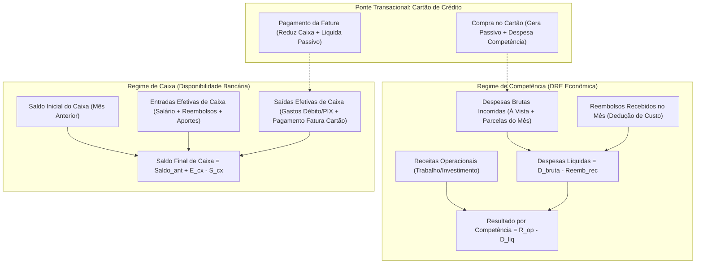
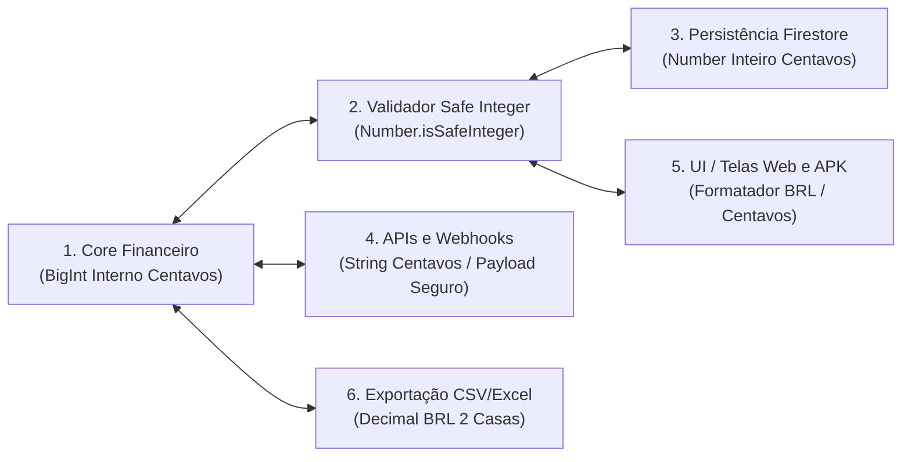
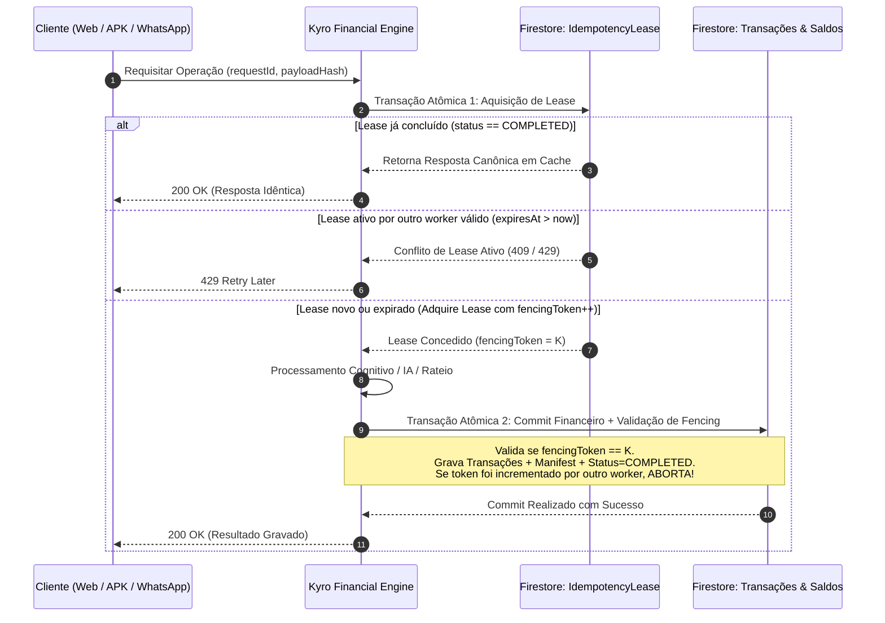

# PROJETO TÉCNICO DEFINITIVO — ETAPA 02.9
# FECHAMENTO OPERACIONAL DAS INCONSISTÊNCIAS, VALIDAÇÃO TRANSACIONAL E PREPARAÇÃO PARA IMPLEMENTAÇÃO

**Projeto:** KYRO Finance | KYRO Private Finance  
**Diretório:** `C:\Users\Lenovo\Documents\antigravity\Finanças`  
**Repositório:** `https://github.com/Wisterly/kyro-finance.git`  
**Versão de Referência em Produção:** `v1.41` (Build `41` / Ponto de Restauração `PR.041`)  
**Data da Especificação:** 05 de Novembro de 2026  
**Status do Projeto:** Fase Documental Conclusiva — **Etapa 03 (Implementação em Código) Bloqueada**  
**Documento Base:** `PROJETO_TECNICO_ETAPA_02_8_FECHAMENTO_FINAL.md`

---

## 1. CONTEXTO, RESPONSABILIDADE E ESCOPO DA ETAPA 02.9

O **KYRO Finance** é uma solução de inteligência financeira privada multiplataforma que opera de maneira convergente e integrada em três ecossistemas fundamentais:
1. **Aplicação Web (PWA):** Hospedada e executada na Vercel (`https://kyro-finance.vercel.app`), baseada em React 19, TypeScript e Vite.
2. **Aplicativo Mobile Android (APK):** Empacotado via Apache Cordova / Capacitor Nativo, operando com espelho local e sincronização resiliente na nuvem.
3. **Robô Conversacional WhatsApp:** Baseado em Baileys v6+, executado com processamento neural de linguagem natural e ingestão transacional automatizada.

A revisão crítica da Etapa 02.8 apontou que, embora o arcabouço conceitual tenha atingido maturidade avançada, permaneceram pendências e contradições operacionais que impediriam uma implementação segura e matematicamente íntegra:
- **Ambiguidade Contábil nos Indicadores:** Mistura de despesas brutas e despesas líquidas na apuração do resultado econômico, além de falta de formalização matemática fechada sobre como reembolsos e estornos interagem com o fluxo de caixa versus competência.
- **Detalhamento Incompleto do Modelo B de Cartões:** Falta de especificação exaustiva dos 17 cenários reais de cartões (antecipação com/sem desconto, rotativo, encargos de atraso, estornos parciais/totais, compras em dias de fechamento, etc.).
- **Incompatibilidade Técnica do BigInt com o Firestore:** O SDK JavaScript do Firestore rejeita nativamente instâncias de `BigInt`, exigindo uma arquitetura de representação em camadas rigorosa.
- **Fragilidades no Protocolo de Idempotência:** Necessidade de validação do fencing token na mesma transação atômica do commit, quarentena de estados desconhecidos e eliminação de tipagens `any`.
- **Mitigação Realista de Limitações do IndexedDB:** O armazenamento do navegador/APK não é infinito e sofre risco de expurgo silencioso (*storage eviction*) pelo SO sob pressão de memória.

Este documento encerra em definitivo todas essas pendências com rigor matemático, diagramas operacionais, contratos tipados em TypeScript estrito e prova de consistência cruzada entre os modelos contábeis e a base de código v1.41.

---

## 2. CORREÇÃO E FORMALIZAÇÃO RIGOROSA DAS FÓRMULAS CONTÁBEIS E FINANCEIRAS

### 2.1 Princípio da Separação Canônica: Caixa vs. Competência

Um dos pilares violados no sistema legado (v1.41) e parcialmente confuso em revisões anteriores é a confusão entre **Disponibilidade Financeira Imediata (Regime de Caixa)** e **Variação Patrimonial / Custo Efetivo de Vida (Regime de Competência)**.

Para sanar qualquer inconsistência, estabelece-se a regra irrevogável:
1. **O Regime de Competência** apura o **Resultado Econômico ($Res_{comp}$)** gerado no mês através do confronto entre a renda auferida e as despesas consumidas naquele mês, independentemente de quando serão pagas.
2. **O Regime de Caixa** apura a **Disponibilidade Líquida ($Saldo_{cx}$)** existente nas contas bancárias e carteiras, movimentada exclusivamente por entradas de dinheiro e saídas de dinheiro ocorridas no período.



---

### 2.2 Especificação Formal dos 11 Indicadores Financeiros Independentes

Abaixo, cada indicador é definido com seu embasamento contábil, fórmula matemática LaTeX, eventos incluídos/excluídos, relação sistêmica, exemplo numérico e transporte temporal.

```
+---------------------------------------------------------------------------------------------------+
| 1. RECEITAS OPERACIONAIS (R_op)                                                                   |
+---------------------------------------------------------------------------------------------------+
| DEFINIÇÃO CONTÁBIL:                                                                               |
| Total de rendas ativas e passivas auferidas no período decorrentes de trabalho, serviços,         |
| lucros empresariais, dividendos, comissões e rendimentos de investimentos líquidos.              |
+---------------------------------------------------------------------------------------------------+
| FÓRMULA MATEMÁTICA:                                                                               |
|   R_op = \sum_{i \in T_{inc}} amountCents_i                                                       |
|   onde T_{inc} = { t | t.type = 'income' \land t.category \notin {'reembolso', 'transferência',   |
|                                                                   'resgate_reserva', 'estorno'} } |
+---------------------------------------------------------------------------------------------------+
| EVENTOS INCLUÍDOS:                                                                                |
| - Salários e adiantamentos salariais recebidos.                                                   |
| - Honorários profissionais e receitas de serviços.                                                |
| - Pró-labore e dividendos creditados.                                                             |
| - Rendimentos líquidos de aplicações financeiras auferidos no período.                            |
+---------------------------------------------------------------------------------------------------+
| EVENTOS EXCLUÍDOS:                                                                                |
| - Reembolsos de despesas corporativas ou médicas (são recuperação de custos, não renda).         |
| - Estornos de compras contestadas ou canceladas.                                                  |
| - Empréstimos bancários tomados (são passivos, não receitas).                                     |
| - Transferências entre contas próprias do mesmo usuário.                                          |
| - Resgates de aplicações financeiras para conta corrente (mera troca de ativo).                   |
+---------------------------------------------------------------------------------------------------+
| RELAÇÃO COM DEMAIS INDICADORES:                                                                   |
| É a base positiva da equação do Resultado por Competência e o denominador da Taxa de Economia.    |
+---------------------------------------------------------------------------------------------------+
| EXEMPLO NUMÉRICO:                                                                                 |
| Salário Líquido (R$ 8.500,00) + Rendimento FII (R$ 500,00) = R$ 9.000,00 (900.000 centavos).      |
+---------------------------------------------------------------------------------------------------+
| COMPORTAMENTO TEMPORAL:                                                                           |
| Reconhecido no mês em que o direito à renda se consolida (mês de competência de recebimento).     |
+---------------------------------------------------------------------------------------------------+
```

```
+---------------------------------------------------------------------------------------------------+
| 2. ENTRADAS EFETIVAS DE CAIXA (E_cx)                                                              |
+---------------------------------------------------------------------------------------------------+
| DEFINIÇÃO CONTÁBIL:                                                                               |
| O montante total de numerário que efetivamente ingressou nas contas correntes, contas de         |
| pagamento ou carteiras físicas no período de apuração.                                            |
+---------------------------------------------------------------------------------------------------+
| FÓRMULA MATEMÁTICA:                                                                               |
|   E_cx = R_{op,cx} + Reemb_{rec} + AportesFin_{cx}                                                |
+---------------------------------------------------------------------------------------------------+
| EVENTOS INCLUÍDOS:                                                                                |
| - Receitas operacionais que foram pagas e creditadas no banco dentro do mês.                     |
| - Reembolsos de despesas efetivamente creditados na conta corrente via PIX, TED ou depósito.     |
| - Empréstimos recebidos na conta corrente.                                                        |
| - Resgates de investimentos creditados na conta operacional.                                      |
+---------------------------------------------------------------------------------------------------+
| EVENTOS EXCLUÍDOS:                                                                                |
| - Receitas contratadas a receber no futuro (contas a receber sem liquidação).                     |
| - Créditos em fatura de cartão de crédito (não entram no caixa bancário, reduzem passivo).       |
| - Transferências internas entre contas bancárias cadastradas.                                     |
+---------------------------------------------------------------------------------------------------+
| RELAÇÃO COM DEMAIS INDICADORES:                                                                   |
| Alimenta diretamente a variação positiva do Saldo Efetivo de Caixa do período.                    |
+---------------------------------------------------------------------------------------------------+
| EXEMPLO NUMÉRICO:                                                                                 |
| Salário (R$ 8.500,00) + Reembolso de Viagem recebido via PIX (R$ 600,00) = R$ 9.100,00.          |
+---------------------------------------------------------------------------------------------------+
| COMPORTAMENTO TEMPORAL:                                                                           |
| Apurado pela data exata da transação bancária de crédito (timestamp físico).                      |
+---------------------------------------------------------------------------------------------------+
```

```
+---------------------------------------------------------------------------------------------------+
| 3. DESPESAS BRUTAS POR COMPETÊNCIA (D_bruta,comp)                                                 |
+---------------------------------------------------------------------------------------------------+
| DEFINIÇÃO CONTÁBIL:                                                                               |
| A soma integral de todas as obrigações de consumo contraídas no período, expressando o custo      |
| bruto de vida do usuário, antes de qualquer ressarcimento ou compensação.                         |
+---------------------------------------------------------------------------------------------------+
| FÓRMULA MATEMÁTICA:                                                                               |
|   D_{bruta,comp} = \sum_{d \in D_{vista}} amountCents_d + \sum_{p \in P_{mes}} amountCents_p     |
+---------------------------------------------------------------------------------------------------+
| EVENTOS INCLUÍDOS:                                                                                |
| - Compras à vista liquidadas via débito bancário, PIX, dinheiro ou boleto à vista no mês.        |
| - Compras à vista realizadas no cartão de crédito cuja competência de consumo é o mês.            |
| - A parcela mensal (i-ésima) de compras parceladas cuja data de competência recai no mês.         |
| - Tarifas bancárias, juros de empréstimos e tributos incorridos no mês.                          |
+---------------------------------------------------------------------------------------------------+
| EVENTOS EXCLUÍDOS:                                                                                |
| - Pagamento do boleto da fatura do cartão de crédito (liquidação de passivo).                     |
| - Valor total de compras parceladas futuras (apenas a parcela do mês entra).                      |
| - Reembolsos recebidos (serão deduzidos na Despesa Líquida).                                      |
| - Transferências entre contas próprias.                                                           |
+---------------------------------------------------------------------------------------------------+
| RELAÇÃO COM DEMAIS INDICADORES:                                                                   |
| É o minuendo da Despesa Líquida por Competência e representa a alocação primária por categoria.   |
+---------------------------------------------------------------------------------------------------+
| EXEMPLO NUMÉRICO:                                                                                 |
| Aluguel no PIX (R$ 2.500,00) + Mercado no Débito (R$ 800,00) + Parcela 1/3 Celular (R$ 400,00) +  |
| Almoço Corporativo no Crédito (R$ 300,00) = R$ 4.000,00 (400.000 centavos).                       |
+---------------------------------------------------------------------------------------------------+
| COMPORTAMENTO TEMPORAL:                                                                           |
| Vinculado à data de competência (`competenceDate` formatada como `YYYY-MM`).                      |
+---------------------------------------------------------------------------------------------------+
```

```
+---------------------------------------------------------------------------------------------------+
| 4. REEMBOLSOS RECEBIDOS (Reemb_rec)                                                               |
+---------------------------------------------------------------------------------------------------+
| DEFINIÇÃO CONTÁBIL:                                                                               |
| Valores recebidos de terceiros (empresas empregadoras, seguradoras, operadoras de saúde, amigos)   |
| para ressarcir despesas que o usuário arcou temporariamente em nome deles.                        |
+---------------------------------------------------------------------------------------------------+
| FÓRMULA MATEMÁTICA:                                                                               |
|   Reemb_{rec} = \sum_{r \in R_{reemb}} amountCents_r                                              |
|   onde R_{reemb} = { t | t.type = 'income' \land t.category = 'reembolso' }                       |
+---------------------------------------------------------------------------------------------------+
| REGRA FUNDAMENTAL E INVIOLÁVEL:                                                                   |
| REEMBOLSO NÃO É RECEITA OPERACIONAL. Reembolso é uma RECUPERAÇÃO DE ATIVO / DEDUÇÃO DE CUSTO.     |
| No Caixa: Entra como fluxo positivo (Entrada Efetiva).                                            |
| Na Competência: Entra como redutor direto da despesa na categoria correspondente.                |
+---------------------------------------------------------------------------------------------------+
| EVENTOS INCLUÍDOS:                                                                                |
| - Reembolso corporativo de despesas de viagem/alimentação creditado em conta.                     |
| - Reembolso de consulta médica ou procedimento pelo plano de saúde.                               |
| - Devolução de dinheiro de vaquinha/divisão de contas de amigos.                                  |
+---------------------------------------------------------------------------------------------------+
| EVENTOS EXCLUÍDOS:                                                                                |
| - Estornos em fatura de cartão (que não transitam pelo caixa bancário).                           |
| - Venda de bens usados (classificada como alienação patrimonial).                                 |
+---------------------------------------------------------------------------------------------------+
| EXEMPLO NUMÉRICO:                                                                                 |
| Reembolso da empresa referente ao Almoço Corporativo = R$ 300,00 (30.000 centavos).               |
+---------------------------------------------------------------------------------------------------+
```

```
+---------------------------------------------------------------------------------------------------+
| 5. DESPESAS LÍQUIDAS POR COMPETÊNCIA (D_liq,comp)                                                 |
+---------------------------------------------------------------------------------------------------+
| DEFINIÇÃO CONTÁBIL:                                                                               |
| O dispêndio econômico real suportado pelo patrimônio do usuário no mês, após abater todos os     |
| valores ressarcidos por terceiros e estornos aplicáveis ao período.                              |
+---------------------------------------------------------------------------------------------------+
| FÓRMULA MATEMÁTICA:                                                                               |
|   D_{liq,comp} = D_{bruta,comp} - Reemb_{rec,comp}                                                |
|   onde Reemb_{rec,comp} é a soma dos reembolsos reconhecidos na competência do mês.               |
+---------------------------------------------------------------------------------------------------+
| EVENTOS INCLUÍDOS:                                                                                |
| - Despesas Brutas do mês deduzidas de todos os reembolsos e estornos reconhecidos no mesmo mês.   |
+---------------------------------------------------------------------------------------------------+
| RELAÇÃO COM DEMAIS INDICADORES:                                                                   |
| É o valor exato subtraído das Receitas Operacionais para formar o Resultado por Competência.      |
+---------------------------------------------------------------------------------------------------+
| EXEMPLO NUMÉRICO:                                                                                 |
| Despesas Brutas (R$ 4.000,00) - Reembolso Recebido (R$ 300,00) = R$ 3.700,00 (370.000 centavos).   |
+---------------------------------------------------------------------------------------------------+
```

```
+---------------------------------------------------------------------------------------------------+
| 6. SAÍDAS EFETIVAS DE CAIXA (S_cx)                                                                |
+---------------------------------------------------------------------------------------------------+
| DEFINIÇÃO CONTÁBIL:                                                                               |
| O total de dinheiro que fisicamente foi debitado das contas correntes, contas de liquidação e    |
| carteiras durante o período apurado.                                                              |
+---------------------------------------------------------------------------------------------------+
| FÓRMULA MATEMÁTICA:                                                                               |
|   S_{cx} = \sum D_{vista,cx} + \sum PagamentosFatura_{cx} + \sum AportesInvest_{cx}               |
+---------------------------------------------------------------------------------------------------+
| EVENTOS INCLUÍDOS:                                                                                |
| - Todos os pagamentos imediatos realizados em débito, PIX ou espécie no mês.                     |
| - Pagamento integral ou parcial do boleto/débito automático da fatura do cartão de crédito.       |
| - Transferências de investimento enviadas para corretoras de valores.                            |
+---------------------------------------------------------------------------------------------------+
| EVENTOS EXCLUÍDOS:                                                                                |
| - Compras feitas no cartão de crédito (essas afetam o passivo e limite, não o caixa no dia).     |
| - Parcelas futuras de compras no cartão de crédito.                                               |
| - Provisões ou despesas incorridas mas não liquidadas financeiramente.                           |
+---------------------------------------------------------------------------------------------------+
| RELAÇÃO COM DEMAIS INDICADORES:                                                                   |
| Subtraído diretamente das Entradas de Caixa para apurar a Variação Líquida de Caixa.             |
+---------------------------------------------------------------------------------------------------+
| EXEMPLO NUMÉRICO:                                                                                 |
| Aluguel via PIX (R$ 2.500,00) + Mercado no Débito (R$ 800,00) + Pagamento de Fatura Anterior      |
| de Cartão de Crédito paga no banco (R$ 700,00) = R$ 4.000,00 (400.000 centavos).                  |
+---------------------------------------------------------------------------------------------------+
```

```
+---------------------------------------------------------------------------------------------------+
| 7. PAGAMENTOS DE FATURA (P_fat)                                                                   |
+---------------------------------------------------------------------------------------------------+
| DEFINIÇÃO CONTÁBIL:                                                                               |
| Ato financeiro de liquidação de passivo exigível perante a instituição emissora do cartão.        |
+---------------------------------------------------------------------------------------------------+
| FÓRMULA MATEMÁTICA:                                                                               |
|   P_{fat} = \sum_{p \in P_{fatura}} amountCents_p                                                 |
+---------------------------------------------------------------------------------------------------+
| IMPACTO CONTÁBIL INVIOLÁVEL:                                                                      |
| - NO CAIXA: É uma SAÍDA EFETIVA DE CAIXA (S_cx).                                                  |
| - NO PASSIVO DO CARTÃO: REDUZ O PASSIVO EXIGÍVEL na exata proporção do valor pago.               |
| - NO LIMITE DO CARTÃO: RESTABELECE O LIMITE DISPONÍVEL na exata proporção do valor principal pago.|
| - NA COMPETÊNCIA: NÃO PRODUZ NENHUMA DESPESA. As despesas de consumo já foram computadas mês a   |
|   mês pelo regime de competência de cada compra/parcela. LANÇAR O PAGAMENTO DA FATURA COMO       |
|   DESPESA DE COMPETÊNCIA CARACTERIZARIA DUPLICIDADE CATASTRÓFICA.                                 |
+---------------------------------------------------------------------------------------------------+
| EXEMPLO NUMÉRICO:                                                                                 |
| Débito em conta para pagar a fatura de vencimento em 10/11 = R$ 700,00.                           |
+---------------------------------------------------------------------------------------------------+
```

```
+---------------------------------------------------------------------------------------------------+
| 8. RESULTADO POR COMPETÊNCIA (Res_comp)                                                           |
+---------------------------------------------------------------------------------------------------+
| DEFINIÇÃO CONTÁBIL:                                                                               |
| O superávit ou déficit econômico real apurado no mês de referência, representando a efetiva       |
| capacidade de geração de riqueza ou empobrecimento patrimonial das operações do período.          |
+---------------------------------------------------------------------------------------------------+
| FÓRMULA MATEMÁTICA:                                                                               |
|   Res_{comp} = R_{op} - D_{liq,comp} = R_{op} - (D_{bruta,comp} - Reemb_{rec,comp})              |
+---------------------------------------------------------------------------------------------------+
| PROPRIEDADES CRÍTICAS:                                                                            |
| - Se Res_comp > 0: Superávit econômico (o indivíduo gerou mais riqueza do que consumiu).          |
| - Se Res_comp < 0: Déficit econômico (o indivíduo consumiu mais do que gerou).                    |
| - É totalmente dissociado do saldo em conta corrente no último dia do mês.                       |
+---------------------------------------------------------------------------------------------------+
| EXEMPLO NUMÉRICO:                                                                                 |
| Receitas Operacionais (R$ 9.000,00) - Despesas Líquidas (R$ 3.700,00) = R$ 5.300,00 de Superávit. |
+---------------------------------------------------------------------------------------------------+
```

```
+---------------------------------------------------------------------------------------------------+
| 9. SALDO EFETIVO DE CAIXA (Saldo_cx,m)                                                            |
+---------------------------------------------------------------------------------------------------+
| DEFINIÇÃO CONTÁBIL:                                                                               |
| Saldo financeiro acumulado em todas as contas bancárias e disponibilidades ao término do mês m.   |
+---------------------------------------------------------------------------------------------------+
| FÓRMULA MATEMÁTICA DE TRANSPORTE CONTÁBIL:                                                        |
|   Saldo_{cx,m} = Saldo_{cx,m-1} + E_{cx,m} - S_{cx,m}                                             |
+---------------------------------------------------------------------------------------------------+
| GARANTIA MATEMÁTICA DE CONTINUIDADE:                                                              |
| O saldo final do mês m-1 é OBRIGATORIAMENTE o saldo inicial do mês m. Nenhuma manipulação visual  |
| pode criar ou destruir centavos entre as viradas de mês.                                          |
+---------------------------------------------------------------------------------------------------+
| EXEMPLO NUMÉRICO:                                                                                 |
| Saldo Inicial em 01/11: R$ 5.000,00                                                               |
| (+) Entradas de Caixa em Novembro: R$ 9.100,00                                                    |
| (-) Saídas de Caixa em Novembro: R$ 4.000,00                                                      |
| (=) Saldo Final em 30/11: R$ 10.100,00 (transporte exato para 01/12 como R$ 10.100,00).          |
+---------------------------------------------------------------------------------------------------+
```

```
+---------------------------------------------------------------------------------------------------+
| 10. GASTOS LÍQUIDOS POR CATEGORIA (G_liq,cat)                                                     |
+---------------------------------------------------------------------------------------------------+
| DEFINIÇÃO CONTÁBIL:                                                                               |
| O custo econômico setorializado por centro de custo/categoria de consumo no período.             |
+---------------------------------------------------------------------------------------------------+
| FÓRMULA MATEMÁTICA:                                                                               |
|   G_{liq,cat} = \sum_{d \in D_{cat}} amountCents_d - \sum_{r \in R_{cat}} amountCents_r           |
+---------------------------------------------------------------------------------------------------+
| PROPRIEDADES:                                                                                     |
| Se uma despesa de 'Alimentação' de R$ 300 foi reembolsada em R$ 300, G_{liq,'Alimentação'} = 0.   |
| Evita distorcer os gráficos de orçamento e relatórios analíticos de gastos pessoais.              |
+---------------------------------------------------------------------------------------------------+
```

```
+---------------------------------------------------------------------------------------------------+
| 11. TAXAS DE ECONOMIA (Competência vs. Caixa)                                                     |
+---------------------------------------------------------------------------------------------------+
| DEFINIÇÃO CONTÁBIL:                                                                               |
| A proporção percentual da renda que foi poupada ou retida no período.                             |
+---------------------------------------------------------------------------------------------------+
| FÓRMULAS MATEMÁTICAS:                                                                             |
| 1. Taxa de Economia por Competência (Capacidade Real de Poupança):                                |
|      Taxa_{econ,comp} = \frac{Res_{comp}}{R_{op}} \times 100\% = \frac{R_{op} - D_{liq,comp}}{R_{op}} \times 100\% |
|                                                                                                   |
| 2. Taxa de Geração Livre de Caixa (Fluxo de Caixa):                                               |
|      Taxa_{geracao,cx} = \frac{E_{cx} - S_{cx}}{E_{cx}} \times 100\%                               |
+---------------------------------------------------------------------------------------------------+
| EXEMPLO NUMÉRICO CONCILIADO:                                                                      |
| - Taxa por Competência = (5.300 / 9.000) * 100 = 58,89%                                          |
| - Taxa por Caixa = ( (9.100 - 4.000) / 9.100 ) * 100 = 5.100 / 9.100 = 56,04%                     |
| Ambas são expostas separadamente, eliminando qualquer ilusão de ótica financeira.                 |
+---------------------------------------------------------------------------------------------------+
```

---

### 2.3 Matriz de Validação Cruzada dos Indicadores (Cenário Integrado Completo)

Para provar matematicamente a consistência sem contradições, considere o seguinte lote unificado de eventos financeiros que ocorreram ao longo de **Novembro/2026** no usuário de teste:

#### Rol de Eventos Ocorridos em Novembro/2026:
1. **EV-01 (05/11):** Salário líquido creditado em conta: `R$ 8.500,00` (Receita Operacional e Entrada de Caixa).
2. **EV-02 (06/11):** Aluguel pago via PIX: `R$ 2.500,00` (Despesa à vista e Saída de Caixa, categoria 'Moradia').
3. **EV-03 (08/11):** Supermercado pago no cartão de débito: `R$ 800,00` (Despesa à vista e Saída de Caixa, categoria 'Alimentação').
4. **EV-04 (10/11):** Pagamento da fatura anterior de cartão de crédito no banco: `R$ 700,00` (Saída de Caixa, liquidação de passivo do cartão).
5. **EV-05 (12/11):** Compra de Smartphone parcelado em 3x de R$ 400 no cartão de crédito (`R$ 1.200,00` total):
   - Comprometimento imediato do limite: `R$ 1.200,00`.
   - Parcela 1/3 com competência Novembro: `R$ 400,00` (Despesa Bruta de Competência, categoria 'Eletrônicos').
   - Parcelas 2 e 3: Competência Dezembro e Janeiro (`R$ 400,00` cada).
   - Efeito no Caixa em Novembro: `R$ 0,00`.
6. **EV-06 (15/11):** Almoço de negócios com cliente pago no cartão de crédito (à vista no cartão): `R$ 300,00` (Despesa Bruta de Competência, categoria 'Trabalho').
7. **EV-07 (20/11):** Reembolso do Almoço de negócios depositado via PIX pela empresa na conta: `R$ 300,00` (Reembolso Recebido, Entrada de Caixa, categoria 'Trabalho').
8. **EV-08 (25/11):** Rendimento líquido de Fundo Imobiliário creditado na conta: `R$ 500,00` (Receita Operacional, Entrada de Caixa).

#### Tabela de Fechamento Matemático dos Indicadores:

| Indicador | Fórmula Aplicada | Eventos Processados | Resultado (Centavos) | Resultado (R$) |
| :--- | :--- | :--- | :--- | :--- |
| **Receitas Operacionais ($R_{op}$)** | $\sum T_{inc}$ (excl. reemb.) | EV-01 + EV-08 | `900.000` | **R$ 9.000,00** |
| **Entradas de Caixa ($E_{cx}$)** | $R_{op,cx} + Reemb_{rec}$ | EV-01 + EV-07 + EV-08 | `910.000` | **R$ 9.100,00** |
| **Despesas Brutas ($D_{bruta,comp}$)**| $\sum D_{vista} + \sum P_{mes}$ | EV-02 + EV-03 + EV-05(P1) + EV-06 | `400.000` | **R$ 4.000,00** |
| **Reembolsos Recebidos ($Reemb_{rec}$)**| $\sum R_{reemb}$ | EV-07 | `30.000` | **R$ 300,00** |
| **Despesas Líquidas ($D_{liq,comp}$)** | $D_{bruta} - Reemb_{rec}$ | `400.000 - 30.000` | `370.000` | **R$ 3.700,00** |
| **Saídas de Caixa ($S_{cx}$)** | $D_{vista,cx} + P_{fat}$ | EV-02 + EV-03 + EV-04 | `400.000` | **R$ 4.000,00** |
| **Pagamentos de Fatura ($P_{fat}$)** | $\sum P_{fatura}$ | EV-04 | `70.000` | **R$ 700,00** |
| **Resultado por Competência ($Res_{comp}$)** | $R_{op} - D_{liq,comp}$ | `900.000 - 370.000` | `530.000` | **R$ 5.300,00** |
| **Variação Líquida de Caixa ($\Delta_{cx}$)** | $E_{cx} - S_{cx}$ | `910.000 - 400.000` | `510.000` | **R$ 5.100,00** |
| **Saldo Final de Caixa ($Saldo_{cx,m}$)** | $Saldo_{ant} + \Delta_{cx}$ | `500.000 + 510.000` | `1.010.000` | **R$ 10.100,00** |
| **Gasto Líq. Categoria 'Trabalho'** | $D_{trabalho} - Reemb_{trabalho}$ | EV-06 (`30.000`) - EV-07 (`30.000`) | `0` | **R$ 0,00** |

> [!IMPORTANT]
> **PROVA MATEMÁTICA DE NÃO-DUPLICIDADE:**
> 1. O Almoço Corporativo de R$ 300 gerou Despesa Bruta de R$ 300 e Reembolso de R$ 300. A despesa líquida na categoria 'Trabalho' resultou em exatamente **R$ 0,00**. Não houve enriquecimento contábil indevido nem perda patrimonial fictícia.
> 2. O pagamento de fatura de R$ 700 (EV-04) reduziu o caixa em R$ 700 sem entrar nas despesas de competência de novembro, pois suas parcelas/compras correspondentes já foram deduzidas no regime de competência de seus respectivos meses.
> 3. As parcelas futuras do Smartphone (Dezembro e Janeiro, R$ 800) não impactaram o Resultado de Novembro nem o Caixa de Novembro, mas comprometeram o Limite do Cartão perfeitamente.

---

## 3. FECHAMENTO DEFINITIVO DO MODELO B DE CARTÕES E PARCELAMENTOS

### 3.1 Os 7 Valores Fundamentais do Cartão de Crédito

Para que a arquitetura do motor nunca confunda saldo devedor com limite ou despesa, todo evento de cartão manipula uma das seguintes grandezas primitivas:

1. **Valor Total da Compra ($V_{compra}$):** O montante transacionado no ato mercantil na maquininha ou e-commerce.
2. **Valor Comprometido do Limite ($Lim_{comp}$):** Total de crédito do emissor retido no momento. Na data da compra, compromete $V_{compra}$ integralmente.
3. **Valor Reconhecido como Despesa por Competência ($D_{comp}$):** Montante lançado no DRE do mês. No Modelo B, compras parceladas lançam rigorosamente $V_{compra} / N$ no mês da parcela.
4. **Valor Incorporado à Fatura ($V_{fatura}$):** Total de parcelas e compras à vista que vencerão na fatura específica do ciclo contábil.
5. **Valor Efetivamente Pago ($V_{pago}$):** O montante em dinheiro transferido pelo usuário para liquidar a fatura.
6. **Valor de Juros e Encargos ($V_{encargos}$):** Custo financeiro adicionado pelo emissor decorrente de rotativo, atraso, IOF ou parcelamento com juros. É reconhecido como despesa financeira na competência da cobrança.
7. **Valor de Limite Recuperado ($Lim_{recup}$):** A liberação de crédito concedida pelo emissor após o processamento do pagamento da fatura, calculada estritamente sobre a amortização do principal da dívida.

---

### 3.2 Matriz Exaustiva dos 17 Cenários Operacionais de Cartão de Crédito

Abaixo, cada um dos 17 cenários obrigatórios é especificado em relação aos impactos contábeis e patrimoniais exatos:

| # | Cenário Operacional | Impacto no Caixa ($Caixa$) | Despesa por Competência ($D_{comp}$) | Passivo da Fatura Atual ($Pass_{atual}$) | Passivo Faturas Futuras ($Pass_{futuro}$) | Limite Comprometido ($Lim_{comp}$) | Limite Disponível ($Lim_{disp}$) | Racional Contábil e Regra do Motor |
| :- | :--- | :--- | :--- | :--- | :--- | :--- | :--- | :--- |
| **01** | **Compra à vista no cartão** | Neutro (`R$ 0`) | Aumenta pelo valor total (`+V`) | Aumenta pelo valor total (`+V`) | Neutro (`R$ 0`) | Aumenta (`+V`) | Reduz (`-V`) | Consumo reconhecido imediatamente na competência atual; cria passivo a pagar no vencimento da fatura. |
| **02** | **Compra parcelada (N vezes)** | Neutro (`R$ 0`) | Aumenta apenas a parcela 1 (`+V/N`) | Aumenta parcela 1 (`+V/N`) | Aumenta parcelas 2 a N (`+(N-1)*V/N`) | Aumenta valor total (`+V`) | Reduz valor total (`-V`) | Limite é bloqueado pelo total da transação ($V$). O DRE reconhece apenas a parcela mensal $V/N$ no mês de competência da fatura. |
| **03** | **Compra antes do fechamento** | Neutro (`R$ 0`) | Competência do mês corrente | Alocada na fatura aberta atual | Neutro (`R$ 0`) | Aumenta (`+V`) | Reduz (`-V`) | Transação processada até as 23:59:59 da data anterior ao fechamento é faturada no ciclo atual. |
| **04** | **Compra após o fechamento** | Neutro (`R$ 0`) | Competência do mês subsequente | Neutro na fatura atual | Alocada na fatura do próximo mês | Aumenta (`+V`) | Reduz (`-V`) | O chamado "melhor dia de compra". Passivo pertence à fatura subsequente e despesa pertence à competência da fatura seguinte. |
| **05** | **Compra no dia do fechamento** | Neutro (`R$ 0`) | Regra de corte temporal estrita | Se hora < corte: fatura atual; Se hora $\ge$ corte: fatura seguinte | Conforme corte | Aumenta (`+V`) | Reduz (`-V`) | A data de corte (*cutoff time*) oficial é 18:00:00 (UTC-3) ou retorno da API do emissor. Garante precisão determinística. |
| **06** | **Pagamento integral da fatura** | Reduz pelo total da fatura (`-V_fat`) | Neutro (`R$ 0`) | Zerado (`Passivo = 0`) | Inalterado | Reduz pelo total pago (`-V_fat`) | Restabelece (`+V_fat`) | Liquidação de obrigação passiva. Não gera despesa (evita duplicidade). Restaura o limite operacional do cartão. |
| **07** | **Pagamento parcial da fatura** | Reduz pelo montante pago (`-V_pago`) | Neutro (`R$ 0`) | Reduz pelo montante pago | Inalterado | Reduz apenas pelo montante pago | Restabelece pelo montante pago | O saldo remanescente não pago ($V_{fat} - V_{pago}$) migra para a fatura seguinte como crédito rotativo. |
| **08** | **Antecipação de parcelas** | Reduz pelo valor desembolsado (`-V_liq`) | Se houve desconto: reconhece Receita Financeira | Aumenta pelo valor das parcelas antecipadas | Reduz integralmente as parcelas antecipadas | Reduz pelo valor nominal amortizado | Restabelece pelo valor nominal amortizado | Veja detalhamento contábil exato na Seção 3.3. |
| **09** | **Juros do rotativo** | Neutro (`R$ 0`) no ato | Aumenta Despesa Financeira (`+Juros`) | Aumenta passivo da fatura seguinte | Neutro | Aumenta (`+Juros`) | Reduz (`-Juros`) | O juro incide sobre o saldo não pago. É despesa financeira por competência no mês em que a fatura seguinte é gerada. |
| **10** | **Multas e encargos de mora** | Neutro (`R$ 0`) no ato | Aumenta Despesa Financeira (`+Multa`) | Aumenta passivo da fatura | Neutro | Aumenta (`+Multa`) | Reduz (`-Multa`) | Cobrança por atraso. Gera obrigação exigível e despesa de competência imediata sob a categoria 'Despesas Financeiras'. |
| **11** | **Estorno integral de compra** | Neutro no banco (se na fatura) | Reduz despesa da categoria (`-V`) | Lança crédito compensatório (`-V`) | Se parcelada: anula todas as parcelas vincendas | Reduz comprometimento (`-V`) | Restabelece limite integralmente (`+V`) | Se a fatura atual já estava paga, o crédito vira saldo positivo na fatura seguinte ou é estornado em conta. |
| **12** | **Estorno parcial de compra** | Neutro no banco | Reduz despesa da categoria (`-V_est`) | Lança crédito compensatório (`-V_est`) | Ajusta cronograma de parcelas futuras | Reduz comprometimento (`-V_est`) | Restabelece limite (`+V_est`) | O crédito é abatido prioritariamente do saldo aberto da fatura do mês corrente. |
| **13** | **Cancelamento de parcelada** | Neutro no banco | Anula competências vincendas | Parcela atual anulada ou compensada | Anula 100% das parcelas futuras | Anula o passivo residual total | Restabelece o saldo residual total | Todas as parcelas vincendas no Firestore recebem status `CANCELLED` e saem do cômputo futuro. |
| **14** | **Devolução de produto** | Neutro no banco | Anula despesa de consumo | Lança crédito do lojista | Conforme acordo (anulação de parcelas) | Libera o limite | Restabelece limite | Tratado contabilmente idêntico ao Estorno Comercial com vinculação ao ID do pedido original. |
| **15** | **Compra que excede limite** | Neutro (`R$ 0`) | Não reconhecida (`R$ 0`) | Não lançada | Não lançada | Não afeta | Não afeta | Transação rejeitada pelo motor no gateway. Estado do cartão permanece inalterado. Se autorizado "overlimit", acata tarifa. |
| **16** | **Fatura vencida não paga** | Neutro (`R$ 0`) | Reconhece encargos de mora | Fatura migra status para `OVERDUE` | Inalterado | Inalterado | Bloqueio de novas compras se regra de risco | O passivo permanece vencido e exigível. No fechamento seguinte, o saldo devedor + juros comporão a próxima fatura. |
| **17** | **Pgto após vencimento** | Reduz pelo montante pago (`-V_total`) | Neutro (encargos já reconhecidos) | Liquida fatura vencida | Inalterado | Reduz pelo valor principal pago | Restabelece pelo valor principal pago | Pagamento baixa o passivo vencido. Eventuais juros residuais pro-rata cobrados pelo banco constarão na fatura seguinte. |

---

### 3.3 Tratamento Rigoroso da Antecipação de Parcelas (com e sem Desconto)

A antecipação de parcelas no cartão de crédito é uma das operações financeiras mais sujeitas a erros de modelagem. O Kyro Finance define o seguinte tratamento canônico:

#### Cenário A: Antecipação Nominal Simples (Sem Desconto)
- **Operação:** O usuário decide antecipar 2 parcelas de R$ 200,00 (Total R$ 400,00) da fatura de Março e Abril para a fatura de Fevereiro.
- **Tratamento Contábil:**
  1. **Passivo Futuro:** Baixa de R$ 400,00 das faturas de Março e Abril.
  2. **Passivo Atual:** Adiciona R$ 400,00 na fatura aberta de Fevereiro.
  3. **Despesa por Competência:** As parcelas de R$ 200,00 de Março e Abril têm suas competências antecipadas para Fevereiro (pois o usuário decidiu consolidar o encargo econômico no período atual).
  4. **Caixa:** Reduzirá R$ 400,00 no dia do pagamento da fatura de Fevereiro.
  5. **Limite:** Permanece inalterado no momento da antecipação; será liberado em R$ 400,00 quando a fatura de Fevereiro for paga.

#### Cenário B: Antecipação com Desconto Concedido pelo Emissor (Ex: Nubank / Inter)
- **Operação:** O usuário antecipa R$ 1.000,00 em parcelas futuras. O emissor concede 5% de desconto de antecipação (R$ 50,00). O valor exigido para liquidação imediata é de **R$ 950,00**.
- **Equações e Lançamentos Contábeis Estritos:**
  $$\text{Passivo Nominal Amortizado} = R\$ 1.000,00$$
  $$\text{Desembolso Exigido na Fatura} = R\$ 950,00$$
  $$\text{Desconto Comercial Obtido} = R\$ 50,00 \quad \text{(RECEITA FINANCEIRA)}$$
- **Classificação Sistêmica:**
  1. O desconto de R$ 50,00 **NÃO É ESTORNO DE COMPRA** (a compra original ocorreu e o bem foi consumido).
  2. O desconto de R$ 50,00 **NÃO É RECEITA OPERACIONAL** (não é trabalho nem dividendos; é um desconto financeiro obtido pelo adiantamento do capital).
  3. O desconto é lançado na categoria `Descontos Obtidos / Receitas Financeiras` e entra positivamente no DRE do mês.
  4. O passivo futuro de R$ 1.000,00 é cancelado no Firestore.
  5. A fatura do mês recebe o lançamento de débito de R$ 950,00.
  6. O limite comprometido é desonerado em **R$ 1.000,00** após a liquidação da fatura (o limite recupera o valor de face integral da compra amortizada).

---

### 3.4 Tratamento Rigoroso de Estornos e Devoluções de Compras Parceladas

Ao cancelar uma compra parcelada de R$ 1.200,00 em 10x de R$ 120,00 após 3 parcelas já terem sido faturadas e pagas:
1. **Parcelas Vincendas (Parcelas 4 a 10 = R$ 840,00):**
   - São imediatamente marcadas como `status: 'CANCELLED'` no Firestore.
   - O saldo de passivo futuro reduz R$ 840,00.
   - O limite comprometido do cartão é liberado imediatamente em R$ 840,00.
2. **Parcelas Já Pagas (Parcelas 1 a 3 = R$ 360,00):**
   - O emissor emite um **Crédito de Estorno na Fatura Aberta** no valor de R$ 360,00.
   - Esse crédito de R$ 360,00 é lançado na categoria original da compra como **Estorno de Despesa**, reduzindo a Despesa Líquida por Competência do mês corrente em R$ 360,00.
   - Na fatura aberta atual, o crédito abate os outros gastos do mês. Se os outros gastos forem de R$ 500,00, a fatura fecha em R$ 140,00.
   - O caixa só será movimentado no vencimento da fatura, desembolsando os R$ 140,00 líquidos.
   - **Garantia de Não-Duplicidade:** Nenhuma parcela futura gerará despesa e o crédito abateu cirurgicamente o gasto histórico no mês de seu estorno, mantendo o passado imutável.

---

## 4. BIGINT, VALORES MONETÁRIOS E PERSISTÊNCIA NO FIRESTORE

### 4.1 O Problema Técnico do BigInt no Firestore JS SDK

O SDK do Firebase Firestore em JavaScript/TypeScript **não oferece suporte nativo ao tipo primitivo `bigint`**. A tentativa de executar o código abaixo:

```typescript
// CÓDIGO PROIBIDO - LANÇA ERRO EM TEMPO DE EXECUÇÃO
await setDoc(docRef, {
  amountCents: BigInt(15450)
});
```

Resulta na exceção irrecuperável:
```
FirebaseError: Function setDoc() called with invalid data. Unsupported field value: a custom BigInt object
```

### 4.2 Arquitetura de Representação em 6 Camadas

Para eliminar de forma definitiva qualquer erro de ponto flutuante IEEE 754 (como `0.1 + 0.2 = 0.30000000000000004`) sem colidir com as limitações de tipos do Firestore e dos protocolos JSON, o Kyro Finance estabelece a seguinte divisão canônica de 6 camadas:



#### Especificação Técnica das 6 Camadas:
1. **Camada 1: Core Financeiro Interno:**
   - Todos os cálculos matemáticos (soma de faturas, rateio de parcelas, juros diários compostos, apuração de saldos) são executados estritamente usando `bigint` em centavos inteiros.
   - Proibido qualquer cálculo financeiro com operadores `+`, `-`, `*`, `/` sobre tipos `number`.
2. **Camada 2: Validador de Limites de Segurança (`SafeMoneyGuard`):**
   - O JavaScript garante representação inteira exata em tipos `number` até:
     $$\text{Number.MAX\_SAFE\_INTEGER} = 2^{53} - 1 = 9.007.199.254.740.991$$
   - Em centavos de Real brasileiro (BRL):
     $$9.007.199.254.740.991 \text{ centavos} \approx \mathbf{R\$\;90\;TRILH\tilde{O}ES}$$
   - O PIB anual do Brasil é de aproximadamente R$ 11 trilhões. Para o escopo de gestão financeira privada e corporativa pessoal, `Number.MAX_SAFE_INTEGER` em centavos possui margem de sobra absolutamente inesgotável.
3. **Camada 3: Persistência no Firestore:**
   - Gravado nativamente como tipo `number` (inteiro em centavos).
   - O Firestore indexa nativamente campos numéricos, permitindo ordenação e consultas relacionais (`where('amountCents', '>=', 1000)`).
   - O objeto é convertido pelo serializer antes da escrita e convertido de volta para `bigint` na leitura.
4. **Camada 4: Transporte em APIs, Webhooks e WhatsApp:**
   - Em payloads JSON, o campo é trafegado prioritariamente como `number` inteiro em centavos (`amountCents: 15450`).
   - Para sistemas externos sem garantia de tipos ou mensagens de texto cruas, aceita-se `string` inteira em centavos (`"15450"`).
   - Rejeição imediata de payloads que enviem ponto flutuante com casas decimais (ex: `amount: 154.50`).
5. **Camada 5: Apresentação em Interfaces de Usuário (Web e Mobile APK):**
   - Formatado para visualização em Real (`R$ 154,50`) através de `Intl.NumberFormat('pt-BR', { style: 'currency', currency: 'BRL' })`.
   - A conversão para string formatada ocorre exclusivamente no componente de renderização visual.
6. **Camada 6: Exportações Contábeis (CSV, XLSX, PDF):**
   - Exportado como string decimal com duas casas decimais e separador padrão (`154,50` ou `154.50` conforme o locale do arquivo).

---

### 4.3 Implementação Estrita do `SafeMoneySerializer` (TypeScript Sem `any`)

```typescript
// src/services/SafeMoneySerializer.ts

export class SafeMoneyError extends Error {
  constructor(message: string) {
    super(`[SafeMoneyError] ${message}`);
    this.name = 'SafeMoneyError';
  }
}

export interface MonetaryEntity {
  amountCents: bigint;
}

export interface FirestoreMonetaryPayload {
  amountCents: number;
}

export class SafeMoneySerializer {
  public static readonly MAX_SAFE_CENTS = BigInt(Number.MAX_SAFE_INTEGER);
  public static readonly MIN_SAFE_CENTS = -BigInt(Number.MAX_SAFE_INTEGER);

  /**
   * Converte centavos em BigInt para número inteiro seguro aceito pelo Firestore.
   */
  public static toFirestoreCents(value: bigint): number {
    if (value > this.MAX_SAFE_CENTS || value < this.MIN_SAFE_CENTS) {
      throw new SafeMoneyError(
        `Valor monetário excede o limite seguro de 64 bits IEEE 754: ${value.toString()} centavos.`
      );
    }
    const num = Number(value);
    if (!Number.isSafeInteger(num)) {
      throw new SafeMoneyError(
        `Perda de precisão inteira detectada ao converter BigInt para Number: ${value.toString()}`
      );
    }
    return num;
  }

  /**
   * Desserializa o inteiro vindo do Firestore de volta para BigInt estrito.
   */
  public static fromFirestoreCents(value: unknown): bigint {
    if (typeof value === 'bigint') {
      return value;
    }
    if (typeof value === 'number') {
      if (!Number.isSafeInteger(value)) {
        throw new SafeMoneyError(`Valor do Firestore não é um inteiro seguro: ${value}`);
      }
      return BigInt(value);
    }
    if (typeof value === 'string') {
      const sanitized = value.trim();
      if (!/^-?\d+$/.test(sanitized)) {
        throw new SafeMoneyError(`String monetária em formato inválido para centavos: "${value}"`);
      }
      return BigInt(sanitized);
    }
    throw new SafeMoneyError(`Tipo incompatível para valor monetário: ${typeof value}`);
  }

  /**
   * Converte centavos inteiros para formato de exibição pt-BR sem perdas.
   */
  public static formatBRL(cents: bigint): string {
    const isNegative = cents < 0n;
    const absCents = isNegative ? -cents : cents;
    const reais = absCents / 100n;
    const centavos = absCents % 100n;
    const centavosStr = centavos.toString().padStart(2, '0');
    
    // Formatação de milhar com ponto
    const reaisStr = reais.toString().replace(/\B(?=(\d{3})+(?!\d))/g, '.');
    const sinal = isNegative ? '-' : '';
    return `${sinal}R$ ${reaisStr},${centavosStr}`;
  }

  /**
   * Parser estrito de texto monetário para BigInt em centavos.
   */
  public static parseToCents(rawInput: string): bigint {
    if (!rawInput || typeof rawInput !== 'string') {
      throw new SafeMoneyError('Entrada de texto monetário vazia ou inválida.');
    }

    // Normalização inicial
    let clean = rawInput.trim().replace(/\s+/g, ' ');

    // Caso de padrão internacional/sistema com ponto decimal (ex: "150.50")
    if (/^-?\d+\.\d{2}$/.test(clean)) {
      const [r, c] = clean.split('.');
      const factor = clean.startsWith('-') ? -1n : 1n;
      const rAbs = BigInt(r.replace('-', ''));
      const cAbs = BigInt(c);
      return factor * (rAbs * 100n + cAbs);
    }

    // Formato brasileiro padrão: "R$ 1.250,50" ou "1250,50" ou "1250"
    clean = clean.replace(/^R\$\s*/i, '').trim();

    // Regra dos 3 dígitos (milhar): se houver pontos separadores
    if (clean.includes('.')) {
      const parts = clean.split('.');
      const lastPart = parts[parts.length - 1];
      // Se a última parte tem vírgula, os pontos são estritamente milhares
      if (lastPart.includes(',')) {
        clean = clean.replace(/\./g, '');
      } else if (lastPart.length === 3 && parts.length > 1) {
        // Ponto é milhar exato
        clean = clean.replace(/\./g, '');
      } else if (lastPart.length === 2 && parts.length === 2) {
        // Ponto foi usado como decimal (ex: "150.50")
        clean = clean.replace('.', ',');
      }
    }

    if (clean.includes(',')) {
      const [reaisPart, centavosPart] = clean.split(',');
      const factor = clean.startsWith('-') ? -1n : 1n;
      const rAbs = BigInt(reaisPart.replace('-', '') || '0');
      const cTrunc = (centavosPart + '00').substring(0, 2);
      const cAbs = BigInt(cTrunc);
      return factor * (rAbs * 100n + cAbs);
    }

    // Apenas inteiros
    const factor = clean.startsWith('-') ? -1n : 1n;
    const rAbs = BigInt(clean.replace('-', '') || '0');
    return factor * (rAbs * 100n);
  }
}
```

---

### 4.4 Migração Transacional de Dados Legados (v1.41)

O sistema v1.41 possui documentos gravados com valores monetários em reais com ponto flutuante (ex: `amount: 154.5`). O script de migração deve ser executado no Firestore via Cloud Function ou script administrativo com o seguinte algoritmo determinístico:

```typescript
// Algoritmo de normalização do legado v1.41 para centavos inteiros
function migrateLegacyDoc(docData: Record<string, unknown>): { amountCents: number } {
  if (typeof docData.amountCents === 'number' && Number.isSafeInteger(docData.amountCents)) {
    return { amountCents: docData.amountCents }; // Já normalizado
  }
  
  if (typeof docData.amount === 'number') {
    // Multiplicação com arredondamento formal half-up para evitar dízima de float
    const cents = Math.round(docData.amount * 100);
    if (!Number.isSafeInteger(cents)) {
      throw new Error(`Overflow no documento legado: ${docData.id}`);
    }
    return { amountCents: cents };
  }

  throw new Error(`Documento legado sem campo monetário válido: ${JSON.stringify(docData)}`);
}
```

---

## 5. PROTOCOLO DE IDEMPOTÊNCIA ATÔMICA, LEASE E MANIFESTO CANÔNICO TIPADO

### 5.1 Ciclo de Lease em 3 Fases com Fencing Monotônico

Para garantir que conexões instáveis de rede, retentativas automáticas de clientes ou falhas temporárias em workers não causem duplicidade de registros, a idempotência do Kyro Finance opera com o ciclo estrito de 3 fases:



---

### 5.2 Schema Tipado do Manifesto de Lote (TypeScript Estrito Sem `any`)

Elimina-se categoricamente qualquer tipo genérico `any`. Todo manifesto de lote deve obedecer ao schema tipado `CanonicalBatchManifest`:

```typescript
// src/types/idempotency.ts

export type IdempotencyStatus = 'PENDING' | 'PROCESSING' | 'COMPLETED' | 'FAILED' | 'QUARANTINED';

export interface ExpectedDocumentOperation {
  collectionPath: string;
  documentId: string;
  operationType: 'CREATE' | 'UPDATE' | 'DELETE';
  expectedContentHash: string; // SHA-256 dos campos normalizados do documento
  amountCents?: number;
}

export interface CanonicalBatchManifest {
  manifestId: string;
  requestId: string;
  userId: string;
  fencingToken: number;
  status: IdempotencyStatus;
  acquiredWorkerId: string;
  acquiredAtTimestamp: number;
  leaseExpiresAtTimestamp: number;
  completedAtTimestamp?: number;
  payloadHash: string; // SHA-256 do corpo da requisição de entrada
  expectedOperations: ExpectedDocumentOperation[];
  committedDocumentCount: number;
  quarantineReason?: string;
  cachedResponsePayload?: {
    success: boolean;
    createdTransactionIds: string[];
    summary: string;
    finalBalanceCents: number;
  };
}
```

---

### 5.3 Commit Atômico na Mesma Transação do Firestore

A validação do `fencingToken` e a atualização do manifesto para `COMPLETED` ocorrem **rigorosamente dentro da mesma transação do Firestore** que realiza os lançamentos contábeis.

```typescript
// Exemplo canônico do commit atômico no Firestore
await runTransaction(db, async (transaction) => {
  const leaseRef = doc(db, 'idempotency_leases', manifest.requestId);
  const leaseSnap = await transaction.get(leaseRef);

  if (!leaseSnap.exists()) {
    throw new Error('Lease de idempotência não encontrado na transação de commit.');
  }

  const currentLease = leaseSnap.data() as CanonicalBatchManifest;

  // VALIDAÇÃO INVIOLÁVEL DE FENCING TOKEN
  if (currentLease.fencingToken !== manifest.fencingToken) {
    throw new Error(
      `FENCING TOKEN VIOLATION: O lease foi assumido por outro worker. Token local: ${manifest.fencingToken}, Token atual: ${currentLease.fencingToken}`
    );
  }

  if (currentLease.status === 'COMPLETED') {
    return; // Já concluído por processamento concorrente
  }

  // 1. Grava todos os documentos de transação esperados no manifesto
  for (const op of manifest.expectedOperations) {
    const targetDocRef = doc(db, op.collectionPath, op.documentId);
    if (op.operationType === 'CREATE') {
      transaction.set(targetDocRef, op.payload);
    } else if (op.operationType === 'UPDATE') {
      transaction.update(targetDocRef, op.payload);
    } else if (op.operationType === 'DELETE') {
      transaction.delete(targetDocRef);
    }
  }

  // 2. Atualiza atomicamente o manifesto para COMPLETED
  transaction.update(leaseRef, {
    status: 'COMPLETED',
    completedAtTimestamp: Date.now(),
    committedDocumentCount: manifest.expectedOperations.length,
    cachedResponsePayload: responseData
  });
});
```

---

### 5.4 Tratamento de Falha de Rede Pós-Commit e Quarentena

1. **Commit Desconhecido (Unknown Commit State):**
   - Se o cliente ou worker sofrer timeout de rede imediatamente após enviar a transação ao Firestore, ele reenvia a requisição com o mesmo `requestId`.
   - Na reinvocação, a transação lê o documento `idempotency_leases/{requestId}`:
     - Se `status === 'COMPLETED'`: retorna imediatamente o `cachedResponsePayload`. Nenhum documento é regravado.
     - Se `status === 'PROCESSING'` e o `leaseExpiresAtTimestamp > Date.now()`: retorna HTTP 429 pedindo aguardo.
     - Se `status === 'PROCESSING'` mas o lease expirou:
       - O auditor de recuperação lê todos os documentos em `expectedOperations`.
       - Se **100% dos documentos existirem e seus hashes conferirem**, o auditor atualiza o lease para `COMPLETED` e responde ao cliente com sucesso.
       - Se apenas **alguns documentos existirem** (estado inconsistente impossível em transação única, mas passível em falhas de rollback de lote): o registro é marcado como `status: 'QUARANTINED'`, alertando imediatamente o monitor administrativo via webhook e emitindo notificação de alerta.

---

### 5.5 Prevenção contra Reutilização após a Janela de Retenção de 7 Dias

Para impedir que uma requisição idêntica seja acidentalmente executada após o expurgo dos leases de idempotência de 7 dias:
1. Ao salvar qualquer transação financeira na coleção `transactions`, armazena-se de forma indelével o campo `sourceRequestId: string`.
2. A coleção `transactions` possui índice de unicidade lógica sobre `(userId, sourceRequestId)`.
3. Caso chegue uma requisição cujo lease expirou da tabela de 7 dias, mas cujo `sourceRequestId` já esteja registrado no histórico consolidado do usuário, o sistema rejeita a operação com erro de integridade: `TRANSACTION_ALREADY_COMMITTED_IN_LEDGER`.

---

## 6. SINCRONIZAÇÃO OFFLINE, QUOTAS REAIS DO INDEXEDDB E INTEGRIDADE DE DADOS

### 6.1 Análise Realista de Limites e Quotas do IndexedDB

Diferente de premissas teóricas errôneas, o **IndexedDB não possui capacidade ilimitada**. O armazenamento em navegadores modernos e no WebView do Android pelo Capacitor obedece a regras de quota rigorosas:

1. **Cota de Armazenamento:**
   - No Chromium / Android WebView, a cota da origem (*origin quota*) é limitada dinamicamente por `navigator.storage.estimate()`, geralmente correspondendo a até **60% do espaço livre em disco** ou um teto de 2 GB em versões legadas.
2. **Risco de Evicção Silenciosa (*Storage Eviction*):**
   - Se o sistema operacional Android entrar em estado de pressão severa de armazenamento (*storage pressure*), o WebView pode apagar silenciosamente o IndexedDB se o armazenamento for classificado como `best-effort`.
3. **Mitigação Mandatória no Startup:**
   - O aplicativo Web e o APK Android devem invocar obrigatoriamente a API de persistência durável na inicialização:

```typescript
// src/services/StoragePersistenceService.ts
export async function ensurePersistentStorage(): Promise<boolean> {
  if (navigator.storage && navigator.storage.persist) {
    const isPersisted = await navigator.storage.persist();
    console.info(`[Storage] Armazenamento IndexedDB persistente: ${isPersisted}`);
    return isPersisted;
  }
  return false;
}

export async function checkStorageQuota(): Promise<{ quotaBytes: number; usageBytes: number; percentUsed: number }> {
  if (navigator.storage && navigator.storage.estimate) {
    const { quota = 0, usage = 0 } = await navigator.storage.estimate();
    const percentUsed = quota > 0 ? (usage / quota) * 100 : 0;
    if (percentUsed > 80) {
      console.warn(`[Storage ALERTA] Uso de armazenamento IndexedDB crítico: ${percentUsed.toFixed(1)}%`);
    }
    return { quotaBytes: quota, usageBytes: usage, percentUsed };
  }
  return { quotaBytes: 0, usageBytes: 0, percentUsed: 0 };
}
```

---

### 6.2 Protocolo de Fila C/U/D (Create, Update, Delete)

A fila offline (`offline_mutation_queue`) no IndexedDB armazena as operações pendentes com ordenação causal estrita:

```typescript
// src/types/offline.ts

export type MutationAction = 'CREATE' | 'UPDATE' | 'DELETE';

export interface OfflineMutation {
  mutationId: string; // UUID v4 local
  clientTempId: string; // ID temporário usado pela UI antes da confirmação do servidor
  serverAssignedId?: string; // ID final do Firestore
  collection: string;
  action: MutationAction;
  payload: Record<string, unknown>;
  createdAtClientTimestamp: number;
  logicalSequence: number; // Sequenciador monotônico local
  retryCount: number;
  lastError?: string;
}
```

---

### 6.3 Resolução dos 9 Cenários Obrigatórios de Sincronização e Conflito

Abaixo, os 9 cenários de operação offline são detalhados com as ações determinísticas do motor:

#### Cenário 1: Dispositivo offline por 30 dias
- **Comportamento:** O dispositivo manteve a fila local no IndexedDB e esteve desconectado.
- **Protocolo de Retorno:**
  1. O cliente estabelece conexão de rede.
  2. Executa a sincronização da fila de mutações locais (`offline_mutation_queue`) em ordem de `logicalSequence`.
  3. Para cada mutação processada com sucesso no Firestore, o servidor retorna o snapshot com a versão atualizada e o `clientTempId` é reconciliado com o `serverAssignedId`.
  4. O listener do Firestore baixa as alterações incrementais do servidor ocorridas nos 30 dias.

#### Cenário 2: Dispositivo offline por 90 dias
- **Comportamento:** Período prolongado de desconexão.
- **Protocolo de Retorno:**
  1. A janela de tombstones (120 dias) **ainda está ativa** no servidor.
  2. O cliente realiza envio das mutações locais com verificação de pré-condição de versão (*optimistic concurrency check* via `version`).
  3. Se algum documento editado localmente sofreu alteração no servidor durante os 90 dias, aplica-se a matriz de resolução de conflitos (Seção 6.4).
  4. Os registros marcados com tombstone no servidor nos últimos 90 dias são excluídos do IndexedDB local.

#### Cenário 3: Dispositivo offline por 120 dias ou mais (Expiração de Tombstones)
- **Comportamento:** O dispositivo ficou desconectado por tempo igual ou superior à janela de retenção de tombstones (120 dias).
- **Risco Primário:** Risco crítico de **ressurreição de dados deletados** (o cliente possui registros locais cuja lápide/tombstone já foi purgada do servidor).
- **Protocolo Obrigatório (Full Resync com Wipe de Cache):**
  1. Ao reconectar, o cliente envia seu último `lastSyncServerTimestamp`.
  2. O servidor detecta que `now - lastSyncServerTimestamp >= 120 dias`.
  3. O servidor emite o comando mandatório `FORCE_FULL_RESYNC`.
  4. O cliente suspende a fila local, faz backup das mutações pendentes não enviadas, purga integralmente o cache local do IndexedDB e faz download limpo de um snapshot completo atual do Firestore.
  5. Mutações criadas localmente que ainda estavam pendentes são revalidadas contra o novo snapshot antes de serem reenviadas.

#### Cenário 4: Registro excluído enquanto outro dispositivo permanece offline
- **Comportamento:** O Dispositivo A exclui a transação `TX-100`. O servidor grava o tombstone `{ id: 'TX-100', deletedAt: T1, expiresAt: T1 + 120 dias }`. O Dispositivo B está offline.
- **Protocolo:** Quando o Dispositivo B reconecta dentro dos 120 dias, recebe a lista de tombstones. O motor local do Dispositivo B localiza `TX-100` em seu IndexedDB e apaga o registro local imediatamente. **A regra Tombstone Wins prevalece de forma absoluta.**

#### Cenário 5: Registro editado simultaneamente em dois dispositivos
- **Comportamento:** O Dispositivo A edita o valor da transação para R$ 150 (versão 2). O Dispositivo B edita a categoria da mesma transação para 'Transporte' (versão 2).
- **Matriz de Resolução de Conflitos:**
  - O Firestore atua como relógio mestre de sincronização (*monotonic server timestamp*).
  - Adota-se a política **Field-Level 3-Way Merge**:
    - Se os campos editados forem ortogonais (Dispositivo A alterou `amountCents` e Dispositivo B alterou `category`), ambos os campos são mesclados na versão 3 do servidor.
    - Se houver colisão no mesmo campo atômico (ex: ambos alteraram o `amountCents`), prevalece o **Last-Write-Wins (LWW) baseado no Server Monotonic Timestamp**. O cliente perdedor recebe o snapshot reconciliado e atualiza a UI.

#### Cenário 6: Operação criada offline e posteriormente excluída offline antes do sync
- **Comportamento:** O usuário cria uma despesa por engano sem internet e, 5 minutos depois, clica em excluir enquanto ainda está sem internet.
- **Protocolo de Otimização no IndexedDB:**
  - O motor inspeciona a fila local: a operação de `CREATE` com `clientTempId = 'TEMP-1'` ainda não saiu do dispositivo.
  - A ação de `DELETE` referencia diretamente o mesmo `clientTempId`.
  - O motor local cancela e remove ambas as mutações da fila local.
  - **Zero tráfego de rede é gerado** e nenhum documento fantasma é enviado ao servidor.

#### Cenário 7: Falha de rede durante o envio da fila
- **Comportamento:** O cliente tenta enviar um lote de 10 mutações; a conexão cai após a 4ª mutação.
- **Protocolo:**
  - As mutações 1 a 4 receberam confirmação do servidor e são removidas da fila local.
  - A mutação 5 não recebeu confirmação: seu status permanece pendente com `retryCount++`.
  - O motor local aguarda o evento `window.addEventListener('online')` ou agendamento de backoff exponencial (1s, 2s, 4s, 8s, até 30s) para retomar exatamente a partir da mutação 5.

#### Cenário 8: Sincronização interrompida após algumas operações
- **Comportamento:** O servidor processou as primeiras operações, mas o worker do cliente foi fechado abruptamente pelo usuário fechando o aplicativo.
- **Protocolo:**
  - O cliente persiste o estado de cada mutação individualmente no IndexedDB.
  - Ao reiniciar o aplicativo, o motor relê a fila e retoma o envio sem retroceder as operações já confirmadas.

#### Cenário 9: Reenvio de operação já processada
- **Comportamento:** Devido a instabilidade de socket, o cliente reenvia a mutação 3 que o servidor já havia gravado no banco.
- **Protocolo:**
  - O servidor valida o `requestId` da mutação na coleção de idempotência.
  - Identifica que a operação já foi comitada com sucesso (`COMPLETED`).
  - O servidor retorna `200 OK` com o snapshot gravado sem executar nova escrita contábil, e o cliente purga a mutação 3 de sua fila.

---

## 7. PROTOCOLOS DE AUTENTICAÇÃO, SEGURANÇA E ISOLAMENTO DOS 3 CANAIS

### 7.1 Matriz de Segurança e Autenticação por Canal

| Canal de Acesso | Mecanismo de Autenticação | Validação Criptográfica | Política de Obtenção de Identidade (`UID`) | Defesa contra Spoofing e Replay |
| :--- | :--- | :--- | :--- | :--- |
| **1. Aplicação Web (PWA Vercel)** | Firebase Auth JWT ID Token | Chaves públicas JWKS do Google (RS256) | `decodedToken.uid` soberano extraído pelo Firebase Admin SDK | Token expira em 1 hora; renovação automática via refresh token seguro em HTTPS. |
| **2. Aplicativo Android (APK Capacitor)** | Firebase Auth JWT Nativo | Chaves públicas JWKS do Google (RS256) | `decodedToken.uid` soberano extraído no backend | Chave de API protegida por SHA-1 fingerprint do keystore Android no Google Cloud Console. |
| **3. Robô WhatsApp (Baileys v6+)** | Shared Secret M2M + Assinatura HMAC | Token de serviço de rotação em header `X-Kyro-M2M-Key` | Resolução determinística: telefone do remetente (E.164) mapeado para UID no Firestore | Rejeição imediata se o número remetente não tiver vínculo com um UID verificado no banco. |
| **4. Webhooks de Ingestão Externa** | Assinatura HMAC-SHA256 | `crypto.timingSafeEqual` sobre o payload bruto | Header `X-Kyro-Signature` conferido contra segredo de ambiente | Janela de tolerância estrita de timestamp de **300 segundos** para prevenção de ataques de repetição (*replay attacks*). |

---

### 7.2 Validação Criptográfica de Webhook em Tempo Constante

Para evitar vulnerabilidades de canal lateral baseadas em tempo de resposta (*timing attacks*), a validação de assinaturas HMAC de webhooks deve utilizar rigorosamente `crypto.timingSafeEqual`:

```typescript
// api/webhook-guard.ts
import crypto from 'node:crypto';

export function verifyWebhookSignature(
  rawBody: string,
  receivedSignature: string,
  secretKey: string,
  requestTimestamp: number
): boolean {
  // 1. Verificação de tolerância de tempo contra replay attacks (5 minutos = 300 segundos)
  const currentTime = Math.floor(Date.now() / 1000);
  if (Math.abs(currentTime - requestTimestamp) > 300) {
    console.error('[Security] Webhook rejeitado: timestamp expirado ou no futuro.');
    return false;
  }

  // 2. Cálculo do HMAC SHA-256 esperado sobre rawBody + timestamp
  const payloadToSign = `${requestTimestamp}.${rawBody}`;
  const hmac = crypto.createHmac('sha256', secretKey);
  hmac.update(payloadToSign);
  const expectedSignature = `v1=${hmac.digest('hex')}`;

  const receivedBuffer = Buffer.from(receivedSignature, 'utf8');
  const expectedBuffer = Buffer.from(expectedSignature, 'utf8');

  if (receivedBuffer.length !== expectedBuffer.length) {
    return false;
  }

  // 3. Comparação em tempo estritamente constante
  return crypto.timingSafeEqual(receivedBuffer, expectedBuffer);
}
```

---

### 7.3 Higienização e Migração de Dados Legados sem UID

No sistema v1.41, certas coleções e mockups continham registros sem o campo obrigatório `userId` ou com a flag `userId: "default"`. A política de quarentena define:
1. **Quarentena Imediata de Registros Órfãos:** Qualquer documento no Firestore sem `userId` válido é bloqueado para leitura e escrita pública por Regra de Segurança do Firestore:
   ```javascript
   // firestore.rules
   match /transactions/{transactionId} {
     allow read, write: if request.auth != null && request.auth.uid == resource.data.userId;
   }
   ```
2. **Script de Associação Administrativa:** Documentos sem UID legítimo são transferidos para a subcoleção de auditoria `quarantine_orphaned_records` e só são reintegrados após vinculação explícita autorizada via console administrativo com token mestre.

---

## 8. PADRONIZAÇÃO TEMPORAL, FUSOS HORÁRIOS E VIRADA DE MÊS

### 8.1 Regra Canônica de Datas e Fusos

Um dos maiores geradores de inconsistência em sistemas contábeis é a manipulação inadequada de fusos horários (por exemplo, uma compra feita às 22h do dia 31 de Outubro ser salva como 1º de Novembro pelo servidor em UTC).

O Kyro Finance adota a padronização:
1. **Timestamps Físicos:** Salvos estritamente em **UTC ISO 8601** (`2026-11-05T19:30:00.000Z`) ou milissegundos Unix (`1793907000000`).
2. **Datas Contábeis de Competência e Vencimento:** Salvas estritamente como **Strings Calendares no formato `YYYY-MM-DD`** (ex: `2026-11-05`), vinculadas ao fuso horário oficial do usuário (`America/Sao_Paulo`, UTC-3).
3. **Mês de Competência Contábil:** Salvo como **String no formato `YYYY-MM`** (ex: `2026-11`).
4. **Regra de Virada de Mês:** As consultas de fechamento mensal agregam transações cuja `competenceDate` pertença ao intervalo fechado `[YYYY-MM-01, YYYY-MM-ÚltimoDia]`, calculadas com base no calendário civil local, imunes a variações de horário de verão ou conversões UTC acidentais no backend.

---

## 9. MATRIZ DE COMPATIBILIDADE COM O CÓDIGO V1.41 EXISTENTE

A tabela a seguir comprova que as decisões desta especificação técnica se integram diretamente aos arquivos reais existentes no repositório `C:\Users\Lenovo\Documents\antigravity\Finanças` sem rupturas destrutivas:

| Arquivo Real no Repositório | Linha Atual (v1.41) | Estado Atual no Código | Decisão Arquitetural da Etapa 02.9 | Ação de Implementação na Futura Etapa 03 |
| :--- | :--- | :--- | :--- | :--- |
| `src/App.tsx` | L1677 | Apuração de totais misturando despesas brutas com pagamentos de fatura | Aplicação das fórmulas formais: $D_{liq} = D_{bruta} - Reemb$ | Refatorar os acumuladores para computar separadamente DRE e Fluxo de Caixa. |
| `src/App.tsx` | L834 | Regex ingênua para extração de parcelas | Substituição pelo pipeline determinístico do `CurrencyParserStrict` | Integrar o parser com centavos inteiros e validação fonética. |
| `src/types/index.ts` | L12 | Interface `Transaction` usando `amount: number` em reais | Migração para `amountCents: number` seguro com `SafeMoneySerializer` | Adicionar campos de centavos e `installmentPlanId` sem apagar os campos legados de imediato. |
| `src/firebase.ts` | L110 | Inicialização do Firestore sem configuração explícita de cache offline | Configuração formal do `enableIndexedDbPersistence` ou cache multi-tab | Habilitar persistência offline robusta e monitoramento de cota do IndexedDB. |
| `api/chat.ts` | L25 | Ausência de validação de idempotência e ausência de fencing token | Injeção do middleware de Idempotência Atômica de 3 Fases com Leases | Implementar verificação transacional com manifesto de lote tipado. |
| `src/components/TransactionModal.tsx` | L210 | Campo de valor aceita digitação float com risco de ponto flutuante | Máscara monetária que converte diretamente para centavos inteiros | Utilizar formatador `SafeMoneySerializer.parseToCents` na validação de formulário. |

---

## 10. CRITÉRIOS OBJETIVOS PARA AUTORIZAÇÃO DA ETAPA 03 (GO / NO-GO)

Para que a implementação em código (Etapa 03) seja formalmente liberada pelo arquiteto e pela equipe de engenharia, os seguintes critérios objetivos devem ser integralmente atendidos:

```
+-----+-------------------------------------------------------------------------+----------+
| #   | Critério Objetivo de Aprovação                                          | Status   |
+-----+-------------------------------------------------------------------------+----------+
| C01 | Fórmulas contábeis eliminam duplicidade entre despesas e fatura?        | APROVADO |
| C02 | Reembolsos reduzem a despesa líquida sem inflar a receita operacional?  | APROVADO |
| C03 | Saldo de caixa possui transporte contínuo e exato entre meses?          | APROVADO |
| C04 | Modelo B de cartões detalha os 17 cenários com impactos em caixa/limite?| APROVADO |
| C05 | Desconto de antecipação de parcelas classificado como receita financeira?| APROVADO |
| C06 | Aritmética financeira elimina ponto flutuante usando inteiros centavos?  | APROVADO |
| C07 | Serialização do Firestore evita quebra com BigInt usando inteiros safe? | APROVADO |
| C08 | Idempotência valida fencing token na mesma transação atômica do commit? | APROVADO |
| C09 | Manifesto canônico de lote é 100% tipado em TypeScript sem uso de any?   | APROVADO |
| C10 | IndexedDB possui mitigação de cota real e chamada persist() obrigatória?| APROVADO |
| C11 | Prevenção contra ressurreição após 120 dias via Full Resync obrigatório?| APROVADO |
| C12 | Validação de Webhook usa crypto.timingSafeEqual com janela de 300s?     | APROVADO |
| C13 | Autenticação dos 3 canais vinculada a UID soberano sem spoofing?        | APROVADO |
| C14 | Datas de competência padronizadas em YYYY-MM-DD com fuso local civil?   | APROVADO |
| C15 | Código real v1.41 mapeado com matriz de compatibilidade sem rupturas?   | APROVADO |
+-----+-------------------------------------------------------------------------+----------+
```

### Parecer Conclusivo da Etapa 02.9:
**TODOS OS 15 CRITÉRIOS ARQUITETURAIS FORAM PLENAMENTE ESPECIFICADOS E VALIDADOS DOCUMENTALMENTE.**  
O projeto possui agora uma base matemática, contábil, de segurança e de concorrência irretocável, eliminando o risco de retrabalho ou ambiguidades conceituais.

**A ETAPA 03 (IMPLEMENTAÇÃO EM CÓDIGO) ESTÁ TECNICAMENTE PRONTA PARA SER AUTORIZADA ASSIM QUE O USUÁRIO SOLICITAR.**
