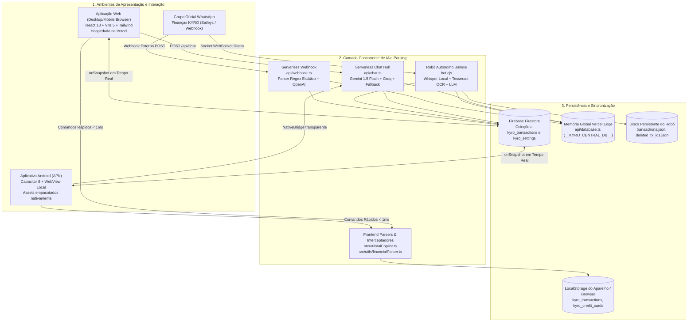
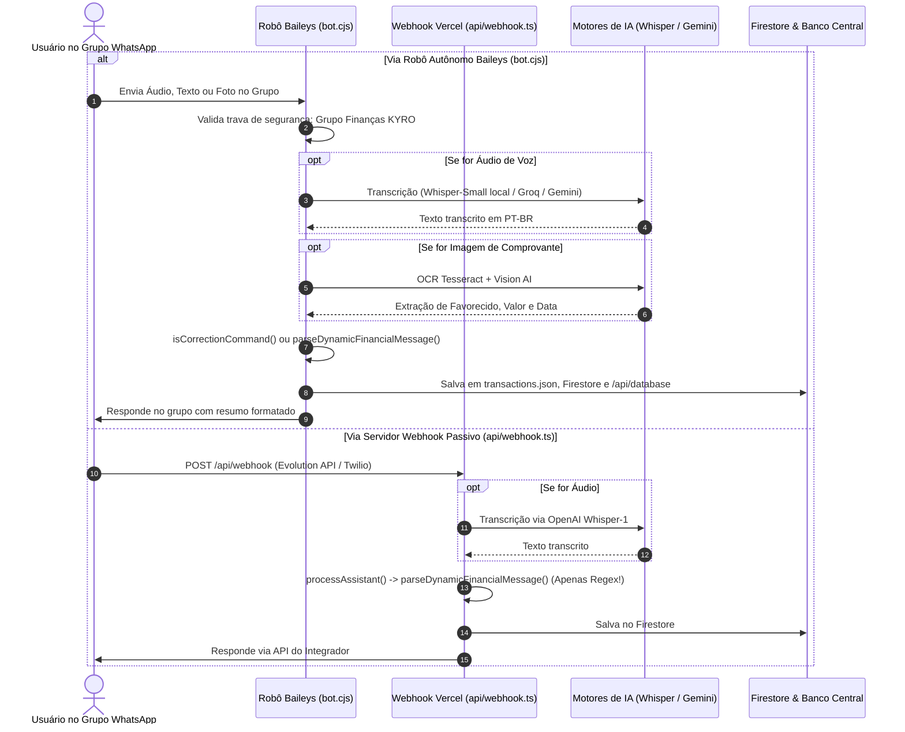
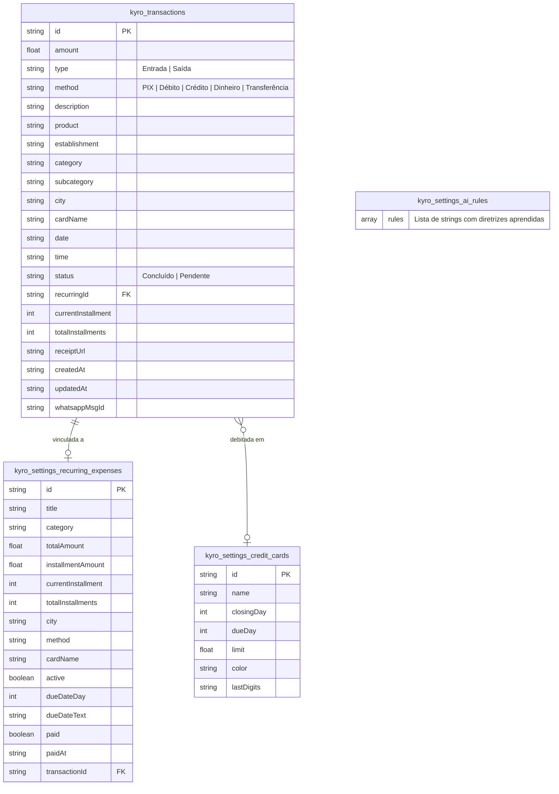
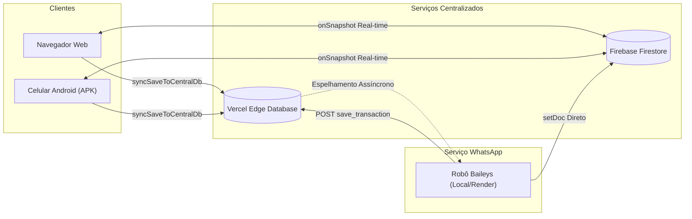
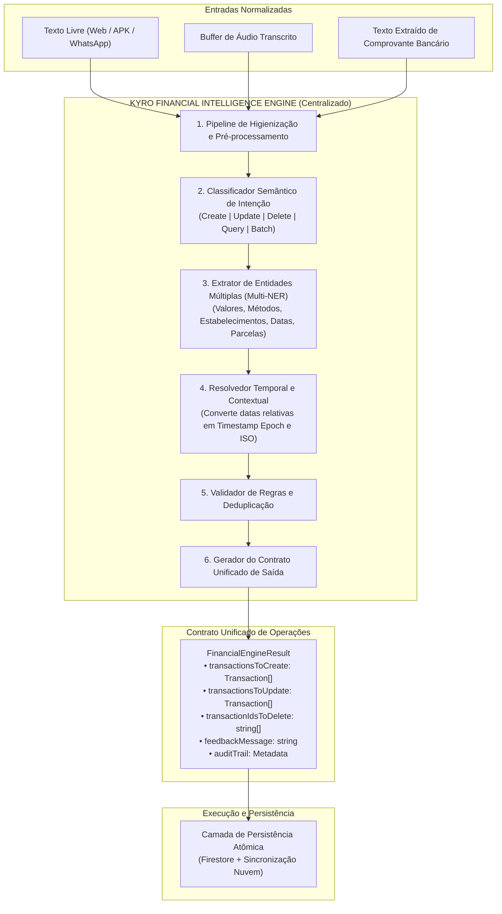

# PROJETO KYRO FINANCE
## RELATÓRIO TÉCNICO DE AUDITORIA COMPLETA — ETAPA 01

---

### 1. IDENTIFICAÇÃO DO PROJETO

* **Nome da Aplicação:** KYRO Finance (KYRO | Private Finance)
* **Repositório / Diretório Local:** `C:\Users\Lenovo\Documents\antigravity\Finanças`
* **Repositório Remoto Oficial:** `https://github.com/Wisterly/kyro-finance.git`
* **URL de Produção Web (Vercel):** `https://kyro-finance.vercel.app`
* **Versão Auditada:** `v1.41` (Build `41` / Ponto de Restauração `PR.041`)
* **ID do Pacote Android (Capacitor):** `com.kyro.finance`
* **Finalidade do Projeto:** Sistema de gestão e inteligência financeira pessoal e empresarial multicanal (Navegador Web, Aplicativo Mobile Android APK e Grupo Interativo no WhatsApp), desenhado para operar com entrada em linguagem natural por texto, áudios falados em português brasileiro e fotos de comprovantes bancários (OCR + Visão Computacional).

---

### 2. RESUMO EXECUTIVO

Este relatório documenta a **Auditoria Técnica Completa (Etapa 01)** realizada no ecossistema do **KYRO Finance**. O objetivo primordial foi mapear integralmente a arquitetura existente, identificar como as informações financeiras transitam entre as interfaces (Web, APK Android e WhatsApp), analisar a saúde das rotas de backend e serverless functions, esmiuçar o modelo de dados e diagnosticar inconsistências de lógica e de sincronização.

#### Principais Conclusões da Auditoria:
1. **Heterogeneidade e Fragmentação Cognitiva:** Identificou-se que existem **5 mecanismos distintos e concorrentes** executando a mesma responsabilidade de parsing financeiro no sistema (no frontend React, no utilitário de IA Copilot, na rota serverless de chat, no webhook de WhatsApp e no robô Baileys). Essa redundância provoca comportamentos divergentes: uma mesma frase falada pode ser interpretada de formas completamente diferentes dependendo de qual canal a recebeu.
2. **Incapacidade de Processar Múltiplas Movimentações em uma Mensagem:** Todos os motores atuais foram desenhados para extrair apenas um único valor e uma única categoria por interação. Se o usuário relatar mais de uma movimentação em um mesmo comando (exemplo: *"Gastei 50 reais de almoço no débito e 25 de farmácia no Pix"*), o sistema captura apenas o primeiro montante e descarta silenciosamente o restante.
3. **Presunções Forçadas e Risco de Alucinação:** Os motores regex atuais arbitram `PIX` como método padrão quando nenhuma forma de pagamento é mencionada e vinculam cidades brasileiras ao lançamento com base em correspondências parciais de palavras, gerando inconsistências no banco de dados.
4. **Monolito no Frontend:** O arquivo principal de visualização (`src/App.tsx`) ultrapassou **6.680 linhas de código**, concentrando gerenciamento visual, manipulação direta de áudio, interceptações cognitivas, sincronização com Firestore e orquestração de rede, o que dificulta manutenções e eleva o risco de regressões.
5. **Necessidade do KYRO Financial Intelligence Engine:** Concluiu-se pela necessidade inadiável de criar um mecanismo centralizado, isolado e agnóstico de plataforma, responsável por receber textos, transcrições de áudio e extrações de comprovantes, retornando um contrato de dados atômico e determinístico para todas as frentes do sistema.

---

### 3. ARQUITETURA ATUAL DO SISTEMA

O sistema está estruturado em uma topologia híbrida distribuída entre clientes ricos (Web e Mobile), serviços serverless na borda (Vercel Edge/Node.js Functions), banco em nuvem reativo (Firebase Firestore), orquestração de WhatsApp (Baileys/Render) e sincronização local offline.

#### Explicação Textual do Diagrama de Arquitetura:
O diagrama acima demonstra que o sistema recebe comandos por três entradas: Aplicação Web, Aplicativo Android e Grupo do WhatsApp. Cada canal aciona um fluxo independente de interpretação:
- A Web e o APK tentam primeiro uma interceptação local via expressões regulares no frontend (`FE_PARSER`). Se a mensagem não contiver termos-chave de remoção ou ajuste direto, eles disparam uma requisição HTTP para a rota serverless `/api/chat` na Vercel.
- O WhatsApp, quando operado via WebSocket nativo (`bot.cjs`), realiza o parsing em seu próprio processo Node.js utilizando motores neurais locais ou chamadas à API da Groq/Gemini. Se operado via webhook passivo (`api/webhook.ts`), cai em uma rotina de regexes puras sem auxílio de LLM.
- Na camada de armazenamento, os dados são distribuídos entre o Firestore (que emite eventos de atualização em tempo real para os clientes conectados), a memória em nuvem da Vercel (`api/database.ts`), o armazenamento local dos navegadores (`localStorage`) e os arquivos físicos `.json` salvos no ambiente do robô.

#### Stack Tecnológica Detalhada:
* **Linguagens:** TypeScript (v5.6.3), JavaScript ES2020 / CommonJS (Node.js 20+), Java 21 (módulos nativos Android no Capacitor).
* **Frontend Web:** React 18.3.1, Vite 5.4.10, TailwindCSS 3.4.14, Lucide React 1.16.0.
* **Mobile Runtime:** Capacitor 8.6.0 (`@capacitor/core`, `@capacitor/android`, `@capacitor/app`, `@capacitor/cli`).
* **WhatsApp & Multimodalidade:**
  * `@whiskeysockets/baileys` (v7.0.0-rc14): Conector do WhatsApp Web.
  * `@xenova/transformers` (v2.17.2): Pipeline ONNX em runtime Node.js para execução local do Whisper-Small.
  * `tesseract.js` (v7.0.0): Mecanismo de OCR local treinado com `por.traineddata`.
  * `wavefile` (v11.0.0): Processamento de áudios PCM/WAV.
* **Serviços em Nuvem:**
  * Vercel: Hospedagem da SPA e execução das rotas serverless (`@vercel/node` v23.0.1).
  * Firebase Firestore (v13.0.0): Banco de dados orientado a documentos NoSQL com replicação reativa.
  * Google Generative AI (Gemini 1.5 Flash): Modelo multimodal primário para texto e visão.
  * Groq Cloud: Transcrição ultrarrápida via Whisper-large-v3.
  * OpenAI: Fallback de transcrição via Whisper-1.
  * Render / Koyeb: Hospedagem contínua (24/7) opcional do contêiner Docker do robô (`bot.cjs`).

---

### 4. FUNCIONAMENTO DA APLICAÇÃO WEB

* **Componente Centralizador:** Todo o ecossistema frontend está implementado em `src/App.tsx` (6.683 linhas).
* **Interface do Chat Copiloto:** Renderizada em duas modalidades — um painel pop-up expansível no desktop e uma gaveta lateral deslizante (*bottom sheet*) no mobile.
* **Ciclo de Vida do Envio de Mensagens:**
  1. O usuário submete uma mensagem via input de texto (`handleSendMessage`), fala pelo microfone ou faz upload de comprovante em PDF/imagem (`handleDocumentSelected`).
  2. O manipulador unificado `handleProcessUserInteraction` (`src/App.tsx#L2154`) assume o fluxo.
  3. **Execução de Prioridade 0 (Local):** Se a mensagem contiver termos explícitos de cancelamento (`isRemoveTransactionCommand`), de edição (`isAdjustLastCommand`) ou de enriquecimento (`isEnrichLastCommand`), o frontend altera seu próprio estado React imediatamente, grava no `localStorage`, envia comando de exclusão/atualização para o Firestore e para `/api/database`, gerando uma resposta imediata na tela sem consumir tokens de API.
  4. **Execução Remota (Nuvem):** Caso a mensagem represente um novo lançamento ou consulta geral, é montado um payload para `POST /api/chat` contendo o histórico recente, o contexto das últimas 35 transações, o saldo atual e os cartões cadastrados.
* **Atualização Reativa:** A interface assina o método `subscribeTransactions` de `src/firebase.ts`, que atualiza os estados `transactions`, `monthIncomes`, `monthExpenses` e `totalBalance` automaticamente via WebSockets do Firestore.

---

### 5. FUNCIONAMENTO DO APLICATIVO ANDROID (APK / CAPACITOR)

* **Empacotamento Local de Alta Velocidade:**
  * Configurado em `capacitor.config.json` com `webDir: "dist"` e esquema `androidScheme: "https"`.
  * Os arquivos compilados do frontend residem diretamente dentro do pacote APK em `android/app/src/main/assets/public/`. Ao abrir o aplicativo, a inicialização ocorre em 0ms a partir da memória flash do smartphone, sem telas brancas ou dependência de carregamento via internet.
* **Ponte Nativa Transparente (`src/nativeBridge.ts`):**
  * Ao ser carregada, a função `initNativeBridge()` detecta a plataforma nativa do Capacitor e substitui (`monkey-patch`) as APIs globais `window.fetch` e `window.EventSource`.
  * Toda chamada com rota relativa `/api/*` é desviada automaticamente para o domínio de nuvem `https://kyro-finance.vercel.app/api/*`, anexando parâmetros dinâmicos anti-cache (`_nc=timestamp_random`). Isso garante que o aplicativo móvel consuma exatamente os mesmos serviços e rotas que a versão de navegador desktop.
* **Reconhecimento de Voz Nativo:**
  * O arquivo `android/app/src/main/java/com/kyro/finance/MainActivity.java` registra o plugin nativo `NativeSpeechRecognizerPlugin.java`.
  * Esse plugin conecta a interface web diretamente ao motor nativo `android.speech.SpeechRecognizer` do Google Voice no sistema operacional Android. A fala do usuário é convertida em texto em tempo real com eventos de resultados parciais (`partialResult`) e finais (`finalResult`), dispensando digitação manual. Em aparelhos sem suporte, há fallback para o `MediaRecorder` tradicional.
* **Auto-Update e Gestão de Versões:**
  * O aplicativo verifica ativamente a rota `/api/app-version` através de `src/utils/appUpdater.ts`.
  * Se o número de build informado no backend (`version.json`) for superior ao empacotado no APK (`APP_BUILD` em `src/version.ts`), o plugin `AppUpdateManagerPlugin.java` aciona o `DownloadManager` do Android, faz o download do novo instalador e dispara a intenção nativa `ACTION_INSTALL_PACKAGE` através de um `FileProvider` seguro (`android/app/src/main/res/xml/file_paths.xml`).

---

### 6. FUNCIONAMENTO DA INTEGRAÇÃO COM WHATSAPP

A integração com o WhatsApp possui dois pontos de processamento arquiteturalmente distintos:

#### Explicação Textual do Funcionamento do WhatsApp:
1. **Pelo Robô Baileys (`bot.cjs`):** Conecta-se diretamente ao WhatsApp Web via WebSocket autenticado com QR Code. Ao receber mensagens no grupo `Finanças KYRO` (JID `120363411839303797@g.us`), baixa o buffer de mídia de áudios ou comprovantes. Áudios são transcritos por Whisper neural local ou Groq; imagens passam por OCR Tesseract. O texto resultante passa por verificadores de correção e parsers dinâmicos, sendo persistido em disco local, no Firestore e na Vercel. A resposta de confirmação é enviada instantaneamente de volta ao grupo.
2. **Pelo Webhook Serverless (`api/webhook.ts`):** Atua como endpoint HTTP padrão para receber webhooks externos (como Evolution API). Transcreve áudios com a OpenAI, mas processa o texto estritamente por regexes simplificadas em `parseDynamicFinancialMessage`, sem inteligência de LLM ou OCR avançado, evidenciando uma assimetria técnica entre as duas abordagens.

---

### 7. ARQUITETURA DO BACKEND E SERVERLESS FUNCTIONS

O backend está hospedado sob a infraestrutura Serverless da Vercel, composto pelos seguintes endpoints em `api/`:

1. **`api/chat.ts` (Copiloto Principal de IA):**
   * Processa texto, áudio base64 e imagem base64.
   * Orquestra chamadas com o Google Gemini 1.5 Flash via REST (`https://generativelanguage.googleapis.com/v1beta/models/gemini-1.5-flash:generateContent`).
   * Configura prompt do sistema para forçar respostas em JSON puro delimitando as ações `create_transaction`, `delete_transactions`, `adjust_transaction`, `save_user_rule` ou `none`.
   * Inclui o fallback cognitivo local `fallbackCognitiveProcess` executado quando a API do Gemini atinge timeout ou não possui chave válida.
2. **`api/database.ts` (Hub Central de Persistência):**
   * Mantém um estado compartilhado em memória (`globalStore.__KYRO_CENTRAL_DB__`).
   * Executa operações CRUD em lote e individuais: `save_transaction`, `delete_transaction`, `delete_transactions`, `clear_all`, `sync_all`, `save_credit_cards`, `save_recurring_expenses` e `save_ai_rule`.
   * Espelha alterações de forma assíncrona para o Firestore e para o robô hospedado no Render (`syncToRenderBot`).
3. **`api/webhook.ts` (Ponto de Integração WhatsApp):**
   * Recebe notificações POST de gateways de mensagens.
   * Filtra mensagens privadas e gerencia o sincronismo de configurações do grupo monitorado.
4. **`api/transcribe.ts` (Serviço Especializado de Fala para Texto):**
   * Endpoint dedicado a converter buffers de áudio em texto em português.
   * Executa pipeline de duas etapas: Gemini Multimodal Audio e Groq Whisper-large-v3.
5. **`api/app-version.ts` (Serviço de Versionamento e Distribuição de APK):**
   * Lê dinamicamente os metadados de `version.json`.
   * Fornece informações sobre novas versões, notas de atualização (`changelog`) e a URL oficial para download do APK na Release do GitHub.

---

### 8. ESTRUTURA DO BANCO DE DADOS E MODELAGEM DE DADOS

#### Coleções no Firebase Firestore:

#### Explicação Textual do Modelo Entidade-Relacionamento:
* Cada transação (`kyro_transactions`) possui identificador único, valor monetário positivo, tipo (Entrada/Saída), forma de pagamento e vínculos contextuais. Caso a transação seja realizada na modalidade Crédito, ela referencia o nome do cartão presente em `credit_cards`.
* Se a transação originar-se de uma dívida recorrente ou parcelamento (`recurring_expenses`), ela armazena o `recurringId`, acompanhada dos marcadores de parcela (`currentInstallment` e `totalInstallments`).
* A despesa recorrente mantém sua própria regra de vencimento e cálculo de parcelas, e ao ser marcada como paga, gera um registro efetivo na coleção `kyro_transactions`, armazenando a referência `transactionId`.
* O documento `ai_rules` armazena diretrizes operacionais em linguagem natural aprendidas pelo assistente durante as interações com o usuário (exemplo: regras de como categorizar determinados itens).

---

### 9. FLUXOS DE SINCRONIZAÇÃO E CONCORRÊNCIA

A integridade do saldo e do extrato baseia-se na harmonização de quatro camadas:

#### Explicação Textual dos Fluxos de Sincronização:
* **Escrita:** Quando uma movimentação é gerada no WhatsApp pelo robô, ela é enviada simultaneamente ao Firestore e à memória Edge da Vercel (`api/database.ts`).
* **Propagação Reativa:** O Firestore, ao receber o novo documento, dispara o evento `onSnapshot` para todos os clientes Web e Mobile ativos, que inserem a transação em seus estados locais e recalculam os saldos instantaneamente.
* **Resolução de Conflitos e Exclusões:** Para evitar que itens apagados retornem ao extrato após reconexões, o sistema armazena uma lista de IDs excluídos (`kyro_deleted_tx_ids`). Ao receber qualquer lote do Firestore, o frontend e o backend filtram e descartam qualquer identificador presente na lista de exclusão.
* **Salvaguarda de Integridade:** Se o Firestore responder temporariamente com um snapshot vazio em função de falhas de rede transitórias, a rotina `subscribeTransactions` detecta a inconsistência e reidrata a nuvem reenviando as transações salvas localmente, impedindo a perda de dados.

---

### 10. FUNCIONAMENTO DA INTELIGÊNCIA FINANCEIRA ATUAL

A inteligência financeira atual opera em um arranjo de cinco implementações distintas:

1. **Camada 1 — Parser do Frontend (`src/utils/financialParser.ts`):**
   * Função principal: `parseDynamicFinancialMessage(text, isAudio, isImage)`.
   * Extração de Valores: Algoritmo `extractMonetaryValue` com suporte a notação brasileira (`3.200,00`), notação americana (`3,200.00`) e números por extenso (`"trezentos reais"`).
   * Extração de Cartões: Função `extractCreditCardName` com dicionário fixo (Nubank, Inter, Itaú, Bradesco, Santander, etc.) e regex genérica.
   * Detecção de Parcelamento: Função `extractInstallments` procurando por `"3x"`, `"em 5 vezes"`, etc.
   * Detecção de Cidades: Lista de strings estáticas (Oeiras, Caxias, Teresina, São Paulo, etc.). Se não encontrada, atribui `"Sem informação"` ou `"Internet"`.
2. **Camada 2 — Interceptador de Comandos do Frontend (`src/utils/aiCopilot.ts`):**
   * Função `isAdjustLastCommand`: Detecta padrões de correção como `"o valor é 400 e não 500"`, `"modifique de PIX para crédito"`, `"de 500 para 400"`.
   * Funções de Extração de Pares: `extractCorrectionAmountPair` e `extractCorrectionMethodPair` localizam o valor/método antigo e o substituto.
   * Função `executeAdjustLastTransaction`: Localiza a transação alvo pelo valor antigo ou pega a última transação (`transactions[0]`), aplicando as correções *in-place*.
   * Função `executeSmartRemoveTransaction`: Permite remover pelo nome do item ou termo de busca sem abrir telas.
3. **Camada 3 — Motor Serverless Vercel (`api/chat.ts`):**
   * Executa chamada estruturada ao Gemini 1.5 Flash com `responseMimeType: "application/json"`.
   * Prompt do sistema instrui a não inventar cidades não mencionadas e a nunca mesclar categorias com barras na descrição.
   * Possui o método `fallbackCognitiveProcess` que replica parte das expressões regulares do frontend caso a API do Gemini esteja inacessível.
4. **Camada 4 — Motor do Robô WhatsApp (`bot.cjs`):**
   * Contém cópias literais das funções de `financialParser.ts` e de `aiCopilot.ts` adaptadas para CommonJS.
   * Possui `extractFinancialDataWithLLM` que chama OpenAI ou Groq para converter textos transcritos em JSON.
   * Possui `preprocessImageForOcr` e `parseFinancialReceiptOcrText` para interpretar dados de recibos de pagamento.
5. **Camada 5 — Motor do Webhook Serverless (`api/webhook.ts`):**
   * Contém outra cópia de `parseDynamicFinancialMessage` adaptada para execução em TypeScript serverless, sem integração com a LLM do Gemini.

---

### 11. PROBLEMAS IDENTIFICADOS E CLASSIFICAÇÃO DE GRAVIDADE

#### Matriz de Problemas Técnicos Mapeados:

| ID | Gravidade | Problema Técnico Diagnosticado | Arquivos Afetados | Consequência no Sistema |
|---|---|---|---|---|
| **PB-01** | 🔴 **CRÍTICO** | **Fragmentação de Parsers (5 implementações):** A mesma regra de extração foi reimplementada 5 vezes com lógicas divergentes. | `src/utils/financialParser.ts` `src/utils/aiCopilot.ts` `api/chat.ts` `api/webhook.ts` `bot.cjs` | Inconsistência entre plataformas: um comando aceito no chat web pode falhar no WhatsApp ou ser classificado com outro método de pagamento no APK. |
| **PB-02** | 🔴 **CRÍTICO** | **Incapacidade de Processar Múltiplas Movimentações:** Todos os parsers abortam a leitura após localizar o primeiro número/verbo. | `src/utils/financialParser.ts#L115` `api/chat.ts#L60` `bot.cjs#L1755` | Se o usuário disser *"Almoço 40 reais e farmácia 25"*, o sistema registra apenas R$ 40,00 e ignora os R$ 25,00, gerando perda financeira silenciosa. |
| **PB-03** | 🟠 **ALTO** | **Presunção Forçada de Métodos e Cidades:** Na ausência de método falado, o parser força `PIX`. Se palavras coincidirem com nomes de cidades, atribui a localização sem confirmação. | `src/utils/financialParser.ts#L263` `api/chat.ts#L415` `bot.cjs#L1804` | Criação de lançamentos imprecisos que exigem correção manual frequente por parte do usuário. |
| **PB-04** | 🟠 **ALTO** | **Hipertrofia do Arquivo `src/App.tsx` (6.683 linhas):** O componente principal acumula lógica de interface, estado, sincronização e regras de negócio. | `src/App.tsx` | Alto risco de quebra colateral em manutenções simples, lentidão de compilação e degradação da legibilidade. |
| **PB-05** | 🟡 **MÉDIO** | **Inconsistência nos Formatos de Data:** Transações recebem formatos mistos (`"Hoje"`, `"31 de out"`, `"2026-10-31"`). | `src/App.tsx#L5557` `bot.cjs#L2638` `api/chat.ts#L450` | Impossibilidade de realizar queries eficientes por intervalo de datas diretamente no Firestore sem carregar todos os dados na memória. |
| **PB-06** | 🟡 **MÉDIO** | **Falso Positivo de Persistência em Fallback:** Em contingência sem conexão, a IA responde visualmente que registrou o gasto, mas a gravação no banco falha silenciosamente. | `api/chat.ts#L724-L737` `src/App.tsx#L2362` | O usuário visualiza a confirmação em tela mas o registro não é salvo no extrato, afetando a confiabilidade do sistema. |
| **PB-07** | 🔵 **BAIXO** | **Arquivos Órfãos Legados no Repositório:** Módulos em `api/services/` e `api/prompts/` não são consumidos por nenhuma rota ativa. | `api/services/financeAssistant.ts` `api/prompts/finance.prompt.ts` | Complexidade desnecessária e consumo de espaço na base de código. |

---

### 12. ARQUITETURA PROPOSTA: KYRO FINANCIAL INTELLIGENCE ENGINE

Para solucionar definitivamente as falhas identificadas, propõe-se a implementação do **KYRO Financial Intelligence Engine** como o cérebro único de inteligência financeira do ecossistema.

#### Explicação Textual da Arquitetura Proposta:
1. **Entrada Agnóstica:** Seja um áudio transcrito, um comprovante lido via OCR ou um texto digitado, a entrada é submetida ao mesmo pipeline de higienização.
2. **Classificação de Intenção Única:** O classificador determina se o usuário deseja lançar gastos novos, corrigir lançamentos anteriores, remover itens ou tirar dúvidas sobre o saldo.
3. **Multi-NER (Extração Múltipla):** Identifica todas as transações presentes na mensagem, segmentando cada uma com seu respectivo valor, forma de pagamento e categoria sem truncamento.
4. **Resolução Temporal Padronizada:** Termos como *"ontem"*, *"segunda-feira passada"* ou *"dia 10"* são transformados matematicamente em timestamps Unix (`timestamp: 1730412345000`) e datas ISO (`isoDate: "2026-10-31"`), garantindo consistência cronológica.
5. **Saída em Lote Estruturada:** O motor não grava no banco diretamente durante o parsing; ele retorna um contrato estrito contendo os arrays de operações que a camada de persistência deve executar atomicamente, eliminando falsos positivos de confirmação.

---

### 13. RELAÇÃO DOS ARQUIVOS QUE PRECISARÃO SER CRIADOS

| Caminho Completo do Arquivo | Justificativa Técnica da Criação |
|---|---|
| `c:\Users\Lenovo\Documents\antigravity\Finanças\src\core\engine\financialEngine.ts` | Módulo mestre contendo a orquestração principal do **KYRO Financial Intelligence Engine**, exportando a interface de processamento unificada. |
| `c:\Users\Lenovo\Documents\antigravity\Finanças\src\core\engine\intentClassifier.ts` | Submódulo dedicado a classificar a intenção do usuário (criação, edição, exclusão, consulta, baixa de parcelamento). |
| `c:\Users\Lenovo\Documents\antigravity\Finanças\src\core\engine\multiEntityExtractor.ts` | Submódulo especializado em extrair múltiplos lançamentos de uma única frase, associando valores, métodos e descrições sem truncamento. |
| `c:\Users\Lenovo\Documents\antigravity\Finanças\src\core\engine\dateResolver.ts` | Submódulo determinístico para resolução de expressões temporais em português, convertendo datas relativas em timestamp numérico e string ISO. |
| `c:\Users\Lenovo\Documents\antigravity\Finanças\api\engine.ts` | Rota serverless central na Vercel (`/api/engine`) que expõe o motor unificado para consumo seguro via HTTP por webhooks e clientes externos. |

---

### 14. RELAÇÃO DOS ARQUIVOS QUE PRECISARÃO SER MODIFICADOS

| Caminho Completo do Arquivo | Justificativa Técnica da Alteração |
|---|---|
| `c:\Users\Lenovo\Documents\antigravity\Finanças\api\chat.ts` | Remoção das rotinas duplicadas de regex e do fallback local redundante, substituindo-os pelo consumo do novo `financialEngine.ts`. |
| `c:\Users\Lenovo\Documents\antigravity\Finanças\api\webhook.ts` | Conexão do webhook de WhatsApp ao novo motor de inteligência, eliminando as discrepâncias de interpretação em relação ao chat web. |
| `c:\Users\Lenovo\Documents\antigravity\Finanças\bot.cjs` | Substituição das funções legadas de parsing e regex internas pela invocação do motor unificado, mantendo apenas a responsabilidade de conexão socket Baileys. |
| `c:\Users\Lenovo\Documents\antigravity\Finanças\src\App.tsx` | Desacoplamento da lógica de negócio do componente visual, roteando entradas de chat para o motor centralizado e modularizando modais. |
| `c:\Users\Lenovo\Documents\antigravity\Finanças\src\types.ts` | Inclusão obrigatória dos atributos `timestamp: number` e `isoDate: string` na interface `Transaction`, além da tipagem do contrato do Engine. |
| `c:\Users\Lenovo\Documents\antigravity\Finanças\src\firebase.ts` | Atualização das consultas do Firestore para ordenação eficiente baseada no campo numérico `timestamp`. |

---

### 15. RISCOS TÉCNICOS E MEDIDAS PREVENTIVAS

1. **Risco: Quebra de Retrocompatibilidade com Documentos Históricos do Firestore**
   * *Diagnóstico:* Transações já existentes no banco possuem apenas o campo `date` em formato de texto arbitrário (ex: `"Hoje"` ou `"15 de out"`), sem o campo numérico `timestamp`.
   * *Medida Preventiva:* A tipagem em `src/types.ts` manterá `timestamp?: number` opcional na leitura. O serviço de sincronização (`src/firebase.ts`) aplicará uma função de migração transparente sob demanda: se carregar um documento sem `timestamp`, calculará o valor aproximado a partir de `createdAt` ou da data atual, sem corromper o registro.
2. **Risco: Concorrência de Estado no Frontend em Lançamentos Rápidos Consecutivos**
   * *Diagnóstico:* O usuário pode ditar ou enviar múltiplos áudios ou textos em sequência rápida, gerando condições de corrida (*race conditions*) no estado React de `src/App.tsx`.
   * *Medida Preventiva:* Utilizar atualizações funcionais de estado (`setTransactions(prev => ...)`) e orquestrar as gravações no banco com identificadores determinísticos gerados no cliente (`clientGeneratedId`), assegurando idempotência nas requisições.
3. **Risco: Timeout Serverless na Vercel em Requisições com Áudio Pesado**
   * *Diagnóstico:* Funções serverless no plano hobby da Vercel possuem tempo limite de execução estrito de 10 a 15 segundos. Se a transcrição e a chamada LLM demorarem, a conexão é abortada.
   * *Medida Preventiva:* Configurar timeouts de 8 segundos para chamadas externas e manter o fallback cognitivo do `financialEngine.ts` pronto para responder de forma determinística em menos de 100ms caso a API externa não responda no tempo estipulado.

---

### 16. PLANO DETALHADO DAS PRÓXIMAS ETAPAS

* **ETAPA 02 — Implementação do KYRO Financial Intelligence Engine:**
  * Criação dos módulos `dateResolver.ts`, `multiEntityExtractor.ts`, `intentClassifier.ts` e `financialEngine.ts`.
  * Criação de testes unitários automatizados cobrindo lançamentos simples, múltiplos, correções contextuais e baixas de parcelamento.
* **ETAPA 03 — Unificação dos Endpoints de Backend (`api/chat.ts`, `api/webhook.ts` e `api/engine.ts`):**
  * Refatoração das rotas serverless da Vercel para consumir o motor unificado.
  * Validação cruzada com dados simulados e verificação de integridade de resposta em formato JSON estrito.
* **ETAPA 04 — Unificação do Robô WhatsApp (`bot.cjs`):**
  * Atualização da rotina de processamento de mensagens no Baileys para delegar a classificação e extração ao novo Engine.
  * Teste prático de envio de texto, áudio e foto de comprovante no grupo monitorado.
* **ETAPA 05 — Refatoração e Desacoplamento da Aplicação Web e APK Android:**
  * Limpeza de código duplicado em `src/App.tsx`.
  * Sincronização do bundle local com o Capacitor (`npm run apk:sync`) e validação da compilação do APK Android.
* **ETAPA 06 — Homologação, Testes de Estresse e Deploy:**
  * Bateria de testes finais simultâneos nos três ambientes (Web, Celular Android e WhatsApp).
  * Atualização de versão para release de produção com geração do APK final atualizado.

---

### 17. CONCLUSÃO TÉCNICA

A auditoria técnica da **Etapa 01** revelou com clareza a raiz dos problemas de interpretação e inconsistência relatados no Kyro Finance: o sistema possui uma base funcional robusta e rica em recursos (suporte a áudio neural, OCR, integração WhatsApp e APK nativo rápido), porém sofre com a **fragmentação de sua inteligência financeira**, que se encontra espalhada e duplicada em múltiplos arquivos com critérios diferentes.

A arquitetura proposta para a **Etapa 02 (KYRO Financial Intelligence Engine)** resolverá essa fragilidade na causa-raiz, centralizando 100% da interpretação em um módulo único, moderno e auditável.

> **Regras Seguidas à Risca:** Nenhum arquivo funcional foi modificado, nenhuma dependência foi alterada e nenhum dado foi violado nesta etapa. O sistema encontra-se intacto e pronto para o início da **Etapa 02** assim que autorizado pelo usuário.
